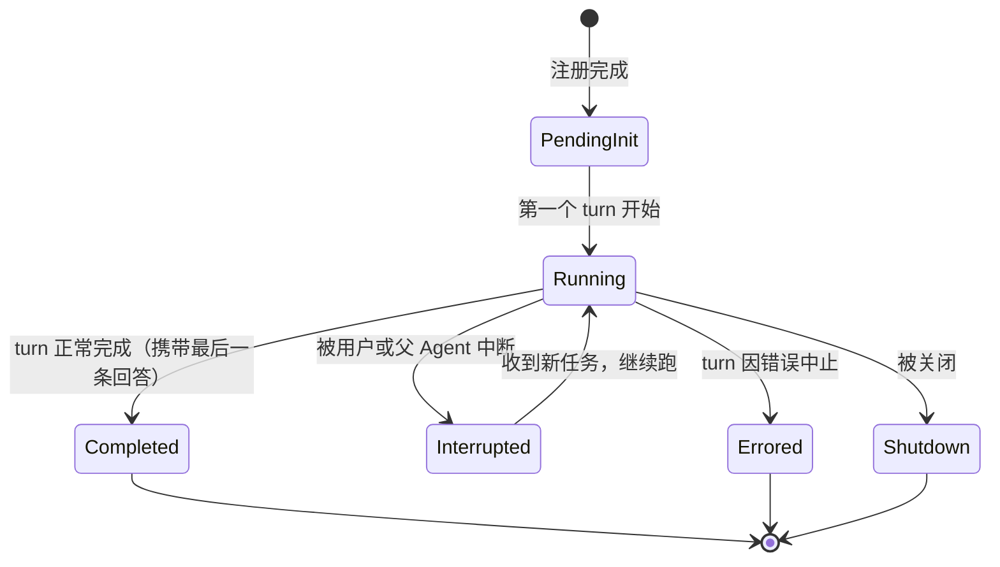
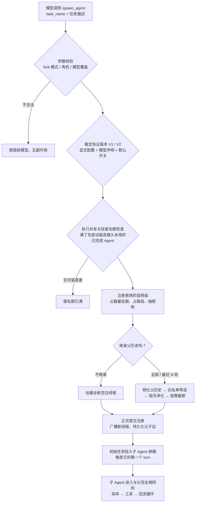
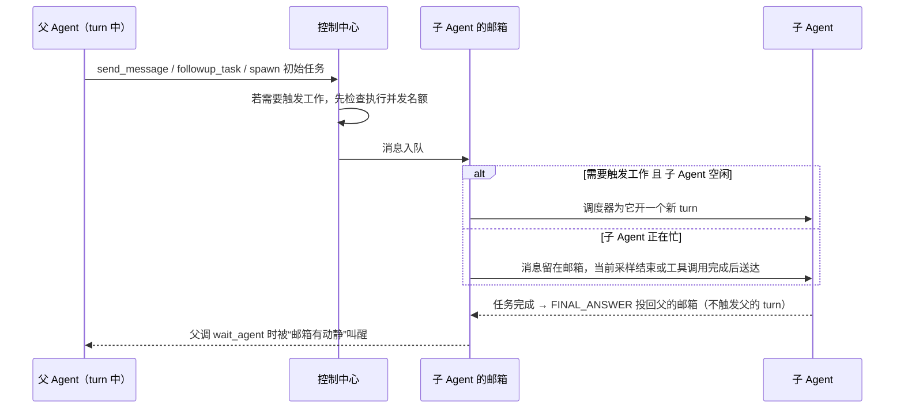

# 第 5 章：Agent 与多 Agent 控制

> 本章导读：Codex CLI 不只能“一个会话干到底”，还能让主 Agent 按需派生多个子 Agent 并行协作。读完本章，你会理解：一个子 Agent 在运行时到底是什么、父子 Agent 如何组成一棵树并被寻址、spawn 一个子 Agent 的完整过程（配置怎么继承、历史怎么 fork）、Agent 之间靠什么机制收发消息和等待结果、为什么同时存在 V1/V2 两套协议，以及并发、深度、驻留三层资源闸门分别挡什么。

本章按“先立心智模型，再走运行时流程”的顺序展开——先弄清 Agent 是什么（5.2）、谁来管（5.3）、以什么身份出现（5.4），然后跟着一次 spawn 走完全程（5.5），看 Agent 之间如何通信与等待（5.6），最后收束到版本差异、资源控制与设计取舍：

| 小节 | 回答的问题 |
|------|-----------|
| 5.1 要解决的问题 | 单 Agent 执行在哪些场景会遇到瓶颈 |
| 5.2 核心抽象 | 一个 Agent 在运行时到底是什么、如何被寻址 |
| 5.3 控制中心与注册表 | 一棵树的状态由谁保管、生命周期怎么走 |
| 5.4 角色系统 | 同一个模型如何安全地扮演不同身份 |
| 5.5 Spawn 全流程 | 从一次工具调用到一个跑起来的子 Agent |
| 5.6 通信与等待 | 消息怎么投递、父 Agent 怎么等结果 |
| 5.7 V1 与 V2 | 两套协议差在哪、运行时选哪套 |
| 5.8 资源控制 | 并发、深度、预算、驻留四层闸门 |
| 5.9 教给模型 | 协作纪律如何写进提示词 |
| 5.10 设计取舍 | 关键选择的替代方案与理由 |

## 5.1 本章要解决的问题

当用户交给 Codex 一个复杂任务时，“一个会话串行做所有事”会遇到瓶颈：

- 一个 Agent 同时只能做一件事，无法并行探索多个方案；
- 长任务容易把上下文窗口撑爆；
- 不同子任务适合不同角色（如“安全审查员”、“测试工程师”、“文档作者”）；
- 子任务失败不应该拖垮整个主任务。

Multi-Agent 系统要回答五个问题：**Agent 如何表示与寻址、如何创建（配置/历史/权限怎么继承）、如何通信与等待结果、资源如何被限制、以及新旧两套协议如何共存**。

## 5.2 核心抽象：一个 Agent 就是一个对话线程

### 5.2.1 Agent ≈ Thread

Codex 没有为“子 Agent”发明新的运行时。**一个子 Agent 就是一条普通的对话线程（Thread/Session）**——它跑的是第 4 章那套一模一样的循环：接收输入、开 turn、采样、调工具、回流结果。它与用户直接交互的根会话只有三个差别：

1. **出身不同**：创建记录里带着父线程是谁、在树里的第几层、路径和昵称、扮演什么角色；
2. **户口不同**：它挂在同一棵树共享的控制中心（AgentControl）下，而不是独立会话；
3. **可被管理**：父 Agent 可以通过工具对它发消息、等结果、打断、再派生自己的子 Agent（受深度限制）。

这个抽象带来三个直接收益：

- **基础设施零新增**：子 Agent 自动拥有完整的 Session、Turn、工具循环能力；
- **持久化统一**：子 Agent 的对话历史走和主会话相同的持久化通道；V2 还会把“谁 spawn 了谁”这条父子边（spawn edge）也持久化下来，会话恢复时能重建整棵树；
- **沙箱统一**：子 Agent 执行命令、改文件，走同一套权限与沙箱体系（第 7 章）。

另一个重要语义（V2 会把它明说给模型听）：**同一棵树里的所有 Agent 共享同一个容器、文件系统和当前工作目录**。一个 Agent 改的文件，其他 Agent 立刻可见——协作建立在共享工作区之上，而不是每个 Agent 一份隔离副本。

### 5.2.2 树形寻址：每个 Agent 有一条“文件路径”

树上的每个 Agent 都有一条类文件系统的路径：`/root` 是用户直接交互的根 Agent，`/root/task_1` 是根派生的第一个子 Agent，`/root/task_1/task_2` 是孙 Agent，以此类推。

路径不是随意拼接的字符串，创建和解析时有硬校验：

| 规则 | 效果 |
|------|------|
| 绝对路径必须以 `/root` 开头 | 其余一律拒绝（唯一的例外是保留命名空间 `/morpheus`，从代码结构推断是给 root 树之外的系统级/云端编排 Agent 预留的） |
| 不能以 `/` 结尾 | 尾斜杠非法 |
| 每段名字只允许小写字母、数字、下划线 | 空格、大写、连字符都会被拒 |
| `root`、`.`、`..` 是保留段名 | 不能用作任何一段的名字 |

最后一条决定了树的形状：**相对引用只能向下挂载，不能向上逃逸、也不能横向跳到兄弟分支**。想引用别的分支下的 Agent，必须给出从 `/root` 开始的完整路径。这个限制把引用关系钉死成真正的树，避免了任意图状寻址带来的“这个 Agent 到底归谁管、什么时候该被回收”的混乱。

日常使用中，父子之间互称短名（`task_3`）或全路径（`/root/task_1/task_3`）都可以；只有跨分支引用才必须用全路径。这条规则也被直接写进了 V2 spawn 工具给模型的描述里。

## 5.3 控制中心与注册表：一棵树的状态由谁保管

### 5.3.1 AgentControl：每棵树一份的控制面

整棵 Agent 树共享**一份**控制中心：由根会话创建，之后树里每个子 Agent 拿到的都是它的克隆句柄。也就是说，注册表、并发名额、token 预算的作用域都是“一棵 root 树”，而不是整个进程——两棵不相干的会话树互不影响。

它在运行时要管的事：

- **出生**：创建子 Agent（详见 5.5），负责把新线程登记进树；
- **投递**：把一条消息送达目标 Agent——目标空闲就为它开一个新 turn，目标正在忙就把消息并进它当前的 turn（steer），调用方不需要关心目标此刻的状态；
- **状态**：回答“某个 Agent 现在跑到哪了”，并支持订阅状态变化；
- **关停**：关闭单个 Agent，或连同它的全部存活后代一起关停；
- **寻址**：把模型给出的路径引用翻译成实际的线程。

一个值得一提的内存设计：控制中心回指全局线程表时用的是弱引用，刻意打断“线程表 → 线程 → 会话 → 控制中心 → 线程表”这个引用环。一旦全局线程表被释放，控制中心的所有操作会统一失败，并向上翻译成模型能看懂的“collab manager unavailable”，而不是悬着一份永远等不到的“影子”会话。

两个自愈性质的行为：

- **死掉的 Agent 自动销户**：如果向某个 Agent 投递时发现它已经死了，控制中心会顺手把它从线程表移除、清掉驻留记录、释放注册表名额——尸体不会占着并发额度；
- **完成自动通知**：子 Agent spawn 出来后，系统会挂一个后台观察者盯它的状态。一旦进入终态，观察者就向父 Agent 投一条完成通知。V1 的做法是把格式化好的通知文本悄悄写进父的上下文（不触发新 turn）；V2 则走标准邮箱，投一条 FINAL_ANSWER 类型的消息（5.6.3）。父 Agent 因此不需要轮询子 Agent 的死活。

此外，spawn 前控制中心会从父线程快照两份运行期资产——当前生效的环境选择和命令执行策略——交给子 Agent 沿用；V2 驻留驱逐（5.8.4）时这两份资产会被存起来，将来重载时原样恢复。

### 5.3.2 注册表：双索引 + 两阶段预留

注册表保管树中每个 Agent 的元数据（线程 id、路径、昵称、角色）。它维护**两个方向的索引**：按路径查线程（寻址用），按线程反查元数据（状态汇报、驱逐恢复用）。重新注册同一个 Agent 时会先清理旧条目，保证两个索引永不漂移。

spawn 不是“直接写注册表”，而是分两阶段：

1. **预留**：先原子地占住一个数量名额（超限直接拒绝），再占住目标路径、抽一个昵称；
2. **提交**：线程真正创建成功后，才把元数据正式登记。

关键在于预留凭证带有自动回滚语义：只要中途任何一步失败、凭证被丢弃，路径占位和数量名额都会被自动撤销。所以 spawn 流程无论在哪一步死掉，都不会留下半截注册状态，也不会泄漏并发名额。

### 5.3.3 昵称池：101 位科学家

每个子 Agent 除了路径，还会分到一个人类可读的昵称。默认昵称池是编译期内嵌的 101 位科学家名字（Euclid、Archimedes、Hypatia、Galileo……），角色配置也可以提供自己的候选名单。

分配规则：从未被占用的名字里随机挑一个；101 个全用完后清空已用集合、开启第二轮，第二轮起昵称带序号后缀——`Archimedes the 2nd`、`Euclid the 13th`。昵称纯属展示用途（TUI、工具输出里的人类可读短名），**寻址永远走路径和线程 id**。

### 5.3.4 Agent 状态机

Agent 的生命周期状态不是单独维护的，而是从会话事件流推导出来的：turn 开始就是 Running，turn 正常结束就是 Completed，被中断就是 Interrupted，依此类推：



注意 **Interrupted 不是终态**：被中断的 Agent 还活着，随时可能收到新任务继续干活。这一点直接影响后面的资源管理——V2 的驻留驱逐（5.8.4）只驱逐“终态附近、邮箱已清空、没有正在跑的 turn”的 Agent，条件与状态机的终态判定严格对齐。

另外，暴露给模型的状态视图比内部状态窄：模型在工具输出里只能看到 `pending_init / running / interrupted / shutdown / not_found` 这几个字符串，外加“已完成（附最终回答）”“已出错（附原因）”两种带负载的形态。内部实现的细节不会透出。

## 5.4 角色系统：同一个模型如何扮演不同身份

角色（Agent Role）让同一个底层模型在不同子 Agent 中表现出不同行为——比如一个只读分析员、一个能改代码的 worker。角色来源有两个：Codex 内置的角色文件，以及用户在 config.toml 里定义的 `[agent_roles]`。spawn 时不指定角色就用默认角色。

### 5.4.1 角色是“受限叠加层”，不是自由改配置

应用一个角色时，系统把角色定义反序列化成一组**白名单覆盖项**，压到子 Agent 的配置层之上。能覆盖的只有：developer instructions、模型与推理档位、输出详略、人格、服务档位、能力开关、技能裁剪。其中能力开关**只允许做减法**——角色可以关掉 Shell、应用、记忆、权限请求等能力，但不能打开父会话没有的能力。

源码注释把设计边界写得很明白：**“Roles may customize the child or reduce its capabilities, but never replace the parent session's authority.”** 角色可以让子 Agent 变弱（更受限），绝不能让它越过父会话的权限。角色加载内部出错时，对外统一报一个模糊的“agent type is currently not available”，避免把配置细节泄露给模型。

### 5.4.2 两条重要的组合规则

- **全量 fork 与换角色互斥**（V1）：选择完整继承父历史的子 Agent 必须连同父的角色一起继承，不允许同时指定别的角色——否则等价于让一个“冒充者”带着新身份去读父的全部历史，工具调用会被直接拒绝。
- **重载时先存后还**（V2）：被驱逐的驻留 Agent 重新载入时要重放角色覆盖，但审批策略、工作目录、权限快照这些**运行期决定**会先取出来，叠完角色层后再原样写回——重载不会让角色的静态配置顶掉用户在会话中做过的动态审批决定。

## 5.5 Spawn 全流程：从一次工具调用到一个跑起来的子 Agent

模型在一次 turn 中调用 `spawn_agent`，给一个任务名和一段任务描述，几十毫秒后树上就多了一个在跑的子 Agent。中间发生了什么：



### 5.5.1 参数校验：在动手之前拒绝

handler 层先做严格校验（多给未知字段都直接拒绝）：

- **fork 模式**：V2 用 `fork_turns` 表达——不填默认全量继承，`none` 表示空白起步，填正整数 N 表示只带最近 N 轮历史；填 0 报错。V1 的旧参数 `fork_context`（布尔）在 V2 里会被拒绝并提示换写法；
- **初始任务**：任务描述必须非空；也可以用结构化内容（文本/图片/音频/skill 引用等）代替纯文本，但两种方式二选一，同时给或都不给都报错；
- **子路径**：用“父路径 + 任务名”拼出子 Agent 的规范路径（如 `/root` + `task_3` → `/root/task_3`），并过一遍 5.2.2 的路径校验。

### 5.5.2 子配置构建：继承“当前生效状态”，而不是克隆旧配置

子 Agent 的配置起点不是父 Session 启动时的旧配置，而是**父当前这个 turn 的生效状态**——模型、provider、推理档位、developer instructions 都以“此刻实际在用的”为准。在此之上，有四样“活的状态”被强制同步给子 Agent：审批策略、当前工作目录、权限档案快照、审批人设置。源码注释明言：漏掉这一步，子 Agent 就会在审批策略、工作目录、沙箱上和父会话不一致——这在多 Agent 共享文件系统的模型下是实打实的安全问题。

然后才轮到可选覆盖，每层都有校验兜底：

| 覆盖项 | 取值优先级 | 校验 |
|--------|-----------|------|
| 模型 / 推理档位 | 调用参数 > 用户配置的默认子 Agent 模型 > 父当前值 | 模型必须在可用列表里且支持多 Agent 后端；档位必须被该模型支持 |
| 服务档位 | 显式参数 > 配置 > 父当前值 | 必须被子模型支持 |
| 角色 | `agent_type` 参数 | 应用角色后如果模型/档位变了，还要重新校验档位合法性 |

工具描述里最多只向模型展示 5 个可选模型，且只展示支持相应后端的——不给模型“选了也白选”的选项。

### 5.5.3 落地：注册、持久化、首发任务

校验和配置都就绪后（对应上图的 E → K）：

1. 注册表两阶段预留（5.3.2）：占名额、占路径、抽昵称；如果这是本树第一次 spawn，顺带把父线程正式登记为 `/root`；
2. 建线程：按是否 fork 走空白创建或历史继承（5.5.4），带上父子环境继承关系；
3. 正式提交注册；向客户端广播“新线程出现了”；**把父子边持久化**——这条边是 V2 会话恢复时重建整棵树的依据；
4. 把初始任务投进子 Agent 的邮箱并触发它的第一个 turn（V2 主路径走标准邮箱投递，5.6.2）；
5. 挂完成观察者（5.3.1），向 UI 发一条“子 Agent 已开始”的活动条目，让界面能画出这棵树。

### 5.5.4 Fork：历史继承的真实算法

“继承父历史”远比复制粘贴对话记录精细，分四步：

**第一步，物化父历史。** 历史落盘是异步排队的，fork 之前必须先把缓冲区里的内容全部刷写完毕，否则快照会漏掉最近几轮。

**第二步，白名单筛选。** 不是所有历史条目都值得遗传：

| 保留 | 丢弃 |
|------|------|
| 系统 / 开发者 / 用户消息 | 推理过程、工具调用与输出 |
| assistant 的最终回答 | assistant 的中间流式消息 |
| 上下文压缩记录、会话元数据 | Agent 间通信记录及其元数据、风险评分 |
| 上下文基线（仅全量 fork） | 已被压缩检查点作废的旧基线 |

上下文基线的取舍有个精妙处：全量 fork 复用父的上下文基线，子端不必从头重建；但如果父历史里存在旧式压缩检查点，基线已经过期，只能放弃重建。

**第三步，指令净化与替换。** 逐条扫描历史中的开发者指令，剔除多 Agent 角色说明、模式指令、usage hint 等“管理性段落”——这些是父 Agent 的身份说明，不应原样遗传，子端会重建属于自己的那份。如果配置了子 Agent 专用的 developer instructions，会把匹配父版本的片段替换成子版本；若父历史里恰好没写入这类片段，则补发一条，保证子 Agent 的专属指令恰好送达一次。

**第四步，截断与追加。** 只继承最近 N 轮时，先把历史截到 N 轮；全量 fork 则在末尾追加子 Agent 自己的 usage hint（5.9.2）。

走完这四步，新线程带着筛选过的历史诞生，并记下“fork 自哪个线程、由哪次 spawn 调用产生”，供审计追溯。

### 5.5.5 spawn 返回什么

默认只返回规范路径，昵称都藏起来（可配置打开）：

```jsonc
// 默认
{ "task_name": "/root/task_3" }
// 打开元数据输出后
{ "task_name": "/root/task_3", "nickname": "Kepler" }
```

动机是减少不必要的信息随响应扩散——模型干活只需要路径，昵称是给人类看的。

## 5.6 Agent 间通信：邮箱模型与等待

### 5.6.1 消息信封

Agent 之间传递的每条消息是一个信封，装着：发件人路径、收件人路径（可抄送更多 Agent）、正文、以及一个关键开关——**要不要触发对方开始一轮工作**。正文默认明文渲染；当消息来自非明文通道时，正文改放加密字段，降低跨会话泄露面。

### 5.6.2 投递路径：统一进邮箱，调度器决定何时开工



关键语义：**所有投递统一进目标 Agent 的邮箱队列，不是“消息一到立刻开 turn”**。是否开工由一个共享的待处理工作调度器裁决——目标空闲且消息要求触发时才开新 turn；目标在忙，消息就在消息边界处择机送达，不打断正在进行的采样。这正是 V2 的 wait 能做成纯事件驱动的前提。

### 5.6.3 三种消息 + 一张通知卡

子 Agent 与父 Agent 收到的通信被渲染成固定格式的上下文条目：

| 类型 | 由什么产生 | 触发对方工作？ |
|------|-----------|----------------|
| MESSAGE | `send_message` | 否 |
| NEW_TASK | `followup_task`、spawn 的初始任务 | 是 |
| FINAL_ANSWER | 子 Agent 结束时由完成观察者自动回投 | 否（入队等父取阅） |

另外 V1 的通知路径不用邮箱消息，而是往父上下文写一张 `<subagent_notification>` 状态卡片（内含 Agent 路径和状态）。

### 5.6.4 wait_agent：只负责“叫醒”，不搬运内容

父 Agent 想等子 Agent 的进展时调用 `wait_agent`。它等待的不是某个具体子 Agent，而是**自己收件方向的任何动静**，只有两类事件能叫醒它：

1. **邮箱来新东西了**——某个子 Agent 发来了消息，或有子 Agent 的完成通知到达；
2. **用户插话了**——用户往父 Agent 正在进行的这个 turn 里 steer 了新输入，等待应立即让位。

结局对应三句返回文案：“Wait completed.”（邮箱有动静）/ “Wait interrupted by new input.”（被用户输入打断）/ “Wait timed out.”（超时），外加一个 `timed_out` 布尔位。注意 **wait 不返回消息内容本体**——它只报告“有动静了”，具体内容会随下一轮模型采样以正常消息形式进入上下文。职责单一：wait 是唤醒原语，不是取件接口。

超时参数的处理也很克制：超过上限（默认 1 小时）直接报错给模型；低于下限（默认 10 秒）不报错，而是**钳制到下限**并在返回里注明被钳制了；不填默认 30 秒。下限存在的意义是防止模型忙轮询。等待期间系统还会向 UI 发出一对“等待开始/结束”的条目，界面因此能画出父 Agent 的等待时段。

V1 的 wait 是另一种形状：调用方点名一批目标 Agent 和超时，谁先进入终态就先返回，结果是一张“Agent → 最终状态”的字典。V2 把“等谁”交给邮箱事件、把“是谁来了”推迟到消息本身——更适合不确定有多少个子 Agent 会回报的并行协作。

### 5.6.5 其他管理动作

- **`send_message`**：轻量投递，永不触发对方开工；
- **`followup_task`**：追加任务——对方空闲就开新 turn，忙碌则在消息边界处送达，插入而不打断；
- **`interrupt_agent`**（V2）：只打断对方当前的 turn，Agent 本体仍存活、可继续收消息。对照 V1 的 `close_agent`：连同存活后代一起关停，而且已进入 Completed 状态的 Agent 如果不显式 close，会一直占着并发名额——V1 的工具描述因此明确提醒模型“用完及时释放”；
- **`resume_agent`**（V1）：把已关闭的 Agent 恢复到可再次接收输入的状态；持久化层面的恢复会沿着持久化的父子边广度优先遍历，把整棵后代树一起恢复。

## 5.7 V1 与 V2：两套协议差在哪

Codex 同时实现了两代多 Agent 工具集，差异远不止“工具名换了”。

### 5.7.1 总览对比

| 维度 | V1 | V2 |
|------|----|----|
| 工具集 | 独立命名空间下的 spawn / send_input / wait / resume / close 五件套 | 扁平的 spawn_agent / send_message / followup_task / wait_agent / interrupt_agent / list_agents |
| 寻址 | 线程 id 字符串为主 | 任务路径（短名或全路径）或线程 id |
| 初始/追加任务 | send_input 一个入口、双语义（靠 interrupt 标志区分） | followup_task（触发工作）与 send_message（不触发）分开 |
| 结束方式 | close_agent 关停整棵子孙树 | interrupt_agent 只断当前 turn；生命周期交给驻留机制 |
| 历史继承 | fork_context 布尔：全量或不继承 | fork_turns：不继承 / 全量 / 最近 N 轮 |
| 历史净化 | 较简单 | 指令片段剔除与替换、usage hint 重建、压缩基线处理（5.5.4） |
| spawn 输出 | 不透明的提交 id | 规范任务路径（默认隐藏昵称） |
| 结果回流 | `<subagent_notification>` 状态卡片 | FINAL_ANSWER 邮箱消息 + 调度 |
| 并发控制 | 总量上限 | 执行并发限制 + LRU 驻留换出 |
| 教学材料 | 工具描述内嵌大段委派指南 | root/subagent 双份 usage hint + 模式指令 |

一句话概括：**V1 管的是“会话内的工作小组”，V2 管的是“可持久化、可驱逐、可恢复的常驻团队”。**

### 5.7.2 运行时选哪套

版本裁定遵循固定优先级：**显式配置 > 模型目录声明 > 功能开关默认值**。

工具是否暴露给模型，两道版本还有各自的闸门：

- V1：当前嵌套深度没超限即可（见 5.8）；
- V2：当前会话要么自己就是发起方（树上还没人给它指派过路径），要么**所用模型在目录里声明支持多 Agent V2**。深嵌套的孙代想继续派生，得靠模型能力位背书——比起 V1 单纯的深度硬卡，V2 更看重“这一层的模型是否理解协作语义”。

## 5.8 资源控制：四层闸门

### 5.8.1 配置一览

| 配置 | 默认值 | 含义 |
|------|--------|------|
| 子线程总量上限（V1） | 6 | 一棵树里最多同时登记多少个子线程 |
| 执行并发上限（V2） | 4 | 一棵树里最多同时“在干活”的线程数；根自己占一个名额，实际留给子 Agent 3 个 |
| 最大派生深度 | 1 | 默认只有根能 spawn 一层，显式调高才能继续嵌套 |
| wait 最小 / 默认 / 最大超时 | 10s / 30s / 1h | 防忙轮询与无限等待 |
| spawn 结果隐藏昵称 | 开 | 默认只返回路径 |

usage hint 还会把并发容量直接念给模型听（“还有 N 个并发槽可用”），让模型对并行度形成正确预期，而不是撞了限制才知道。

### 5.8.2 执行并发：限“正在干活的”，不限“活着的”

V2 的并发限制针对的是**同时处于执行中（在跑 turn）的 Agent 数**，而不是存活 Agent 数——已完成或空闲等待的 Agent 不占名额。检查发生在两个时刻：spawn 新 Agent 时，以及一条“要触发工作”的消息投递前（如果对方已经在跑 turn，直接放行，不需要新名额）。拿到名额后开始干活，干完自动归还——中间出错也保证归还，不会泄漏。

### 5.8.3 深度与预算

深度默认卡死在 1（只有根能派生），对 V1 是双重闸门：决定要不要把 spawn 工具暴露给模型时查一次，真正执行时再查一次。V2 则用模型能力位部分替代了深度硬卡（5.7.2），但物理上限仍在，防止无限递归派生。

token 预算则是整棵树共享一份：根与所有子 Agent 指向同一个预算实例，包含总量上限、提醒阈值和采样权重，任何节点都不会偷偷超支。

### 5.8.4 V2 驻留：像内存换页一样管理 Agent

V2 子 Agent 的存活语义类似操作系统的内存换页——**“关机”不等于“除名”**：

- 每个 V2 子 Agent 都是“驻留候选”，系统维护一条按最近使用排序的驻留队列；
- 新 spawn 需要驻留名额；名额满了，就从最久未用的一端找驱逐对象。可被驱逐的条件很严格：处于终态附近（Completed/Errored/Interrupted）、没有正在跑的 turn、邮箱已清空。满足条件才被关停、历史落盘、移出内存；找了一圈没有合格对象，才把名额还回去并报“名额已满”；
- 被驱逐者的环境选择等运行期资产存进注册表。之后如果有人给它发了后续任务，系统会从持久化存储读回它的元数据和模型上下文、重放角色（5.4.2）、恢复模型设置，把它重新载入内存并标记为最近使用；
- “此刻在不在内存里”（驻留状态）与“树关系还在不在”（持久化的父子边）是两套独立状态——这就是 V2 “常驻团队”的含义：Agent 可以被换出内存，但随时能被召回，树的结构不因驱逐而丢失。

## 5.9 把协作教给模型：工具描述与 usage hints

多 Agent 能力最终是通过工具暴露给模型的，但暴露的不只是工具 schema，还有一整套嵌在上下文里的提示词工程——机制负责“挡住失控”，提示词负责“引导别乱来”。

### 5.9.1 工具描述里的委派纪律

V1 的 spawn 工具描述本身就是一篇委派方法论，要点包括：

- **授权门槛**：除非用户或 AGENTS.md/skill 明确要求委派或并行，否则不许 spawn；“研究得深入一点”这类话不算授权；
- **先计划再委派**：识别关键路径上的阻塞点和可并行的支线任务；阻塞点必须自己做，不能丢给子 Agent 然后干等；
- **子任务设计**：具体、自包含、实质推进主任务；编码类任务尽量委派“能落盘修改、最后列出改动文件”的 worker，而不是只读探险；多个子任务的写集必须不相交；
- **委派之后**：wait 要省着用（只在关键路径真被阻塞时）；等待期间立刻去做不重叠的正事，禁止反射性地反复 wait。

这些软性纪律与 5.8 的硬性限流互为表里：机制挡住“想并行也并行不了太多”，描述词引导“不该并行的别并行”。

### 5.9.2 双视角 usage hints

V2 按身份注入不同的提示文本（可被配置或模型目录覆盖，设为空串则彻底关闭）：

- **root 版**：告诉它“你是 /root，所有 Agent 同等智能、拥有同样的工具，你可以 spawn / 追加任务 / 发消息”，并列出它会收到的两种消息格式（MESSAGE、FINAL_ANSWER）；
- **subagent 版**：多教一条 NEW_TASK 进件格式，并说明“你在 final 频道的回复会立即送回父 Agent”——这就是结果回传机制的说明书；
- **公共部分**：协作工具必须作为独立工具调用（不能包在 exec 里间接调）；所有 Agent 共享目录和文件系统、编辑互相立即可见；当前还剩几个并发槽；等待建议用分钟级，避免忙轮询。

### 5.9.3 模式指令：多 Agent 的总开关

还有一层总开关式的开发者指令，三种模式：

| 模式 | 效果 |
|------|------|
| ExplicitRequestOnly（默认） | 覆盖一切更早的主动性指示：“除非被明确要求，否则不要派生子 Agent” |
| Proactive | 反转上述限制，允许主动委派，直到下一条模式指令改变它 |
| Custom | 使用配置或模型目录提供的自定义全文 |

模式的自动判定颇有意思：**推理档位拉到最高档（Ultra）时自动升级为 Proactive**；配置了自定义文本则进入 Custom；否则保持默认。“推理强度越高，越信任它的自主委派判断”——这是一条刻在机制里的启发式。

## 5.10 设计取舍

| 取舍 | 选择 | 替代方案 | 原因 |
|------|------|----------|------|
| Agent 的表示 | 复用普通对话线程 | 独立进程/独立运行时 | 基础设施零新增，持久化与沙箱天然统一 |
| 控制中心作用域 | 每棵 root 树一份 | 全局一份 | 预算与名额的作用域天然收敛在树内，树间互不干扰 |
| 寻址 | 树形路径 + 硬校验，禁 `..` | 任意相对引用 | 引用关系钉死成树，归属与回收语义清晰 |
| spawn 注册 | 两阶段预留 + 失败自动回滚 | 先写再补偿删除 | 中途失败零残留、不泄漏名额 |
| 历史继承 | 白名单筛选 + 指令净化 | 整卷复制 | 防止父的“管理性指令”遗毒子 Agent，控制上下文体积 |
| 结果回流 | 完成观察者自动投递 | 父轮询子状态 | 父不用关心子的死活，事件驱动 |
| wait 语义 | 只报告“有动静”，不带内容 | wait 返回全部积压消息 | 内容走正常采样通道进场，唤醒与取件职责分离 |
| 生命周期 | V2 驻留换出、可召回 | spawn 即常驻直到显式关闭 | 内存可控，又不失“可回访性” |
| 版本策略 | V1/V2 并存 | 只保留一套 | 平滑演进，兼容旧配置 |

## 5.11 关键实现入口

| 概念 | 主要文件 | 说明 |
|------|----------|------|
| 控制中心 AgentControl | codex-rs/core/src/agent/control.rs | 注册、投递、状态订阅、完成观察者 |
| Spawn 落地与 fork | codex-rs/core/src/agent/control/spawn.rs | spawn 主流程、fork 算法、驻留重载、V1 树状恢复 |
| Spawn 共享辅助 | codex-rs/core/src/tools/handlers/multi_agents_common.rs | 子配置构建、模型/档位/角色校验 |
| V1 工具 handlers | codex-rs/core/src/tools/handlers/multi_agents/ | spawn / send_input / wait / resume / close |
| V2 工具 handlers | codex-rs/core/src/tools/handlers/multi_agents_v2/ | spawn / send_message / followup_task / wait / interrupt / list |
| 工具 schema 与描述文 | codex-rs/core/src/tools/handlers/multi_agents_spec.rs | 参数/输出 schema、委派指南 |
| 关停 | codex-rs/core/src/agent/control/legacy.rs | shutdown / close / 树级关停 |
| 执行并发限制 | codex-rs/core/src/agent/control/execution.rs | V2 执行名额管理 |
| V2 驻留 | codex-rs/core/src/agent/control/residency.rs | LRU 驻留与驱逐 |
| 注册表 | codex-rs/core/src/agent/registry.rs | 双索引、昵称池、两阶段预留 |
| 路径 | codex-rs/protocol/src/agent_path.rs | 路径校验与解析 |
| 协议类型 | codex-rs/protocol/src/protocol.rs | Agent 状态枚举、消息信封 |
| 状态推导 | codex-rs/core/src/agent/status.rs | 事件 → 状态映射、终态判定 |
| 角色 | codex-rs/core/src/agent/role.rs | 角色加载与受限叠加 |
| 角色配置 | codex-rs/core/src/config/agent_roles.rs | `[agent_roles]` 解析 |
| 消息渲染 | codex-rs/core/src/context/ | MESSAGE / FINAL_ANSWER / 通知卡的上下文渲染 |
| 模式指令 | codex-rs/core/src/context/multi_agent_mode_instructions.rs | 三种委派模式 |
| usage hints | codex-rs/core/src/session/multi_agents.rs | root/subagent 双视角提示文本 |
| 会话收信 | codex-rs/core/src/session/handlers.rs | 邮箱入队与开工调度 |
| 工具注册开关 | codex-rs/core/src/tools/spec_plan.rs | 按版本与深度决定暴露哪些协作工具 |
| 配置默认值 | codex-rs/core/src/config/mod.rs | 并发/深度/超时等常量 |
| 昵称池 | codex-rs/core/src/agent/agent_names.txt | 101 个科学家名 |

## 5.12 小结

Codex 的多 Agent 系统建立在一个极简抽象上：**子 Agent 就是一条普通对话线程**，跑和主会话完全相同的循环。围绕这个抽象：

- 一棵树共享一份控制中心与注册表，两阶段预留保证 spawn 原子性，弱引用与自愈清理保证死 Agent 不占资源；
- 树形路径寻址禁掉向上逃逸，把归属关系钉死成树；
- Spawn 是一次完整的配置工程：从父的当前生效状态出发，强制同步审批与权限等“活状态”，再叠加经过校验的模型/角色覆盖，历史继承走白名单筛选加指令净化；
- 通信是邮箱模型：投递统一入队、调度器决定何时开工；完成通知由观察者自动回投；wait 只负责唤醒、不搬运内容；
- 资源有四层闸门：总量上限、执行并发上限（限“在干活的”）、深度闸门、以及 V2 的 LRU 驻留换出——Agent 可以被换出内存但永远可被召回；
- 角色只能削权不能扩权；委派纪律、消息格式、并发余量则通过工具描述与 usage hints 直接教给模型。

这套设计的总效果是：**核心 Agent Loop 几乎不需要感知多 Agent 的存在**——树上每个节点跑同一套循环，协作只是多了几种发消息和等结果的工具。

下一章（工具系统与扩展点）会深入工具路由、Extensions / MCP / Skills 如何把新能力注册进这套循环。
