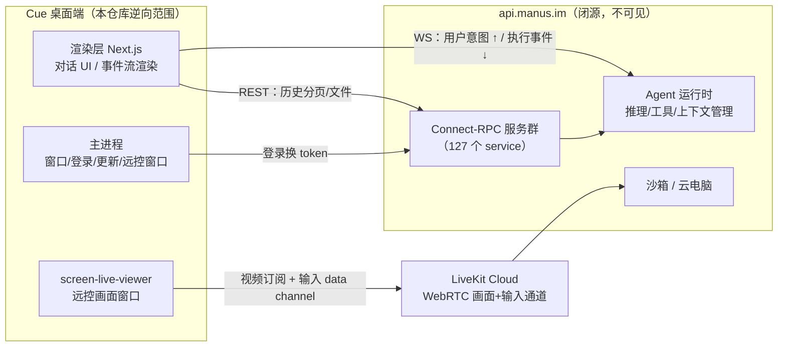

# How Cue Works

> **文档同步跟踪**
> - 分析对象：`/Applications/Cue.app`，bundle id `ai.manus.agents`，版本 1.0.3（arm64 Electron 应用，381MB）
> - 分析方式：闭源二进制逆向 —— REA（rea-agents 6.4.0）静态测绘 + `@electron/asar` 解包 + 人工/子代理代码精读
> - 解包产物：`~/rea-analysis/cue-src`（dist/main.cjs、dist/preload.cjs、out/ 渲染层）；REA 证据图谱：`~/rea-analysis/cue-overview.json`
> - 证据边界：本笔记只覆盖**客户端**。Agent 的推理、工具执行、上下文压缩全部在云端（api.manus.im），客户端代码里不存在，相关结论标注为「推断」

这是一组面向「理解系统设计」的 Cue 拆解笔记。Cue 是 Manus 的桌面 Agent 客户端，闭源分发，本仓库从逆向结果出发，还原它的架构决策。

## 阅读入口

- [01. 定位与整体架构](docs/01-overview.md)
- [02. Electron 壳：窗口、IPC 与登录](docs/02-desktop-shell.md)
- [03. 电脑控制：LiveKit 远控的完整链路](docs/03-computer-control.md)
- [04. 会话与上下文管理：为什么本地是空的](docs/04-context-management.md)
- [05. 渲染层应用结构：一套 Web 代码库的两个宿主](docs/05-renderer-app.md)
- [06. 本机能力桥与设备授权](docs/06-local-bridge.md)
- [07. 安全边界：壳的防御体系](docs/07-security-boundary.md)
- [08. 自动更新与技能录制](docs/08-updater-and-recording.md)
- [09. 后端接口面：WS / REST / Connect-RPC](docs/09-backend-surface.md)
- [10. 最小复刻指南](docs/10-minimal-rebuild.md)
- [源码索引（证据锚点）](docs/source-map.md)

## 一句话总览

**Cue 是一个纯瘦客户端**：本地 Electron 壳只做四件事——保管登录态、渲染对话事件流、弹远控窗口、管自动更新。Agent 的思考、工具执行、上下文管理 100% 在云端。「控制电脑」也不是控制本机，而是通过 **LiveKit WebRTC** 实时观看并操作另一台设备或云电脑。

## 当前覆盖范围

| 主题 | 覆盖度 |
|---|---|
| Electron 壳（窗口/IPC/preload/登录/更新） | 完整，代码事实 |
| 电脑控制链路（viewer 端） | 完整，代码事实；被控端不在包内，协议行为为推断 |
| 会话通道与事件流 | 完整，代码事实 |
| 上下文管理 | 客户端侧完整（结论：本地没有）；云端机制不可见，仅给出证据边界 |
| 渲染层应用结构 | 页面/Redux/i18n 完整，代码事实 |
| 本机能力桥与设备授权 | 客户端侧完整；设备侧执行器不在包内，已标注证据缺口 |
| 安全边界 | 完整，代码事实 |
| 自动更新与技能录制 | 完整，代码事实；含死代码/预留机制的甄别 |
| 后端接口清单 | 完整枚举（33 REST + 127 RPC + WS/SSE） |
