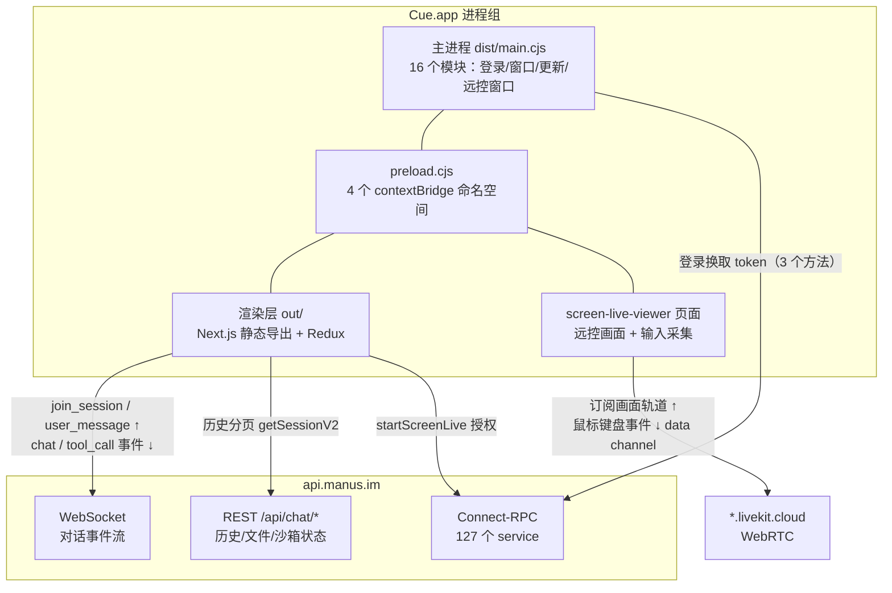

# 第 1 章：定位与整体架构

> 本章导读：Cue 是什么、为什么它的「 Agent 客户端」身份具有迷惑性、以及逆向分析能覆盖到什么边界。读完本章你会建立一个关键判断：**这个 381MB 的桌面应用里几乎不含 Agent**。

本章按「定位 -> 架构分层 -> 技术栈 -> 证据边界」展开：

| 小节 | 回答的问题 | 读者将掌握 |
|---|---|---|
| 1.1 它解决什么问题 | Cue 在 Manus 产品体系里的角色 | 桌面壳存在的理由 |
| 1.2 整体架构 | 本地三层 + 云端 + LiveKit 如何分工 | 全局组件图 |
| 1.3 技术栈与打包形态 | 代码长什么样、怎么读 | 逆向产物的结构 |
| 1.4 证据边界 | 哪些结论是事实、哪些是推断 | 本笔记的可信度模型 |

## 1.1 它解决什么问题

Cue 是 Manus 的桌面客户端。Manus 本体是云端 Agent 服务：用户在网页上发起任务，云端 Agent 推理、调工具、在沙箱里执行。桌面端要解决的工程问题不是「在本地跑 Agent」，而是三件网页做不到的事：

1. **持久登录态**：系统级登录（浏览器 SSO 回跳），365 天有效会话。
2. **远控窗口**：用独立原生窗口观看/操作另一台设备或云电脑，带全屏、自适应分辨率、本地录制。
3. **本机资源桥接**：给云端沙箱工作区提供本地文件浏览/搜索能力（`/api/desktop/*` 系列接口，由主进程转发到本机文件系统）。

理解了这三件事，就理解了为什么这个应用存在。剩下的功能（自动更新、录制管理）都是围绕它们的支撑设施。

## 1.2 整体架构

运行时只有四类组件在协作：主进程（Node.js，16 个模块）、渲染层（Next.js 静态页）、云端服务群、LiveKit 媒体通道。

关键判断：**本地没有任何 agent 运行时**。对主进程与渲染层全量检索，不存在 prompt 组装、token 计数、截断/压缩/摘要的任何代码（详见第 4 章）。云端推送的是已经执行到一半的工具调用事件（文件编辑、图片生成、沙箱状态），客户端只是订阅并渲染。

## 1.3 技术栈与打包形态

| 层 | 技术 | 逆向可读性 |
|---|---|---|
| 主进程 | esbuild 打包的单文件 `dist/main.cjs`（2MB），保留 `// backend/xxx.ts` 模块注释 | 高：变量名被压缩，但模块边界、字符串常量、注释完整 |
| preload | `dist/preload.cjs`（7KB），几乎是源码形态 | 极高：完整桥接口契约 |
| 渲染层 | Next.js 静态导出 `out/`，674 个混淆 chunk（约 97MB） | 中：标识符混淆，但字符串（URL、事件名、频道名）可靠 |
| RPC 层 | Connect-RPC + protobuf-es，127 个 service 定义全量打包 | 高：proto 字段名保留 |

REA 静态测绘的数字底座：720 个源文件、685 个成功解析、5456 个模块、43 个 IPC 频道、35 个主进程 handler 全部与渲染层调用配对。

## 1.4 证据边界

本笔记遵守一个纪律：**区分代码事实与推断**。

- **代码事实**：字符串常量、函数调用、模块注释直接可见的行为，标注文件与锚点。
- **推断**：从协议形状反推的对端行为（如被控端如何执行输入事件），或从打包清单反推的云端分工。
- **不可见**：云端 `api.manus.im` 的一切内部机制。Agent 怎么做上下文压缩、怎么调度 map-reduce 子任务，客户端代码只能证明「不在这里」，不能证明「在那边怎么做」。

## 1.5 小结

- **你该带走什么**：Cue = 登录壳 + 事件流渲染器 + 远控窗口管理器。它的体积来自 Next.js 渲染层和 Electron 运行时，不来自 Agent 智能。
- **下一步**：第 2 章拆解这个壳本身——主进程 16 个模块如何分工，43 个 IPC 频道如何组织，登录 token 存在哪。
