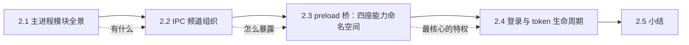
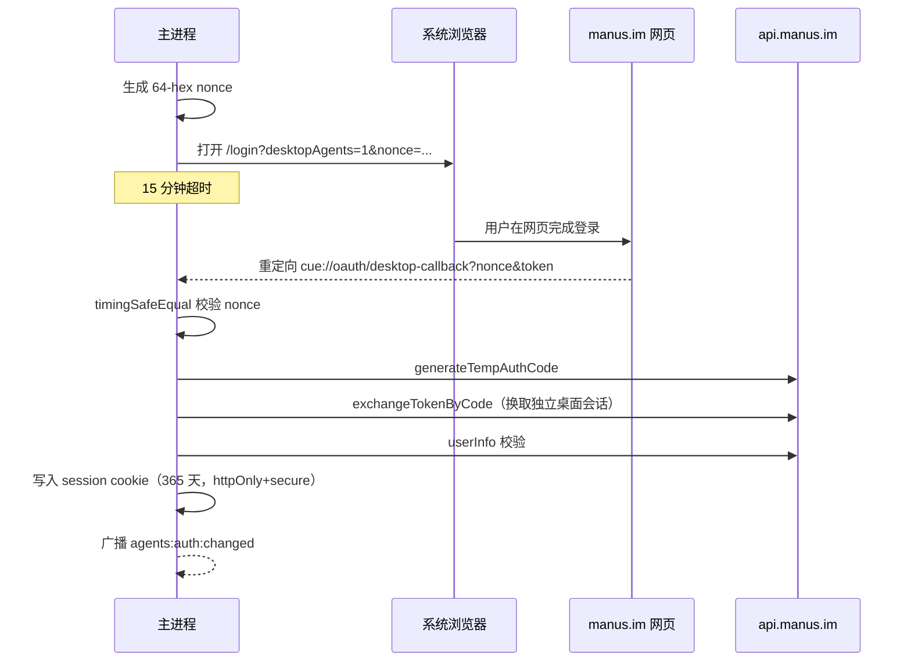

# 第 2 章：Electron 壳——窗口、IPC 与登录

> 本章导读：主进程是 Cue 唯一有「特权」的地方——它持有登录态、控制所有窗口、拦截外部链接。本章讲清这个壳的运行时行为：它监听什么、保护什么、把什么能力以什么形式借给渲染层。

本章结构如下——先讲主进程模块分工（2.1），再讲 IPC 与 preload 桥这对契约（2.2-2.3），最后落在登录态的完整生命周期（2.4）：

## 2.1 主进程模块全景

主进程打包产物里保留的 `// backend/*.ts` 注释给出了完整模块清单——只有 16 个，全部是壳功能：

| 模块 | 职责 |
|---|---|
| `main` / `ipc` | 启动编排、IPC handler 注册 |
| `rendererWindow` / `WebWindows` | 窗口创建与生命周期 |
| `ComputerWindows` | 远控 viewer 窗口族（第 3 章展开） |
| `AuthSession` / `BrowserLogin` / `CredentialStore` | 登录流与 token 保管 |
| `DesktopUpdates` / `PreviewUpdater` / `UpdateCheckpoint` / `UpdatePolicyTest` | 自动更新（Squirrel） |
| `appProtocol` / `urlPolicy` | 自定义协议 `cue://` 与外链白名单 |
| `rendererCors` / `rendererPermissions` / `rendererStorageMigration` | 渲染层安全边界 |

值得注意的负事实：**没有任何 agent 执行、工具调度、网络代理模块**。主进程对云端 API 的直接调用只有 3 个 Connect-RPC 方法，且全部服务于登录换 token。

## 2.2 IPC 频道组织

43 个 IPC 频道统一以 `agents:` 开头，按域分组，每组都遵循同一模式：渲染层 `invoke` 拉取/请求，主进程 `webContents.send` 推送状态变更。

| 域 | 频道数 | 运行时语义 |
|---|---|---|
| `agents:auth:*` | 8 | 渲染层问「当前 token 是什么」；主进程在登录态变化时广播 |
| `agents:computer:*` | 11 | 远控窗口的开关、尺寸适配、播放状态（第 3 章） |
| `agents:updater:*` | 13 | 更新策略查询、检查、重启；含一个 `policy-test` 调试通道 |
| `agents:window:*` | 4 | 主窗口状态与「关闭即隐藏」协商 |
| `agents:recording:*` | 2 | 录制标记会阻塞更新重启 |
| 杂项 | 5 | device-id、打开外链、debug-tools |

两个设计细节值得记住：

- **同步通道只用于启动竞态**：`agents:auth:get-sync` 和 `agents:device-id` 用 `sendSync`——渲染层第一帧渲染前必须知道登录态，等不起异步往返。其余全部异步。
- **关闭不是关闭**：主窗口收到关闭请求时，先问渲染层「你要拦截吗」（`close-requested`），渲染层不处理才退化为隐藏窗口。Mac 上「关窗不退出」的惯例被做成了一个可协商协议。

## 2.3 preload 桥：四座能力命名空间

preload 是壳与页面之间唯一的契约，7KB 文件完整暴露了全部能力面。它把 43 个频道收敛成 4 个挂在 `window` 上的对象：

| 桥对象 | 面向的页面 | 内容 |
|---|---|---|
| `agentsDesktop` | 主对话页面 | auth、window、updater、recording、debug、device、billing、system |
| `__desktopUpdater` | 主对话页面 | 独立的更新 API 面（apis/events 分离） |
| `desktopAuthStorage` | 登录页 | 唯一的 `getToken` 同步读 |
| `__screenLiveViewer` | 远控 viewer 页 | 画面播放、窗口适配、全屏（第 3 章） |

设计含义：**每个页面只能拿到自己需要的能力**。登录页看不到远控 API，远控页碰不到 token 写入。这是用 contextBridge 的暴露范围做最小授权，而不是依赖渲染层自觉。

## 2.4 登录与 token 生命周期

登录是壳最复杂的流程，因为它要穿过系统浏览器再回到应用内：

三个设计决策：

1. **不直接复用网页会话**。代码注释写明 "An independent desktop session is required"——网页 token 只作为换取桌面 token 的一次性凭证，桌面会话独立吊销。
2. **token 存 Electron session cookie，不用 safeStorage/keychain**。`session_id` cookie 挂在 `https://api.manus.im` 域下，`httpOnly + secure + sameSite:lax`。旧版的加密文件 `session.enc` 在登录成功后会被删除（一次性迁移）。渲染层发起的请求统一注入 `authorization: Bearer` + `x-client-id/type/version/locale/timezone` 五个客户端标头。
3. **device-id 与 token 分离**。profile 目录下独立文件（随机 UUID，0600 权限），同步 IPC 暴露。设备身份不因登录态变化——它是远控授权（第 3 章）里识别「这台电脑」的锚。

`agents:web-return-token` 是这条链的延伸：当外部浏览器里完成第三方 OAuth（connectors）后跳回壳内页面时，用一次性令牌证明「这个回跳是我发起的」。

## 2.5 小结

- **你该带走什么**：主进程是个「小而严」的壳——16 个模块，特权集中在登录态与窗口；IPC 用「invoke 拉取 + send 推送」的统一模式组织；preload 按页面最小授权；登录穿过系统浏览器并以独立桌面会话收口。
- **下一步**：第 3 章进入本拆解的核心——`agents:computer:*` 背后的远控体系，看它如何用 LiveKit 把另一台电脑的屏幕搬进一个原生窗口。
