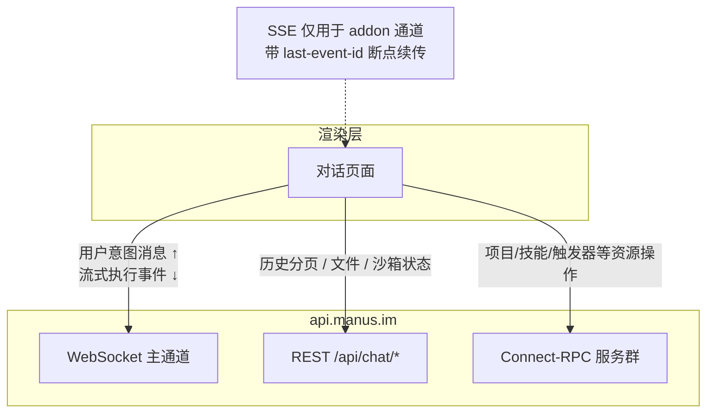
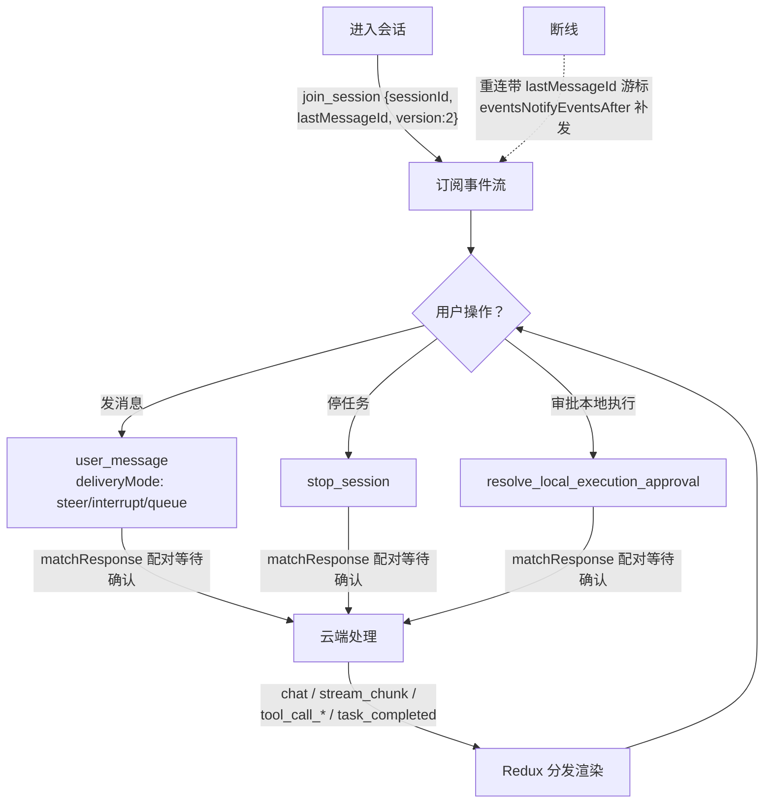

# 第 4 章：会话与上下文管理——为什么本地是空的

> 本章导读：拆开 Cue 想找「Agent 怎么管理上下文」的人会发现一个反常事实：**本地没有任何上下文管理代码**。本章先证明这个负事实，再讲清本地实际承担的会话职责——意图上行、事件下行、断线续传，以及从客户端协议形状能推断出的云端架构。

本章按「结论 -> 通道 -> 生命周期 -> 状态管理 -> 云端推断」展开：

| 小节 | 回答的问题 | 读者将掌握 |
|---|---|---|
| 4.1 负事实：本地没有上下文管理 | 凭什么这么说 | 检索证据与边界 |
| 4.2 三条通信通道 | 客户端和云端怎么说话 | WS / REST / RPC 分工 |
| 4.3 会话生命周期 | 从发消息到看结果的完整回路 | 意图协议与事件流 |
| 4.4 渲染层状态模型 | 事件流如何变成 UI | Redux + 请求-响应配对 |
| 4.5 云端上下文管理推断 | 云端大概在做什么 | 协议里漏出的线索 |
| 4.6 小结 | | |

## 4.1 负事实：本地没有上下文管理

先做一组可复核的检索结论（对解包产物全量 grep）：

- 主进程全文无 `systemPrompt` / `promptTemplate` / `buildPrompt`——仅有的 4 处 "prompt" 全部是更新对话框文案变量。
- 渲染层 674 个 chunk 中无 `context_window`、`countTokens`、`tiktoken`、`compaction`、`truncate conversation`、`sliding window` 等任何 LLM 上下文管理字符串。命中的 `summarize` 全是 i18n 示例文案，命中的 `compaction` 是 SQL 关键字表。
- 消息历史不是本地持有全量再裁剪，而是**从服务端按游标分页拉取**：`GET /api/chat/getSessionV2` 带 `historyCursor` / `historyDirection(before|after)` / `historyLimit` / `anchorEventId` 参数。

结论：prompt 组装、token 预算、截断/压缩/摘要如果存在，必然在服务端。客户端连「上下文长度」这个概念都不需要知道——这正是瘦客户端架构最诚实的地方：**它不假装自己在管理上下文**。

## 4.2 三条通信通道

客户端与云端有三条分工明确的通道，运行时各自监听不同的东西：

- **WebSocket 是主通道**：所有「会变化」的东西都从这里来——对话消息、工具调用进度、任务状态。三个用途（chat/notification/stt）共用 `wss://api.manus.im`。
- **REST 是查询通道**：拉历史、拿上传下载签名 URL、查沙箱状态——一次性问答。
- **Connect-RPC 是资源通道**：127 个 protobuf service（第 9 章有全清单），操作项目、技能、触发器这类「资源」而非「对话」。

## 4.3 会话生命周期

一个会话在客户端眼中的完整回路：

上行协议是**意图，不是 prompt**。`messageSentToSocket` 发送的 74 种消息类型全部是用户意图或指令：`user_message`（带三种投递模式）、`new_session_with_context`、`submit_subtask_card`、`resume_map_reduce`、`cascade_steer_interrupt`、`change_task_mode`、`set_workspace_working_directory` 等。客户端从不组装「给模型看的文本」，只表达「用户想干什么」。

其中 `user_message` 的 `deliveryMode` 三态是最有信息量的设计：`steer`（插入当前执行）、`interrupt`（打断重来）、`queue`（排队等空闲）——对应 Agent 运行中接收用户输入的三种语义，状态机在云端，客户端只做声明。

下行事件流同样声明式：`stream_header/chunk/trailer` 承载文本流，`tool_call_text_edit_file` / `tool_call_img_view_file` / `tool_call_video_generate_file` 等事件直接描述「云端正在干什么」，`session_busy` / `task_completed` / `agent_error` 是生命周期信号。

## 4.4 渲染层状态模型

事件流变成 UI 的管道很短：WS 单例 → `on("message")` → 按消息类型分发 → Redux（`sessionsSlice` 等）→ 组件。数据获取用 RTK Query，`prepareHeaders` 统一注入认证标头。

两个容易忽略的机制：

- **请求-响应配对**：上行消息带 id，`matchResponse` 按类型和发送者匹配云端回执，支持超时与 AbortSignal——在纯推送的 WS 上叠出了 RPC 语义。
- **离线入队**：断线时上行消息进入本地队列，恢复后补发（`messageQueueUpdated` 事件让 UI 显示「未送达」）。

## 4.5 云端上下文管理推断

客户端协议里漏出了几条云端架构的线索（以下为推断，置信度标注）：

| 线索 | 推断 | 置信度 |
|---|---|---|
| `map_reduce` / `cascade` 系列事件与子任务卡片 | 宽研究类任务被拆成云端分布式 job，有独立的暂停/恢复/重试协议 | 高 |
| `start_sandbox` / `getSandboxStatus` / `requestVncOtp` | 每个任务在云沙箱执行，客户端能请求其 VNC 画面（即第 3 章远控的被控端之一） | 高 |
| 项目资源的 `instruction` / `skill_config` 字段 | 系统级指令是云端资源，会话创建时引用，而非客户端拼装 | 高 |
| 上下文压缩/摘要 | 完全无客户端线索，云端机制不可知 | 不可知 |

**证据边界声明**：云端如何做 compaction、token 预算、记忆，本拆解无法回答——这超出客户端逆向的证据范围，不靠猜。

## 4.6 小结

- **你该带走什么**：上下文管理 100% 在云端；客户端的会话职责收敛为三件事——声明意图（74 种上行消息）、渲染事件流、用游标抗断线。`steer/interrupt/queue` 三态是整个协议里最值得借鉴的设计。
- **下一步**：第 5 章看看这套渲染层本身——它其实是一整套 Manus Web UI 的桌面移植。
