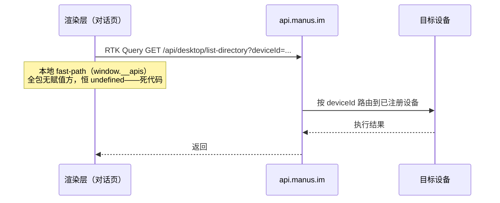

# 第 6 章：本机能力桥与设备授权

> 本章导读：Cue 的会话里可以让 Agent 操作你的本地文件夹——这是最敏感的能力。本章回答三个问题：请求从哪条路到达你的电脑、谁有权发起、边界划在哪。先说一个反直觉的结论：**这个应用在本机不监听任何业务端口**。

## 6.1 没有本地 server

先排除最直觉的方案。对主进程全量检索：

- 唯一的 `http.createServer` 属于 electron-updater——给 macOS 原生 Squirrel 更新器喂 zip 的代理，监听 `127.0.0.1` 随机端口，每次启动随机 64 字节 Basic 密码 + 随机一次性路径。与本机能力无关。
- 主进程 31 个 IPC handler 里**没有任何文件系统 / git / 截屏 handler**。

也就是说，本机没有任何一个端口或 IPC 通道能让其他本地进程直接驱动文件访问。这不是缺省，是架构选择。

## 6.2 云端中继模型

`/api/desktop/*`（列目录、搜文件、截屏、git 信息、workspace 读写）的真实路径是：

两个关键事实：

1. 渲染层里存在一个本地 fast-path 分支（目标是本机时走 `window.__apis` 桥），但**全包只有读取、没有赋值**——它是从 Manus Web/旧桌面端共享代码带来的死代码（参见第 5 章的「两个宿主」模式）。1.0.3 里所有 `/api/desktop/*` 一律打向 `api.manus.im`。
2. 设备身份的锚是 profile 目录的 `device-id` 文件（随机 UUID，0600 权限），请求以 `x-client-id` 标头携带。

**证据缺口（如实说明）**：设备侧的执行器——云端请求如何最终在这台机器上落地执行——不在这个 asar 里。bundle 内没有对应的 listener 或长连接客户端代码；`DesktopService` 的设备视图带 `is_connected` 字段和心跳时间戳，推断执行侧由云端持有的设备长连接对端或独立 runtime 组件承担。本拆解只能确认到「请求发往云端」为止。

## 6.3 授权模型

能驱动本地资源的前提有三层，全部可静态核实：

| 层 | 机制 | 运行时语义 |
|---|---|---|
| 设备注册 | Connect-RPC `DesktopService` | 设备先注册进账号设备列表 |
| 文件夹授权 | `UpdateDesktopConfig`：`CONNECT_FOLDER / DISCONNECT_FOLDER / SET_ALLOW_CMD` | 用户**显式**把某个本地文件夹注册给云端，每个文件夹带独立的 `allow_cmd`（允许执行命令）开关 |
| 逐次审批 | WS 消息 `resolve_local_execution_approval` / `submit_workspace_directory_access` / `change_local_permission_mode` / `enable_device_sandbox` | 具体动作触发渲染层弹确认，用户点过才放行 |

参数侧也有护栏：路径超 1024 字符直接抛 `invalid_directory`；已授权路径记录在 localStorage `folder_access_allowed_paths`。

## 6.4 攻击面评估

把第 2-5 章的边界合起来看，本地攻击面收敛为一条链：

> **想动你的文件，必须经由 Manus 云端 → 你已注册的设备 → 你已授权的文件夹 → （需要命令时）逐次审批。**

- 本机无监听端口，局域网/本地进程无法直连驱动。
- 渲染层网页（即使被注入）碰不到文件 API——那组接口不在 preload 桥上，只能以 RTK Query 形式向云端发请求，依然受云端鉴权约束。
- 剩余信任集中在两处：Manus 云端本身，以及设备长连接另一侧的执行器（不可见，已声明为证据缺口）。

## 6.5 小结

- **你该带走什么**：本机能力桥是「云端中继 + 显式授权 + 逐次审批」模型，而不是本地 agent 开端口；本地 fast-path 是共享代码库留下的死代码，读混淆代码时「存在」不等于「活着」。
- **下一步**：第 7 章把镜头拉远，系统盘点整个壳的安全边界——URL 策略、CSP、权限处理器的完整防线。

## 关键实现入口

| 主题 | 位置 |
|---|---|
| `/api/desktop/*` 路由表与 zod schema | `out/_next/static/chunks/93000-*.js`（锚点 `fileLocations`） |
| fast-path 分发与死代码 | `out/_next/static/chunks/45722-*.js` 模块 98448；`68702-*.js` 模块 69124（`window.__apis` 读取方） |
| 设备注册 RPC | `dist/main.cjs` 约 :22347（`desktop/v1/desktop.proto` 定义） |
| device-id | `dist/main.cjs` 约 :16344 |
| 逐次审批消息 | `out/_next/static/chunks/53116-*.js`（`resolve_local_execution_approval` 等） |
