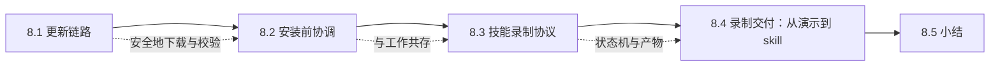
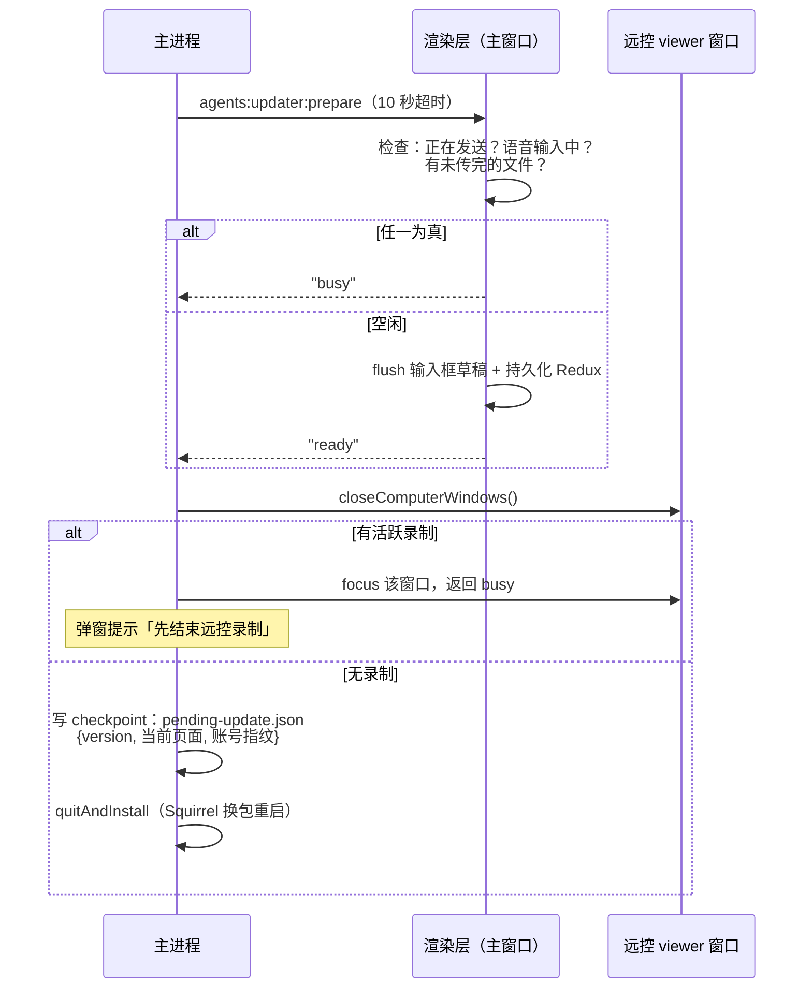
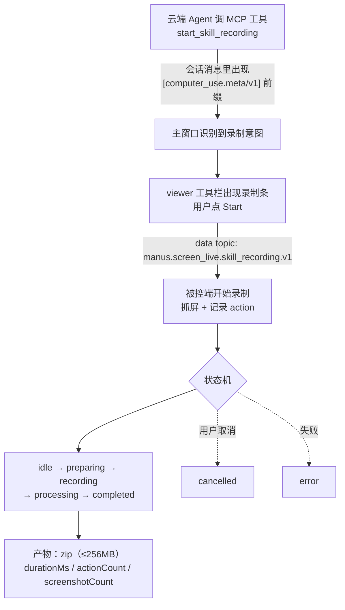

# 第 8 章：自动更新与技能录制

> 本章导读：两个「运行中」的机制。自动更新回答「怎么在用户干活时安全地换掉自己」；技能录制回答「怎么把一次远控操作沉淀成 Agent 可复用的技能」——后者是 Cue 把「人操作电脑」反哺给 Agent 的关键回路。



## 8.1 更新链路

更新栈是 **electron-updater + 原生 Squirrel.Mac 双事件源**，更新源配置（`app-update.yml`）：

```yaml
provider: generic
url: https://download.cue.im/
channel: latest
```

主进程对这份配置做**逐 key 严格比对**（key 集合、provider、channel、缓存目录名、URL 必须是 https、无 userinfo、路径以 `/` 结尾），任何一项不符就把更新能力整体禁用（`availability: "disabled"`）——防止配置被篡改后把更新引向恶意源。版本护栏同样严格：拒绝降级、拒绝跨 preview 线，`allowDowngrade: false`。

校验链分两层：electron-updater 比对 `latest-mac.yml` 声明的 SHA512 与下载文件；真正的替换由原生 Squirrel.Mac 执行，它要求更新包的代码签名与当前应用一致。electron-updater 为此在本机起了一个随机端口、随机一次性 Basic 密码的代理给 Squirrel 喂包——这是全应用唯一的本地 HTTP listener（第 6 章）。

另有一个随正式版发布的 **QA 钩子**：deep link `cue://update-test?action=notify|force&version=x.y.z` 写入测试规则后，渲染层跳过真实检查、直接渲染「强制更新条」或「30 分钟可关闭提醒」。它有完整的 UI 和 localStorage 持久化，是发版演练通道而非调试残留——但也意味着它跟着生产包一起分发。

## 8.2 安装前协调：与工作共存

安装更新不是一句话的事，主进程要先问过正在工作的各方：



重启后凭 checkpoint 恢复现场：校验安装版本与记录一致、账号指纹（token 的 SHA256）匹配，才恢复更新前的页面——换账号登录不会误入别人的会话现场。

两个「预留但未启用」的点值得记录：① 「任务空闲时自动安装」在本版本被硬编码禁用（`autoInstallSupported: false`，渲染层传 true 直接抛错）；② 渲染层 updater 模块里有 `restartBlockedReason === "skill-recording"` 分支和 `__apis.updater.setTaskRunning` 调用，来自旧 Manus 桌面端共享代码，在 Cue 里是死分支。此外 `recording:active` 在安装进行中会**拒绝**开始新录制——两个方向的闸门都关了。

## 8.3 技能录制协议

录制的完整名是 **skill recording**：把用户在被控电脑上的一次操作演示，录成 Agent 可复用的技能。它的发起方出乎意料——**是云端 Agent 发起的**：



协议方法集：`open / status / start / stop / readArtifact / cleanup / cancel / uploadArtifact / completeTranscription`。录制本体发生在**被控端**（抓屏 + 记录操作动作），viewer 端只做控制与观察。

viewer 侧唯一的本地采集是**旁白麦克风**：`getUserMedia` 拿音频，MediaRecorder 以 60 秒分段（优先 `audio/webm;codecs=opus`），每段 PUT 到云端的语音转写接口换成文字，最终经 `completeTranscription` 拼回录制——用户边操作边讲解，讲解成为技能的一部分。

## 8.4 录制交付：从演示到 skill

产物不经过本地磁盘，走一条「预签名 URL 直达对象存储」的链：

1. 录制完成 → viewer 向被控端 `readArtifact` 拿到 zip 信息；
2. viewer 向云端申请预签名上传 URL（PUT 超时按体积线性放大）；
3. **被控端自己**把 zip PUT 到 S3/CloudFront——协议层校验上传 URL 必须是 CloudFront 签名或 S3 预签名形态，防止把产物引向任意服务器；
4. viewer 把交付物（`{recordingId, file, durationMs, actionCount, screenshotCount}`）交给录制交付页，用户选定目标 Agent 会话后，以 `workflow_recording` 附件发进对话；
5. Agent 回 `accepted`——一次人类演示正式变成可复用 skill。

整个过程中 `agents:recording:active` 一直向主进程举着「别关窗、别重启更新」的牌子（第 2、3 章），录完可通过 `open-agent` 直接跳回目标会话。

## 8.5 小结

- **你该带走什么**：更新的安全来自「配置逐 key 锁定 + 双层签名校验 + 安装前三方协调 + checkpoint 现场恢复」；技能录制是 Agent 发起、用户演示、被控端录制、云端转写旁白、产物直达对象存储、最终回喂 Agent 的完整闭环——这是 Cue 里「教人」与「Agent 学」咬合的齿轮。
- **下一步**：第 9 章汇总客户端能触达的全部后端接口面。

## 关键实现入口

| 主题 | 位置（`dist/main.cjs`，除标注外） |
|---|---|
| 更新策略校验 | `PreviewUpdatePolicy`，约 :23683-23732 |
| 更新引擎 | `PreviewUpdater`，约 :23733-23890 |
| 安装前协调与 checkpoint | `DesktopUpdates` / `UpdateCheckpoint`，约 :23895-24107；`pending-update.json` |
| QA 测试钩子 | `UpdatePolicyTest`，约 :24111-24139；消费端 chunk `76662` |
| 更新源配置 | `/Applications/Cue.app/Contents/Resources/app-update.yml` |
| 录制识别与发起 | chunk `45722`（`skill-recorder` / `start_skill_recording`） |
| 录制协议状态机 | chunk `45722` 模块 88145（`manus.screen_live.skill_recording.v1`） |
| 旁白转写 | chunk `45722`（MediaRecorder 60s 分段 + `audioTranscription` RPC） |
| 交付页 | chunk `app/screen-live-viewer/page-*.js` 模块 51208 |
