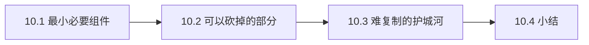

# 第 10 章：最小复刻指南

> 本章导读：基于前九章的机制还原，回答一个工程问题——**如果从头做一个 Cue，最少要写什么**。本章也是全书的收束：能用少量组件重建它，才算真正理解了它。

## 10.1 最小必要组件

按依赖顺序，六个组件构成最小可用的 Cue：

| # | 组件 | 规模估计 | 关键决策 |
|---|---|---|---|
| 1 | **Electron 壳 + 登录流** | ~1k 行 | 系统浏览器 SSO + nonce + 自定义协议回调 + 换取独立会话 cookie |
| 2 | **preload 桥** | ~200 行 | 按页面暴露能力，invoke 拉取 + send 推送的统一 IPC 模式 |
| 3 | **对话渲染器** | 主体工作量 | WS 单例 + 事件流 → Redux；上行意图带 id 配对回执 |
| 4 | **远控 viewer** | ~2k 行 + livekit-client SDK | Room 连接 + 屏幕轨道订阅 + data channel 输入队列（节流/背压/断线补发） |
| 5 | **安全边界** | ~500 行 | URL 分类校验、单 handler 协议 + nonce CSP、权限默认拒绝、弹窗拦截（第 7 章） |
| 6 | **自动更新** | ~300 行 | electron-updater + 配置逐 key 锁定 + 安装前协调 + checkpoint 恢复（第 8 章） |

组件 1-2 是壳，照抄 Cue 的设计就是最佳实践；组件 3 是任何 Agent 客户端的通用骨架；组件 4 是 Cue 最有差异化的部分；组件 5-6 是上线前必须补的课，开发期可以没有。

## 10.2 可以砍掉的部分

复刻时不必照搬的：

- **127 个 RPC service 客户端**：那是服务端契约快照，你只需要 login、device authorization、desktop 三个 service。
- **`playback` / `playing-sessions` 通道**：1.0.3 自己都没接线。
- **`__apis` 双兼容桥、task-idle 自动安装**：共享代码库带来的死分支，别学。
- **多屏切换、IME 合成、剪贴板同步**：远控的 90 分体验来自主链路，这些是 95 分到 98 分。
- **技能录制**：是护城河的一部分，不是最小闭环的一部分。

## 10.3 难复制的护城河

客户端可以复刻，但 Cue 的价值不在客户端：

1. **云端 Agent 运行时**：推理、工具生态、沙箱调度、map-reduce 宽研究——客户端协议只露出冰山一角。
2. **被控端 agent**：发布屏幕、执行输入事件、执行 `/api/desktop/*` 本机操作的那一端，不在逆向范围内；输入合成的可靠性（光标校对、按键释放自愈）与设备长连接的保活是工程难点。
3. **技能录制回路**：把人类演示沉淀为可复用 skill 的完整管线（第 8 章），涉及云端转写、对象存储、技能系统的配合。
4. **授权运营体系**：设备授权码、登录实例管理、吊销——协议简单，难的是配套的安全运营。

## 10.4 小结

- **你该带走什么**：Cue 的客户端是一个「薄而正确」的范本——登录、桥、渲染、远控、安全、更新六件套各司其职；它的设计启示是**把智能完全放在云端时，客户端反而需要更强的协议纪律**（意图声明、回执配对、断线游标、能力最小授权、默认拒绝的权限）。
- **全书回顾**：第 1 章定位 → 第 2 章壳 → 第 3 章远控 → 第 4 章会话 → 第 5 章渲染层 → 第 6 章本机桥 → 第 7 章安全 → 第 8 章更新与录制 → 第 9 章接口面 → 本章收束。所有证据锚点集中在 [源码索引](source-map.md)。
