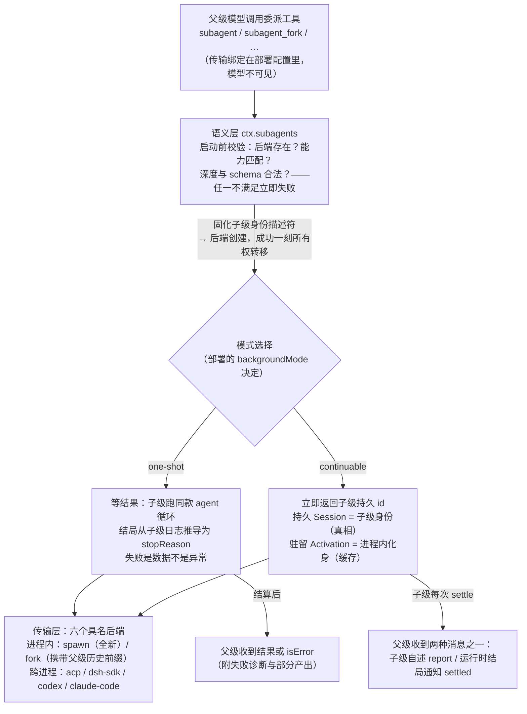
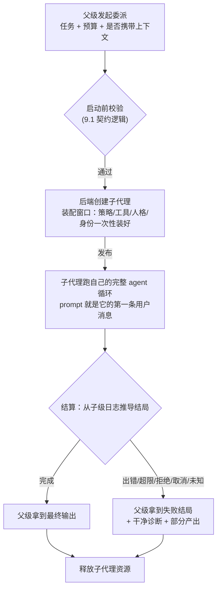
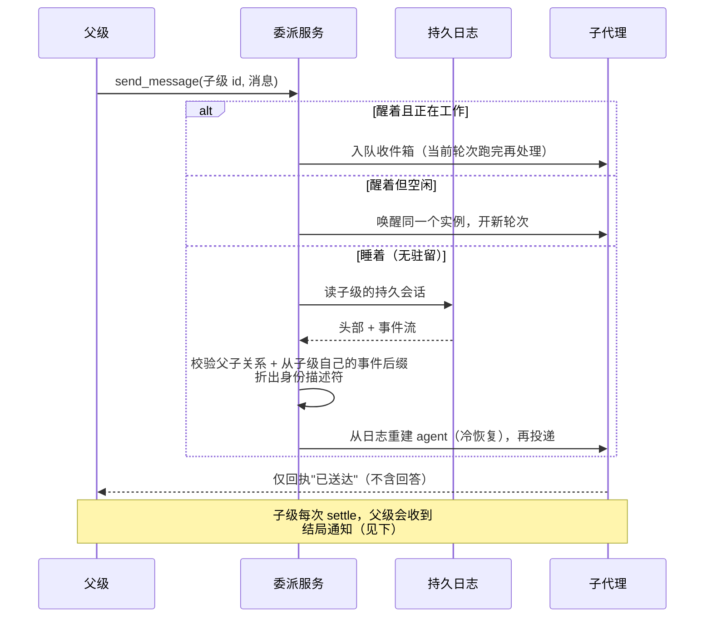
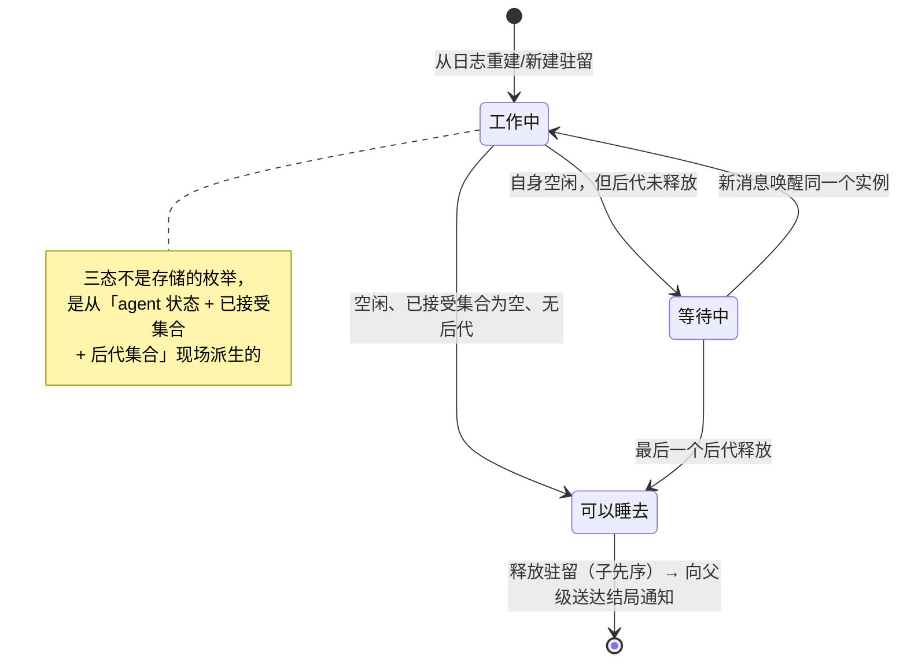

# 第 9 章：编排能力——subagent、preset 与后台工作

> 本章导读：单 agent 之上的编排——子代理委派、按会话组装能力集合（preset）、后台任务、工作流、计划/目标/定时。所有这些都不是 agent loop 的内建特性，而是建立在同一套 seam 与 scope 原语上的可选能力。9.1–9.5 按"总—分—总"深拆 subagent（锚点以 `0.1.0-rc.8` 为准，其余小节以 rc.5 为准）；建议先读[第 4 章](04-核心循环.md)（轮次与 inbox）、[第 5 章](05-会话日志与持久化.md)（事件溯源）与[第 7 章](07-工具系统与执行世界.md)（seam 三角色）。

## 9.1 subagent 总览：两种委派模式，一套架构

委派解决的问题是：**把工作连同它需要的上下文预算一起交出去，只把结果拿回来**，从而不消耗父级对话的上下文。拆开"委派"这个动作，它有四个要素：**任务**（一段 prompt）、**上下文**（子级要不要看到父级历史）、**权威**（谁能指挥它、停它、收它的报告）、**预算**（token、递归深度、工具范围）。本章的分节就沿着这四个要素展开。

dsh 的委派功能建立在两个根本判断上，全部机制都是它们的推论：

**判断一：委派的语义是稳定的，委派的传输是多样的。** "启动子代理、等它做完、拿到结果或失败"这套语义，与"子代理跑在哪"无关。所以第一刀切在语义与传输分离：语义层定义一套契约与词汇（`ctx.subagents`，具名多后端注册表，形态对齐 LLM adapter registry 而非 bash 的单执行器），传输层以可插拔的后端实现它，调用方按名字选择。模型见到的工具 schema 里**没有后端参数**——传输选择是部署决策，不是模型决策。

**判断二：委派有两种不可通约的模式。** 模型的两个使用诉求——"交一个任务、等一个结果"与"启动一个长期对话伙伴、随聊随在"——看起来相似，本质完全不同：前者是一次性产出，结果属于调用者；后者是持续关系，子级身份必须比任何一次进程驻留更长寿。塞进一个抽象会让两套语义互相污染，所以 dsh 让两种模式**共用词汇、分开生命周期**：

| | **模式一：one-shot（一次性）** | **模式二：continuable（持续对话）** |
|---|---|---|
| 使用方式 | 交任务、等结果（可前台可后台 job） | 启动后立即返回子级 id，`send_message` 多轮跟进 |
| 结果归属 | 调用者拿到全部输出 | 父级收到子级自述 + 运行时的结局通知 |
| 子级身份 | 一次性，用完即弃 | 持久会话，跨进程重启存活 |
| 是否有 run 句柄 | 有（result + dispose） | 没有——驻留管理直接持有 agent |
| 后台载体 | jobs（与后台 bash 同一套任务词汇） | 刻意不走 jobs（对话不是一次性产出） |
| 典型工具 | `subagent`（spawn）、`subagent_fork`（fork） | 同一批工具，由部署的 `backgroundMode` 决定 |

两种模式跑在同一条架构主干上。下图是委派的全景路径——从模型发起，经语义层校验，在**模式选择处分叉**，最终落到六个具名传输后端之一：



在进入分述前，先记住三条贯穿两种模式的契约逻辑（细节在 9.2/9.4 展开）：

1. **能力协商 fail loud**。每个后端用四个静态标志如实声明启动期能担保什么（结构化输出、深度限制、工具过滤、人格），请求声明需要什么；启动前逐项核对，第一个不满足就失败。绝不做"接受请求、静默忽略"——静默降级让父级基于错误假设继续工作，配置错误会变成行为谎言并在多代理调用链里放大。"能否持续对话"这个能力不用标志位表达，而用**方法的存在性**表达——标志位会与实现漂移，方法存在性不会。
2. **发布边界唯一**。创建过程中的子代理是未发布的半成品，对世界不可见；成功的一刻是唯一的发布点与所有权转移点。发布前失败由后端清理半成品，如同委派从未发生（没有 id、没有事件）；发布后一切成败走结算通道。取消、失败、清理在边界两侧各有唯一语义，不存在"创建到一半谁收拾"的灰色地带。
3. **失败是数据，不是异常**。子代理的失败是委派语义内的正常结局。五种结局词汇（完成/取消/出错/超限/拒绝，可扩展）跨全部传输统一；结局从**子级自己的日志**推导而不是从"它是怎么停的"推导——取消一个其实已失败的子级，不能把失败变成取消；认不出的结局一律按失败处理。

## 9.2 模式一：one-shot——一次性委派

one-shot 的生命周期是理解委派功能的主干（整体位置见 9.1 的全景图，下图展开"等结果"分支内部）：



四个值得展开的逻辑点：

**1. 子代理跑的是与父级完全相同的循环。** 委派不是特殊执行模式：子代理就是一个普通 agent，prompt 以一条普通用户消息进入它的收件箱，由它自己的循环跑到空闲。子代理天然拥有父级的一切能力（工具、审批、继续委派），委派功能没有发明任何新的执行机制——**多智能体是原语的组合，不是循环的扩展**。

**2. "出厂设置"在创建窗口内完成。** 子代理对世界可见之前有一个装配窗口：委派策略（9.4）、工具范围、人格、身份描述符全部在此时装好；窗口之后子代理即定型。"创建期组合"与"运行期行为"就此分开。

**3. 携带上下文的委派只复制"已完成轮次前缀"。** fork 型委派让子代理看到父级历史，但复制有严格规则：从开头切到**最近一次轮次正常结束**的位置。进行中的轮次（工具调了还没出结果）不能复制——那是不平衡、无法重放的状态。没有已完成轮次时 fork 自然退化为全新子代理。且**复制的只有对话历史**：父级的工具限制、权限、人格一概不随历史走。

**4. 结构化输出不跑第二次模型。** 把**"交卷"做成一个工具**：子代理的 schema 就是这个工具的参数定义，系统提示声明"只有工具调用算结果"，提交通过校验即结束当前轮次，提交后禁止再执行任何动作。"结果"从"要从文本里猜的东西"变成"一个明确的、可机器校验的动作"，且无额外模型开销。

one-shot 也可以转后台：此时它被包装成一个**后台任务**（job），与"后台 bash"共用同一套任务词汇——列出、读输出、终止（见 9.7）。对模型和 UI 来说，"后台跑的一切"是同一种东西。

## 9.3 模式二：continuable——日志是真相，驻留是缓存

continuable 面对更难的问题：**一个可以聊很多轮的子代理，身份必须跨进程驻留而存在，但内存不能一直占着。** 一个聊完就闲置的子代理，凭什么常驻一个完整 agent 的运行时？

答案是整个功能最核心的一条逻辑分层：

```
持久层（真相）：一个 durable Session —— 子代理"是"它的日志
                   身份、策略、全部对话史都在里面，跨进程重启存活
进程内（缓存）：至多一个 Activation —— 子代理"醒着"的一段时间
                   持有一个活着的 agent 实例，消息从它唯一的收件箱进出
```

**子代理的本质是它的会话日志；驻留的 agent 只是日志的一个进程内化身。** 睡着了（无驻留），子代理依然"存在"——它占一行持久记录；叫醒它，就是从日志重建一个 agent 继续跑。驻留期可横跨多个轮次，也会在所有工作做完、且它创建的后代全部结束后自动释放。

### 醒来：消息到达时的三路路由

父级给子代理发消息（`send_message`）时，投递逻辑只看一件事——它现在醒着吗：



**冷恢复为什么不经过当初创建它的后端？** 因为重建需要的一切——初始历史、身份描述符、委派策略——全在日志里，后端没有任何只有它能贡献的东西。让后端参与恢复，等于让"创建方式"成为"身份"的托管人，还会留下一批进程重启后无法重建的悬空句柄。推到底就是一句断言：**创建方式只是子代理的出生证明，不是它的监护人。**

这里必须防御一个身份污染：fork 型子代理的日志开头复制了父级历史，而父级自己可能也是别人的子代理——日志里因此躺着**祖先**的身份描述符。恢复时只从"子级自己写的那段后缀"折取身份。同一个污染问题在读取、投影、缓存三处用同一招化解。

### 睡去：排除静默假象的三态派生

什么时候可以安全地让子代理"睡去"？直觉答案"它没在跑的时候"有个陷阱：一条消息刚被接受、还没真正排入执行的那一瞬间，agent 状态仍是"空闲"——只看当前状态会把马上有活干的子代理误判为静默而提前释放。所以驻留管理器额外记账一个**已接受集合**：消息接受时登记 id，被领取或丢弃时移除。三个状态全部现场派生，不落存储：



### 树形所有权：父等子，取消向下、释放向上

continuable 子代理自己也能继续委派，形成一棵树。所有权逻辑两条：**父不能在子还活着时睡去**（每个驻留体记账自己创建的子级集合，集合非空就停在"等待中"，不会出现"爷爷没了、孙子悬空"）；**取消自上而下，释放子先序**（停止信号在同一同步瞬间传遍全树，资源释放从叶子向根进行——快的停止与稳的释放各取所需）。

### 结局通知：两种消息，绝不混同

父级感知子级结局，靠投递到父级收件箱的消息，这里有一条刻意二分：

| | 子级的报告（report） | 运行时的结局通知（settled） |
|---|---|---|
| **谁在说** | 子代理自己选择的内容 | 运行时对子代理结局的陈述 |
| **何时有** | 子代理主动调用报告工具时 | **无条件**——只要父级拿到过这个子级的 id |
| **呈现** | 往来信件，可展开 | 一行通知，折叠呈现 |

为什么不能合并？其一，**归因**：日志必须能精确区分"子代理说它做完了"和"系统观察到它停了"——合并等于把系统的话记在子代理名下。其二，**覆盖**：最需要告知父级的结局——token 耗尽、模型失败、被取消、被拆除——恰恰是子代理**永远没机会**自己报告的。所以结局通知不看子级是否报告过，无条件送达，并附上子级的"遗言"（最后一条非空回答）。投递调度按父级状态分三种：父级空闲→给它一个正常轮次；父级正忙→并入最近的步骤边界（多个子级同时结束只花一步）；父级在被拆除→只写入日志不唤醒。

## 9.4 权威与递归边界：两种模式的公共安全逻辑

多代理系统里最容易出错的是权威。subagent 的答案是一张精确的**操作-凭证表**：

| 操作 | 谁有资格 | 凭证是什么 |
|---|---|---|
| 发消息（send_message） | 只有**精确的、活着的、直接的**父级 | 活着的父 agent 对象，与持久化的父子关系双重核对 |
| 汇报（report） | 子代理自己；**收件人不能指定** | 活着的子 agent 对象；收件人从持久父子关系唯一推导 |
| 中断（interrupt） | 刻意更宽：人类出示父级地址，或**任意活着的祖先** | 父级会话地址，或物化时记录的祖先链成员身份 |
| 列举（list_agents） | 只读操作 | 不需要任何 agent 活着——从会话存储与持久层派生 |

三条贯穿原则：**归因与权威分离**——每条消息都记录"谁发的"，但归因字段不授予权威，权威永远是活着的 agent 身份与持久化关系的现场核对；**工具不携带权威**——控制工具只是薄适配，全部授权判断在服务边界完成，加载与否改变的是"模型能不能发起"，不是"允不允许发生"；**中断的授权刻意更宽**——中断幂等且不投递内容，误停代价低而够不着代价高，对不存在目标的中断是被接受的无操作。

与权威配套的是**委派时的策略快照**：子代理创建时一次性捕获父级的沙箱策略，审批策略钉死为"永不批准"——无人值守的子代理不能发起权限升级。快照以事件写进**子级自己的日志**，恢复时重放这些事件而非重读父级当前策略——父级后来的变化属于父级的未来，不属于已出生的子代理。

子代理拥有父级完整能力，也看得到委派工具——**递归没有天然终点**。防线三层，逻辑各不同：

- **深度上限：单调记账，不许洗白。** 每个 agent 的深度 = 父深度 + 1，持久化在会话头部；读取取"持久值与运行时值的较大者"，持久值是单调下限——否则冷恢复的子代理以深度 0 重生，恢复就成了深度记账的洗白通道。默认上限 3，配 0 完全禁止委派；跨进程后端可选"provider-managed"把预算交给对方部署。
- **工具过滤：是可见性，不是权威。** 可以在装配窗口把指定工具从子代理提示词移除并拒绝执行，但这是减少误用的可见性控制，不是安全边界；真正的递归刹车是深度上限。
- **人格与模型选择：子级局部遮蔽。** 只在子代理范围内生效；这些组合事实同样写进子级描述符与头部——能力集合影响模型行为，冷读历史必须能重建"它当时是什么配置"。

## 9.5 六种传输，同一套语义

语义层不变，传输层目前有六个后端，差异被完整封装在契约之内：

| 后端 | 子代理是什么 | 携带父级上下文 | 启动期四能力 | 可做持续对话 |
|---|---|---|---|---|
| **spawn** | 同进程新 agent | 否 | 全支持 | ✅ |
| **fork** | 同进程新 agent + 父级历史前缀 | **是** | 全支持 | ✅（组合上有分歧，见下） |
| **acp** | 进程外 ACP 协议对端 | 否 | 全不支持 | ❌ |
| **dsh-sdk** | 另一个完整的 dsh 进程 | 否 | 全不支持 | ❌ |
| **codex** | 真实 Codex app-server 进程 | 否 | 全不支持 | ❌ |
| **claude-code** | 真实 Claude Code 进程（官方 SDK） | 否 | 全不支持 | ❌ |

两个跨进程后端的共性逻辑值得注意。其一，**如实申报"我什么都担保不了"**：四个跨进程后端统一声明启动期能力全否——它们够不着子代理的工具表、人格、深度和输出校验，于是让这类请求在启动前被语义层拒绝；后端能力的诚实声明，换来语义跨传输的严格一致。其二，**结局词汇跨传输统一**：无论子代理是进程内 agent 还是外部产品，结局都映射回同一组词汇（ACP 的 cancelled→取消、Codex 的 contextWindowExceeded→超限、Claude Code 的各类错误→出错），连最终输出的提取都共用同一套折叠规则（最后一条非空回答优先，流式文本兜底）。对父级来说，六种后端**只有能力与上下文的差异，没有词汇的差异**。

此外两点部署逻辑。其一，**fork 的持续对话组合存在一处真实的分歧**：fork 的全部价值是 KV 前缀复用——子级请求的前导字节与父级一致就省掉整段共享前缀的 prefill，而复用在第一个不同字节处终止；持续对话子级会被注入 report 工具及其提示词段，这两样位于请求头部（系统块与工具块排在一切消息之前），继承历史尚未开始、复用已经破产——这个组合付了 fork 的复制成本，却收不到它存在的唯一收益。因此 base bundle 与示例把 fork 绑定为 one-shot（一次性子级不装报告通道，父子请求前缀逐字节一致），而 agent presets 目前仍绑定 continuable；能力本身保留，重开统一的条件（子级提示词与工具 schema 能与父级逐字节相同）记录为待办。其二，Codex 与 Claude Code 后端是**可选安装件**：安装后端只让后端可用，想让模型用上还要在 preset 里显式授予对应工具——"后端存在"与"工具授予"是两层独立的显式决策。

## 9.6 preset：按会话组装能力集合

一个进程里同时跑多个能力集合不同的 agent（写代码的、做研究的、管 cordis 的……），靠 **agent preset**：一个 preset = 一个目录 + 一份 `agent.cordis.yml`。

机制（建立在[第 1 章](01-cordis与组装.md)的 scope/isolate 原语上）：

- preset 的常驻组装在 roster 挂载时完成一次；会话经 `dsh-scope` 父链"认父"加入 preset；视图解析顺序 `agent → preset → global`；
- 服务行需要 **isolate realm**：`isolate: {planMode: true}` 使服务按 entry 本地 realm 实例化，两个 preset 提供同名服务互不冲突。mount 时拒绝三类行：无 scope、行未就绪、把服务发布进根 realm——前两条在挂载时一次性检查；第三条（根 realm 发布）另由包 invariant 在每次服务通知时复查，防止 timer 或异步延续逃逸一次性挂载审计；
- 切换 preset 记 `agent-preset/selected` 会话事件（模型可见 ⟺ 已记录：preset 决定能力集合，能力集合影响模型行为，所以必须入日志）；
- 随附 roster：`apps/cli/config/agent-presets/{standard, code, cordis, minimal}`——这四类预制模式的设计意图见[第 11 章](11-预制的Agent模式.md)。

## 9.7 后台工作：jobs 统一收口

`ctx.jobs`（抽象 SD + LocalJobRegistry，每 owner 并发上限 10）是所有后台执行的统一收口：bash 后台、subagent one-shot 后台都注册成 job。Consumer 是 `job_list`/`job_output`/`job_kill` 三个工具——**UI 与模型只有一套任务词汇**。要点：

- `JobStart{kind, label, owner, run()}`；owner 会话 id 是授权围栏（别的会话不能 kill 你的 job）；
- `attachController` 缺席时 `start` 拒绝——没有控制面的 owner 不能开工；
- `JobKindMap` 可合并扩展，新后台类型加入同一词汇。

continuable subagent **不走** jobs——它是对话而非一次性产出。这个区分是刻意的（见 9.1 模式对照表）。

## 9.8 workflow：worker 线程里的编排脚本

`ctx.workflowEngine`（每上下文仅一个引擎）+ workflow-worker-thread Provider（node:worker_threads，每 run 一 worker，脚本在 vm realm）+ tool-workflow Consumer。脚本全局函数是 `agent()/parallel()/pipeline()/phase()/log()`——`agent()` 子调用走 subagent seam 且 `parent` 必填。

两个设计细节：`WorkflowRun.result` 永不 reject（错误是结果字段）；事件 payload 只含数据快照（观察者拿不到 cancel/dispose 句柄）。tool-workflow 把 run-start/run-end 写入父 Session，UI 折叠成 `workflow-run` 节点（见[第 10 章](10-应用与对外接口.md)的 Conversation Node）。

## 9.9 行为单元：plan / goal / todo / self-modification

- **plan mode**（`plan/plan-mode`）：把计划模式做成**已记录状态**——`plan/mode` 会话事件（仅日志、整值替换、绝不进 transcript），`foldPlanMode` 折叠即真相。`exit_plan_mode` 工具恒注册：切模式不改工具目录，**保 KV cache**。软性指引靠提示词段（order 50），强制归沙箱/审批。
- **goal**（`goal/*`）：事件溯源的目标服务（`goal/change` 全快照事件 + clear 墓碑，`GoalRef{id,revision}` CAS）；goal-round-driver 做同会话续跑（RoundAttempt 序列化、以 inbox 为准）。goal 服务方法带 `@Remote` 注解直接暴露给 Web Client——是"业务服务如何经 Typert 上 wire"的活例（见[第 10 章](10-应用与对外接口.md)）。
- **todo**：单产品包 `tool-todo`（`todo_write` 工具），无 provider 约定——不是所有能力都需要 seam。
- **self-modification**（`extensions/*`）：`cordis_inspect_list/query/self` 三个只读检视工具 + `cordis_define/run/stop/undefine` 四个生命周期工具 + cordis-host-runner（node:vm 沙箱里跑模型编写的动态包）。agent 检视/挂载自己的插件——"一切皆插件"的终极致敬：agent 的运行时对自己也是插件树。

## 9.10 设计取舍

| 判断 | 朴素方案 | dsh 的选择 | 理由 |
|---|---|---|---|
| 后端组织 | 像 bash 一样全局唯一执行器 | 具名多后端共存 | 共存本身是需求：同一父级可能同时要廉价进程内子级与隔离的进程外子级（未来还有 A2A） |
| 后端选择 | 作为工具参数暴露给模型 | 部署配置绑定，多次实例化出不同工具名 | 模型该看到任务语义，不该感知传输词汇；部署者保留传输控制权 |
| 携带上下文 | 做成请求上的一个开关 | 做成两个不同后端（spawn/fork） | 平衡前缀排除了进行中轮次，两者语义不可通约，开关会暗示可互换 |
| 失败表达 | 结果通道抛异常 | 失败是数据（结局词汇），异常只留给词汇外故障 | 子级失败是委派的正常结局，消费方需要结构化处理 |
| 持续对话恢复 | 后端负责 resume | 恢复不经后端，直接从日志重建 | 重建输入全在日志里；创建方式不该成为身份的托管人 |
| 持续对话后台化 | 复用后台任务（jobs）体系 | 刻意不走 jobs | jobs 是"一次性产出"语义，持续对话是"驻留+所有权"语义，混用两伤 |
| 结局通知 | 外部监听生命周期事件来通知父级 | 驻留管理器亲自、无条件投递 | 谁有权结束驻留，谁才有能力在正确的时点（先于所有权释放）告知结局 |

**preset 为什么用 isolate realm 而不是前缀命名**：前缀命名把冲突管理推给每个服务的命名纪律；realm 在框架层保证同名服务按域解析，组合者不需要知道全局有哪些服务名。代价是 realm 本身的复杂度（symbol 化 key、服务迁移、定向通知）被收在 loader 里。

**jobs 统一收口的取舍**：所有后台执行一套词汇，UI/模型不用分别理解"后台 bash"与"后台 subagent"；代价是 jobs 抽象必须容纳多种完成语义（first-wins 通知、teardown 计入 reported）。

## 9.11 关键实现入口

路径相对仓库根。subagent 部分锚点以 `0.1.0-rc.8` 为准（`packages/subagent/` 下）：

| 文件 | 职责 |
|---|---|
| `subagent/src/types.ts` | seam 发布契约：后端接口、能力标志、结果与结局词汇 |
| `subagent/src/index.ts:171` | SubagentRuntime（语义层服务）；`:385` registerProvider；`:430` start 校验链；`:212` startContinuable |
| `subagent/src/continuation.ts:355` | 驻留管理器：三路路由 `:502`、冷恢复 `:945`、结算观察 `:1295`、释放 `:1359`、结局通知 `:1462` |
| `subagent/src/lifecycle.ts` | start/end 事件对发射（逐 listener 异常包容）；`:235` 结局推导 |
| `subagent/src/{descriptor,projection,list-children,depth,child-agent}.ts` | 身份描述符、投影与三级阶梯列举、深度单调记账、创建窗口装配 |
| `subagent/src/out-of-process.ts` | 跨进程后端公共底座：能力宣告、结局结算、run 句柄 |
| `subagent/src/activation-setup-registry.ts` | 持续对话子级装配窗口的事务化 setup 注册表 |
| `subagent-in-process-driver/src/{index,structured}.ts` | one-shot 进程内驱动；structured output 工具协议 |
| `subagent-{spawn,fork}-in-process/src/`、`subagent-{acp,dsh-sdk,codex,claude-code}/` | 六个传输后端（codex 的 wire.ts 是协议适配层） |
| `tool-subagent/src/index.ts:392` | 委派工具：三种入口（continuable/jobs 后台/前台） |
| `tool-subagent-control/src/{index,list-agents}.ts` | send_message / interrupt_agent / list_agents |
| `tool-subagent-report/src/index.ts` | 子级 report 工具（经 setup 注册表注入子级） |
| `apps/cli/config/agent-presets/standard/agent.cordis.yml:174-220` | 随附接线：subagent(spawn) + subagent_fork(fork)；codex/claude-code 休眠 |
| `packages/preset/agent-presets/` | ctx.agentPresets roster（README 即设计文档） |
| `vendor/loader/src/config/isolate.ts` | isolate realm 底层机制 |
| `packages/jobs/jobs/src/index.ts`、`jobs-local`、`tool-jobs` | jobs 三角色 |
| `packages/workflow/{workflow,workflow-worker-thread,tool-workflow}/` | workflow 三角色 |
| `packages/plan/plan-mode/src/index.ts` | ctx.planMode |
| `packages/goal/{goal,goal-round-driver,tool-goal,command-goal}/` | 目标域 |
| `packages/extensions/{tool-cordis,cordis-host-runner}/` | 自我修改 |
| `docs/subsystems/subagent.md`（仓库内） | 官方子系统参考，9.1–9.5 论断的权威对照 |

## 9.12 小结

subagent 委派功能的实现逻辑，压缩成六句话：**语义与传输分离**——委派词汇稳定，后端按名插拔，模型只见任务不见传输；**启动前把话说清楚**——能力协商 fail loud，发布边界唯一，半成品不存在；**失败是数据不是异常**——五种结局一套词汇跨全部传输统一，未知结局按失败处理；**日志是真相，驻留是缓存**——continuable 子代理"是"它的会话日志，进程内化身可以睡去、从日志冷重建，创建方式不托管身份；**结局必须回到父级**——子级自述与系统陈述严格分账，结局通知无条件送达；**权威在服务边界**——四种操作四种凭证，归因不授权，工具不带权威，递归靠单调深度上限刹车。

再放到全章的编排全景里看：subagent 是 dsh 原语复用的最佳样本——它没有为"多智能体"发明任何新的循环、队列或持久化：轮次与收件箱来自 [agent loop](04-核心循环.md)，身份与策略来自[会话日志](05-会话日志与持久化.md)，后台词汇来自 jobs，子级组装来自 scope/preset。本章其余的编排特性同样如此：preset 用 isolate realm 实现按会话组装，后台执行统一收口在 jobs，workflow 在 worker 线程里复用同一 seam，行为单元（plan/goal）都是已记录状态。**共性是：没有任何一个编排特性需要改 agent loop——它们全部建在 seam、scope、inbox、日志这四个原语上。** 下一章看这一切如何暴露给浏览器与外部进程。
