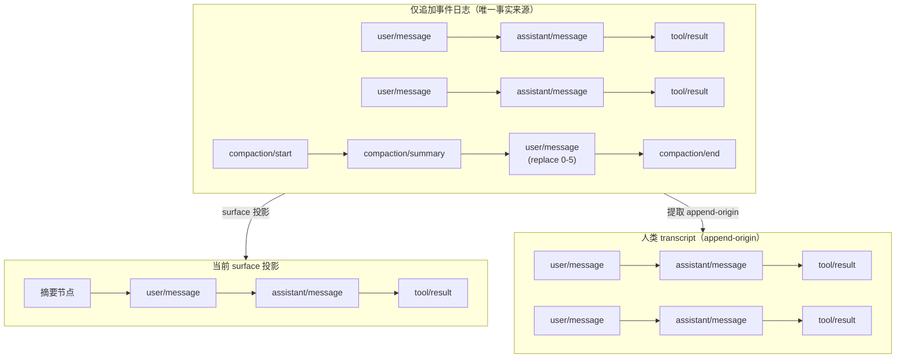
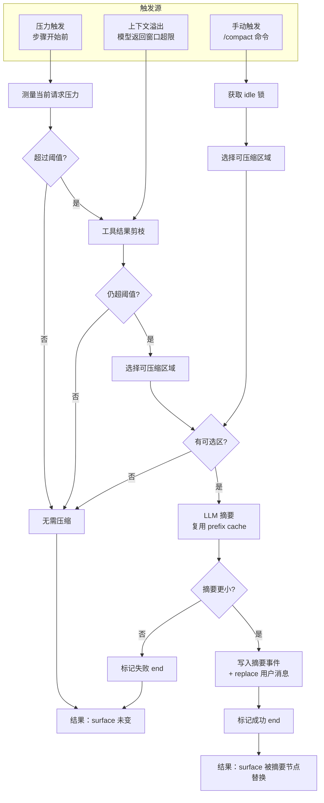
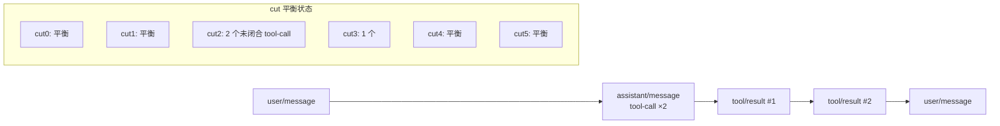

# 第 14 章：上下文压缩机制

> 本章导读：长会话必然撞上上下文窗口天花板。dsh 的约束是"模型可见 ⟺ 已记录"，因此压缩不能靠删日志或丢消息。本章从运行逻辑角度回答：dsh 如何在保留完整事件日志的前提下缩小模型可见历史、压缩在哪些时机被触发、如何选择被压缩的区域、一次压缩事务如何不留下半成品、失败如何恢复。建议先读[第 4 章](04-核心循环.md)的轮次/步骤语义和[第 5 章](05-会话日志与持久化.md)的 surface 投影机制。

## 14.1 为什么需要上下文压缩

任何持续运行的 agent 都会遇到同一个问题：模型上下文窗口有限，而会话会无限增长。朴素方案是截断——只保留最近 N 条消息，更早的直接丢弃。这在 dsh 里行不通，因为[第 4 章](04-核心循环.md)的运行时不变量要求"模型可见 ⟺ 已记录"：任何进入模型请求的内容，必须能从会话日志重建。

截断会破坏这个契约：

- 如果直接删掉旧事件，回放、fork、transcript 都会少一段历史；
- 如果把摘要偷偷塞进请求但不写日志，重放时无法复现同一条请求；
- 如果只在内存里维护一份"当前消息列表"，系统就出现两份事实来源。

dsh 的选择是：**不删除、不隐藏、不改写历史，而是追加新的 surface 节点，用 replace 操作遮蔽旧节点**。旧事件仍在日志里，只是不再进入模型派生历史。这样，模型看到更短的上下文，而日志、回放、transcript 仍然完整。

## 14.2 核心设计：不删日志，只改投影

dsh 的消息历史不是存储对象，而是从事件日志派生的投影。能够产生消息的事件只有三种 surface 类型：用户消息、助手消息、工具结果。每个这样的事件在追加时都要声明它是如何进入 surface 的：

- **append**：追加到当前 surface 尾部；
- **replace**：用本事件替换当前 surface 上某个区间内的已有节点。

压缩正是第二种操作的典型用途。一次成功压缩会向日志追加：

1. 一条 `compaction/start` 事件，标记事务开始（只进日志，不进入 surface）；
2. 一条 `compaction/summary` 事件，记录摘要内容、被遮蔽范围和模型调用事实（只进日志）；
3. 一条新的用户消息，其内容就是摘要，并声明它 replace 了某个旧区间；
4. 一条 `compaction/end` 事件，标记事务结束（只进日志）。

被遮蔽的节点仍在日志里，只是 surface 投影时把它们替换掉了。于是：

- **模型请求**只看到新的摘要节点和未被遮蔽的近期节点；
- **会话日志**保留全部原始事件；
- **transcript** 读的是 append-origin 事件，因此人类看到的对话记录不会丢；
- **回放**只要把同一个 surface 折叠规则跑一遍，就能复现任何请求当时的模型历史。

下图展示了同一份日志上三种视角的关系：

这种设计让压缩成为"纯投影层面的重写"，而不是存储层面的破坏。所有下游消费者——LLM 请求、UI、遥测、fork、持久化——都从同一份日志派生，各自选择自己需要的投影规则。

## 14.3 压缩策略全景

在深入三个触发源之前，先看整体决策流程。所有路径最终都落在同一个核心事务上：先无模型剪枝、再选区、再 LLM 摘要、最后以 replace 节点提交；区别在于触发条件和阈值。

## 14.4 三种触发条件

`dsh-compaction-basic` 是默认后端。它默认启用三组触发：

### 14.4.1 压力触发

在每次步骤开始前，系统会测量当前请求压力：最近一次路由的 provider/model 的上下文窗口，加上当前 surface 的 token 估算。如果总量超过窗口的一个比例阈值（默认 80%），就认为需要压缩。

配置可以按具体 provider/model 覆盖：比如给长窗口模型设更高阈值，给短窗口模型设更低阈值，或者为某个模型指定专门的摘要模型。

### 14.4.2 上下文溢出恢复

当模型明确返回"上下文窗口超限"时，系统进入恢复模式。与压力触发不同，溢出恢复：

- 不再检查阈值，强制尝试一次有用压缩；
- 先尝试无模型的工具结果剪枝；
- 如果 surface 确实前进了，就重试刚才失败的请求；
- 重试次数有上限，避免无限循环；
- 一次成功响应会重置重试计数。

### 14.4.3 手动触发

用户可以通过 `/compact` 命令主动要求压缩。手动触发要求 agent 处于 idle 状态：它会先获得一个维护锁，把后续输入排队，等压缩完成（并可选择 flush 到持久化后端）后再释放。

三种触发对比如下：

| 触发 | 时机 | 是否检查阈值 | 是否等待 flush | 典型用途 |
|---|---|---|---|---|
| 压力触发 | 每个步骤开始前 | 是 | 否 | 主动在窗口满前压缩 |
| 溢出恢复 | 模型返回窗口超限时 | 否 | 否 | 溢出后自救 |
| 手动触发 | 用户执行 `/compact` | 否 | 是 | 用户主动整理历史 |

## 14.5 选区：保留尾与工具配对边界

压缩不是把整个日志都摘要，而是保留一段最近的"尾"，只压缩头部历史。选区逻辑是：

1. 从 surface 尾部向前累加 token，直到满足保留预算；
2. 如果切割点落在未完成的工具调用/结果对中间，向头部回退，直到边界两侧工具配对平衡；
3. 若回退后没有可压缩头部，就不压缩。

工具配对平衡是关键约束。一个助手消息可能请求多个工具调用，只有等这些工具结果全部返回后，这个"步骤"才算闭合。压缩边界必须落在一个闭合点上，否则会留下未完成的工具调用进入模型历史，导致请求状态无效。

下图展示了一个带工具调用的 surface 如何被切割：

因此压缩边界可能位于一轮中间——只要该位置的工具调用已经配对即可。这比"必须保留整轮"更激进，也比"任意切分"更安全。

## 14.6 摘要与提交事务

压缩是一次事务，核心函数按严格顺序追加事件，并保证任何失败都能被检测到：

1. 校验选区存在且工具配对平衡；
2. 检查当前无活跃压缩锁；
3. 生成一个压缩事务 ID，写入 `compaction/start`；
4. 调用摘要器生成摘要（这一步可能耗时较长，会 yield）；
5. 校验 surface 在 yield 期间未变；
6. 写入 `compaction/summary`；
7. 写入 replace 用户消息；
8. 写入 `compaction/end`；
9. 手动路径可选地 flush 到持久化后端。

### 锁的语义

锁不是内存互斥量，而是日志里的 durable marker。判断是否有活跃压缩的方法是扫描日志：

- 找到最后一个 `compaction/start`；
- 如果它之后没有匹配的 `compaction/end`，则锁处于打开状态；
- 但如果中间出现过会话生命周期边界（`session/end-seed`），且该边界在 start 之后，则这个 start 属于上一个生命周期，视为陈旧孤儿，不影响当前进程。

这个设计让崩溃恢复变得简单：加载日志时看到一个未匹配的 `compaction/start`，可以明确识别为"上一个生命周期死锁"，而不会误以为是当前正在压缩。

### 失败处理

事务中的任何错误都会尝试追加一条带错误信息的 `compaction/end`。具体行为：

- 摘要器失败：surface 未变，追加失败 end；
- surface 在摘要期间变化：追加失败 end，手动路径报"历史已改变"；
- `compaction/end` 本身失败：留下一个孤儿 start，下次压缩报"busy"；
- 手动路径 flush 失败：事务已提交，但告诉用户"没存盘"。

失败尝试也会留在日志里，成为可审计的记录。

## 14.7 无模型预处理：工具结果剪枝

在长工具输出场景中，先调 LLM 做摘要可能是一种浪费。`dsh-compaction-tool-result-pruner` 提供了一种无模型的字符级截断。

配置默认：

- 阈值：8192 个字符；
- 保留头部：4096 个字符；
- 保留尾部：1024 个字符。

当某个工具结果的文本内容超过阈值时，只保留头部、尾部，中间用标记替换。截断按 Unicode code point 进行，避免拆散 surrogate pair；非文本块不参与字符计量但保留相对顺序。

每次替换遵循 shadow-price 协议：先写入一条 `compaction/prune` 事件记录被遮蔽范围和启发式 token 价格，再同步相邻地写入新的工具结果 replace 节点。这样，token 计量器等纯消费者不需要保留每个节点的历史价格，只需要看到 shadow-price 事件，就能从当前 surface 中扣除被遮蔽节点的价格。

压力触发时会先尝试工具结果剪枝，如果剪枝后总 token 已低于阈值，就跳过 LLM 摘要。

## 14.8 可重建性保证

压缩机制的可重建性由多层保证：

1. **surface 折叠规则唯一**：所有压缩替换节点和普通节点走同一条投影规则。

2. **source 引用校验**：每次 replace 必须声明被遮蔽的所有 surface 节点。这保证投影时能找到替换目标，也保证下游消费者能追溯摘要来源。

3. **checkpoint provenance**：压缩产生的摘要用户消息携带统一的来源标记（`kind: 'plugin', plugin: 'compact'`），并绑定压缩事务 ID。UI 和 transcript 可以据此识别并特殊渲染摘要节点。

4. **运行时不变量校验服务**：每次事件发布前校验：
   - `compaction/start` 不能与未关闭的压缩重叠；
   - 同一个事务的 start、summary、end 的 ID 必须一致；
   - 压缩 bracket 不能跨越 turn 边界；
   - 替换 checkpoint 必须落在对应的打开 bracket 内；
   - 生命周期边界正确清理继承的孤儿锁。

5. **可重放测试**：测试会构造事件日志，重建新 session，断言派生消息与原 session 相等。

## 14.9 设计取舍

**为什么不直接截断日志？**
截断会丢失 fork、回放、transcript、遥测所需的事实。replace 投影让"模型看到什么"和"系统记录什么"解耦，同一份日志服务多个消费者。

**为什么摘要复用当前请求的 system/tools/messages 作为前缀？**
摘要请求把被压缩区间的消息放在 compaction instruction 前面，且复用最近一次的 system prompt 和 tool 定义。这样辅助摘要请求与正常请求共享前缀，更可能命中 provider 的 KV/prefix cache。

**为什么区域边界保持工具配对而不是整轮？**
保持整轮会过度保守，导致很多场景无法压缩；任意切分又会留下未闭合的 tool-call。工具配对平衡是"能安全压缩的最大范围"。

**为什么压力触发不等待 flush，而手动触发等待？**
压力触发发生在步骤边界，下一步请求很快就会发出，由 checkpoint policy 保证请求前 flush；手动触发是人类显式命令，用户期望看到"已完成并保存"，因此显式等待 flush。

**为什么保留失败的 compression start/end？**
日志是审计线索。失败尝试本身不破坏 surface，但记录了"系统曾经尝试压缩并失败"，这对调试和不变量检查都有价值。

## 14.10 关键实现入口

| 文件 | 职责 |
|---|---|
| `packages/compaction/compaction/src/index.ts` | `CompactionEngine` SD；触发类型与手动错误分类 |
| `packages/compaction/compaction/src/types.ts` | `compaction/start`/`summary`/`end`/`prune` 事件；`CompactionResult` |
| `packages/compaction/compaction/src/tool-pairing.ts` | 工具调用/结果配对平衡；边界检查缓存 |
| `packages/compaction/compaction/src/checkpoint.ts` | 摘要 checkpoint 的 provenance 构造与识别 |
| `packages/compaction/compaction/src/invariant.ts` | 压缩 bracket、turn 边界、checkpoint provenance 校验 |
| `packages/compaction/compaction-basic/src/index.ts` | `BasicCompactionEngine`；三种触发监听；`compactIfNeeded` |
| `packages/compaction/compaction-basic/src/region.ts` | `selectCompactableRange`、`compactSurfaceRegion` 事务 |
| `packages/compaction/compaction-basic/src/summarizer.ts` | 默认 LLM 摘要；`SummarizationInput`；prefix-cache 复用 |
| `packages/compaction/compaction-basic/src/config.ts` | 配置解析、目标策略、容量缩放 |
| `packages/compaction/compaction-tool-result-pruner/src/index.ts` | `ToolResultPruner`；无模型字符截断与 shadow-price |
| `packages/compaction/command-compact/src/index.ts` | `/compact` 命令注册与失败分类 |
| `packages/core/session/src/surface.ts` | surface fold；replace 操作验证；`deriveEventMessage` |
| `packages/core/session/src/index.ts` | `Session.append`、`deriveMessages` 缓存 |
| `packages/llm/token-meter/src/index.ts` | `TokenMeter.measure`；日志回放式压力计量 |
| `packages/llm/token-meter/src/surface-fold.ts` | token-meter 的 priced surface fold；shadow-price 协议落地 |
| `packages/core/agent-loop/src/agent.ts` | agent-loop 调用 `agent/pre-step`、`agent/request-error` 挂点 |

## 14.11 小结

dsh 的上下文压缩不是"删历史"，而是**追加摘要节点并用 replace 投影遮蔽旧节点**。这个设计严守"模型可见 ⟺ 已记录"：模型请求从 surface 派生，surface 由日志折叠而来，日志本身只增不减。

掌握三个关键点即可理解整个机制：

1. **压缩是 surface 层面的 replace，不是日志删除**；
2. **每次压缩是一次带事务 ID 的 durable 事务**，`compaction/start`→`summary`→replace→`compaction/end`，失败也会留下可检测的 marker；
3. **选区受工具配对边界约束**，并优先使用无模型的工具结果剪枝，必要时才调 LLM 摘要。

下一章（如果继续）可以回到会话生命周期，看这些压缩事件如何与 fork、resume、telemetry 一起被持久化后端消费；或者转向具体能力 seam，看子 agent 如何利用父会话的压缩历史。
