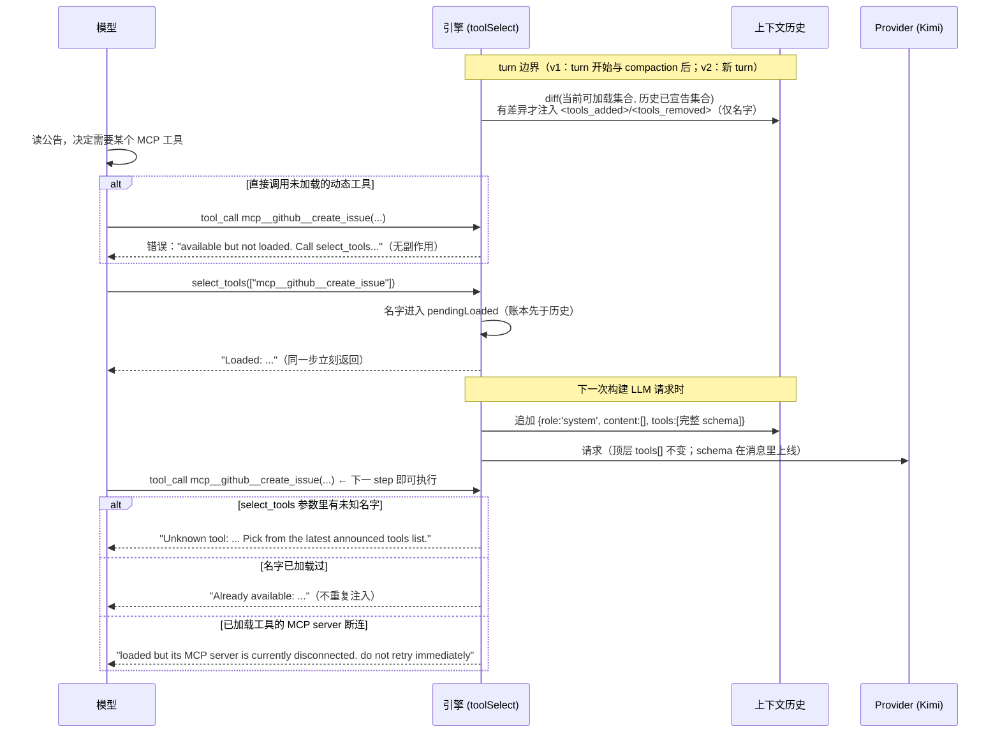

# 第 9 章：Tool Defer 机制与全量工具清单


> **文档同步跟踪**
> - 最后同步代码：`kimi-code` commit `c3a2ef0ce`（2026-08-27）
> - 同步方式：基于该文档撰写时的源码路径与提交记录梳理

> 本章导读：官方名称是 **progressive tool disclosure**（渐进式工具披露），代码里叫 `select_tools` / `tool-select`。"defer" 指的不是延迟执行，而是**延迟披露 schema**：工具对宿主始终可执行，但它的参数定义不进每次请求的顶层 `tools[]`，等模型主动索取时才以"消息级声明"进入上下文。读完本章应能回答：机制何时开启；一次按需加载的完整链路；undo / compaction / 断连后历史如何自愈；以及全部工具里**哪些是 deferred 的**（答案比直觉简单：内置工具一个都不是）。

本章按「目标 → 门控 → 运行链路 → 历史自愈 → wire 契约 → 工具清单 → 双引擎对照」推进：

```mermaid
flowchart LR
    A["9.1 解决什么问题"] --> B["9.2 三道门"]
    B --> C["9.3 一次按需加载"]
    C --> D["9.4 历史即账本"]
    D --> E["9.5 wire 契约"]
    E --> F["9.6 全量工具清单"]
    F --> G["9.7 v1/v2 对照"]
    A -.->|顶层 tools[] 必须字节稳定| C
    C -.->|加载状态存在哪| D
    D -.->|schema 走哪条路上线| E
    E -.->|到底谁被 defer| F
```

## 9.1 解决什么问题

MCP 生态里一个 server 挂几十个工具是常态，多个 server 叠加就是上百个 schema。朴素做法是把全部 schema 塞进每次请求的顶层 `tools[]`，代价有两个：每个请求都重复支付这笔 token；上百个工具描述还会稀释模型注意力。

Kimi Code 的约束更苛刻一层：**顶层 `tools[]` 必须在整个 session 内字节稳定**，这是 prompt cache 命中的前提。任何"根据当前需要动态增删顶层工具"的做法都会击穿缓存。

progressive disclosure 的解法是把工具拆成两种披露通道：

| 通道 | 内容 | 稳定性 |
|---|---|---|
| 顶层 `tools[]` | 内置工具 + 一个 `select_tools` | 整个 session 字节不变 |
| 消息级 `messages[].tools` | 动态工具的完整 schema，按需追加进历史 | 历史只增不减（ pruning 除外） |

模型看到的是一串**只有名字**的公告（`<tools_added>/<tools_removed>`），需要时调用 `select_tools` 按名字加载，加载后 schema 作为一条系统消息永久留在历史里，下一步即可调用。顶层的字节稳定性、token 成本、工具丰富度三者同时保住。

## 9.2 三道门：机制何时开启

门控是三重与，判定收敛在一个入口（v2 `AgentToolSelectService.enabled()`，v1 `Agent.toolSelectEnabled`），所有消费方读同一判定而不是各自推导：

1. **模型能力 `dynamically_loaded_tools`**：模型必须支持 `messages[].tools` 这条 wire 特性。能力来源两处——Kimi 模型目录（目录条目的 `dynamically_loaded_tools` 字段映射进能力表），或用户在模型配置的 `capabilities` 里显式声明。
2. **`tool_use` 能力**：不支持工具调用的模型谈动态加载是矛盾的。
3. **实验旗标 `tool-select`**：环境变量 `KIMI_CODE_EXPERIMENTAL_TOOL_SELECT` 开启，**默认 false**。截至所同步的 commit，这是一个实验特性。

关键性质是**无损降级**：任何一道门关上，行为逐字节回到全量 inline——动态工具直接进顶层 `tools[]`，历史里残留的公告和 schema 消息也会被剥掉（`stripDynamicToolContext`），保证 mid-session 换到不支持该能力的模型时不发出模型读不懂的协议消息。`select_tools` 工具本身也只在门全开时才出现在顶层工具表里。

## 9.3 一次按需加载的完整链路

主链路和三条失败分支都在这张时序图里：



几个值得注意的运行时语义：

- **公告是增量 diff，不是全量清单**。每个 turn 边界把"当前可加载集合"和"历史已宣告集合"折叠对比，多数 turn 什么都不注入，prompt cache 继续命中；session 开始后的第一次公告天然就是全量名单。
- **账本领先于历史**。`select_tools` 返回的那一刻名字就算"已加载"（pending 集合），schema 消息要等下一次请求构建才落历史——这个窗口内重复 select 是 no-op，不会双重注入。
- **执行表每 step 重建**。schema 消息落历史后，无需等下一个 turn，同一 turn 的下一个 step 就能分发到新工具。
- **混合输入逐名字结算**。一批名字里有认识的有不认识的，认识的加载、认识的报告、不认识的报错，不整批失败，模型不必为一个 typo 重发整批。
- **权限前置过滤**。被工具策略禁用的工具不进公告、也 load 不进来——披露层不越过权限层。

## 9.4 历史即账本

加载状态存在哪里？答案是：**没有独立的内存账本，历史本身就是账本**。要判断一个工具是否已加载，就扫历史里 schema 消息的 `tools` 字段。这个选择让三种扰动全部免费自愈：

| 扰动 | 公告消息的命运 | schema 消息的命运 | 后果 |
|---|---|---|---|
| undo 回退 | 随回退消失（`system_trigger` origin 不受保护） | 保留（`injection` origin，属协议上下文非对话） | 下一轮边界 diff 重新宣告，自动补齐 |
| compaction | 与历史一起折进摘要 | 与历史一起丢弃 | loaded 集合清空，模型按需重新 select |
| resume / crash | records 回放重建历史 | 同上重建 | 状态原样恢复 |
| `/clear` | 清空 | 清空 | pending 窗口被显式清掉，防"已加载"误报 |
| MCP 断连 / 权限禁用 | 下一边界从公告移除 | 从历史 schema 消息里剪掉该工具 | 模型再调用会得到明确的断连提示 |

两个配套细节：compaction 的**摘要输入**也会先剥掉协议消息（公告和 schema 不是对话内容，摘要它们既浪费 token 又可能把 schema 文本泄漏进摘要）；v2 侧 compaction 完成事件会同时清 pending 窗口，防止"历史已经没有 schema 了却报告 Already available"。

## 9.5 wire 契约：deferred 标记与唯一的裁剪点

机制的最底层是一个极小的客户端标记：kosong 的 `Tool.deferred`。语义是"此工具可执行，但其 schema 不得序列化进本次请求的顶层 `tools[]`"。`generate()` 是**全系统唯一的裁剪点**——所有 provider 的请求都从这里过，标记本身永不上线。

与直觉不同的一点：**已加载的动态工具也带 deferred 标记**。也就是说动态工具无论加载与否，永远不会出现在顶层 `tools[]` 里——已加载的靠历史里的 schema 消息生效，未加载的干脆不出现。顶层工具表因此从 session 第一字节起就冻结为"内置工具 + select_tools"。

这条契约推演出两个容易忽视的设计：

- **`select_tools` 的 description 刻意不含任何动态信息**（不列名字、不报数量）。它常驻顶层 `tools[]`，描述里任何随工具集变化的字眼都会破坏字节稳定；可变的部分全部外置到公告消息。
- **`messages[].tools` 只有 Kimi provider 序列化**（复用顶层工具的转换逻辑，含 `$` 前缀内置函数分支）。OpenAI / Anthropic / Google 的 provider 不认这条字段——所以能力门（9.2 的第一道门）必须存在：它保证携带 `tools` 的消息永远不会发给不支持该特性的模型。

裁剪的时机在每次 LLM 请求构建处：工具表先过 `shapeTools()`（打 deferred 标记），历史先过 `shapeHistory()`（补注入 + 剪失效 schema），然后才交给 `generate()`。

## 9.6 全量工具清单：谁是 inline，谁是 deferred

判定规则只有一行：**`source === 'mcp'`（全部 MCP 工具）或注册时显式声明 `disclosure: 'deferred'`（部分用户自定义工具）**。

结论先行：**所有内置工具都是 inline，没有任何一个是 deferred**。"哪些工具被 defer"的完整答案因此是：

| 集合 | 成员 | 披露方式 |
|---|---|---|
| 内置工具（v2 共 39 个 / v1 共 27 个） | 下表全部 | 常驻顶层 `tools[]` |
| `select_tools` | 特殊的加载原语 | 仅门开时常驻顶层，权限走独立判定 |
| **deferred** | 全部 MCP 工具（`mcp__<server>__<tool>`） | 公告名字 → select_tools 加载 |
| **deferred（可选）** | 宿主注册 user tool 时声明 `disclosure:'deferred'` 的那些 | 同上；不声明则 inline |

### v2 内置工具全景（默认引擎，39 个）

> 注：39 个是源码中注册的全部内置工具；实际暴露给模型按能力与服务条件装配（cron / skill / subagent / Tower 等服务不存在时对应工具不出现），见第 4 章的条件装配逻辑。

| 类别 | 工具 | 说明 |
|---|---|---|
| 文件 / OS | `Read` `Write` `Edit` `Glob` `Grep` `Bash` | 文件读写、检索、shell |
| Web | `FetchURL` `WebSearch` | 抓取与搜索 |
| 媒体 | `ReadMediaFile` | 图片/音视频读取 |
| 协作 | `Agent` `AgentSwarm` `AskUserQuestion` `Skill` | 子代理、批量代理、提问、技能 |
| 后台任务 | `TaskList` `TaskOutput` `TaskStop` `WaitFor` | 后台任务管理；WaitFor 为 v2 新增 |
| 规划 | `EnterPlanMode` `ExitPlanMode` | Plan Mode |
| 目标 | `CreateGoal` `GetGoal` `SetGoalBudget` `UpdateGoal` | Goal 系统 |
| 待办 | `TodoList` | 任务清单 |
| 定时 | `CronCreate` `CronDelete` `CronList` | 定时任务 |
| Tower | `TowerInit` `TowerSpawn` `TowerSend` `TowerInbox` `TowerStatus` `TowerPlan` `TowerMerge` `TowerReview` `TowerMission` `TowerFinding` `TowerTeardown` | 多 agent 编排（Tower，v2 独有，11 个） |
| 披露 | `select_tools` | deferred 工具的加载原语，本章主角 |

### v1 内置工具（legacy 引擎，27 个）

= 上表去掉 `WaitFor` 与全部 11 个 Tower 工具，其余一一对应（`Read/Write/Edit/Glob/Grep/Bash/FetchURL/WebSearch/ReadMediaFile/Agent/AgentSwarm/AskUserQuestion/Skill/TaskList/TaskOutput/TaskStop/CronCreate/CronDelete/CronList/CreateGoal/GetGoal/SetGoalBudget/UpdateGoal/EnterPlanMode/ExitPlanMode/TodoList/select_tools`）。

两个清单之外还有第三类存在：**user tools**。宿主通过公开 API（v2 的 userTool 服务 / v1 的 `registerUserTool`）注入自定义工具，注册时可选 `disclosure`——这是内置工具之外唯一能进 deferred 集合的入口。MCP 工具则无需声明，按来源自动全部 deferred。

## 9.7 v1 / v2 实现对照

同一协议在两套引擎各有一份实现，行为一致，机制组件不同：

| 维度 | v1（agent-core） | v2（agent-core-v2，默认引擎） |
|---|---|---|
| 门控判定 | `Agent.toolSelectEnabled` getter | `AgentToolSelectService.enabled()` |
| 可加载集合 | `ToolManager.loadableDynamicToolNames()`（MCP + deferredUserTools，按权限过滤、排序保稳定） | 同语义，收敛在 toolSelect 服务 |
| 公告注入 | `ToolsDiffInjector`，turn 开始 + compaction 后两个边界 | reminder 系统的 `loadable-tools` variant，仅新 turn 触发 |
| schema 注入 | select_tools 执行内直接 append schema 消息 | select_tools 只记 pending，请求构建时由 `dynamic_tool_schema` variant 统一 drain |
| 账本 | 历史 schema 消息 + pendingLoadedDynamicTools 窗口 | 同构（`toolSelect.pendingLoaded` 状态 + 历史扫描） |
| subagent | 公告与 select_tools 不设 main-only，subagent 有自己独立的披露循环 | 同左 |
| 未加载拦截 | loop 的 missing/unavailable 描述钩子 | toolExecutor 的 `registerUnavailableToolDescriber` / `registerMissingToolDescriber` |

一个 v1 注释里写明的并发约束值得一提：select_tools 不声明任何文件访问面，按默认规则与同批其他工具**串行**执行——这不是疏忽，两次 select_tools 并发落账可能向历史注入重复的 schema 消息。

## 9.8 关键实现入口

| 主题 | 位置 |
|---|---|
| v2 机制主体（门控 / shapeTools / shapeHistory / load） | `packages/agent-core-v2/src/agent/toolSelect/toolSelectService.ts` |
| v2 旗标定义（`KIMI_CODE_EXPERIMENTAL_TOOL_SELECT`，default false） | `packages/agent-core-v2/src/agent/toolSelect/flag.ts` |
| v2 公告 / schema 注入（reminder variant） | `packages/agent-core-v2/src/agent/toolSelect/toolSelectAnnouncementsService.ts`、`toolSelectSchemasService.ts` |
| v2 select_tools 工具 | `packages/agent-core-v2/src/agent/tools/select-tools/selectToolsTool.ts` |
| v2 user tool 的 disclosure 注册 | `packages/agent-core-v2/src/agent/userTool/userToolService.ts` |
| v2 请求装配（裁剪与注入的发生点） | `packages/agent-core-v2/src/agent/llmRequester/llmRequesterService.ts`（`defaultTools` / `runRequest`） |
| v2 select_tools 权限特判 | `packages/agent-core-v2/src/agent/toolPolicy/toolPolicyService.ts`（`isToolActiveForDisclosure`） |
| kosong `Tool.deferred` 标记 | `packages/kosong/src/tool.ts` |
| kosong 唯一裁剪点 | `packages/kosong/src/generate.ts`（`wireTools` 过滤） |
| `messages[].tools` 的唯一序列化方 | `packages/kosong/src/providers/kimi.ts`（`convertMessage`） |
| 模型能力定义与目录映射 | `packages/kosong/src/capability.ts`、`packages/kosong/src/catalog.ts` |
| v1 门控 | `packages/agent-core/src/agent/index.ts`（`toolSelectEnabled`） |
| v1 账本与可加载集合 | `packages/agent-core/src/agent/tool/index.ts` |
| v1 select_tools 工具（含并发约束注释） | `packages/agent-core/src/tools/builtin/select-tools.ts` |
| v1 公告注入器 | `packages/agent-core/src/agent/injection/tools-diff.ts` |
| v1 协议消息谓词与剥离 | `packages/agent-core/src/agent/context/dynamic-tools.ts` |

## 9.9 小结

- Tool defer 的准确含义是**延迟披露 schema**：工具对宿主始终可执行，参数定义按需经 `select_tools` 以消息级 `messages[].tools` 进入历史。
- 设计的不变量是**顶层 `tools[]` 字节稳定**——已加载的动态工具也不回顶层，动态工具的 schema 永远只走消息通道。
- 开启需三道门：模型声明 `dynamically_loaded_tools` + `tool_use` + 实验旗标（**默认关**）；任一门关即无损回退全量 inline。
- 加载账本就是历史本身：undo、compaction、resume、断连全部靠"扫描历史 + 边界 diff"自愈，无独立状态。
- **deferred 集合 = 全部 MCP 工具 + 显式声明 `disclosure:'deferred'` 的 user tools；39 个（v2）/ 27 个（v1）内置工具全部 inline，没有一个是 deferred。**

下一章回到横切面：第 5 章已拆过权限与审批，本章的披露层刻意叠在其下——公告过滤、加载拦截、select_tools 特判都在权限判定之后。若要继续沿 v2 深入，第 7 章的 DI × Scope 架构解释了本章所有服务（toolSelect / reminder / toolPolicy）为何都以 Agent scope 的 Feature 形式装配。
