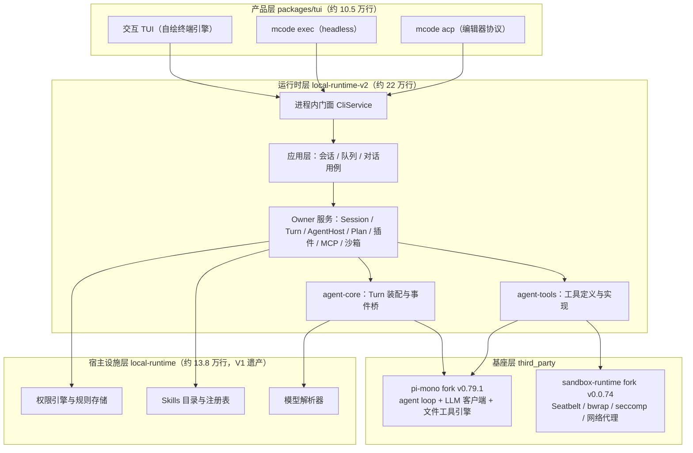

# How MiniMax Code Works

> **文档同步跟踪**
> - 最后同步代码：`minimax-code` commit `ff415b1`（2026-09-21 checkout）
> - 同步方式：基于包结构、关键源码路径与第三方 fork 台账（`third_party/pi-mono/MINIMAX_CHANGES.md`、`third_party/sandbox-runtime/upstream.json`）逐一梳理
> - 版本基线：仓库自述为 TUI 0.4.12 source preview，工作区版本号已推进到 0.5.0；首个公开快照 2026-09-18 导入（commit `c59cf537`）

这是一组面向源码阅读的 MiniMax Code（`mcode`）拆解笔记。

写法上刻意采用“先给心智模型，再沿真实代码路径下钻”的方式：不把仓库当成文件列表解释，而是把它当成一个正在运行的系统来拆。

## 阅读入口

- [01. 整体架构](docs/01-overview.md)
- [02. 启动与命令分发](docs/02-startup-and-dispatch.md)
- [03. 核心循环：一条消息的完整生命](docs/03-agent-loop.md)
- [04. Subagent 与委托任务](docs/04-subagents-and-delegation.md)
- [05. Plan Mode 的设计与运行](docs/05-plan-mode.md)
- [06. Tool 系统与执行 Harness](docs/06-tool-system.md)
- [07. 安全与权限机制](docs/07-security-and-permissions.md)
- [08. 执行环境与沙箱](docs/08-execution-and-sandbox.md)
- [09. Session 持久化与恢复](docs/09-session-persistence.md)
- [10. 上下文管理与压缩](docs/10-context-and-compaction.md)
- [11. 插件、技能与 MCP](docs/11-plugins-skills-mcp.md)
- [12. 配置、账号与模型提供者](docs/12-config-auth-providers.md)
- [13. TUI 内核与渲染](docs/13-tui-internals.md)
- [14. 最小复现指南](docs/14-minimal-rebuild.md)
- [源码索引](docs/source-map.md)

## 一句话总览

MiniMax Code 是一个「站在开源基座肩上」的终端编码 Agent：

- **agent 循环不自己写**：主循环（模型流式响应 → 工具调用 → 结果回填）整体来自 fork 的 [pi-mono](https://github.com/earendil-works/pi-mono) v0.79.1，模型接入层也用它（`@earendil-works/pi-ai` 支持约十家 provider）。
- **产品语义自己写**：Turn 生命期、权限、安全审查、上下文压缩、插件/技能/MCP、子 Agent、Plan 模式，全部在 `packages/local-runtime-v2`（约 22 万行）。
- **沙箱也是 fork**：命令级沙箱来自 Anthropic 实验项目 sandbox-runtime v0.0.74（macOS 走 Seatbelt），**默认关闭**。
- **三种表面共享一个进程内运行时**：TUI / `mcode exec` / `mcode acp` 最终都调到同一个进程内门面 `CliService`，无 HTTP、无 RPC envelope。
- **仓库本身是内部 monorepo 的公开投影**：每个发布文件登记在 `release/public-source.json`，上游变更走三方合并。

## 当前覆盖范围

这版覆盖十四个主题：

1. 三层架构、公开投影仓库性质、V1/V2 双运行时、基座 fork 策略。
2. 从 `mcode` 敲下到三表面就绪的启动生命期与运行时装配线。
3. Turn 事务：提交、准入、租约、装配、安全重生成、steering 与持久化队列。
4. `task` 工具的前台/后台委托、`task_*` 工具族、子会话模型与 Goal 校验层。
5. Plan Mode 的交互模式状态机、三重约束与审批闭环。
6. 工具四类来源、定义/实现分离、执行管线、并发规则、输出预算。
7. 六档权限模式、三级决策管线、规则存储、审批交互与密钥卫生。
8. sandbox-runtime fork 的架构、平台现实与 bash 执行环境。
9. SQLite + JSONL 双存储、会话/消息模型、续接/分叉/回退。
10. 系统提示五层拼装、AGENTS.md 32KB 预算、调用前压缩与工具结果外置。
11. 插件四种清单方言、技能多源、MCP 三源、钩子与快照温插拔。
12. 数据目录与 config.yaml、OAuth 设备流、BYOK、模型解析、令牌租约、遥测。
13. 非 React/Ink 的自绘终端引擎、状态投影、面板与键位。
14. 复刻一个最小 mcode 需要哪些组件、按什么顺序。

后续可以继续按同样风格补：

- cron 定时任务与通道（Telegram/飞书/微信）接入的完整链路
- 内容安全审查（输入审查 + 输出重生成）的实现细节
- MiniApps / 托管连接器（connectors）的宿主绑定协议
- Desktop 产品通过 HTTP 前门复用同一套 Application 的路径
