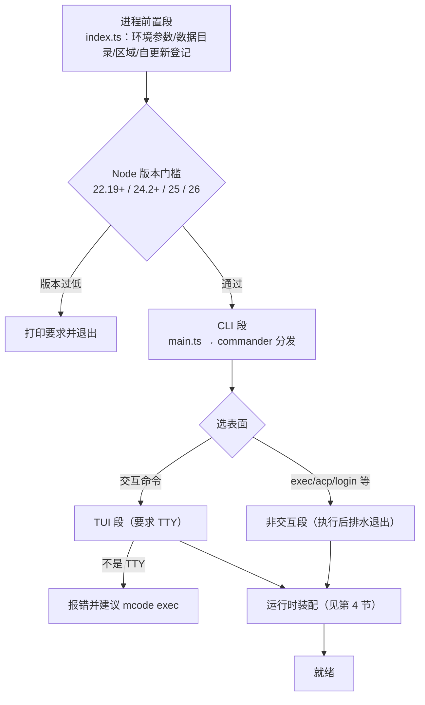
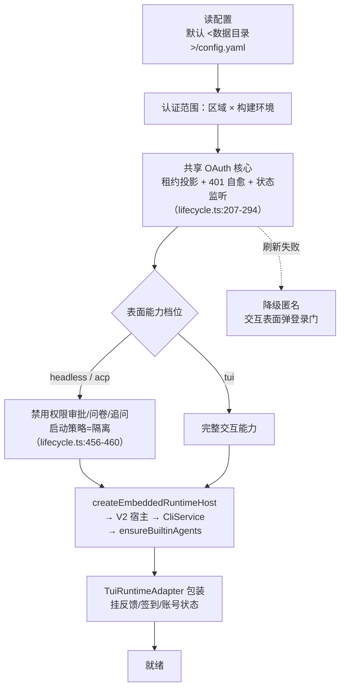

# 02. 启动与命令分发

> **文档同步跟踪**
> - 最后同步代码：`minimax-code` commit `ff415b1`（2026-09-21）
> - 同步方式：基于该文档撰写时的源码路径与提交记录梳理

`mcode` 敲下之后并不是「直接进对话界面」。它是一个严格的四段式启动：进程前置 → CLI 解析 → 表面分发 → 运行时装配。本章拆这条链路，以及一个关键设计：**运行时与 UI 并行启动，UI 先渲染、运行时后接入**。

三种表面（TUI / exec / ACP）不是三套功能，而是同一个运行时的三档能力位——发消息、续接会话、取消运行，最终都调到 `CliService` 的同一批方法。

## 1. 四段式启动生命期

构建入口在 `scripts/build.mjs:80-85`：`packages/tui/src/index.ts` 打包成 `dist/cli.js`（`mcode` 命令），`packages/tui/src/cli/mcode-tools-entry.ts` 打包成第二个二进制 `mcode-tools`。

各段在做什么：

1. **进程前置段**（`packages/tui/src/index.ts`）：在任何框架代码运行前，先从 argv 摘掉内部环境参数（`src/cli/environment.ts:82-118`，仅内部构建）、确定数据目录（默认 `~/.minimax`，`MINIMAX_DATA_DIR`/`MAVIS_DATA_DIR` 或 profile 覆盖）、确定区域（默认 `cn`，环境变量 `MAVIS_REGION` 或上次登录偏好覆盖）、登记自更新协调（`MCODE_UPDATE_PARENT_PID`，让父进程原位换版本不弄坏运行中的会话）。然后**动态 import** `src/cli/main.ts` 并调 `runTuiCli`——保证轻命令不加载重模块。
2. **CLI 段**（`src/cli/main.ts:83` 起）：进程标题设为 `minimax-code`，Node 版本门（main.ts:87-93），commander 解析。分发表在 `src/cli/program.ts:52`（`createTuiProgram`），每个子命令懒加载自己的实现（main.ts:249-312）。
3. **表面段**：交互命令进 `src/tui/launcher.ts` 的 `launchTui`（:152），要求 TTY（:162-164）；非交互命令执行完把 stdout/stderr 排干 250ms 再退出（main.ts:127）。
4. **装配段**：见第 4 节。

## 2. 子命令地图

分发表一览（`src/cli/program.ts`，参数契约在 `src/cli/contract.ts`）：

| 命令 | 用途 | 备注 |
|---|---|---|
| `mcode [prompt]` | 交互 TUI | `-m` 选模型；`--session [id]` 打开/选择会话；`-c` 续接最近会话；三者互斥（contract.ts:73-80） |
| `mcode init [dir]` | 生成项目指引 | 等价于在目标目录以 `/init` 首条指令启动 TUI（program.ts:83-89） |
| `mcode exec [prompt]` | 无头一次性运行 | stdin 输入、`--output-format text\|json\|stream-json`、`--permission smart\|full\|off`、`--output-schema`、`--max-steps`（contract.ts:102-149） |
| `mcode exec review` | 审查本地 git 改动 | 同一引擎的 `review: true` 变体 |
| `mcode acp` | ACP 服务 | stdio 上的 JSON-RPC；`acp login` 独立登录通道 |
| `mcode login` / `logout` | OAuth 设备流 | `--region cn\|global`；详见第 12 章 |
| `mcode provider …` | 管理模型端点 | `add/list/remove/test/use/set-minimax-key`；密钥只从环境变量读（program.ts:169-247） |
| `mcode plugin …` | 管理插件 | `list/add/remove/enable/disable/marketplace`（program.ts:274-342） |
| `mcode update` / `telemetry` | 自更新 / 遥测检查 | 遥测默认关闭 |

第二个二进制 `mcode-tools`：独立启动嵌入式工具 CLI，通过本地租约 broker 复用主程序登录态（第 12 章），暴露搜索、媒体等托管能力。宿主在 `beta.mcodeTools` 开启时准备它（`src/runtime/lifecycle.ts:323-339` → `src/runtime/mcode-tools-integration.ts:80-140`）。

## 3. 三种表面：共享一个 Turn 引擎

三种表面共享同一个「运行协调器」（`src/application/run-coordinator.ts` 的 `TuiRunCoordinator`）——发消息、收流式事件的编排逻辑只有一份。

| | TUI | `exec` | ACP |
|---|---|---|---|
| 入口链 | `launcher.ts` → `createTuiApp` | `run-exec-command.ts` → `headless/runner.ts` | `run-acp-command.ts` → `acp/stdio.ts` + `acp/agent.ts` |
| 表面标识 | `surface:'tui'` | `surface:'headless'` | `surface:'acp'` |
| 交互能力 | 完整：权限审批、问卷、追问 | 宿主层禁用（lifecycle.ts:451-455）；`--permission` 映射 `smart→auto`、`full→bypassPermissions`、`off→off`（run-exec-command.ts:129-140） | 交互委托给 ACP 客户端（`acp/interactions.ts`） |
| 传输 | 终端渲染器 | stdout 文本/JSON/流式 JSON | 换行分隔 JSON-RPC（`@agentclientprotocol/sdk` ndJsonStream） |
| 会话操作 | `/sessions`、`--continue` | `--session`、`--continue`（工作区必须匹配，runner.ts:872-896） | `session/new`、`load`、`resume`、`fork`、`close`（agent.ts:494-900） |
| 退出语义 | 打印续接提示 | 结构化退出码：0 成功 / 2 用法 / 3 权限拒绝 / 4 未登录 / 6 超时 / 7 步数上限 / 70 内部错误 / 130·141 信号（`headless/exit-policy.ts:4-15`） | 随客户端连接生命周期 |

两个表面各自的独有机制：

**TUI 的并行启动。** `launchTui` 同时做两件事：一边构造 UI 应用，一边异步创建运行时（launcher.ts:335-345）。UI 拿到的是延迟代理（`src/runtime/deferred.ts`）——运行时没就绪时调用被暂存，就绪后转发。效果是首帧渲染不等数据库迁移、不等插件同步。启动器在三件事之间赛跑：运行时就绪、用户先退出、进程停止信号（launcher.ts:498-505），无论谁先发生都有干净收尾。就绪后 `prepareInitialTuiState`（launcher.ts:892-941）应用启动参数：`--session <id>` 打开、`--continue` 续接、`--model` 切模型、裸 `--session` 提交 `/sessions`。

**exec 的监督器。** 无头模式在共享协调器外面套一层 `ExecRunSupervisor`（`headless/supervisor.ts:55`）：流事件对账与恢复、诊断目录落盘、结果按请求格式编码。退出码是一份契约，脚本能区分「任务失败」和「权限被拒」。

## 4. 运行时装配线

三种表面最终走到同一条装配线（`src/runtime/lifecycle.ts:137` 的 `createTuiRuntime`）：

两个细节：

- **隔离启动策略**：无头与 ACP 在数据环境可疑时以 quarantined 档启动——配置被污染也不会一上来就带高权限跑东西。
- **关停有秩序**：`shutdownTuiRuntime`（lifecycle.ts:839-909）按固定顺序排水（关宿主 → 停 OAuth 监听 → 关浏览器会话 → 刷日志与观测），60 秒硬上限。

## 5. 设计取舍

**进程内门面 vs HTTP 服务。** CLI 三表面与运行时同进程，调用就是方法调用——`cli-service.ts:107` 的注释原话是「不经过 HTTP 或 RPC envelope，直接调用本地 Application」。同一套应用层服务，Desktop 产品通过 HTTP 控制器暴露。代价是 TUI 崩溃即运行时崩溃；收益是去掉一整层序列化、鉴权和进程管理。

**延迟代理 vs 串行启动。** 另一种做法是「先启动运行时再画 UI」——简单，但用户盯着黑屏等数据库迁移。延迟代理把等待摊进首帧之后的自然时序，代价是每个运行时调用过一层代理。

**共享协调器 vs 每表面一套。** 无头与 ACP 没有另写执行逻辑，而是复用 TUI 的运行协调器再包监督器。收益是行为一致（同一份流式与取消语义）；代价是协调器必须把「交互」抽象成可插拔的能力档位。

## 6. 读启动代码的入口

| 主题 | 入口 |
|---|---|
| 进程入口与环境前置 | `packages/tui/src/index.ts`、`src/cli/environment.ts` |
| CLI 分发表 | `packages/tui/src/cli/program.ts`、`main.ts`、`contract.ts` |
| TUI 启动器（并行启动/延迟代理） | `packages/tui/src/tui/launcher.ts`、`src/runtime/deferred.ts` |
| 运行时装配与关停 | `packages/tui/src/runtime/lifecycle.ts`、`embedded-host.ts` |
| 表面适配器 | `packages/tui/src/runtime/adapter.ts`、`port.ts` |
| 无头管线 | `packages/tui/src/headless/runner.ts`、`supervisor.ts`、`exit-policy.ts` |
| ACP 适配 | `packages/tui/src/acp/agent.ts`、`stdio.ts`、`interactions.ts` |
| 共享运行协调器 | `packages/tui/src/application/run-coordinator.ts` |

## 7. 小结

mcode 的启动是四段式：**前置（环境/数据目录/区域）→ CLI（懒加载分发）→ 表面（TTY 门与排水退出）→ 装配（配置→认证→能力档位→嵌入宿主→适配器）**。三种表面共享同一个 `CliService` 和同一个运行协调器，差异只在能力档位、传输和退出语义。UI 与运行时以延迟代理衔接并行启动，是感知性能的关键手法。

入口就绪，下一章进入心脏：一条用户消息如何变成 Turn、进入 agent 循环、执行工具、流式回到屏幕——见 [03. 核心循环](03-agent-loop.md)。
