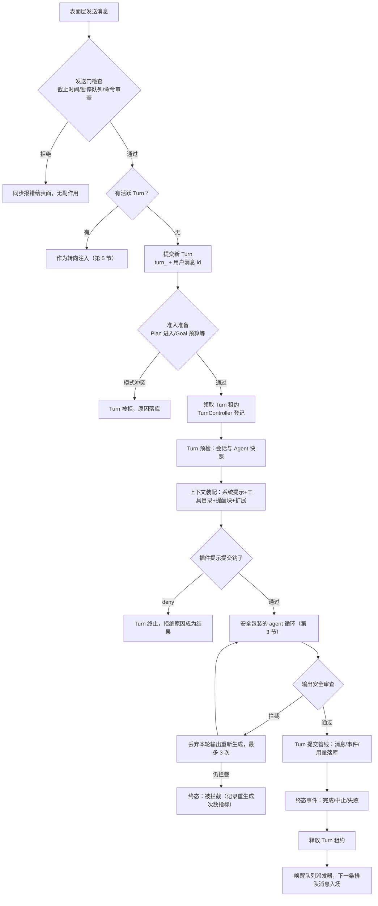
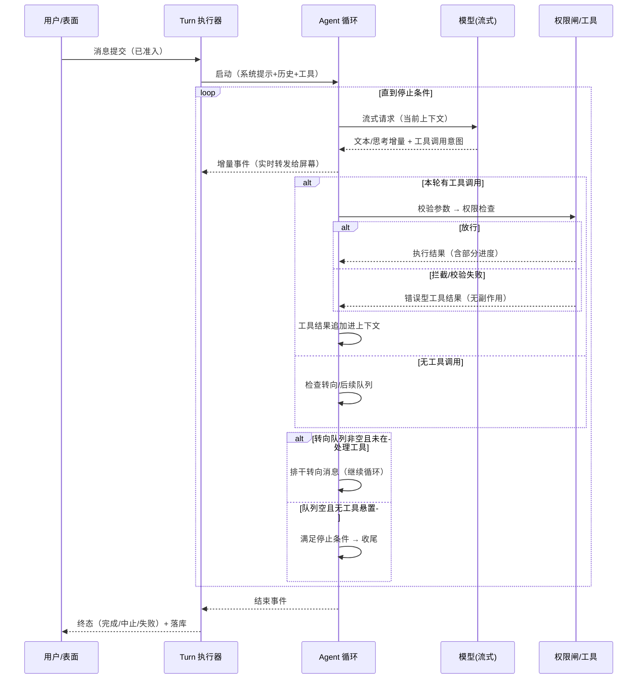

# 03. 核心循环：一条消息的完整生命


> **文档同步跟踪**
> - 最后同步代码：`minimax-code` commit `ff415b1`（2026-09-21）
> - 同步方式：基于该文档撰写时的源码路径与提交记录梳理

你发一条消息，系统并不会「调一次模型」——它开启一个 **Turn**：一个有编号、有租约、有收据、崩溃后可恢复的执行单元。本章沿一条真实消息走完全程：提交 → 准入 → 上下文装配 → agent 循环（模型流式响应、工具执行、转向注入）→ 事件流回屏幕 → 终态落库 → 队列唤醒。

先立本章最重要的分界线：**while 循环在 third_party，Turn 生命期在第一方**。pi-mono 的 `agent-loop.ts` 拥有「流式请求 → 工具调用 → 结果回填」的通用机械；`local-runtime-v2` 的 turn-system 拥有租约、准入、持久化、安全审查、权限闸这些产品语义。第一方不改循环本身，只在它暴露的接缝位挂逻辑。

## 1. Turn：把一轮对话做成事务

一个 Turn 从出生到死亡都被持久化记录：谁提交的、何时准入、领了哪把租约、产生了哪些消息和事件、以什么状态收尾（完成/中止/失败）。

为什么把一轮对话做这么重？因为长任务的中断是常态：用户随时按 Esc、进程可能被杀、上下文可能中途超限。没有租约和收据，就会出现「两条消息抢一个会话」「中止后队列丢消息」这类难查的并发 bug。Turn 是这个系统里最稳定的契约——三种表面和持久化、事件流都只依赖它。

## 2. 主路径全景：从发送到终态



发送到执行的调用链（文件级）：

```text
packages/tui/src/runtime/adapters/conversation-access.ts:19   TuiConversationAccess.sendMessage
  → packages/local-runtime-v2/src/local/cli-service.ts        CliService.sendMessage
  → …/application/conversation/conversation-application.ts:154 ConversationApplication.sendMessage
  → …/application/conversation/direct-send-delivery.ts:69    DirectSendDeliveryService.open
      预留流槽位 → 有活跃 Turn 则 turns.steer，否则 turns.submit（composer 直发 allowQueue:false）
  → …/service/turn-system/turn-submission.service.ts:50      TurnSubmissionService（立即 or 入队）
  → …/service/turn-system/execution/turn-execution.service.ts TurnExecutionService
      admitTurnWithSubmissionPreparation(:329) → startAcceptedTurn(:497) → TurnController(:522)
  → …/service/turn-system/agent-host/local-agent-host.ts:156 LocalAgentHost.run
      能力租约(:180) → TurnPreflight → assembleTurn(:194-204) → executor
  → …/agent-host/execution/executor.ts:130                   LocalRuntimeTurnExecutor
      插件 USER_PROMPT_SUBMIT 准入(:168) → runPreparedTurn(:319)
  → …/agent-host/runner/local-agent-turn-runner.ts            LocalAgentTurnRunner（安全包装）
  → packages/agent-core/src/pi-turn-runner/pi-turn-runner.ts:114 PiTurnRunner
  → third_party/pi-mono/packages/agent/src/agent.ts:93        runAgent → agent-loop.ts runLoop(:155)
```

三个失败分支的归宿各不相同：**发送门拒绝**是同步报错、零副作用；**准入拒绝**产生一个被记录的 Turn（审计可见）；**安全拦截**不杀 Turn，而是触发受控重生成——输入侧还有一道前置审查，被拦的输入在进循环前就被处理。`local-agent-turn-runner.ts` 里能看到重生成计数的实现（`runAttempts`，`:170` 起；指标 `output_safety_regenerations_per_user_turn`，`:138`）。

## 3. 循环内部：pi-mono 的 while 世界

循环本体在 `third_party/pi-mono/packages/agent/src/agent-loop.ts` 的 `runLoop`（:155）。运行时语义：

- **它等待模型**：带着系统提示、历史、工具目录发起流式请求（pi-ai 的 `streamSimple`），逐段收到文本、思考过程和工具调用意图（`streamAssistantResponse`，:279）；
- **它等待工具**：每个工具调用先过校验和权限闸（`prepareToolCall`，:684；beforeToolCall 钩子 :703），放行的并行执行（`executeToolCalls`，:377），结果追加回上下文；
- **它听两路新输入**：转向与后续任务，每轮迭代开始前排干（`getSteeringMessages`，:167 / `getFollowUpMessages`，:261）；
- **它自己决定何时停**：无工具悬置、无待排干输入、停止条件允许时收尾（`shouldStopAfterTurn`/`shouldStopAfterSteering`，:241-257）。

一轮典型迭代（`alt` 分支是关键——权限拦截**不打断循环**，拦截原因作为工具结果回给模型自行调整）：



第一方的包装层有两处：

- **PiTurnRunner**（`packages/agent-core/src/pi-turn-runner/pi-turn-runner.ts:114`，8 个文档化步骤）：newTurn（工具、streamFn、事件桥、id 计数器）→ emitRunning → newAgent（构造 pi `Agent`，`toolExecution:'parallel'`，出站消息规范化 `convertToLlm = projectAgentMessagesForModel`）→ setToolHooks/setLLMHook（**压缩就挂在 LLM 钩子位**，第 10 章）→ subscribeEvents（单一串行队列）→ runAgent（`agent.prompt([...])` 或 `agent.continue()` + waitForIdle）。
- **LocalAgentTurnRunner**（`local-agent-turn-runner.ts`）：在 PiTurnRunner 外包输入安全审查、输出安全门控、最多 3 次重生成、被拦时的撤回逻辑。

一个容易误解的点：**中止不是终态的死角**。用户按 Esc 中止运行中的 Turn 时，已在途的转向消息不会丢——`createSteeringRequeue`（turn-system/`initialize.ts:275`）把它们重新排队，成为下一个 Turn 的输入。

## 4. 事件回传：一条流，两种消费者

循环内部的原始事件（pi `AgentEvent`）经 `EventBridge`（`packages/agent-core/src/event-bridge/bridge.ts`）翻译成产品事件协议（`RuntimeEvent`），再经 `LocalTurnEventWriter` → 提交管线，进入**按会话维护的流服务**（`session-system/stream/session-stream-service.ts`）：每个会话一个有界环形缓冲 + 订阅者注册表，表面层以异步迭代器消费（TUI 的 `watchSessionTurn`，`packages/tui/src/runtime/adapter.ts:672`），断线后凭消息位点续传；Desktop 通过 SSE 端点吃同一份流。

事件标识是确定性的：`evt_<turnId>_<kind>_<n>`（`local-agent-turn-runner.ts:482`），重放历史与恢复中断渲染可以精确对齐。另外还有一个全局事件总线（`infra/event-bus`，services.ts:620-636 接线）承载产品级事件（用量提交、会话生命周期），与 turn 流分开。

## 5. 转向与队列：插话的两种命运

用户在 Turn 运行时再发消息，`DirectSendDeliveryService.open` 做一次分流（`direct-send-delivery.ts:114-134`）：

| 输入形态 | 命运 |
|---|---|
| 常规输入（Enter） | **转向**：注入运行中 Turn 的待处理队列，下一轮迭代开头被模型看见 |
| 排队输入（Alt+Enter） | **入队**：持久化到会话队列，当前 Turn 释放后由派发器按序入场 |
| 特殊意图 | `plan-entry`/`plan-exit`/`paused-queue-*` 转为控制意图，走专门准入准备 |

队列不是内存态：持久化在 SQLite（`session-system/queue/`），进程重启后派发器（`queue.dispatcher.ts:69`）按每会话唤醒计数恢复排水。`TurnReleasedSignal` 触发下一次派发（initialize.ts:111）。设计上有一个 FIFO 让位例外——Goal 场景允许特定输入插队（第 4 章）。

## 6. 谁拥有循环：分界线速查

| 机制 | 归属 | 为什么 |
|---|---|---|
| while 循环、流式解析、工具编排、转向排空时机 | 基座（pi-mono） | 通用 agent 机械，与产品无关 |
| Turn 生命期（租约/收据/准入/提交）、持久化、事件协议、安全审查、权限闸、压缩钩子 | 运行时层（V2 + agent-core） | 全是产品语义 |
| 发送编排、流式渲染、审批交互 | 产品层（tui） | 纯表面翻译 |

分界线的实现手法是接缝：第一方在基座暴露的钩子位（模型调用前 `setLLMHook`、工具调用前 `beforeToolCall`、事件流）挂逻辑，不改循环本身。fork + 台账（第 1 章）保证接缝受控。

## 7. 设计取舍

**为什么循环外包、生命期自建？** agent 循环是成熟、难差异化的机械，社区已有高质量实现；Turn 事务、安全、权限、插件才是产品护城河。工程预算押在后者，同时用 fork 台账保住对前者的控制权。

**安全重生成 vs 硬失败。** 输出被内容安全拦截时选择「换一次」而不是报错结束——最多 3 次，仍被拦才以拦截终态收尾并记指标。代价是最坏情况 3 倍推理费；收益是误杀对体验的侵蚀被兜底。

**有界环形缓冲 vs 无界队列。** 落后太多的消费者触发重同步而不是无限吃内存——长会话流式渲染的必要自保。

## 8. 读核心循环代码的入口

| 主题 | 入口 |
|---|---|
| 发送用例与发送门 | `packages/local-runtime-v2/src/application/conversation/conversation-application.ts`、`direct-send-delivery.ts` |
| Turn 提交/准入/执行 | `…/service/turn-system/turn-submission.service.ts`、`execution/turn-execution.service.ts`、`execution.coordinator.ts` |
| Turn 租约控制器 | `…/service/turn-system/turn-controller/turn.controller.ts` |
| AgentHost 编排 | `…/turn-system/agent-host/local-agent-host.ts`、`execution/executor.ts` |
| 安全包装与重生成 | `…/turn-system/agent-host/runner/local-agent-turn-runner.ts` |
| Turn 装配器与事件桥 | `packages/agent-core/src/pi-turn-runner/pi-turn-runner.ts`、`agent.ts`、`packages/agent-core/src/event-bridge/bridge.ts` |
| **循环本体** | `third_party/pi-mono/packages/agent/src/agent-loop.ts`（runLoop :155）、`agent.ts`（:174） |
| 会话流服务 | `…/service/session-system/stream/session-stream-service.ts` |
| 转向与重排队 | `…/turn-system/execution/steering/steer-session.service.ts`、`steering-requeue.ts` |
| 队列派发器 | `…/turn-system/queue.dispatcher.ts` |

## 9. 小结

MiniMax Code 的核心循环可以概括为一句话：**一条消息 = 一个 Turn 事务；主路径是「发送门 → 准入 → 租约 → 预检 → 装配 → 钩子 → 安全包装的 pi 循环 → 提交 → 终态 → 释放 → 队列唤醒」；循环本体在 third_party 的 fork 里，第一方通过接缝挂上产品逻辑。**

失败分三级（同步拒绝 / 准入拒绝 / 安全重生成），各有归宿；运行中插话走转向、排队走持久化队列，中止时转向消息重新排队不丢。执行可以并行，但事件以确定性 id 落库、按位点续传。

Turn 的骨架立住了，但它委派出去的子任务如何运转——见 [04. Subagent 与委托任务](04-subagents-and-delegation.md)。
