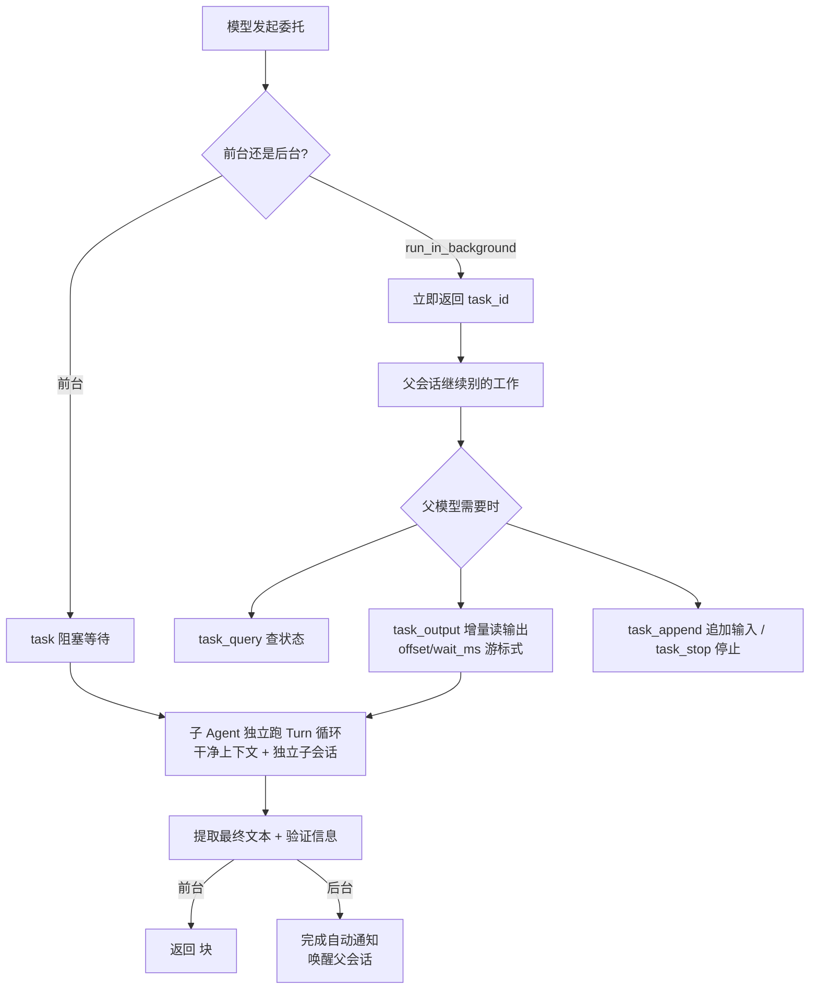

# 04. Subagent 与委托任务

> **文档同步跟踪**
> - 最后同步代码：`minimax-code` commit `ff415b1`（2026-09-21）
> - 同步方式：基于该文档撰写时的源码路径与提交记录梳理

本章解释 MiniMax Code 如何把独立工作封装成可调度、可恢复、可审计的子 Agent 生命周期。读完你会理解：`task` 工具的前台/后台两种形态分别走什么路径、`task_*` 工具族为什么被设计成「防轮询」的、子任务在数据上长什么样（答案是：**一个子会话**）、以及 Goal 场景之上的验收看门人怎么工作。

## 1. 设计目标

委派体系围绕四个目标设计。

**第一，主上下文保持干净。** 子 Agent 可以大量读文件、搜索、跑命令，中间过程不回灌主 Agent。前台委托返回的是压缩后的 `<task_result>`（最终文本 + 验证信息），不是完整探索日志。

**第二，前台后台共享一套生命周期。** 一个子任务可以前台等待，也可以后台跑。没有两套实现，只有同一生命周期的两种等待方式。

**第三，委派复用会话机制。** 子任务是数据库里挂着父会话 id 的子会话（`sub_session_id`），跑的是与主会话完全相同的 Turn 生命期（第 3 章）。持久化、崩溃恢复、事件流、用量统计全部免费。

**第四，防轮询是一等设计。** 后台任务的伴随工具族在工具描述层面就写明「完成会自动通知，不要频繁轮询」，读输出用游标式增量而非全量拉取。

## 2. task 工具：两种委派形态

定义在 `packages/agent-core/src/tools/builtin-defs.ts:230`，实现是 `packages/agent-tools/src/desktop/local-task.ts:14` 的 `LocalTaskTool`（经 `LocalTaskAdapter` 由宿主提供真正执行）。协议层把子 Agent 建模为 `IAgentConfig.subagent_types`（`packages/protocol/src/runtime.ts:321`）。

| 形态 | 模型看到什么 | 生命周期 |
|---|---|---|
| 前台（默认） | 调用阻塞至完成，返回 `<task_result>`：最终文本 + 验证信息 | 同步：父 Turn 等待 |
| 后台（`run_in_background`） | 立即拿到 `task_id`，配四个伴随工具继续干别的 | 异步：完成时自动通知并恢复父会话 |

两个实现细节值得点名：

- `task` 声明串行执行（`executionMode`），配合第 6 章的「一票串行制」，父 Turn 不会同时铺开多个前台子任务；
- 参数预处理会剥掉空的可选字段（`prepareTaskArguments`，builtin-defs.ts:592-603）——模型留空的 `model`/`effort` 不进执行层。

## 3. task_* 工具族：被刻意设计成防轮询

后台伴随工具族的语义（定义同样在 `builtin-defs.ts:641-713`）：

| 工具 | 语义 |
|---|---|
| `task_output` | 游标式增量读：`offset` 指定上次的 `next_offset`，`wait_ms` 最多等 30 秒（更大的值封顶 30000ms，不报错）；已到终态立即返回 |
| `task_query` | 查任务状态 |
| `task_stop` | 停止任务 |
| `task_append` | 给运行中的任务追加输入 |

`task_output` 的工具描述里有两句精心写的话（builtin-defs.ts:692-709 的原意）：「完成会自动通知并恢复所属会话，等待时不要频繁轮询」「显式 offset 读取不推进自动游标，offset=0 会重放已有输出」。也就是说系统给模型提供了两个顺手默认：**一直省略 offset 就有自动游标**（接着上次读），**wait_ms 让单次调用可以合法地等一小会儿**——这两者合起来把「轮询刷输出」变成最不划算的策略。

## 4. 子会话模型：委派在数据上的形状

子任务是 `SessionRecord` 的一个子行：挂父会话 id、种类标记为 task、跑标准 Turn 循环。收益：

1. **持久化免费**：消息、事件、用量走第 9 章的双存储，崩溃恢复语义一致；
2. **权限约束可叠加**：第 7 章的「旁路会话审批检查」正作用在这里——子会话即使命中全局 allow 规则，也被降级为强制一次用户确认（`local-turn-permission-gate.ts:184-207`），防止「委派 + 自动放行规则」组合出失控自动化；
3. **模型解析有默认链**：`resolveChildModelSelection`（`packages/local-runtime/src/api/child-model-config.ts:13-24`）——task 显式指定 > 团队默认 > 继承父会话当前模型。

会话种类受数据库检查约束钉死五种：conversation / task / peek（只读旁观）/ channel（IM 接入）/ cron（定时任务）。子 Agent、定时任务、通道都是这条父子会话轴上的变体。

## 5. Goal 校验层：有验收的委派

在裸 `task` 之上还有一个面向 Goal 场景的校验层：协调器把「验证子任务是否真正达成目标」也交给一个独立的验证子 Agent，验证者有权打回。入口在 `packages/local-runtime-v2/src/application/agent/goal-subagent-coordinator.ts` 和 `goal-subagent-verifier.ts`（services.ts:717-781 接线）。

第 3 章队列的「FIFO 让位」例外也来自这里——Goal 场景允许特定输入插队，让主目标相关的工作优先于普通排队消息。这套层是产品后期叠加的（在服务组装根里独立成段接线），可以视为「委派原语 → 有验收的委派」的演进层。

## 6. 设计取舍

**委派复用会话 vs 独立任务对象。** 另一种设计是造一个轻量 Task 实体（不背会话的持久化与事件设施）。这里选择复用：代价是子任务「重」（完整会话开销），收益是恢复、权限、事件、模型解析全部免费且语义一致——当整套基础设施本来为会话而建时，复用比再造便宜。

**防轮询靠协议设计 vs 靠限流。** 可以在执行层限制 `task_output` 调用频率，但那会产生难解释的失败。这里的做法是把「自动通知 + 自动游标 + 合法短等待」写进工具契约，让轮询在模型自己的成本计算里就输掉。

**验收看门人独立成层。** Goal 验证没有塞进 `task` 工具本身，而是叠在委托原语之上——不需要验收的场景（普通子任务）不付验证成本，需要的场景（Goal）显式接线。

## 7. 读委派代码的入口

| 主题 | 入口 |
|---|---|
| task 工具定义 | `packages/agent-core/src/tools/builtin-defs.ts:230`（task_* 族 :641-713） |
| task 实现 | `packages/agent-tools/src/desktop/local-task.ts`、`local-task-append.ts`、`local-task-control.ts` |
| 子 Agent 类型协议 | `packages/protocol/src/runtime.ts:321` |
| Goal 协调与验证 | `packages/local-runtime-v2/src/application/agent/goal-subagent-coordinator.ts`、`goal-subagent-verifier.ts` |
| 子任务模型选择链 | `packages/local-runtime/src/api/child-model-config.ts` |
| 旁路审批降级 | `…/turn-system/agent-host/runner/policy/local-turn-permission-gate.ts:184-207` |

## 8. 小结

MiniMax Code 的委派可以概括为一句话：**子任务 = 子会话 + 复用的 Turn 生命期；前台同步返回 `<task_result>`，后台拿 task_id 配防轮询的伴随工具族，完成自动唤醒父会话；Goal 在其上叠加独立验证子 Agent 作为验收看门人。**

委派出去的工作不是「发了就忘」，而是父会话的一个可等待未来。权限层对子会话强制一次用户确认，是「委派不放大自动化」的关键闸门（第 7 章展开）。

委派解决「拆工作」，下一章看「约束节奏」：Plan Mode 如何用一个小状态机加三重约束兑现「先审后做」——见 [05. Plan Mode 的设计与运行](05-plan-mode.md)。
