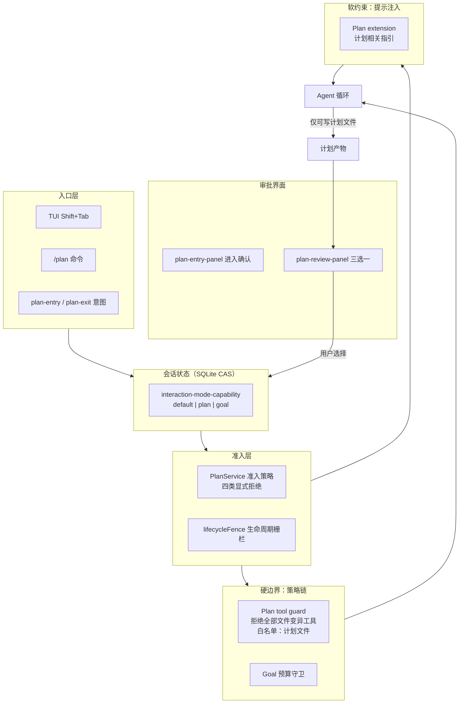

# 05. Plan Mode 的设计与运行


> **文档同步跟踪**
> - 最后同步代码：`minimax-code` commit `ff415b1`（2026-09-21）
> - 同步方式：基于该文档撰写时的源码路径与提交记录梳理

Plan Mode 不是「让模型先写一段计划」这么简单的功能。它是一个**运行时约束机制**：计划被用户批准之前，Agent 只能读取、思考、写计划文件本身，不能修改任何业务文件；只有用户批准后，Plan Mode 退出，Agent 回到正常执行。

MiniMax Code 的实现里，Plan 不是独立开关，而是**会话交互模式**之一（`default | plan | goal`），由数据库 CAS 状态机守护。这个选择决定了它的全部行为特征：模式切换与正在运行的 Turn 之间有栅栏串行化，约束靠策略链硬拦截而不是提示词软约束。



这张图的关键信息：入口可以很多（快捷键、命令、客户端意图），但约束和审批语义统一落在运行时层的 Plan 服务里。TUI 只负责状态展示和交互收集，不做决策。

## 1. 交互模式：一个 CAS 状态机

每个会话同一时刻只有一种交互模式。状态存 SQLite，用比较并交换（CAS）做迁移——两个表面同时切模式、崩溃恢复中途切换都不会产生中间态。

```mermaid
stateDiagram-v2
    [*] --> default : 会话创建
    default --> plan : plan-entry 意图（CAS 迁移，冲突则报错）
    plan --> default : plan-exit 意图（审批通过或放弃）
    default --> goal : 设定 Goal 任务
    goal --> default : 目标完成或放弃
    plan --> plan : 模式内推进（被生命周期栅栏串行化）
```

实现是 `packages/local-runtime-v2/src/service/session-system/sessions/interaction-mode-capability.ts`（`setPlan` 等 CAS 迁移方法）。

模式切换不是简单的布尔位：进入/退出 Plan 的意图本身要走第 3 章的准入准备（`plan-entry`/`plan-exit` 在 `direct-send-delivery.ts:126-134` 有专属意图通道），**生命周期栅栏**保证切换请求与正在运行的 Turn 串行化——不会出现「Turn 还在跑、模式已经切了」的窗口。

## 2. 三重约束：准入、守卫、注入

Plan 模式的可靠性来自三层独立机制的叠加，而不是单一开关。

**（1）准入策略：四类显式拒绝**

Plan 服务（`packages/local-runtime-v2/src/service/plan/`，接线在 services.ts:690-716）对进入/退出请求做准入检查，拒绝四类不合时宜的请求（`plan/contracts.ts:32-37`）：Turn 活跃中 / 问卷进行中 / 入口被禁用 / 模式冲突。被拒的请求有明确原因，落库可审计。

**（2）工具守卫：硬拦截文件变异**

Plan 激活期间，策略链拒绝全部文件变异工具——`write`/`edit`/`append`/`apply_patch`/`multiedit`/`notebook_edit`——**唯一白名单是计划文件本身**（`plan/tool-guard.ts:6-8, 53-70`）。它与 Goal 预算守卫通过 `combineLocalTurnToolPolicyGuards`（services.ts:973）合并成一条策略链，挂进第 6 章讲的工具调用前钩子链。被拦的调用变成错误型工具结果回给模型，模型据此自我修正。

**（3）提示注入：软引导**

Plan extension 向上下文注入计划相关指引（services.ts:987），计划正文渲染进转录区。注入是软约束，守卫是硬边界，两者互补。

## 3. UI 审批闭环

用户侧的体验由三块面板完成：

| 面板 | 时机 | 选项 |
|---|---|---|
| 进入确认（`plan-entry-panel.ts:10`） | 切入 Plan 前 | 继续进入 / 拒绝 |
| 审查面板（`plan-review-panel.ts:21-25`） | 计划产出后 | **同意并开始执行 / 暂不执行 / 补充上下文再修订** |
| 计划查看器（`plan-viewer-panel.ts`） | 随时 | 查看计划正文 |

选「同意」会带着已批准的计划退出 Plan 模式进入执行，计划文件此时成为执行的参照物。TUI 侧的乐观切换由 `controller/interaction/plan-mode-flow.ts` 处理：先发意图、能力门校验、失败回滚。

这套 UI 是「等用户拍板」决策框架（`features/interaction/decision-frame.ts`）的一个实例——权限审批、问卷、模式确认共享同一个带边框的框架，用户学会一次处处可用（第 13 章）。

## 4. Goal 模式：同一状态机的第三个档位

Goal 是交互模式的第三个档位，语义是「预算驱动的目标循环」：设定目标后，系统在预算内反复推进直到目标达成或预算耗尽。它的两个配套机制：

- **预算守卫**：与 Plan 工具守卫同链组合（见上），对超出预算的资源调用亮红；
- **队列插队**：第 3 章队列的 FIFO 让位例外——Goal 相关输入优先于普通排队消息；
- **验收看门人**：第 4 章的 goal-subagent 验证层。

Goal 与 Plan 共享状态机和准入基础设施，但没有 Plan 的「只许写计划文件」约束——它是执行模式，不是规划模式。

## 5. 设计取舍

**模式切换用 CAS vs 内存标志。** CAS 在数据库层保证并发安全（两个表面同时切、崩溃恢复中途切都不产生中间态），代价是每次切换一次事务。频率极低，划算。

**工具守卫在策略链而非提示层。** 只靠提示约束「计划阶段别改文件」是软约束，模型偶尔越线；策略链拦截是硬约束，且拒绝原因作为工具结果回给模型形成自我修正闭环。这与 kimi/Codex 的 Plan Mode 殊途同归：**可靠的行为约束必须落在权限/策略层，提示只负责引导。**

**Plan 与 Goal 共用一个状态机。** 另一种设计是两个独立开关，但那样要处理「同时开」的矛盾组合态。一个三档状态机从根上消灭了非法组合。

## 6. 读 Plan Mode 代码的入口

| 主题 | 入口 |
|---|---|
| 交互模式状态机 | `packages/local-runtime-v2/src/service/session-system/sessions/interaction-mode-capability.ts` |
| Plan 服务（准入/栅栏） | `packages/local-runtime-v2/src/service/plan/initialize.ts`、`contracts.ts:32-37` |
| 工具守卫（计划文件白名单） | `packages/local-runtime-v2/src/service/plan/tool-guard.ts:6-8, 53-70` |
| 守卫组合器接线 | `packages/local-runtime-v2/src/services.ts:973`（combineLocalTurnToolPolicyGuards） |
| 意图通道 | `packages/local-runtime-v2/src/application/conversation/direct-send-delivery.ts:126-134` |
| TUI 面板 | `packages/tui/src/tui/features/interaction/plan-entry-panel.ts`、`plan-review-panel.ts`、`plan-viewer-panel.ts` |
| TUI 乐观切换流 | `packages/tui/src/tui/controller/interaction/plan-mode-flow.ts` |
| Goal 验证层 | `packages/local-runtime-v2/src/application/agent/goal-subagent-coordinator.ts`（见第 4 章） |

## 7. 小结

Plan Mode 的本质是一个**横切式的运行时阶段控制机制**：CAS 状态机记录当前阶段，准入策略拒绝不合时宜的切换，工具守卫硬性阻止越界写入（白名单只有计划文件），提示注入持续引导，审批面板把关键切换点交给用户。Goal 是同一状态机的执行档位，配预算守卫与验收看门人。

值得注意的是，Plan Mode 不是 UI 层的附加功能——TUI、exec、ACP 只是入口，真正的语义集中在运行时层的 Plan 服务与策略链。这种设计保证了无论从哪个表面进入，Plan Mode 的行为都一致、可预期。

模型「动手」的机制看完了，下一章看它的「手」长什么样——工具系统全景，见 [06. Tool 系统与执行 Harness](06-tool-system.md)。
