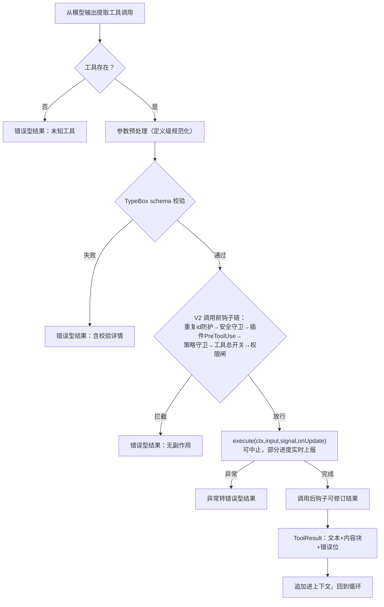

# 06. Tool 系统与执行 Harness

> **文档同步跟踪**
> - 最后同步代码：`minimax-code` commit `ff415b1`（2026-09-21）
> - 同步方式：基于该文档撰写时的源码路径与提交记录梳理

> 本章导读：拆 MiniMax Code 中 tool 的来源、契约、执行管线、并发规则和输出预算。读完后应该能回答三个问题：模型看得到哪些工具；一次 tool 调用从模型响应到结果回填经历哪些边界；为什么批量调用里只要有一个串行工具，整批都串行。

## 1. 这个系统解决什么问题

Tool 系统把「模型想做事」变成「宿主可审计、可审批、可取消、可恢复的副作用」。这个系统最核心的结构决定是**定义与实现分离**：

- **定义**（模型看到的契约）：名字、TypeBox 参数 schema、行为描述、并发模式——集中在 `packages/agent-tools`；
- **实现**（真正干活的代码）：文件四件套（read/write/edit/bash）的底层引擎复用基座 fork `@earendil-works/pi-coding-agent` 的成熟实现，第一方在引擎外面包权限、截断、事件上报。

这个分离的契约类型在 `packages/agent-core/src/tools/types.ts:1-25`（文档注释原话说明了 bindTool/defineRuntimeTool 的分工）。基座自带一套自己的工具实现作兜底，但生产环境显式关掉（`packages/agent-core/src/pi-turn-runner/tools.ts:54-59` 的注释）——保证模型看到的和实际执行的一定是第一方审查过的实现。

## 2. Tool 清单：四类来源

本地工具定义的单一出口是 `packages/agent-tools/src/desktop/builtin-defs.ts`（清单常量 `LOCAL_BASE_TOOL_DEFS` 在 :1034-1053），注册表是同目录 `index.ts:118-194` 的 `buildLocalToolRegistry`。

| 类别 | Tool | 门控 |
|---|---|---|
| 文件 | `read`、`write`、`edit`、`grep`、`glob` | 引擎来自 pi-coding-agent（`local-pi-tools.ts:8-14` 包装） |
| Shell | `bash`（前台默认 120s/上限 300s、`run_in_background`、15s 自动转后台） | 引擎来自 pi，外面包环境擦洗与沙箱钩子（:355-494） |
| 任务状态 | `todowrite` | 发 todo 事件 |
| 委派 | `task` + `task_append`/`task_query`/`task_output`/`task_stop` | 第 4 章 |
| 能力 | `skill`（:268）、`memory`（:309）、`code_review`（:287）、`request_feature_enable`（:467） | 部分受 beta 开关 |
| 交互 | `ask_user`（:421） | 仅交互表面 |
| Web | `web_fetch`（:484，16000 token 上限）、`web_search`、`website_deploy` | 搜索受账号门控 |
| 元工具 | `mavis`（:959） | 用 `<组> <动作>` 子命令管理本地 Agent、cron、会话、MCP——给模型一个受控的自我管理入口 |
| 浏览器 | `browser` + `browser_navigate/click/type/press_key/scroll/hover/wait_for/get_dom/screenshot/paste/verify_text/inspect_editable_targets`（`builtin-browser-defs.ts:779-994`） | 宿主能力位门控；端到端 275s 预算（:49） |
| 托管媒体 | `images_understand`、`image_synthesize`、视频生成/批量族、语音音乐合成族、`transcribe_audio`、`audios_understand`、`videos_understand` 等 17 个（`cloud/matrix-tools/tool-defs.ts`） | MiniMax 云服务，需账号与额度；按模型能力位屏蔽（`shared/model-tool-capabilities.ts:9-11`） |
| MCP 披露 | `tool_search`、`mcp_invoke`（`mcp-disclosure/`） | 仅当 MCP 工具过多时启用（第 11 章） |

浏览器工具的实现是 `desktop/local-browser.ts`（54KB），经宿主提供的 `LocalBrowserAdapter`（`desktop/types.ts:216-226`）接到 TUI 的无头 Chrome 传输层；CDP、语义树等核心在 `packages/browser-core`。

## 3. 单次 tool 调用生命周期

一次模型响应可以包含多个 tool 调用。执行主体在 pi 循环的 `executeToolCalls`（`third_party/pi-mono/packages/agent/src/agent-loop.ts:377-392`），但 V2 在工具调用前钩子链上叠了自己的治理层（`packages/local-runtime-v2/src/…/agent-host/execution/plugin-hook-tool-lifecycle.ts:66-130`）。管线全貌（所有失败分支都归宿为「错误型工具结果回模型」，循环不断）：

按阶段：

1. **提取**：循环从 assistant 消息里滤出工具调用块。
2. **查名**：未知工具立即生成错误型结果（agent-loop.ts:688-692），循环不断。
3. **参数预处理**：定义级规范化（如 task 剥空字段，agent-loop.ts:670-681）。
4. **schema 校验**：TypeBox 校验（agent-loop.ts:702），失败成为错误型结果。TypeBox 是模型 JSON 与内部类型之间唯一的信任边界。
5. **调用前钩子链**（V2 侧，顺序是防御性的）：重复 toolCallId 防护 → 委托工具准备 → 工具安全守卫 → 插件 PreToolUse 钩子 → 工具策略守卫（Plan 工具守卫在这，第 5 章）→ 工具总开关 → **权限闸**（`local-turn-permission-gate.ts:171-216`，第 7 章）。拦截成为无副作用的错误型结果（agent-loop.ts:703-718）。
6. **执行**：`newTool` 包装（`packages/agent-core/src/pi-turn-runner/tools.ts:127-166`）闭包住每 Turn 的 `ToolExecutionContext`（会话、事件上报、权限与模式、通道上下文），调 `impl.execute(ctx, input, signal, onUpdate)`；中止信号可打断，部分进度经 `onUpdate` 实时上报（agent-loop.ts:755-762）。
7. **调用后钩子**：可修订结果（tools.ts:104-117）。
8. **结果回填**：`ToolResult` 结构是 `{tool_name, text, content[], details, isError, terminate}`（`agent-core/src/tools/types.ts:83-91`），content 可以是文本、图片或视频块；转换成 pi 结果时注入错误位（tools.ts:231-242），追加进上下文回到循环。

这个生命周期里没有任何一条失败分支会打断循环——错误一律作为工具结果回给模型自行处置。这和第 3 章「渐进式拒绝」是同一个哲学。

## 4. 并发规则：一票串行制

批量调用的调度规则（agent-loop.ts:384-392、:551）：**一批调用中只要有一个工具声明 `executionMode: 'sequential'`，整批就串行；全部声明 `parallel` 才并行**（并行就是朴素的 `Promise.all`）。实际情况是只有 `read` 声明并行（builtin-defs.ts:19），其余几乎全串行——所以「多文件并发读」是常态，「边读边写」不会发生。

文件写还有第二道保险：同文件的变异操作进 pi 的 `withFileMutationQueue`（`third_party/…/core/tools/file-mutation-queue.ts:27-31`）串行化，防止两个编辑交错落盘。

对比 kimi 的资源感知调度（`accesses` 声明 + ToolScheduler），mcode 的选择更粗但更确定：整批串行的最坏代价是多花墙钟时间，换来的是推理结果的确定性。

## 5. 输出预算：两层截断

| 层 | 作用对象 | 预算 | 出处 |
|---|---|---|---|
| 引擎层 | `read` 文本 | 2000 行或 50KB 先到先截，提示用 offset/limit 续读 | pi `core/tools/truncate.ts:11-12` |
| 桌面层 | `read` 文本 / `bash` 输出 | 各 24KB | `packages/agent-tools/src/desktop/output-limit.ts:3-5` |
| 桌面层 | `grep` 内容 | 16KB | 同上 |
| 工具级 | `web_fetch` | 16000 tokens | `local-webfetch.ts:6` |
| 通用 | 图片 | 自动缩放到最大 2000×2000 | pi `read.ts:75` |

截断不是硬切：保留头尾或前缀后附续读指引（`withDesktopOutputContinuation`，output-limit.ts:57-72）。意图很清楚——**截断的产物必须仍然可行动**，而不是让模型面对半截文本。

## 6. 编辑安全：为什么 edit 很少出错

`edit` 是精确字符串替换，安全靠四道机制叠出：

1. **唯一性强制**：旧串在文件中出现多次直接报错（pi `edit-diff.ts:341-347`），从根上消灭「改错地方」；
2. **行号前缀容错**：模型经常把 `read` 输出里的 `123→` 行号前缀粘进旧串，`packages/agent-tools/src/shared/edit-line-number-retry.ts` 专门检测并剥离这种污染后重试；
3. **模糊匹配兜底**：精确匹配失败先做一次 CJK 安全的模糊定位（MINIMAX_CHANGES 里 2026-07-04/07-09 两条台账就是修这个）；
4. **细节保真**：BOM、CRLF/LF 检测恢复，统一 diff 返回确认（pi `edit.ts:318-354`）。

「先读后编」没有硬性状态跟踪（不像部分同类产品记录文件读取版本号），是提示层约定。代价是理论上存在「基于过期内容编辑」的失败模式，由唯一性强制与模糊兜底兜住。`replace_all` 实现为一次全文替换（`shared/replace-all-edit.ts`）。

## 7. 设计取舍

**复用基座引擎 vs 全部自研。** 文件工具的难点在边角（编码、行尾、超大文件、图片缩放），pi-coding-agent 已经趟过这些坑；第一方把预算放在定义契约和权限/安全包装上。风险是上游行为变更需要台账化跟进——第 1 章 fork 策略的延续。

**TypeBox vs Zod。** TypeBox 产出标准 JSON Schema，可直接喂给模型 API 的 tools 参数，不需要二次转换。工具契约即协议，协议即 schema。

**截断进工具层 vs 进上下文管理层。** 截断发生在工具输出处（不是压缩时），让进入上下文的第一次就是预算内的；第 10 章的压缩再处理「当时合理、后来过大」的历史结果。

## 8. 读 tool 系统代码的入口

| 主题 | 入口 |
|---|---|
| 工具契约类型 | `packages/agent-core/src/tools/types.ts` |
| 本地工具定义全集 | `packages/agent-tools/src/desktop/builtin-defs.ts`、`builtin-browser-defs.ts` |
| 注册表与实现 | `packages/agent-tools/src/desktop/index.ts:118`、`local-pi-tools.ts` |
| 文件工具引擎（基座） | `third_party/pi-mono/packages/coding-agent/src/core/tools/` |
| 执行与钩子（基座循环侧） | `third_party/pi-mono/packages/agent/src/agent-loop.ts:377-762` |
| V2 钩子链组装 | `packages/local-runtime-v2/src/…/agent-host/execution/plugin-hook-tool-lifecycle.ts:66-130` |
| 输出预算 | `packages/agent-tools/src/desktop/output-limit.ts` |
| 编辑容错 | `packages/agent-tools/src/shared/edit-line-number-retry.ts`、`replace-all-edit.ts` |
| 托管媒体工具 | `packages/agent-tools/src/cloud/matrix-tools/` |
| MCP 披露 | `packages/agent-tools/src/mcp-disclosure/` |
| 浏览器核心 | `packages/browser-core/src/`、`packages/tui/src/runtime/browser/` |

## 9. 小结

mcode 的 tool 系统可以概括为一句话：**定义在 `agent-tools`（模型只见定义），引擎在 pi-coding-agent（第一方包装），治理在 V2 钩子链（权限闸在链尾、策略守卫居中、总开关靠前），执行是「提取→查名→预处理→校验→钩子链→执行→后处理→回填」，所有失败都是错误型结果、循环不断。**

并发是一票串行制，输出两层截断且截断产物可行动，编辑安全靠唯一性 + 行号容错 + 模糊兜底。工具会改变世界，所以需要闸门——下一章完整展开权限体系。
