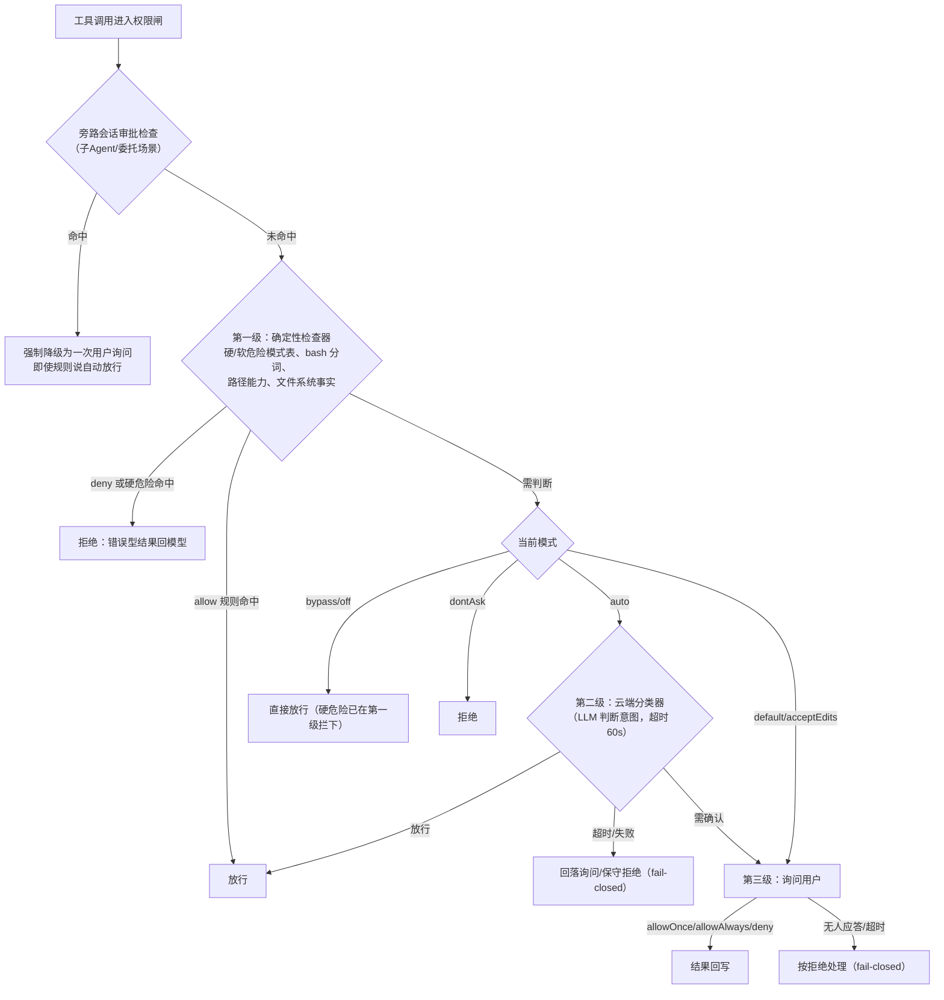

# 07. 安全与权限机制

> **文档同步跟踪**
> - 最后同步代码：`minimax-code` commit `ff415b1`（2026-09-21）
> - 同步方式：基于该文档撰写时的源码路径与提交记录梳理

权限层回答一个问题：**一次工具调用发生前，系统默认倾向放行还是询问**。本章拆六档权限模式、三级递进的决策管线、规则存储和审批交互。

先立两个反直觉事实，它们是这个产品设计立场的声明：

- **默认模式是 `auto` 而不是 `default`**（`packages/config/src/config.ts:1709`：`permissionMode: "auto"`）——开箱体验默认选择「云分类器兜底」而非「频繁打断用户」；
- **bypass 档不等于无安全**——一小撮「硬危险」模式（不可恢复的破坏性命令等）在确定性检查层就被拒绝，绕过档也拦。

## 1. 六档权限模式

| 模式 | 语义 | 备注 |
|---|---|---|
| `default` | 敏感操作询问 | 传统档 |
| `acceptEdits` | 同 default + 预置「编辑类放行」规则 | 实现为 default + 启动时种入 allow 规则（`packages/local-runtime/src/permissions/service.ts` 头注释） |
| `auto` | **默认档**：先走确定性规则，拿不准的交给云端分类器 | 无头 `--permission smart` 映射到这里 |
| `bypassPermissions` | 不再询问 | 无头 `--permission full`；硬危险仍拦 |
| `dontAsk` | 一律拒绝需询问的操作 | 「只读跑一趟」的保守档 |
| `off` | 同 bypass 的别名 | 无头 `--permission off` |

模式定义在 `packages/agent-modules/permission/src/types.ts:13-18`，到内部询问策略的映射在 `ask-policy.ts:24-47`：`bypassPermissions/off→never`、`auto→on-request-llm`、`dontAsk→deny`、`default/acceptEdits→on-request`。

## 2. 决策管线：三级递进

每次工具调用前的权限判断从便宜到昂贵递进，每一级失败都 fail-closed：

三个组成部分的位置：

- **确定性检查器**：`packages/agent-modules/permission/src/tools/`——硬/软危险模式注册表、bash 命令分词与管道拆分（防止 `echo safe && rm -rf /` 骗过整串匹配）、路径能力、文件系统事实检查；
- **云分类器**：`auto` 模式下调用云端权限检查端点（一个 LLM 分类器，`packages/local-runtime/src/permissions/service.ts:16-19`），超时默认 60 秒（config `permission.classifierTimeoutMs`）；
- **V2 权限闸**：`packages/local-runtime-v2/src/…/runner/policy/local-turn-permission-gate.ts:171-216`，构造于 `native-production-dependencies.ts:160`。

两个可靠性设计值得单独点名：

- **旁路降级**（gate `:184-207`）：即使全局规则说「自动放行」，子会话场景（第 4 章的委托）仍强制一次用户确认——防止规则在你不直接监督的上下文里被放大；
- **查询失败一律关闸**（gate `:240-258`）：权限状态查不到时按拒绝处理，宁可打断也不放行。

## 3. 规则存储：三个作用域

用户对「询问」的应答可以沉淀为规则。结构是「行为 × 匹配器 × 作用域」（`packages/local-runtime/src/permissions/rule-model.ts:5-23`）：

| 维度 | 取值 |
|---|---|
| 行为 | `allow` / `deny` / `ask` |
| 匹配器 | 工具名；命令模式（bash 分词后匹配）；路径模式 + 动作集（读/写/删除/执行/网络） |
| 作用域 | 全局 `<数据目录>/permission.json` / 按 Agent `<数据目录>/agents/<name>/permission.json` / 按会话 `<数据目录>/sessions/<id>/permission.json`（`rules.ts:325-355`，写文件带锁） |

「总是允许」的落点因表面而异：TUI 的 allowAlways 生成对应作用域 allow 规则；IM 通道（Telegram/飞书/微信）的权限卡片里「允许」只落**会话**作用域、「总是允许」才落**全局**（`channels/permissions/reply.ts:31-49`）——远程场景默认更保守。

## 4. 审批交互：询问如何到达你

询问以「需要动作」事件进入第 3 章的会话流，表面层渲染成决策卡片：结构化预览（要跑的命令、要改的路径）+ 三个选项（`allowOnce` / `allowAlways` / `deny`，`packages/tui/src/runtime/port.ts:632`）。渲染在 `packages/tui/src/tui/features/interaction/permission-picker.ts`，事件流接线在 `tui/controller/runtime/runtime-event-flow.ts:1098-1099`，应答经 pending map 回写。

**拒绝本身就是一种通信**：拒绝可以附带一句反馈，作为工具结果回给模型，模型据此调整方案。

无头表面没有交互能力（第 2 章的能力档位），需询问的场景要么靠模式避免、要么按 fail-closed 拒绝。

## 5. 密钥卫生：存储面

密钥不落不该落的地方。存储面的防线（子进程面在第 8 章、租约面在第 12 章）：

- OAuth 令牌与 API key 全部落磁盘文件、0600 权限（`packages/oauth-core/src/credential-store/file-store.ts:51-121`，原子写 + 权限断言）；
- **没有钥匙串集成**——凭据存储工厂只产 FileStore（`credential-store/factory.ts:6-8`）；
- 状态文件有「敏感字段绝不出现在 auth-state」的断言（`state-store.ts:41-52`）；config 视图里的 key 做掩码展示。

代价是文件系统级攻击面；收益是跨平台一致、无系统弹窗、可备份可脚本化。

## 6. 设计取舍

**云分类器 vs 纯本地规则。** 纯规则离线、可审计，但表达能力有限（一条 `curl | sh` 的风险取决于上下文）；纯 LLM 判断灵活但引入网络依赖与误判风险。这里选「规则先行、分类器兜底、用户终审」的三级递进，每级 fail-closed。

**旁路强制确认 vs 信任全局规则。** 把「总是允许」的规则在子 Agent 场景重新送审，牺牲一点流畅度换取「自动化不被委派放大」的安全属性。这是显式的产品决策，不是实现疏忽。

**规则落 JSON 文件 vs 落数据库。** 会话与 Turn 都在 SQLite（第 9 章），权限规则却在带锁 JSON 文件——因为规则要被用户直接阅读/编辑/版本管理，文件是更诚实的界面。

## 7. 读权限代码的入口

| 主题 | 入口 |
|---|---|
| 模式定义与档位映射 | `packages/agent-modules/permission/src/types.ts:13-18`、`ask-policy.ts:24-47` |
| 确定性检查器 | `packages/agent-modules/permission/src/tools/` |
| 权限门面与云分类器 | `packages/local-runtime/src/permissions/facade.ts`、`service.ts:16-19` |
| 规则模型与三作用域存储 | `packages/local-runtime/src/permissions/rules.ts:325-355`、`rule-model.ts:5-23` |
| V2 权限闸（旁路降级/fail-closed） | `packages/local-runtime-v2/src/…/runner/policy/local-turn-permission-gate.ts:171-258` |
| TUI 审批卡片 | `packages/tui/src/tui/features/interaction/permission-picker.ts` |
| IM 权限卡片应答 | `packages/local-runtime/src/channels/permission-bridge.ts`、`permissions/reply.ts:31-49` |
| 凭据文件存储 | `packages/oauth-core/src/credential-store/file-store.ts` |

## 8. 小结

权限体系可以概括为一句话：**六档模式（默认 auto）、三级递进判断（确定性规则 → 云分类器 → 用户终审）、fail-closed、旁路强制确认，规则沉淀在三个作用域的带锁 JSON 文件。**

权限判断「该不该跑」，跑起来之后命令能碰到什么，是下一章沙箱的话题——见 [08. 执行环境与沙箱](08-execution-and-sandbox.md)。
