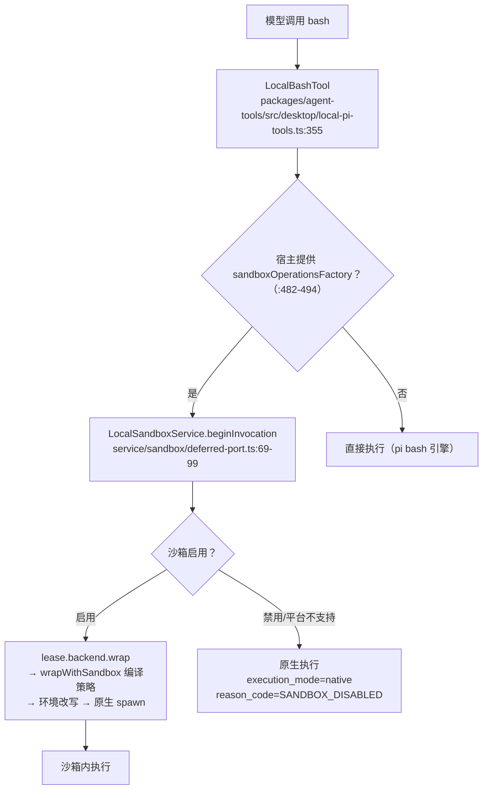

# 08. 执行环境与沙箱

> **文档同步跟踪**
> - 最后同步代码：`minimax-code` commit `ff415b1`（2026-09-21）
> - 同步方式：基于该文档撰写时的源码路径与提交记录梳理

权限层判断「该不该跑」，执行环境回答「跑起来之后命令能碰到什么」。本章拆两块：OS 级命令沙箱（Anthropic 实验项目 sandbox-runtime 的 fork）和 bash 的执行环境细节（环境变量擦洗、信号处理、可恢复删除）。

先立两个必须如实陈述的事实，它们都容易在别处的介绍里被模糊掉：

- **沙箱默认关闭**：默认配置是 `enabled: false` + `filesystemMode: 'full_access'`，归一化逻辑直接把这两者折叠为「无沙箱」（`packages/config/src/sandbox-settings.ts:14-27`），命令以原生方式直接执行；
- **当前实际仅 macOS**：V2 运行时只注册了一个后端描述符 `srt-macos`（`packages/local-runtime-v2/src/service/sandbox/initialize.ts:35-40`），Linux/Windows 上选择器直接抛 `SANDBOX_UNSUPPORTED_PLATFORM`（`backend/selector.ts:27-34`）——库支持三平台，产品只开了一扇门。

## 1. 沙箱从哪来：fork 的台账

沙箱是 `anthropic-experimental/sandbox-runtime` tag `v0.0.74` 的 fork（本地版本 `0.0.74-mcode.2`，出处 `third_party/sandbox-runtime/upstream.json`，Apache-2.0）。第一方改动集中在（`third_party/sandbox-runtime/README.md:7-13`）：SecurityServer 控制、独立 unlink 作用域、deny-first 的网络 allow-all、每次调用净化 baseEnv、调用方提供的临时目录、代理禁用时的文件保护、Node-fs 可执行查找（不依赖 `which`）。

## 2. 沙箱架构：包一层平台原生限制

核心动作是 **把即将执行的命令包进平台原生的限制机制**。入口是 `src/sandbox/sandbox-manager.ts` 的 `wrapWithSandbox`（:1553+）：编译文件系统读写限制配置（含 unlink 作用域）、凭据掩码，然后按平台分发：

| 平台 | 机制 | 实现位置 |
|---|---|---|
| macOS | `/usr/bin/sandbox-exec` + 生成的 Seatbelt（SBPL）profile，违规监控 | `macos-sandbox-utils.ts:682+`、`:1234` |
| Linux | bubblewrap（bwrap）绑定挂载 + seccomp 过滤器（vendor C 助手生成）+ 挂载点清理 | `linux-sandbox-utils.ts:93-98`、`generate-seccomp-filter.ts` |
| Windows | Rust 原生助手（`vendor/srt-win-src`）+ ACL + WFP 出口过滤 | `windows-sandbox-utils.ts` |

网络策略通过**本地代理族**实现（`http-proxy.ts`、`socks-proxy.ts`、`mitm-ca.ts`、`tls-terminate-proxy.ts`）：出站流量经本地 HTTP/SOCKS 代理拦截，可选 MITM CA 做 TLS 终止检查；配合**凭据哨兵**（credential sentinel）——环境变量与文件里的密钥在沙箱内被掩码替换。效果：即使命令被诱导外发数据，也带不出真实凭据。

文件系统四档：`read_only` / `workspace_write` / `delete_guard`（unlink 限定作用域的可恢复删除）/ `full_access`（`packages/config/src/sandbox-settings.ts:5-8`）。

## 3. 集成路径：bash 工具怎么接沙箱

几个细节：

- 沙箱开启时，`identity.forceReadOnlyFilesystem` 可以把编译出的策略收紧到只读（`local-sandbox-service.ts:343-350`）；
- `delete_guard` 档与工具层的「可恢复删除」配合：`rm` 命令可被路由到 host-trash 机制（`packages/agent-tools/src/desktop/host-trash-executor.ts`），删除进回收站而不是真删；
- Desktop 策略把网络编译为不受限（`effective-policy.ts:41`）——当前产品里网络围栏主要来自代理族的能力，而非默认开启。

## 4. 为什么默认关闭

从代码证据推断：沙箱对现有工作流（写构建产物、访问网络包管理器）的兼容成本高，而权限层的确定性规则 + 云分类器已提供可用的副作用闸门；沙箱作为纵深防御的第三层留给高安全需求用户显式选择。这与「权限默认 auto」是同一个产品哲学的两面：**把摩擦放在显式 opt-in，而不是默认强加**。

Linux 用户显式开启会得到显式报错而非静默降级——这个选择本身也是立场：不支持就说不支持。

## 5. bash 执行环境细节

即使不走沙箱，bash 工具的执行环境也有一层自己的治理：

**环境变量擦洗。** 非交互模式下，子进程环境按名单剥离密钥类变量（自有 provider key、`ANTHROPIC_API_KEY`、`OPENAI_API_KEY` 等）——名单与模式在 `packages/agent-core/src/bash-subprocess-env.ts:53-100`（交互模式默认 off，可按 strict 模式收紧）。这是密钥卫生的子进程面（存储面在第 7 章、租约面在第 12 章）。

**超时与后台化。** 前台默认 120 秒、上限 300 秒；托管前台任务 15 秒后自动晋升为后台任务（builtin-defs.ts:146 的工具描述）。

**信号处理。** 终止信号改为 SIGTERM → 宽限期 → SIGKILL，让 shell trap 有机会执行（pi-coding-agent，MINIMAX_CHANGES 2026-07-07 台账）；分离的后台进程有可选的父进程死亡守护（2026-08-20 台账）。

**每调用新 shell。** 每次 bash 调用都是全新 shell（无状态延续），cd/export 不跨调用保留——状态外置给模型自己管理。

## 6. 设计取舍

**沙箱层与权限层分离。** 两者控制不同失效面：权限防「模型故意越权」，沙箱防「放行的命令被注入或失控」。合并成一层（只靠沙箱）会把判断粒度从「这次调用」退化为「整个进程」，且丢失用户审批这个社交层控制。

**fork 而非依赖。** 与 pi-mono 同理：egress 控制、环境净化这些接缝需要完全控制权，公开投影也要求依赖可审计。

**仅注册 macOS 后端。** 库本身三平台可用，产品只开了自己能充分测试的一扇门。相比「全平台注册但 Linux 半残」，显式报错是更诚实的选择。

## 7. 读沙箱与执行环境代码的入口

| 主题 | 入口 |
|---|---|
| 沙箱本体（fork） | `third_party/sandbox-runtime/src/sandbox/sandbox-manager.ts:1553`、`macos-sandbox-utils.ts:1234`、`linux-sandbox-utils.ts` |
| 沙箱服务与后端选择 | `packages/local-runtime-v2/src/service/sandbox/`（`initialize.ts:35-40`、`backend/selector.ts:27-34`、`effective-policy.ts`） |
| 沙箱配置与默认值 | `packages/config/src/sandbox-settings.ts:14-27`、`sandbox-config.ts` |
| bash 工具集成点 | `packages/agent-tools/src/desktop/local-pi-tools.ts:355-494` |
| 可恢复删除 | `packages/agent-tools/src/desktop/host-trash-executor.ts` |
| bash 环境擦洗 | `packages/agent-core/src/bash-subprocess-env.ts:53-100` |
| bash 引擎与信号（基座） | `third_party/pi-mono/packages/coding-agent/src/core/tools/bash.ts` |

## 8. 小结

执行环境可以概括为一句话：**沙箱是 fork 的 Anthropic sandbox-runtime（Seatbelt/bwrap+seccomp/本地代理/凭据掩码），默认关闭、当前仅 macOS；bash 的执行环境自带一层治理——环境擦洗、每调用新 shell、SIGTERM 宽限、可恢复删除。**

权限、沙箱、密钥三件套构成副作用控制的纵深。接下来转向状态：会话数据存在哪、怎么恢复——见 [09. Session 持久化与恢复](09-session-persistence.md)。
