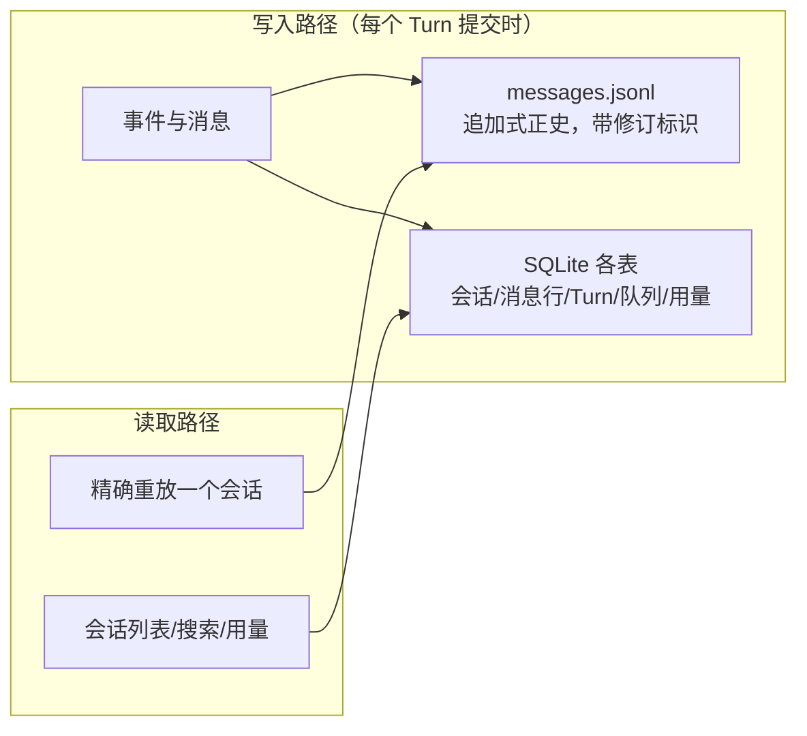

# 09. Session 持久化与恢复

> **文档同步跟踪**
> - 最后同步代码：`minimax-code` commit `ff415b1`（2026-09-21）
> - 同步方式：基于该文档撰写时的源码路径与提交记录梳理

mcode 把 Session 当成**持久化的数据事实**而不是内存对象：断电后哪些数据必然还在、哪些靠修复，取决于一套刻意设计的双存储分工——**正史在 JSONL，索引在 SQLite**。本章拆这套存储、会话与消息的数据模型、以及续接/分叉/回退三个恢复操作。

## 1. 双存储模型

所有本地状态落在数据目录（默认 `~/.minimax`）下两套存储里：

**JSONL 正史**：每个会话一个目录，按 UTC 日期分层——`<数据目录>/v2/sessions/<yyyy/mm/dd>/<hh-mm-ss-mmm>-session_<id>/`，内含 `manifest.json` + `messages.jsonl`（部分会话还有 ledger/display/snapshot 文件，由 manifest 引用）。路径规则与追加写入在 `packages/local-runtime-v2/src/service/session-system/messages/history/session-history-paths.ts:53-87,141-164` 和 `canonical-history-provider.ts`（崩溃修复最多重试 3 次写尝试，`MAX_CANONICAL_WRITE_ATTEMPTS=3`）。

**SQLite 索引**：单库文件 `<数据目录>/v2/sqlite/runtime-state.sqlite`（`packages/local-runtime-v2/src/infra/db/client.ts:48-49`），Drizzle 表结构在 `infra/db/schema/`：`local_runtime_sessions`（会话行 + 列投影：agent、状态、父会话、工作区、项目、historyRelativeDir）、`local_runtime_message_rows`、`local_runtime_turn_*`、`local_runtime_session_locks`、`local_runtime_queue_items` + `queue_pauses`、用量、项目、偏好、Agent、插件、cron。

这个分工的直接推论：**会话的可恢复性以 JSONL 为准，查询性能以 SQLite 为准**。索引坏了不丢正史，重建即可；第 3 章的持久化队列排水能跨重启，也是因为队列在 SQLite 里。

## 2. 会话与消息模型

「会话」在数据上有精确的形状：

- **种类受约束**：conversation / task / peek / channel / cron 五种，数据库 CHECK 约束钉死（`schema/sessions.ts:6`），新代码无法悄悄发明第六种；
- **父子关系**：子 Agent、定时任务产生的会话挂在父会话下（第 4 章）；
- **消息双层**：一层给用户看的展示消息，一层与模型对话的正史消息（含角色、所属 Turn、来源）——回退、分叉、重放服务都建在正史层之上（`session-system/messages/` 下的 replay/rewind/fork 服务）；
- **事件 id 确定性**：`evt_<turnId>_<kind>_<n>`，按尝试计数（`local-agent-turn-runner.ts:482`）——重放历史与恢复中断渲染靠它对齐。

Turn 本身也有专门的仓储（`persistence/turn.repository.ts`，1195 行）：录入、租约续期、收据、维护租约、插件钩子会话所有权。

## 3. 续接、分叉、回退

| 操作 | 运行时语义 | 入口 |
|---|---|---|
| 续接（`--continue` / `/sessions`） | 无头模式只挑「工作区匹配且未归档」的最新会话；子 Agent 会话和已归档会话显式拒绝 | `packages/tui/src/headless/runner.ts:841-928` |
| 分叉（fork） | 复制正史到新会话 id，从分叉点继续 | ACP `session/fork` 与 TUI 会话管理器共用 |
| 回退（rewind） | 会话回拨到某消息位点，其后消息不再进模型上下文（正史仍保留） | `session-system/messages/` rewind 服务 |
| 打开指定（`--session <id>`） | 直接恢复；TUI 退出时打印续接提示命令 | `launcher.ts:892-941`、`:881-890` |

两个防御性细节：

- 无头续接强制**工作区匹配**——防止在另一个项目里意外把上一个项目的上下文带进来；
- 区域切换或重新登录导致的进程重启，会带着 `--session <id>` 重新拉起（`launcher.ts:800-832`），会话不因重启而丢。

## 4. 设计取舍

**JSONL 正史 vs 纯数据库。** 纯 SQLite 更「整洁」，但追加式日志对崩溃修复（截断末尾半条记录即可）和跨版本兼容（不依赖表结构迁移）天然友好；索引坏了可重建、正史坏了才是真丢数据。「正史不可变、索引可再生」是这套设计的核心分层。

**消息双层 vs 单层。** 展示层与正史层分开，让 UI 演进（改个渲染）不会动到与模型对话的事实记录；重放/回退只依赖正史层，语义干净。

**回退是逻辑指针不是物理删除。** 回退后消息仍在正史里，只是不再进入上下文——审计完整性与「悔棋」并存。

## 5. 读持久化代码的入口

| 主题 | 入口 |
|---|---|
| 数据库客户端与表结构 | `packages/local-runtime-v2/src/infra/db/client.ts:48-49`、`infra/db/schema/` |
| 会话目录布局与追加写 | `…/session-system/messages/history/session-history-paths.ts`、`canonical-history-provider.ts` |
| Turn 仓储 | `…/persistence/turn.repository.ts` |
| 消息回放/回退/分叉 | `…/session-system/messages/`（replay/rewind/fork） |
| 无头续接语义 | `packages/tui/src/headless/runner.ts:841-928` |
| TUI 启动参数应用 | `packages/tui/src/tui/launcher.ts:892-941` |
| 会话管理面板 | `packages/tui/src/tui/features/session/manager.ts` |

## 6. 小结

Session 持久化可以概括为一句话：**正史在 JSONL（追加式、带崩溃修复）、索引在 SQLite（可重建），消息分展示/正史双层，续接/分叉/回退都建在正史层；无头续接强制工作区匹配，重启带着 session id 回来。**

会话的「容器」讲完了，容器里装的上下文如何组装、快满时如何压缩——见 [10. 上下文管理与压缩](10-context-and-compaction.md)。
