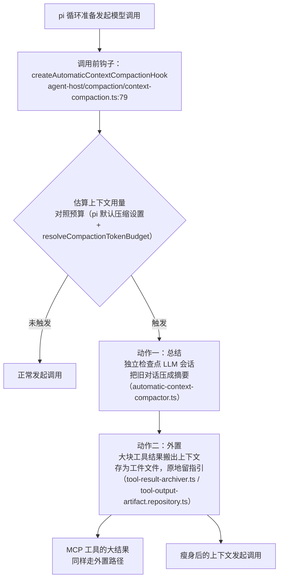

# 10. 上下文管理与压缩

> **文档同步跟踪**
> - 最后同步代码：`minimax-code` commit `ff415b1`（2026-09-21）
> - 同步方式：基于该文档撰写时的源码路径与提交记录梳理

模型每次抬头看到的上下文不是一段写死的文本，而是**分层拼装**的产物；上下文快满时的压缩也不是 Turn 结束才检查，而是**挂在每一次模型调用之前**。本章拆这两件事：系统提示的组装规则（含 AGENTS.md 的 32KB 预算），以及自动压缩的两个动作（总结 + 大结果外置）。

## 1. 系统提示：五层拼装

组装发生在每个 Turn 的装配步（第 3 章），主力是一个 1173 行的配置构建器：`packages/local-runtime-v2/src/service/turn-system/agent-host/preparation/config/local-agent-config-builder.ts`。按注入顺序五层：

| 层 | 来源 | 预算与规则 |
|---|---|---|
| 身份提示 | Agent 配置（内置或用户定义） | 基座 |
| 全局指引 | `<数据目录>/AGENTS.md` | 32KB 预算；**超限直接静默省略** |
| 项目指引 | 工作区根 `AGENTS.md`，找不到回退 `CLAUDE.md` | 32KB 预算；超限截断并附「请自行读原文件」提示 |
| 记忆 | 跨会话记忆条目（`memory` 工具写入） | 受 `beta.autoMemory` 开关控制 |
| 技能目录 | `<available_skills>` 块（名称+描述），放系统提示末尾 | 正文按需加载（第 11 章） |

读取逻辑在 `preparation/static-prompt-reader.ts`（项目 :93-130，回退 CLAUDE.md 的目录名以转义字面量写在 :10）、`persistence/global-instructions.ts:27-56`（全局超限静默省略）、V1 侧等价物 `packages/local-runtime/src/project/instructions.ts:6-12`。

三个高价值细节：

- **全局与项目的超限策略故意不一致**（全局静默省略 vs 项目截断提示）——项目指引离任务更近，截断后提示模型自己读原文件，比整体丢掉安全；
- **不向上层目录递归查找 AGENTS.md**（与部分同类产品逐级收集不同）——只看工作区根。从代码只能确认行为差异，动机是推断：CLI 的工作区根通常就是任务边界，向上收集会把 monorepo 父目录的无关指引卷进来；
- **提醒走 system-reminder**：环境状态、待办变更等提醒类信息不进系统提示，而是以 `<system-reminder>` 块拼进**用户提示**（`execution/prompt.ts:6-24`，`joinUserPrompt` :41 合并）——每次 Turn 都是新鲜快照而非陈旧缓存。

发往模型前还有一道**出站规范化**：按目标模型族改写消息（角色映射、内容块顺序等），装配处是 pi-turn-runner 的 `convertToLlm = projectAgentMessagesForModel`（第 3 章）。

## 2. 自动压缩：挂在「模型调用前」边界上

压缩发生的精确时刻是**每一次模型调用之前**——第一方在基座循环暴露的 LLM 钩子位（`setLLMHook`）挂了自动压缩器，而不是等 Turn 结束。

要点：

- **外置而不是丢弃**：工具输出（一次长测试日志、一个大文件内容）后续可能还有引用价值，搬到工件存储后上下文立刻瘦身、信息仍可达——模型需要时可以再读回；
- **阈值与预算**：来自 pi-mono 的 `DEFAULT_COMPACTION_SETTINGS` 加第一方的 token 预算解析（`@mavis/context-manager` 的 `resolveCompactionTokenBudget`）；
- **手动触发**：Turn 服务暴露 `requestCompaction`（turn-system/`initialize.ts:497`），TUI 的压缩命令接它；
- **与第 6 章截断的分工**：截断发生在工具输出处（进上下文前），压缩处理「当时合理、后来过大」的历史结果——两层治理时间点不同。

## 3. 设计取舍

**压缩在调用前 vs 在 Turn 边界。** Turn 边界压缩实现简单，但一个长 Turn 内部（几十次工具调用）就可能把上下文撑爆；挂在每次调用前，保护粒度才是真实的。代价是每次调用多一次估算——相对推理成本可忽略。

**总结 + 外置 vs 纯总结。** 纯总结最简单，但会永久丢失工具输出的细节；外置把「上下文里的重量」变成「磁盘上的工件 + 一条指引」，需要时可回捞。这是压缩比（上下文省多少）与保真度（信息丢多少）之间更好的交换。

**提醒进用户提示 vs 进系统提示。** 系统提示在整个 Turn 内复用，放易变信息会陈旧；拼进用户提示保证每次调用都是最新快照。

## 4. 读上下文代码的入口

| 主题 | 入口 |
|---|---|
| 系统提示装配 | `…/agent-host/preparation/config/local-agent-config-builder.ts` |
| 静态指引（AGENTS.md 32KB） | `…/agent-host/preparation/static-prompt-reader.ts`、`…/persistence/global-instructions.ts` |
| 提醒块合并 | `…/agent-host/execution/prompt.ts:6-41` |
| 自动压缩钩子 | `…/agent-host/compaction/context-compaction.ts:79` |
| 压缩执行器 | `…/compaction/automatic-context-compactor.ts`、`algorithm/compact-context.ts` |
| 工具结果外置 | `…/compaction/algorithm/tool-result-archiver.ts`、`…/persistence/tool-output-artifact.repository.ts` |
| 手动压缩 | `…/turn-system/initialize.ts:497`（requestCompaction） |
| 出站消息规范化 | `packages/agent-core/src/pi-turn-runner/`（convertToLlm 装配处） |

## 5. 小结

上下文管理可以概括为一句话：**系统提示是五层拼装（身份/全局指引/项目指引各 32KB 预算/记忆/技能目录），提醒以 system-reminder 拼进用户提示保证新鲜；压缩挂在每次模型调用前，动作是「独立会话总结 + 大结果外置为工件」，手动压缩随时可触发。**

拼装里提到的那块 `<available_skills>` 从哪来、加载时机如何——下一章展开插件、技能与 MCP 的完整机制，见 [11. 插件、技能与 MCP](11-plugins-skills-mcp.md)。
