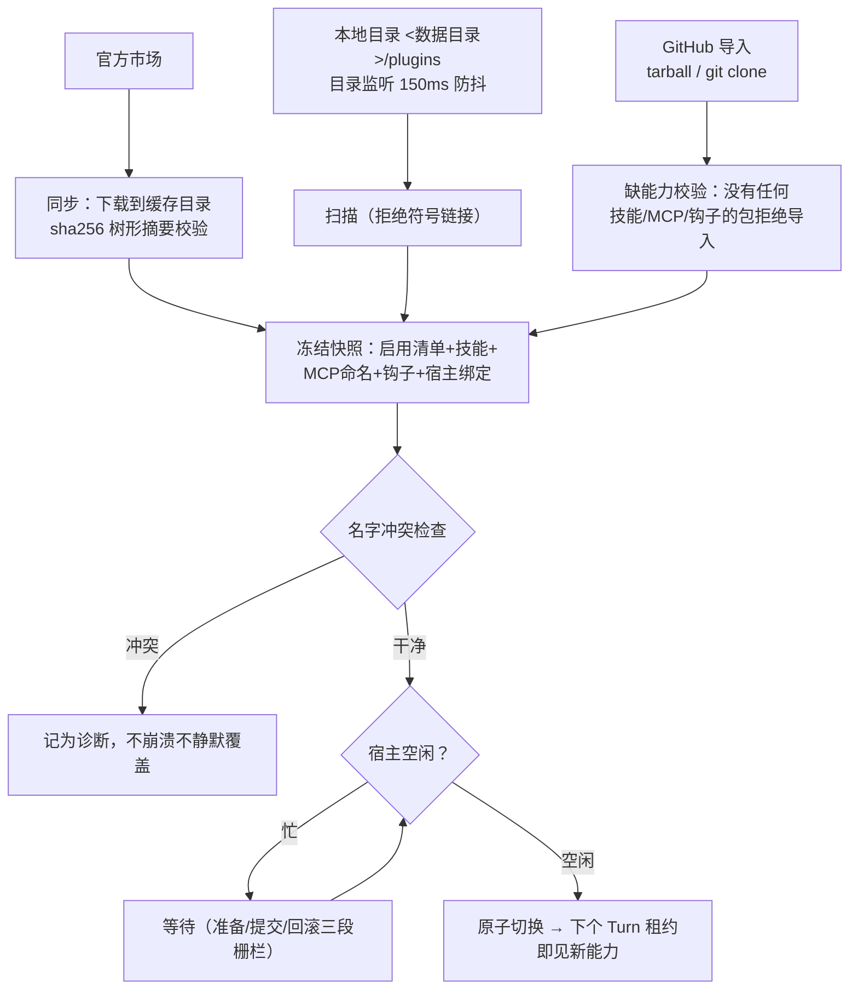

# 11. 插件、技能与 MCP

> **文档同步跟踪**
> - 最后同步代码：`minimax-code` commit `ff415b1`（2026-09-21）
> - 同步方式：基于该文档撰写时的源码路径与提交记录梳理

本章拆「不动核心循环就能长能力」的三套机制：插件（可携带技能、MCP 服务器和钩子的分发包）、技能（SKILL.md 能力包）、MCP（外部工具服务器）。核心是**快照与发布**：所有扩展能力先被冻结成一份一致的快照，且只在宿主空闲时原子切换——把「热插拔」做成「温插拔」。

## 1. 扩展点全景

| 扩展点 | 格式 | 来源 | 进入运行时的路径 |
|---|---|---|---|
| 插件 | 四种 `plugin.json` 方言（见第 2 节） | 官方市场 / 本地目录 / GitHub | 快照 → 工具/提示贡献 |
| 技能 | `SKILL.md`（YAML frontmatter） | 工作区、用户目录、Agent 目录、插件、内置种子 | 目录注入 + `skill` 工具按需读 |
| MCP 服务器 | JSON `mcpServers` 映射 | 用户级 / 项目 `.mcp.json` / 插件自带 | 连接池 → `mcp__服务器__工具` |
| 钩子 | JSON 钩子集（插件内） | 插件 | Turn 与工具生命周期事件 |
| 托管连接器 | 云端目录描述符 | MiniMax 云 | 云端工具映射为本地工具 |
| 项目指引 | `AGENTS.md` | 工作区根 / 全局 | 系统提示（第 10 章） |

## 2. 插件：四种清单方言

清单读取器认四种目录方言（`packages/local-runtime-v2/src/service/plugin-system/plugin/package/package-readers.ts:36-62,146-162`）：开源标准 **Agent Plugins v1**（schema 指向 agent-plugins.org）、MiniMax 自有格式、Claude 的 `.claude-plugin`、Codex 的 `.codex-plugin`。后两家的目录名在源码里是用转义字面量写的（`agent-plugin-reader.ts` 里那串 `\u0063\u006c\u0061\u0075\u0064\u0065`，避免字符串搜索直接命中竞品名），但兼容是完整实现的。来源枚举 `OFFICIAL / LOCAL_MINIMAX / LOCAL_AGENT_PLUGIN / LOCAL_CLAUDE / LOCAL_CODEX`（`package/types.ts:18-28`）。

策略清晰：**降低从 Claude/Codex 生态迁移插件的成本，比发明独占格式更重要**。

安全边界（`package-contract.ts:9-18,418-424` 与 `agent-plugin-reader.ts:284-343`）：

- 包契约拒绝符号链接/硬链接，强制尺寸与数量上限；
- stdio 命令必须是插件根内的裸可执行或 `./` 相对路径；远程地址仅允许 HTTPS（loopback http 除外）；URL 里不得带凭据；
- `PLUGIN_ROOT` / `PLUGIN_DATA` 是仅有的保留占位符；
- 插件声明的 MCP 服务器不允许 OAuth（`plugin-system/mcp/config.ts:142-146`）；
- 插件 MCP 池与用户 MCP 池刻意分开（`plugin-system/mcp/runtime.ts:94-97`）。

生命周期细节：官方插件完整性用**树形 sha256 摘要**校验（`official-reconciler.ts`），下载到 `<数据目录>/v2/plugin-cache/official`；未登录时市场同步被授权栅栏挡住，快照退化为「仅本地插件」；本地目录有原生递归 watcher（150ms 防抖）触发重发布。名字冲突产生诊断信息而不是崩溃（`snapshot-builder.ts:293-296,451-471`）。

插件能贡献什么：技能（运行时名 `插件名:技能名`，`packages/shared/src/plugin-skill-name.ts:9-11`）、MCP 服务器（每包 ≤8 台）、钩子、MiniApps、**宿主绑定**——声明式的「逻辑工具名 + 宿主能力引用」，且声明本身不给任何执行权限（`package/types.ts:74-82` 的注释原话：「supplies no executable implementation and receives no permission by declaring this record」）。

## 3. 技能：目录可见，正文按需

技能的可见性分两段：

1. **目录注入**：所有可用技能的名称+描述渲染成 `<available_skills>` 块放系统提示末尾（第 10 章）——模型知道有什么；
2. **按需加载**：模型调 `skill` 工具读正文与资源——上下文只为此付一次费。实现是 `packages/agent-tools/src/desktop/local-skill.ts:6-48`，读取先查独立注册表、再落到 Turn 能力视图里的插件技能（`packages/local-runtime/src/api/local-native-tools.ts:131-180`）。

frontmatter 契约（`plugin-system/skill/frontmatter.ts:9-24`、`skill/reader.ts:20-63`）：`name`+`description` 必填且 name 须与目录名一致；可选 `license`、`allowed-tools`、`compatibility`（≤500 字符）、`metadata`。

多源优先级（数值大者在同名冲突时胜出，重复只告警；`packages/local-runtime/src/skills/roots.ts:22-155`、`packages/config/src/skills-config.ts:62-76`）：

| 来源 | 路径 | 优先级 |
|---|---|---|
| Agent 专属 | `<数据目录>/agents/<agent>/skills` | 100 / 90 |
| 工作区外部目录 | `.minimax/skills` / `.claude/skills` / `.agents/skills`（向上查找至 git 根） | 65 / 60 / 55 |
| 用户全局 | `<数据目录>/skills` | 中档 |
| 内置种子 | 启动时按指纹播种（`seed-builtin.ts:26-67`） | 20 |
| 打包资产 | 随发布携带 | 10 |

每个启用的技能同时成为 `/技能名` 斜杠命令（`tui/controller/run/active-run-flow.ts:82-117`）。`mcode init` 的引擎 `/init` 就是一个种子技能（`packages/local-runtime/assets/skills/init/SKILL.md`）：在 git 工作区且根上无 AGENTS.md 的冷启动场景自动触发（frontmatter 里写的触发标记是 `<bootstrap_check>`），产出符合规范的 AGENTS.md。

## 4. MCP：三源配置，统一命名空间

三个互不隶属的配置来源：

| 来源 | 位置 | 校验 |
|---|---|---|
| 用户级 | `<数据目录>/mcp.json`（或 `mcp/mcp.json`） | stdio 的 command/args/env 或 http 的 url/headers（`mcp/runtime/config.ts:16-64`） |
| 项目级 | 工作区根 `.mcp.json` | ≤1MB；`${VAR:-default}` 环境展开；保留名禁用（`matrix`、`__proto__` 等，`service/mcp/project-config.ts:21-57,135-163`） |
| 插件自带 | 插件清单或其 `mcp.json` | ≤8 台；不允许 OAuth |

连接由共享连接池执行（`packages/agent-modules/mcp/src/runtime/connection-pool.ts`；默认 120 秒超时、并发 5）。工具统一改写为 `mcp__<服务器>__<工具>`，命名注册表负责（`name-registry.ts:100`）：

- 段长限制：服务器段 ≤48 字符、全名 ≤80（`tool-name.ts:2-36`）；
- 冲突加 `_2` 后缀（`name-registry.ts:182-196`）；
- **注册表落盘共享**：用户级与插件级共用 `<数据目录>/mcp-runtime-names.json`（`local-mcp.service.ts:85-88`），跨重启稳定——历史会话里的工具调用记录不会因重算而失效；所有权优先级为 用户配置 > 官方插件 > 本地（`:246-258`）；
- 单服务器工具上限 128、单快照总数上限 256（`plugin-system/mcp/runtime.ts:24-25`）。

**披露模式**：用户自配来源的工具过多时，不再全部平铺给模型，而是给两个元工具——`tool_search`（搜索索引）与 `mcp_invoke`（按名调用）——加一段系统提示指引（`packages/agent-tools/src/mcp-disclosure/plan.ts:40-54`；启用条件 `source === 'configured'`，`service/mcp/tools/runtime-tools.ts:11-22`）。内置 Matrix 服务器特殊处理为裸工具名（`mcp/runtime/config.ts:116-125`）。

## 5. 钩子：八个生命周期时机

插件钩子声明「某事件发生时执行某命令」（`packages/agent-modules/plugin-hooks/src/contracts.ts:3-16`、`parser.ts:180-249`）：

| 事件 | 时机 |
|---|---|
| SessionStart / SessionEnd | 会话开始与结束 |
| UserPromptSubmit | 用户提示提交（可拒绝 Turn，第 3 章准入分支） |
| PreToolUse / PostToolUse | 工具调用前后（前者可拦截） |
| Stop | Turn 停止 |
| PreCompact / PostCompact | 上下文压缩前后（第 10 章） |

处理器是命令式的（`type: "command"`，带匹配器与超时）——钩子进程没有任何特殊权限通道，副作用仍受第 7 章权限体系管辖。

## 6. 快照一致性：为什么「只在空闲时发布」

所有扩展能力（插件、技能、MCP 工具、钩子）任一时刻呈现为一份**冻结快照**。每个被接受的 Turn 从快照租借能力视图（获取→就绪→准备→捕获→持有→释放，`turn-capability-lifecycle.ts:103-195`）。发布新快照必须等宿主空闲，走「准备/提交/回滚」三段栅栏。

反例最能说明价值：若无此机制，一个 Turn 跑到一半时插件被卸载，它正持有的工具实现可能已消失，事件流会引用不存在的来源。快照把「能力的版本」与「Turn 的生命期」对齐——**Turn 开始时看到什么，结束前就一直是什么**。

## 7. 设计取舍

**校验型隔离 vs 进程沙箱。** 插件的 stdio 子进程没有 OS 级沙箱（推断，基于代码结构：隔离手段是包契约校验 + 能力碰撞检查 + 主机策略门）。与沙箱默认关闭（第 8 章）是同一条产品线上的选择；对第三方插件生态，这条边界是否足够，值得使用者自己评估。

**方言兼容 vs 生态独占。** 认别家的清单格式是双刃剑：换入成本低，换出成本也低。产品显然判断「存量生态的引力」大于「格式锁定的价值」。

**注册表落盘 vs 每次重算。** 落盘保证工具名跨重启稳定，代价是要处理磁盘状态与新配置的合并——注册表的「新鲜度」与所有权优先级就是为这个代价付的利息。

## 8. 读扩展系统代码的入口

| 主题 | 入口 |
|---|---|
| 插件系统初始化与服务 | `packages/local-runtime-v2/src/service/plugin-system/initialize.ts`、`plugin-system.ts` |
| 清单读取（四方言） | `…/plugin-system/plugin/package/`（`package-readers.ts`、`agent-plugin-reader.ts` 等） |
| 包契约与官方同步 | `…/plugin/package/package-contract.ts`、`…/plugin/runtime/official-reconciler.ts` |
| 快照构建 | `…/plugin/runtime/snapshot-builder.ts` |
| 空闲发布与 Turn 能力租约 | `…/turn-system/agent-host/assembly/turn-capability-lifecycle.ts` |
| GitHub 导入 | `…/plugin/import/github-plugin-importer.ts` |
| 技能根目录与优先级 | `packages/local-runtime/src/skills/roots.ts` |
| 技能目录渲染与种子 | `packages/local-runtime/src/skills/catalog.ts`、`seed-builtin.ts` |
| MCP 连接池与命名注册 | `packages/agent-modules/mcp/src/runtime/` |
| 用户级/项目级 MCP | `…/service/mcp/runtime/local-mcp.service.ts`、`…/service/mcp/project-config.ts` |
| MCP 披露 | `packages/agent-tools/src/mcp-disclosure/` |
| 插件钩子 | `packages/agent-modules/plugin-hooks/src/` |

## 9. 小结

扩展系统可以概括为一句话：**六类扩展点全部汇入冻结快照，快照只在宿主空闲时原子发布，Turn 按租约消费快照；插件走「校验→快照→温插拔」流水线且认四种方言；技能「目录可见、正文按需」；MCP 三源配置共用落盘命名注册表，过多时切换 tool_search/mcp_invoke 披露模式；钩子是八个生命周期事件上的无特权命令。**

能力与状态都讲完了，最后一组基础设施：配置、账号与模型——见 [12. 配置、账号与模型提供者](12-config-auth-providers.md)。
