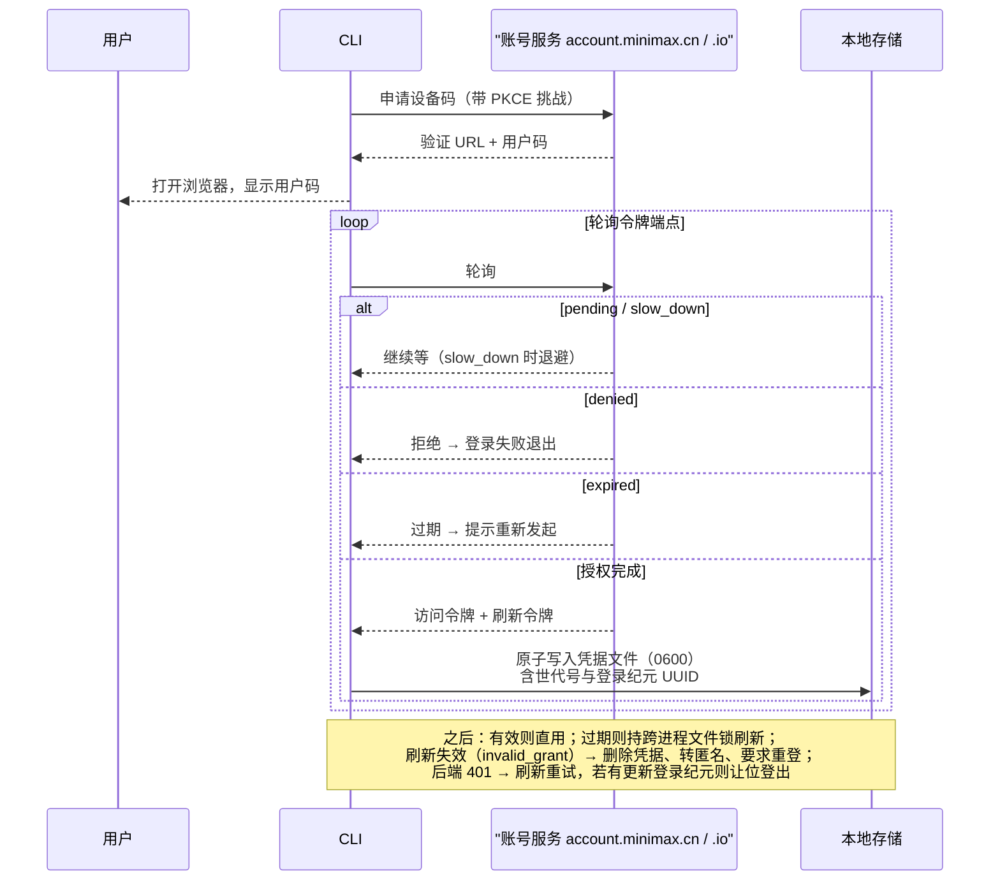

# 12. 配置、账号与模型提供者

> **文档同步跟踪**
> - 最后同步代码：`minimax-code` commit `ff415b1`（2026-09-21）
> - 同步方式：基于该文档撰写时的源码路径与提交记录梳理

本章拆三块基础设施：配置（一个单文件 YAML，**没有项目级配置层**——这是个刻意的决定）、账号（标准 OAuth 设备授权流 + 给子进程用的令牌租约协议）、模型（三棵提供商树、一条解析链、硬编码的自家模型目录）。

## 1. 数据目录与 Profile

所有用户态数据的根是数据目录：默认 `~/.minimax`，历史目录 `~/.mavis` 自动迁移并留兼容软链（`packages/config/src/data-dir.ts:384-393`）；环境变量 `MINIMAX_DATA_DIR`/`MAVIS_DATA_DIR` 可整体改址；**profile 机制**把目录后缀化（`~/.minimax-<profile>`）实现多账号隔离。

一个必须强调的事实：**没有项目级配置层**。配置只来自「数据目录的单文件 + 编译进二进制的默认值」（`config.ts:1917-1924` 的 `getConfig()`），环境变量只影响数据目录/端口/profile 选址，不覆盖配置键。这避免了「进了个目录行为就变了」的隐式状态。

彩蛋：数据目录解析会按 git 仓库名自动启用内部 profile（`config.ts:1381-1432`）——内部 monorepo 开发者的工效设施，第 1 章「公开投影」性质的又一处残留。

## 2. config.yaml：单文件配置矩阵

配置文件在 `<数据目录>/config.yaml`，权限 0600。关键键位（默认值均经源码核对）：

| 键 | 作用 | 默认/备注 |
|---|---|---|
| `permissionMode` | 权限档位（第 7 章） | **`auto`**（config.ts:1709） |
| `sandbox` | 沙箱开关与文件系统档位 | **关闭 + 完全访问** = 无沙箱（第 8 章） |
| `telemetry` | 遥测三开关 | 全部 **false**（opt-in） |
| `defaultModel` | 默认模型 | `minimax/MiniMax-M3`（config.ts:1672） |
| `minimaxModelSource` | MiniMax 模型凭据来源 | `token_plan`（账号）或 `minimax_api_key`（自有 key） |
| `minimax_api` / `custom_provider` | 自有 MiniMax key / 外部提供商树 | 见第 4 节 |
| `beta` | 特性开关集合 | `autoMemory`、`browserBridge`、`mcodeTools` 等（config.ts:329-505） |
| `permission.classifierTimeoutMs` | 云分类器超时 | 60s |
| `skills` | 外部技能目录与优先级 | 第 11 章 |

## 3. 登录：设备授权流全链路

`mcode login` 走标准 OAuth 设备授权许可（RFC 8628）+ PKCE S256。客户端常量 `client_id = 'mcode-public'`、scope `['agent.default']`、audience `'agent-backend'`（`packages/oauth-core/src/contracts.ts:1-3`）；端点 cn 走 `account.minimax.cn`、global 走 `account.minimax.io`（`endpoint-config.ts:24-56`，可用环境变量覆盖）。

调用链：`mcode login`（`packages/tui/src/cli/auth-command.ts:31`）→ `McodeAuthApplication.login`（`src/auth/application.ts:71-115`）→ oauth-core 的 `auth-core.ts`。凭据落在 `auth/<构建环境>/<区域>/mcode-public/auth.json`（0600，`file-store.ts:51-121`）。

三个工程细节值得记住：

- **并发登录协调**：一个十分钟粒度的「授权租约」（`auth-core.ts:385-491`）保证只有一个进程驱动浏览器流程，后来的登录请求等结果而不是开第二个浏览器；
- **登录纪元**：每次登录生成 UUID（`loginEpoch`）；旧会话发现自己不是最新纪元时主动让位（401 处理 `:285-305`）——防止旧令牌覆盖新会话；
- **注销的网络容错**：撤销令牌失败时本地凭据仍删除，状态记为 `logout_pending`（`:307-362`）——不会因为断网留下可用凭据。

区域（cn/global）决定账号服务域名；已登录状态下切区域被显式拒绝（`AuthDomainConflictError`，`auth-core.ts:91-103`）。账号额度查询走「Matrix」服务（`packages/tui/src/account/matrix-account-client.ts`）：会员信息缓存 30s、额度缓存 5s。

## 4. 提供商三棵树与模型解析

| 树 | 凭据 | 说明 |
|---|---|---|
| `provider.minimax`（内置托管） | 账号 OAuth 令牌 | 配置里的 API key 只是**哨兵占位符** `sk-xxx`，真实凭据是运行时注入的 Bearer；这棵树受读时保护——被删改会在读取时从预设重建（`packages/config/src/byok-config.ts:279-343`） |
| `minimax_api` | 用户自己的 MiniMax API key | 同样的模型、不同的计费通道 |
| `custom_provider` | 外部提供商 API key | BYOK：任意 OpenAI/Anthropic 兼容端点 |

API 格式三选一：`anthropic-messages`（默认）/ `openai-completions` / `openai-responses`（`packages/tui/src/provider/contract.ts:3-8`）。历史上手写在 `provider.*` 下的 BYOK 会在磁盘上迁移进 `custom_provider` 并留备份（`byok-config.ts:178-256`）。

一次运行的模型解析链（`packages/local-runtime/src/runtime/model-resolver.ts:172-334`）：解析 `提供商/模型` 键 → 定位树与凭据 →（特例）`minimax/*` 在凭据来源切到自有 key 时**重路由**到用户 key 通道（`:228-268`）→ 从模型目录取上下文/输出上限（会话级覆盖优先，`:354-362`）→ 托管模式校验真实 Bearer，占位符未同步直接报错（`:294-311`）。选定优先级：**会话固定 > 配置默认**；会话固定的模型失效时自动修复回默认并发出 `session_model_repaired` 事件（`channels/primary-agent-session-model-repair.ts:39-120`）。

内置模型目录硬编码在 `config.ts:1528-1565`：

| 模型 | 上下文 | 输出 | 特性 |
|---|---|---|---|
| MiniMax-M3（默认） | 512K（可选 1M） | 128K | 推理+工具调用；文本/图像/视频输入；思考可开关；Files API |
| MiniMax-M2.7 | 200K | 128K | 纯文本 |
| MiniMax-M2.7-highspeed | 200K | 128K | 高速档 |

模型能力位反过来影响工具可见性（第 6 章：不支持图像理解的模型看不到 `images_understand`）。

**BYOK 流程**：`mcode provider add`（`packages/tui/src/cli/provider-command.ts:45-155`）的密钥**只从环境变量读**（`MCODE_PROVIDER_API_KEY` 或 `--api-key-env <NAME>`），命令行不接受密钥值——密钥不进 shell 历史、不进进程列表。`--use` 先做一次连接测试，**测试失败什么都不保存**。

## 5. 令牌租约：子进程的最小凭据协议

嵌入的 `mcode-tools` 子进程需要调云端接口，但**绝不能持有长效刷新令牌**。解法是本地租约 broker（`packages/mcode-tools-host/src/lease-broker.ts:42-189`）：

1. 主程序在私有目录（0700）开 Unix 域套接字 `<数据目录>/run/mcode-auth-lease-v1.sock`，旁边放 32 字节随机**能力密钥**文件（base64url 43 字符，0600，`:246-266`）；
2. 启动器脚本把套接字地址与能力文件路径以环境变量传给子进程，同时**擦除所有令牌类环境变量**（`resource.ts:232-247`）；
3. 子进程每次要令牌时连套接字：请求帧必须带能力密钥（恒定时间比较 `timingSafeEqual`，`node-server.ts:110-127`）；协议只有三个方法——`status` / `lease {minValidityMs ≤ 5min}` / `unauthorized {generation}`（`packages/oauth-lease-protocol/src/contracts.ts`）；
4. broker 背后代理主程序 OAuth 核心：能刷新就刷新，登录态失效立即停止放行（`lease-broker.ts:152-160`）。

协议边界感：帧上限 64KB、空闲 30 秒断开、单连接 256 请求、最多 32 连接（`node-server.ts:16-18`）。**租约寿命就是访问令牌的寿命**——没有独立续租循环，过期重新租。

## 6. 遥测：默认关闭的最小化设计

遥测三开关默认全关（`config.ts:1773`），`MCODE_DISABLE_TELEMETRY` 或 `DO_NOT_TRACK` 一票否决；配置读不出来时永远不会开启上报（`packages/config/src/telemetry-policy.ts:5-23`）。发送内容受事件白名单约束（启动、登录结果、发消息、斜杠命令等），且**每个事件用全新随机匿名 id**（`packages/tui/src/analytics/business-telemetry.ts:221-222`）——服务端无法把两次事件关联到同一用户。`mcode telemetry preview` 本地预览完整负载。

## 7. 设计取舍

**无钥匙串 vs 系统钥匙串。** 凭据全部落 0600 明文文件（工厂只产 FileStore，`credential-store/factory.ts:6-8`）。代价是文件系统级攻击面；收益是跨平台一致、无系统弹窗、可备份可脚本化。配合子进程擦洗与租约协议，密钥暴露面压在「能读用户主目录的代码」这一层。

**单文件配置 vs 分层配置。** 放弃项目级配置换来确定性行为（对 CI 与多环境用户重要）；代价是「不同项目不同默认模型」只能靠 profile 目录或会话级覆盖解决。

**占位符哨兵 vs 留空。** 托管树的 `sk-xxx` 占位符让「配置存在但凭据未同步」成为一个可检测、可报错的状态，而不是静默用空 key 请求。

## 8. 读配置与账号代码的入口

| 主题 | 入口 |
|---|---|
| 配置模式、默认值与模型目录 | `packages/config/src/config.ts` |
| 数据目录迁移与 profile | `packages/config/src/data-dir.ts` |
| BYOK 解析与托管树保护 | `packages/config/src/byok-config.ts`、`provider-auth-mode.ts`、`model-availability.ts` |
| OAuth 核心与设备流 | `packages/oauth-core/src/auth-core.ts`、`oauth-client.ts:79-187`、`endpoint-config.ts:24-56` |
| 凭据文件存储 | `packages/oauth-core/src/credential-store/file-store.ts` |
| 登录命令与应用 | `packages/tui/src/cli/auth-command.ts`、`src/auth/` |
| provider 子命令 | `packages/tui/src/cli/provider-command.ts` |
| 模型解析器 | `packages/local-runtime/src/runtime/model-resolver.ts:172-334` |
| 会话模型修复 | `packages/local-runtime/src/channels/primary-agent-session-model-repair.ts` |
| 租约协议与 broker | `packages/oauth-lease-protocol/src/`、`packages/mcode-tools-host/src/lease-broker.ts` |
| 遥测 | `packages/tui/src/analytics/business-telemetry.ts`、`packages/config/src/telemetry-policy.ts` |

## 9. 小结

配置与账号可以概括为一句话：**配置 = 数据目录单文件（无项目层），默认值本身是产品立场的声明（权限 auto、沙箱关、遥测关）；账号 = 设备授权流 + 世代化凭据 + 登录纪元自愈；模型 = 三棵凭据树、一条「会话固定 > 默认」的解析链、硬编码的自家目录；子进程凭据 = 套接字租约，短时访问令牌永不下放刷新令牌。**

最后一章回到你盯着的界面：不用 React/Ink 的自绘终端引擎——见 [13. TUI 内核与渲染](13-tui-internals.md)。
