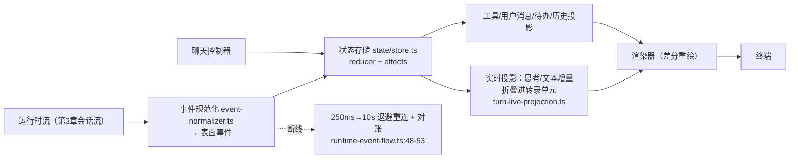

# 13. TUI 内核与渲染

> **文档同步跟踪**
> - 最后同步代码：`minimax-code` commit `ff415b1`（2026-09-21）
> - 同步方式：基于该文档撰写时的源码路径与提交记录梳理

`packages/tui` 没有任何 React/Ink 依赖。整套 UI 建在一个 fork 自基座项目的自绘终端引擎上。本章拆三件事：引擎怎么把组件画成终端上的 ANSI 文本（含 fork 证据）；流式模型输出如何经「投影层」进入转录区而不撕裂 UI；布局、键位、面板这些用户可感机制背后的结构。

## 1. 引擎事实：自绘，fork 自 pi-tui

核心抽象极简：**每个组件是一个对象，给它宽度，它返回一串带 ANSI 转义的文本行**（`Component` 接口，`packages/tui/src/tui/engine/tui.ts:22-80`）。渲染器对行做差分更新，只重绘变化部分；焦点、撤销栈、kill ring、括号粘贴这些编辑器级设施都在引擎层。

说它「fork 自基座」而非自研，证据是结构性的：引擎目录的文件清单与 pi-tui 完全同构（keys、kill-ring、undo-stack、word-navigation、stdin-buffer、editor-component 一一对应），且注册跨 realm 符号用的正是基座命名空间——`Symbol.for("@earendil-works/pi-tui/viewport")`（engine/tui.ts:323）、`Symbol.for("@earendil-works/pi-tui/layout-node")`（layout-node.ts:3）。fork 之后的增量同样清晰：补了布局系统（VStack/HStack/ScrollView，`layout.ts`/`layout-node.ts`）、终端配色探测（OSC 11，`terminal-colors.ts`）、LaTeX 渲染。pi-tui 上游本体只有 pi 自己的 CLI 在用（mcode 的 TUI 不直接 import 它）。

还有两个引擎细节：硬件光标用 APC 序列标记（`\x1b_pi:c\x07`）；OSC 8 超链接在 macOS 上以 BEL 结尾做点击命中（MINIMAX_CHANGES 2026-08-10 台账）。

## 2. 状态与投影：流式输出为什么不出戏

TUI 的状态架构是 Redux 风格的环：**事件 → 归约器 → 状态存储 → 渲染**，外加副作用层。组装在 `app.ts:54` 的 `createTuiApp`（工厂来自 `app-composition.ts`），控制器是 `controller/chat-controller.ts:59`。

投影层的价值：模型输出是**增量**到达的（一段思考、半句文本、工具进度百分比），转录区则是**单元**（一条消息、一张工具卡片）。投影器（`controller/projection/` 下的 turn-live/turn-tool/turn-user/turn-todo/turn-history 五个投影）负责把增量折叠进单元，渲染器只看单元状态——流式过程不闪烁重排，Ctrl+O 切换工具输出详情可见性也只是单元状态的一次翻转。

事件消费带断线退避重连与**对账**（250ms→10s，`controller/runtime/runtime-event-flow.ts:48-53`）：重连后按消息位点补齐错过的帧；进程信号守护（`platform/process-guards.ts:41`）覆盖挂起/恢复场景。

## 3. 布局：两种屏幕形态，十个区域

界面有内联模式（转录随输出向下滚）与全屏模式（备用屏幕）。区域清单在 `shell/chat-layout.ts:17-29`：

| 区域 | 内容 |
|---|---|
| transcript | 转录区（消息、工具卡片、计划正文） |
| interaction | 决策面（权限/问卷/计划审批），叠在输入框上且**不破坏草稿** |
| composer | 输入框（message/goal/working/follow-up/blocked 多模式） |
| goal / followUp / tasks / activity | 目标进度、排队输入、后台任务、活动行 |
| status | 状态行 |

全屏形态的页脚自上而下固定排序：goal → follow-up → tasks → activity → composer → status（chat-layout.ts:78-86），转录进 ScrollView 体。「决策面不破坏草稿」是容易被忽略的体验设计：审批卡片弹出时输入框保持在下层可编辑。

渲染器在 `renderer/interactive-renderer.ts` 切换 `TuiMainScreen`（内联）与 `TuiAltScreen`（全屏）。

## 4. 键位与补全

键位分两层：引擎层（`engine/keybindings.ts`）+ 壳层作用域（`shell/keybindings.ts`），用户可覆盖。核心位：

| 键 | 动作 | 出处 |
|---|---|---|
| Enter | 发送（运行中则作为转向注入） | shell/keybindings.ts:350 |
| Alt+Enter | 排队跟进（持久化队列） | :361 |
| Shift+Enter / Ctrl+J | 换行 | engine/keybindings.ts:143 |
| Shift+Tab | 切换 Plan 模式 | :406 |
| Alt+M | 循环权限档位 | shell |
| Esc | 关闭面板 / 中止运行 | — |
| Ctrl+T / Ctrl+O / Ctrl+R | 待办 / 详情可见性 / 历史搜索 | shell |
| `@` / `/` | 文件引用补全 / 斜杠命令补全 | engine/autocomplete.ts:431,447 |

斜杠命令目录（`tui/commands/catalog.ts:122-507`：`/help`、`/sessions`、`/model`、`/status`、`/plugins`、`/skills`、`/mcp`、`/review`、`/plan`…）是一个可贡献的注册表（`packages/tui/src/contributions/registry.ts:14-45`），技能借此成为 `/技能名` 命令，还能贡献 CLI 子命令（`cli/program.ts:344-351`）。

## 5. 决策面板：一类问题，一个共享框架

权限审批、问卷、计划确认、模式切换确认——这些「系统在等用户拍板」的界面共享同一个带边框的决策框架（`features/interaction/decision-frame.ts`），各自填充结构化预览与选项集。用户学会一次，处处可用。被拒时的可选反馈输入也走同一框架。

## 6. 主题与状态行

主题子系统（`tui/theme/`）覆盖调色板、16 色、语法高亮，按终端配色探测结果自适应。状态行可配置（`tui.statusLine` YAML，文档 `packages/tui/docs/status-line-config.md`）：条目、顺序、自定义命令扩展，还有给外部脚本的 `[V]` 构建模式机器协议——状态行本身是个小型可编程界面。

## 7. 设计取舍

**自绘 vs Ink/React。** Ink 生态成熟、心智模型普及；自绘换来零框架税的渲染管线控制权（差分粒度、光标协议、大转录性能）与更小的依赖面。代价是所有编辑器级设施都要自己拥有——好在 fork 基座把起步成本买断了。

**投影层 vs 直接把流事件塞给渲染器。** 直接渲染最省事，但增量与单元的错位会让界面在流式期间反复重排。投影层用一次间接换取稳定——这是全书反复出现的模式：**用一层显式翻译，把两种变化速率不同的世界隔开**（事件桥之于基座循环、投影之于 TUI、快照之于插件，同一个手法的三次应用）。

## 8. 读 TUI 代码的入口

| 主题 | 入口 |
|---|---|
| 引擎核心（组件接口/差分/符号注册） | `packages/tui/src/tui/engine/tui.ts:22-80,323`、`layout.ts` |
| 键位（引擎层/壳层） | `packages/tui/src/tui/engine/keybindings.ts`、`src/tui/shell/keybindings.ts` |
| 补全 | `packages/tui/src/tui/engine/autocomplete.ts` |
| 应用组装与控制器 | `packages/tui/src/tui/app.ts:54`、`app-composition.ts`、`controller/chat-controller.ts:59` |
| 状态环与投影 | `packages/tui/src/tui/state/`、`controller/projection/` |
| 事件规范化与重连 | `packages/tui/src/runtime/event-normalizer.ts`、`controller/runtime/runtime-event-flow.ts:48-53` |
| 布局区域与决策面 | `packages/tui/src/tui/shell/chat-layout.ts:17-29`、`interaction-surface.ts`、`features/interaction/decision-frame.ts` |
| 斜杠命令目录 | `packages/tui/src/tui/commands/catalog.ts`、`packages/tui/src/contributions/registry.ts` |
| 主题与状态行 | `packages/tui/src/tui/theme/`、`packages/tui/docs/status-line-config.md` |

## 9. 小结

TUI 可以概括为一句话：**fork 加持的自绘引擎（组件 → ANSI 行 → 差分重绘）+ Redux 风格状态环 + 投影层把流式增量折叠成转录单元，断线靠退避重连+对账恢复；两种屏幕形态、十个区域、双层键位；所有「等用户拍板」的界面共享一个决策框架。**

至此从进程入口到终端像素的链路闭合。如果要自己复刻一个最小版本，哪些组件不能省——见 [14. 最小复现指南](14-minimal-rebuild.md)。
