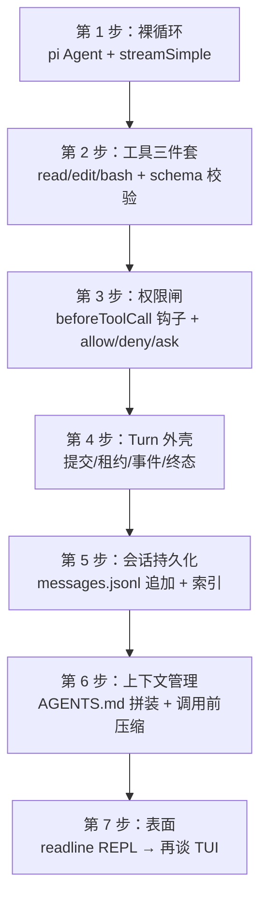

# 14. 最小复现指南

> **文档同步跟踪**
> - 最后同步代码：`minimax-code` commit `ff415b1`（2026-09-21）
> - 同步方式：基于该文档撰写时的源码路径与提交记录梳理

如果要重写一个最小 mcode（复刻它的架构而非功能全量），哪些组件不能省、按什么顺序搭？本章按依赖顺序给出一份「最小必要组件」清单——每层都标注「复刻时对应的真实实现」，方便对照前十三章。

## 1. 分层复刻顺序

## 2. 各步的最小实现与真实对照

| 步 | 最小实现 | 真实对照 | 不能省的原因 |
|---|---|---|---|
| 1. 裸循环 | 直接用 pi-mono 的 `Agent` + `streamSimple`（或任一开源 agent loop），接一个模型 | `third_party/pi-mono/packages/agent/src/agent-loop.ts` | 循环是成熟机械，复刻它性价比最低——mcode 自己也是 fork 的 |
| 2. 工具三件套 | `read`（行号+截断）、`edit`（唯一性强制）、`bash`（超时+新 shell），TypeBox/Zod schema 校验 | `pi-coding-agent/src/core/tools/` + `packages/agent-tools/src/desktop/` | 没有工具就不是编码 agent；**定义与实现分离**要从第一天建立 |
| 3. 权限闸 | 在循环的 beforeToolCall 钩子位放一个门：规则表 allow/deny/ask + 兜底「问用户」 | `packages/agent-modules/permission/` + `local-turn-permission-gate.ts` | 副作用控制是产品底线；**fail-closed** 和「拒绝理由回给模型」这两个语义第一天就要对 |
| 4. Turn 外壳 | 给每轮对话编号、落租约、把循环事件桥成自己的事件流、终态写库 | `turn-system/` + `agent-core` 的 PiTurnRunner/EventBridge | 这是 mcode 与玩具的分水岭：可恢复、可审计的长事务 |
| 5. 会话持久化 | 每会话一个 `messages.jsonl` 追加文件 + 一个 SQLite/JSON 索引 | `session-system/messages/history/` + `infra/db/` | 「正史不可变、索引可再生」——崩溃修复和跨版本兼容靠它 |
| 6. 上下文管理 | 拼装系统提示（AGENTS.md 两级 + 预算）、在 LLM 钩子位挂「超阈值就总结」 | `local-agent-config-builder.ts` + `context-compaction.ts` | 512K 窗口也会满；压缩挂在**调用前**而不是 Turn 边界 |
| 7. 表面 | 先用 readline REPL；TUI 是独立的后期投资 | `packages/tui/`（第 13 章） | mcode 的教训：自绘引擎换来控制权，但 fork 买断了起步成本——没有基座就别自绘 |

## 3. 可以先砍掉什么

这些是 mcode 的产品化部分，最小版复刻可以全部跳过，不影响验证架构：

- **V1/V2 双运行时**——最小版只有一层；mcode 的 V1 是历史包袱的渐进迁移（第 1 章）；
- **插件快照与四种方言**——留一个「工具注册表」接缝即可（第 11 章）；
- **沙箱**——默认关闭的东西，权限闸做好之前不碰（第 8 章）；
- **Plan/Goal 状态机**——先把「策略链拦截工具」这个机制做对，模式切换是它的组合应用（第 5 章）；
- **子 Agent 委派**——会话模型建好后，task 就是「子会话 + 同一套 Turn 循环」（第 4 章）；
- **OAuth 与租约 broker**——单用户本地工具先用环境变量里的 API key（第 12 章）；
- **TUI**——readline 足够验证全部运行时语义（第 13 章）。

## 4. 三条最容易走偏的路

1. **先写 TUI 再写运行时。** mcode 的顺序正相反：运行时与 UI 并行、UI 靠延迟代理等待运行时（第 2 章）。先有稳定的事件流契约，UI 才有东西可渲染。
2. **把权限做进每个工具。** mcode 的权限闸在钩子链上，工具只声明契约不判断权限（第 6/7 章）。分散实现意味着每加一个工具多一个安全审查点。
3. **压缩做成 Turn 结束时的批处理。** 长 Turn 内部就会撑爆上下文，压缩必须在模型调用前逐次估算（第 10 章）。

## 5. 验收标准

最小版能通过这三个场景，架构就立住了：

- 对话中途 `kill -9` 进程，重启后续接会话，正史无损坏（第 9 章）；
- 模型连续调用 20 次工具后上下文仍在预算内（第 10 章）；
- 一个 `rm -rf` 式调用被权限闸拦下、拒绝理由回给模型、模型改道（第 7 章）。

## 6. 小结

复刻 mcode 的最小路径是：**fork 或复用一个开源 agent 循环，第一天就把「定义/实现分离的工具契约 + 钩子位权限闸 + Turn 事务 + JSONL 正史」这四件事做对，其余（插件、沙箱、Plan、委派、TUI）全部是这四件事之上的组合与产品化。** 这也正是读 mcode 源码的正确视角：它的 22 万行运行时里，真正不可替代的是 Turn 事务与副作用控制这两根柱子。

全书完。回到 [源码索引](source-map.md) 查实现入口。
