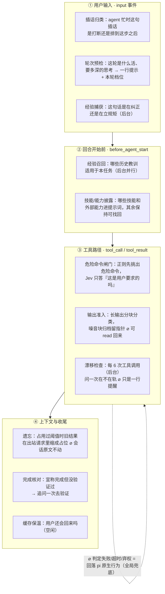
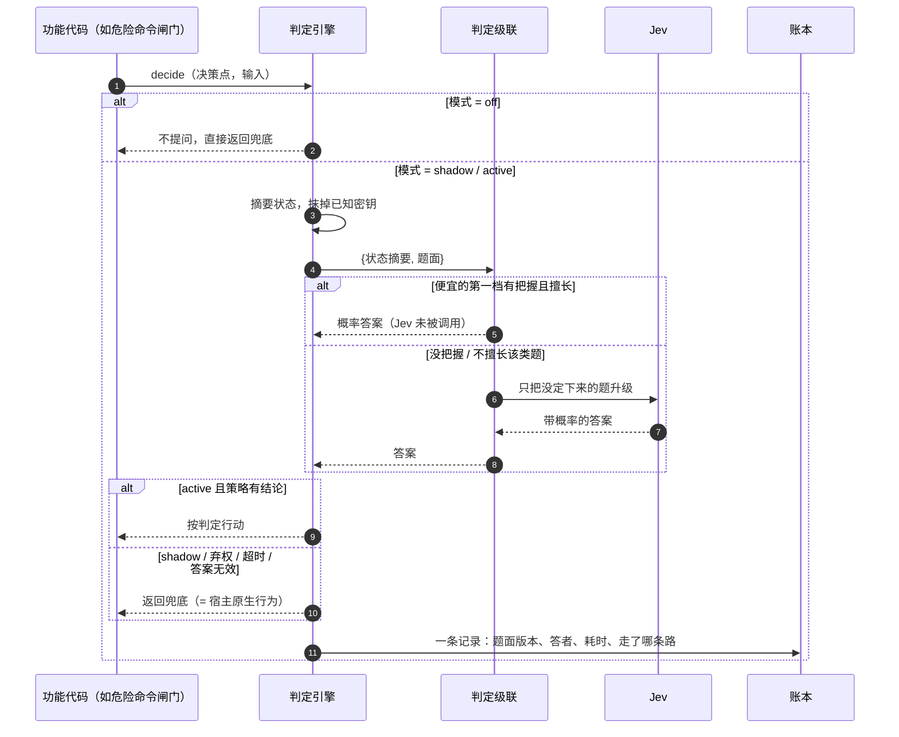

# 第 1 章：mu 的 harness 如何融入 Jev——把例行判断从主模型手里拿走

> 本章导读：mu 是一个基于 pi（开源 coding agent）的编程智能体，它的特殊之处不在模型，而在 harness：一层以 pi 扩展形式挂载的"判断内核"，把每轮对话中约 35 个与代码无关的例行决定（这条命令危不危险、这段输出值不值得进上下文、活干完没有），交给一个小而快的托管判断模型 **Jev** 去答。本章回答一个问题：这套 harness 是用什么结构把 Jev 织进宿主生命周期的。读完你应掌握：决策点的定义方式、判定引擎的三种模式与 fail-open 语义、Jev 在判定级联中的位置、一次判定从发问到落账的完整旅程、Jev 线协议的题面与应答长什么样，以及延迟与安全两端的边界设计。mu 的其他子系统（浏览器、蜂群、看板）都建立在本章机制之上，本章是它们的共同地基。

本章按「目标 -> 抽象 -> 接入点 -> 一次判定的旅程 -> 线上协议 -> 边界 -> 入口」展开，先立目标再落实现：


## 1.1 设计目标：哪些决定不该由主模型做

一个 coding agent 每轮要做几百个与代码无关的决定：什么留在上下文里、一条命令是否安全、一个发现值不值得告诉另一个 agent、工作是否真的完成了。这些决定只有两条朴素出路，各有各的失败方式：

| 出路 | 问题 |
| --- | --- |
| 全交给大模型 | 每个小决定都要动用最贵的注意力：花 token、加延迟，还会稀释主模型对工作本身的专注 |
| 全写成固定规则 | 场景太多变，规则错得太频繁，没人敢让规则真正做主 |

mu 的答案是引入第三个角色：一个小而快的**判断模型**，一次只回答一个有界问题。Jev 就是这个角色的托管实现——它不是聊天模型，而是一个问答服务：请求带上一份小状态和若干道有标准题型的题（是非题、选择题、程度打分），每道题带着一个概率回来。热连接下答一问约 0.3 秒，16 段工具输出合并成一次请求 0.44 秒。分工被概括为一句话：**判断模型判断，代码执行，主模型思考**。

harness 的职责由此确定。mu = pi（宿主 agent，主循环、工具、会话管理原封不动）+ 一层以 pi 扩展形式挂载的判断内核。Jev 在这套结构里是**可替换的一档**，不是架构的中心：本地小模型 Laya、任意生成式模型、甚至 mock，都可以顶替它答题。由此推出四个贯穿全部代码的工程目标：

1. **答错了要便宜、可撤回**——被归档的输出留有指针，被隐藏的技能能找回，会话文件里的原文永不动。
2. **答不出来就回到宿主原生行为**——判定失败、超时、弃权，一律回落到"没有判断模型时 pi 本来会做的事"。
3. **主模型上下文不被判定过程占用**——判定是旁路，多数结果根本不以消息形式出现。
4. **每次判定可审计**——每一条判定落账，题面、答者、耗时、走了哪条路都可回看，也是未来蒸馏专用判断模型的训练集。

## 1.2 核心抽象：四层互相独立的结构

融入的第一步不是找挂点，而是定义**一个判定长什么样**。mu 把它拆成四层，每层只认接口不认实现——这正是 Jev 能被随意替换的原因。

| 层 | 运行时职责 | 关键约束 |
| --- | --- | --- |
| 决策点定义 | 把一个业务问题写成一道标准题：题面 + 状态摘要器 + 策略 + 兜底 | 每个决策点自带兜底，兜底就是宿主无判断模型时的行为 |
| 判定引擎 | 收题、定模式、发问、算结果、落账 | 永不抛错：失败一律变兜底 |
| 判定者 | 真正答题的一方：单判定器或按成本排序的级联 | 功能代码不知道也不关心谁在答题 |
| 账本 | 每次判定一条记录 | 记账失败不得影响 agent 行为 |

**决策点定义**是一道题的完整契约，用代码里的类型固化下来。一道题必须声明：题面（布尔题必须带 ≤0.2/≥0.8 的置信带才有资格算数；选择题必须带逃生选项如 other/unclear，定义时没有就抛错拒绝注册）；状态摘要器——判定窗口只有 32K，送进去的是摘要和元数据，不是原文；策略——把答案翻译成行为的纯函数，可以弃权；兜底——确定性默认值；外加三个运行时元数据：缓存影响（不动上下文 / 只追加 / 会改前缀）、延迟等级（阻塞回合 / 与其他判定并行 / 纯后台）、所需能力（单文本分类、两段文本关系、程度打分、对请求本身的判断）。题面还带版本号，措辞一改就递增——账本里的判定因此可以按版本对齐比较。

**判定引擎**只有三个动词值得记：`off`（不问，直接兜底）、`shadow`（问了只记账，行为仍走兜底——新决策点的默认起点，先攒数据再转正）、`active`（按判定行动）。引擎是全链路上唯一"永不抛错"的一层：超时、答案无效、策略弃权，全部折算成兜底并写明原因。

**判定者**是三级结构。最内层是单个判定模型：默认 4 秒超时，超过 32 道题自动分片并发、共用同一份状态，返回前逐题校验答案（题型对不对、概率在不在 0–1、选择题的选项存不存在），不合格直接按"答案无效"处理。中间层是**级联**：判定档按成本从低到高排队（例如本地 Laya 在前、Jev 在后），每一档只回答前一档"没把握或不擅长"的题。两个机制支撑它：一是**置信带**——布尔答案落在带内、选择题最高选项概率不足 0.6，都算没把握，升级到下一档；二是**能力档案**——每个判定档声明自己不擅长哪类题（本地小模型的关系类和打分题不可信），这类题直接跳过它。档案存在的理由很锋利：过度自信是概率里看不出来的失败，只能由使用者声明。若没有任何一档可信，题被强制给一个中性答案，所有策略都把它读作"不确定"——判定档的已知弱点永远不允许驱动行为。最外层是各协议适配：Jev 本身有三条路（直连 TypeSafe、经 OpenRouter、经 Vercel AI Gateway，按哪个密钥在环境里自动选择），另有本地模型、任意生成式模型、以及一个与任何服务同形的通用 HTTP 适配——新判断模型出来，起一个说同一线协议的服务、配置里加一行即可，决策点零改动。

**账本**每次判定记一条：哪个决策点、第几版题面、哪个判定档答的、各档各答了几题、耗时、token、走的是判定还是兜底、为什么。批量判定（比如 30 段输出分块）合并成一条记录，账本不被刷屏。记录写进会话文件，也写本地 JSONL；`mu ledger` 命令和桌面端的 judgments 页把它和对应的用户消息配对回看。

四层之间唯一的耦合点是那次 `decide(决策点, 输入)` 调用。功能代码（比如危险命令闸门）写的是"问什么、答案怎么用"，永远不出现"Jev"三个字。

## 1.3 接入点：一轮对话里，Jev 在哪些时刻被问到

定义了判定之后，融入的第二步是选挂点。mu 没有改 pi 的主循环，挂点就是宿主已有的**生命周期事件**：用户输入、回合开始前、工具调用前后、上下文组装、回合结束、空闲。pi 对每个事件顺序执行各扩展注册的处理器，判断内核在入口处按序注册约三十个功能模块，每个模块挑自己关心的事件挂上去。注册顺序本身是设计：插话归类必须先于一切（不然别的功能已经对一条会被改道的消息做了反应）；轮次预检先于经验召回和技能披露（它们要读这轮的档位）；约束门先于权限审批（被用户规则排除的调用不值得再问一遍要不要放行）。

把一轮对话从头到尾排开，判定点分布如下——实线是主路径，`⌀` 标注的是每个点答错时的归宿：



这张图之外还有一族"主模型主动调用的工具"，判定循环藏在工具内部：`browse` 只让主模型说一次目标，之后每一步"做什么操作、点哪个元素"都由判断模型对着页面上的真实元素一问一定，直到判定目标达成——整个过程不进主模型上下文，只有最终页面和动作轨迹回来；`delegate` 派子代理时由判定选角色、选模型档位、选思考强度；`locate` 让判定给候选文件路径排序，替代一串 grep。这些工具的共同点是把"一步一问主模型"的循环整个换成了"一步一问判断模型"，主模型只出一次性指令、只收最终结果。

每个接入点还标了延迟等级：会挡住回合的一律封顶等待（见下一节），纯记账的丢到后台。错过的判定不补做、不重试——账本里记下原因，下一次问就是补偿。

## 1.4 一次判定的旅程

把上一节的任意一个接入点放大，判定这样流动。注意图里的分支：一次判定有两种"不采纳"，以及一条级联升级的路：



这条旅程有两个容易被误读的地方。其一，**Jev 不是每道题都见**：级联里便宜的前档能定就不升级，Jev 只挣灰色地带的钱；反过来，能力档案声明了某档不擅长的题，连问都不问它。其二，**"问了"不等于"用了"**：shadow 模式下判定照常发生、照常落账，只是结果被丢弃——这是新决策点的试用期，攒够了与真实结果的对照数据才转 active。

### 延迟治理：等待只算一次，影子从不等待

判定是网络调用，harness 真正的工程量在把几十次网络调用藏进一轮对话里。pi 对每个事件是顺序执行处理器的，若不治理，一轮开始前要串行等预检、召回、披露各一两秒，工具路径上每条命令再等一两次审批。mu 的治理手段按"谁等、等多久"组织：

| 手段 | 做什么 | 效果 |
| --- | --- | --- |
| 到达即问 | 回合开始前的几个功能在消息一到达就发出自己的问题，回合开始时只取回已在路上的答案 | 开始前等待从"各步之和"变成"最慢的一步" |
| 统一预算 | 所有回合前的等待从消息到达时刻起算，不给后发的问题续配额 | 一个功能慢了不会拖累整轮 |
| 影子不等待 | 非 active 的判定直接丢到后台记账，立刻放行 | 试用期零延迟 |
| 内联封顶 | 每个挡路的等待各有上限（预检 4 秒、完成核对 3 秒、遗忘 4 秒、输出准入 4 秒） | 超时就先放行，判定跑完只记账，下次生效 |
| 连接治理 | 判定请求走 HTTP/2 与保活连接；会话活跃时每 50 秒发一个不入账的小问题保温 | 热连接单问 0.31 秒，冷连接并发 3.9 秒降到 1.7 秒 |
| 整批一问 | 输出准入把 16 个块放进一次请求，状态只计费一次 | 1.43 秒（16 次请求）降到 0.44 秒，token 反而更少 |

这套治理的共同哲学是：**判定是增强，不是依赖**。任何一次判定迟到、失败、被跳过，agent 都必须照常往前走——这就是 fail-open。

## 1.5 Jev 的输入输出：线协议与真实报文

上一节的判定旅程，落到线上只有一个 HTTP 请求。Jev 的协议刻意做小：单一端点，请求是**一份状态 + 若干道题**，应答是**逐题的带概率答案**——与 Vercel AI Gateway 的 `evaluation-model` 契约同形，任何服务只要说这个形状就能顶替 Jev（CLM、自建中转都是这么接进来的）。题只有三种，恰好覆盖三类判定：

| 题型 | 题面构成 | 应答形态 |
| --- | --- | --- |
| `boolean`（线上改名 `noul`） | 一句指令 + 可选的 true/false 判据说明 | `{ "noul": 0.93 }` —— P(true)，不是回答者的信心 |
| `choice` | 一句指令 + 封闭选项集（选项名 → 描述，必含逃生选项） | 选中项 + 可选的完整分布 |
| `score` | 一句指令 + 有序档位表（从 0 起） | 落在档位之间的小数位置 |

一次真实请求长这样。以轮次预检为例——状态只有四个字段，判定窗口有限（32K），送进去的是摘要和元数据，不是原文：

```json
{
  "user_message": "把整个项目从 callback 重构成 async/await，先别动手",
  "current_action": null,
  "task_frame": null,
  "recent_turns": []
}
```

题面——同一次请求带 10 道（一道选择、六道是非、三道打分），这里节选三道看形状，选项与措辞是源码原词：

```json
{
  "turn_type": {
    "type": "choice",
    "instructions": "What does `user_message` ask for?",
    "criteria": {
      "chat": "Small talk or a general question that is not about code",
      "chat_question": "An explanation of a concept",
      "quick_lookup": "Finding where something is in the code",
      "single_edit": "One small code change",
      "multi_step_task": "A larger task with several steps",
      "research": "A broad survey or investigation",
      "design_discussion": "A discussion of options and trade-offs",
      "other": "Something else"
    }
  },
  "needs_files_changed": { "type": "boolean", "instructions": "Does `user_message` request a code change?" },
  "task_complexity": {
    "type": "score",
    "instructions": "What is the scope of `user_message`?",
    "criteria": ["A question", "One place in the code", "Several places in the code", "The whole codebase"]
  }
}
```

批量判定共用这套形状、换个组织法：输出准入把 16 个块放进**一份**状态（`call` 字段加 `c1`…`c16`），每块配一道题（`k1`…`k16`，题面相同，只换指令里指向的字段名）——状态只计费一次，16 次判定一次请求回来。

真实应答（集成测试里拦截到的原样报文）：

```json
{
  "model": "jev-1",
  "answers": {
    "edit": { "noul": 0.93 },
    "kind": { "choice": "chat", "confidence": 0.8, "probabilities": { "chat": 0.9, "other": 0.1 } },
    "size": { "score": 1.4, "confidence": 0.7, "probabilities": {} }
  },
  "usage": { "input_tokens": 300, "output_tokens": 40 }
}
```

内核收下后逐题校验——题型对不对、概率在不在 0 到 1、选择题的选项在不在题面里、打分有没有超出档位范围——任何一项不合格按"答案无效"处理，进上一节时序图里的 fail-open 分支。校验过的答案交给策略时还要过**三区间**：布尔题 ≤0.2 记 no、≥0.8 记 yes、带内记 unsure——级联正是在这个带里把题升级给下一档。屏幕上的判定行就是这些原始概率的投影（真实会话实测）：

```
◆ jev-latest  chat · answer directly · thinking medium → low · 804 ms
  turn type          chat 55% · concept question 45%
  side question      yes · 72% likely
```

题面措辞本身是被测量过的设计项：同一道是非题，长复合措辞在小型判定模型上 42% 准确率，压短到"一题一个短谓词、状态字段用反引号点名、不写枚举和复合条件"后 74%——同模型、同状态。所以题面措辞一改，决策点的版本号就递增，账本里的判定永远能按题面版本对齐比较。

## 1.6 边界与取舍

fail-open 是默认，但有一个精心挑选的例外。危险命令闸门的语义是反过来的：正则规则先筛出危险命令，判断模型只回答"这是用户要求的吗"——**判定只能加闸，不能开闸**。没有答案不等于放行，而是等价于"要用户确认"；连确认界面都没有的非交互环境，直接拦截并说明原因。安全路径上 fail-open 会变成漏洞，于是它 fail-closed 到人。

其余的边界，各有一条明确的设计理由：

| 边界 | 规则 | 理由 |
| --- | --- | --- |
| 规则先行 | 循环检测、危险命令筛选、逐字重复的日志折叠都用确定性规则，不问模型 | 能用代码定的事不花一次网络调用；判定档只看规则筛出来的真问题 |
| 错了可撤回 | 归档的输出留 read 回来的路径，隐藏的技能可用命令找回，被遗忘的结果在会话文件里原样保留 | 判断模型会错，架构必须让每个错误可逆 |
| 缓存分三档 | 每个决策点声明缓存影响；会改提示词前缀的判定只在缓存边界做、做了就粘住 | 提示缓存是延迟和成本的大头，准入（不放进来的 token 最便宜）优于事后遗忘，追加优于改写 |
| 默认 shadow | 新决策点一律先只记账 | 先用真实会话验证"它答得对不对"，再让它拿行为的主意 |
| 密钥不外流 | 送判前把已知密钥值从状态和题面里抹掉；为其他服务配置的密钥绝不发往 TypeSafe 的地址；判定状态默认不落盘 | 判定档能看到用户消息，密钥和配置的信任边界要收在用户自己一侧——判定配置只读用户目录，不读项目目录，防止克隆下来的仓库把判定指向自己的端点 |

几处不太显眼但值得记下的取舍：批量判定无论多少题只落一条账（超过 8 题连逐题答案都不留，防止账本膨胀）；判定在问出时记下"此刻在哪一轮"而不是在答出时——慢判定往往答到下一轮去了，不这样对不上账；状态默认只存哈希不存原文，要存原文得显式打开，为的是日后拿真实判定数据蒸馏本地模型时密文可控。

## 1.7 关键实现入口

| 机制 | 入口 |
| --- | --- |
| 总装：按序注册约三十个功能模块，顺序即设计 | `packages/kyrn-judge/src/extension/kyrn-judge.ts` |
| 运行时共享件：fail-open 封装、回合前统一预算、判定落进会话 | `packages/kyrn-judge/src/extension/runtime.ts` |
| 判定引擎：三模式、永不抛错、单条与批量判定 | `packages/kyrn-judge/src/decision.ts` |
| 单判定模型：超时、32 题分片、答案校验 | `packages/kyrn-judge/src/judge.ts` |
| 级联：置信带升级、能力档案路由、中性答案兜底 | `packages/kyrn-judge/src/cascade.ts` |
| 判定档装配：Jev 的三条路由、各档超时、密钥边界 | `packages/kyrn-judge/src/registry.ts` |
| Jev 线协议适配（System One：`{state, questions}` → `{answers}`） | `packages/kyrn-judge/src/providers/typesafe.ts` |
| 线协议类型契约：三种题型与应答形态 | `packages/kyrn-judge/src/types.ts` |
| 线上报文示例：布尔题出走为 `noul`、概率应答的原样报文 | `packages/kyrn-judge/test/typesafe-provider.test.ts` |
| 账本记录结构与落盘 | `packages/kyrn-judge/src/ledger.ts` |
| 危险命令闸门（本章正文例子：规则先行 + 只能加闸） | `packages/kyrn-judge/src/extension/features/guard.ts` |
| 注入点总图（项目自己的决策点清单，比本章更全） | `kyrn/docs/04-injection-points.md` |
| 宿主侧扩展事件定义（挂点的来源） | `packages/coding-agent/src/core/extensions/types.ts` |

## 1.8 小结

mu 融入 Jev 的方式可以压缩成三句话：**融入的载体**是宿主已有的事件系统——判断内核以 pi 扩展的形式挂进用户输入、回合开始、工具调用、上下文组装、回合结束、空闲这几类时刻，不改主循环一行代码；**融入的契约**是决策点定义——题面、状态摘要、策略、兜底被打包成一个自描述的单元，兜底保证判断模型缺席时系统照常，题面版本号保证判定数据可长期对齐；**融入的纪律**是 fail-open 加审计——失败回落宿主原生行为、错了便宜可撤回、安全闸门单独 fail-closed 到用户、每一次判定落账可回看。Jev 在这个结构里是可替换的答题者：协议有界（有状态的批量问答）、能力有档案、成本有级联，换一个更强的判断模型，决策点与 harness 都不用动。

如果继续拆解 mu，接下来的自然方向有二：一是藏在工具内部的判定循环（`browse` 的"一步一问"浏览器、`delegate`/`hive` 的子代理路由与蜂群白板），它们把本章的机制推到了多智能体场景；二是判定数据本身的用途（shadow 数据校准、阈值按用户校准、蒸馏专用判断模型），那是这套架构的长期回报所在。
