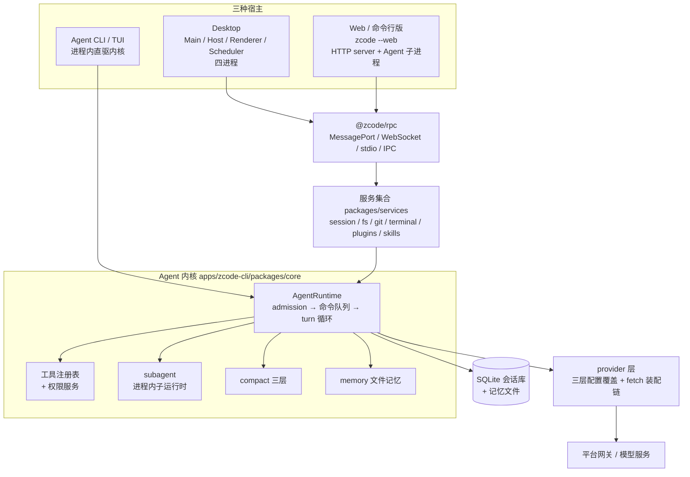

# How ZCode Works

> **文档同步跟踪**
> - 最后同步代码：`ZCode` commit `872ad960de`（2026-09-21）
> - 同步方式：基于该文档撰写时的源码路径梳理，关键论断已回到源码抽查

这是一组面向源码阅读的 ZCode 拆解笔记。

ZCode 是一个 AI 编程工作台：桌面应用、浏览器界面、终端 Agent 三种形态共享同一个 Agent 内核。写法上采用"先给心智模型，再沿真实代码路径下钻"的方式：不把仓库当成文件列表解释，而是把它当成一个正在运行的系统来拆。多智能体、上下文压缩、记忆、桌面端四个方向各有一章重点展开。

## 阅读入口

- [01. 整体架构：一个 Agent 内核，三种宿主形态](docs/01-overview.md)
- [02. Agent 运行时与主循环](docs/02-agent-runtime.md)
- [03. 工具系统与权限审批](docs/03-tools-and-permissions.md)
- [04. 多智能体模式：子代理运行时与调度](docs/04-multi-agent.md) ★
- [05. 上下文压缩：三层压缩体系与会话持久化](docs/05-context-compaction.md) ★
- [06. 记忆系统：文件记忆、注入与后台提取](docs/06-memory.md) ★
- [07. 桌面端：四进程模型与 Agent 托管](docs/07-desktop.md) ★
- [08. Server 形态与远程执行](docs/08-server-and-remote.md)
- [09. 插件、技能与 MCP](docs/09-plugins-skills-mcp.md)
- [源码索引](docs/source-map.md)

## 一句话总览

ZCode 是"一份 Agent 内核 + 一组可嵌入服务 + 一套传输无关 RPC"点亮成的三种宿主：

- Agent 内核在 `apps/zcode-cli`（独立子 workspace，可单独发行），运行时是**类 + 约百个 mixin 方法模块**的装配体，状态建立在**事件溯源**之上。
- 后端服务是**库不是服务器**：Web server 与桌面 Host 用同一个服务工厂实例化同一批服务。
- 子代理是**进程内子运行时**（不是子进程），与父共享事件存储；压缩是**三层体系**（micro / auto / reactive）；记忆是**纯文件方案**加后台受限提取 agent。
- 桌面端是四进程模型（Main / 每窗口 Host / Renderer / Scheduler），Agent 是被托管的 stdio 子进程。
- 模型执行经 AI SDK 三种 provider 类型 + 五层 fetch 装配链，官方端点精确转发到平台网关。

## 当前覆盖范围

九个主题：

1. 整体架构：双层 workspace、三种形态、RPC 骨架、服务集合、持久化布局、工程约束。
2. Agent 运行时：mixin 装配、消息准入（steer/queue 三分支）、命令队列、turn 循环、模型步、流式处理与恢复、事件溯源。
3. 工具系统：工具契约与副作用域、单次调用管道、权限模式决策序、审批与授权持久化、Bash 三层语义分析、并行调度、结果预算。
4. **多智能体**：子代理 = 进程内子运行时、profile 体系、生命周期与 watchdog、SendMessage 三分支路由、后台通知账本、动态工作流。
5. **上下文压缩**：microcompact / auto-compact 阈值算术 / reactive、摘要请求构造与降级链、rapid-refill 熔断、压缩与 rewind/fork 的持久化语义。
6. **记忆**：文件存储布局、两处注入点、后台提取调度与游标、记忆 agent 工具约束矩阵、子代理持久记忆、CLI/桌面开关差异。
7. **桌面端**：四进程职责边界、每窗口 Host、Agent 子进程托管与 v4 协议、TaskRealtimeBus（lease + 流镜像）、Scheduler 定时/闲时任务、手机远控。
8. Server 与远程：HTTP/stdio 双入口、SSH/WSL/Docker 远程部署链、发行包装器、Provider 三层配置、模型执行 fetch 装配链与网关转发。
9. 插件、技能与 MCP：五类插件贡献物、市场与商店、技能三级解析与信任边界、自定义命令、MCP 三种连接与 OAuth、逐边界信任模型。

## 后续可以继续按同样风格补

- v4 协议（topic 帧/重同步）的完整拆解
- 动态工作流编译器（类型检查/污点分析/时序投影）的下钻
- TUI（OpenTUI + React）的渲染与会话投影
- CUA（计算机使用）与浏览器控制链路
- 测试体系与 architecture-check 的实现
