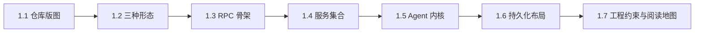
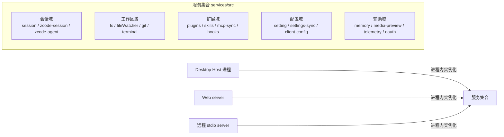

# 01. 整体架构：一个 Agent 内核，三种宿主形态

> **文档同步跟踪**
> - 最后同步代码：`ZCode` commit `872ad960de`（2026-09-21）
> - 同步方式：基于该文档撰写时的源码路径梳理，关键论断已回到源码抽查

ZCode 是一个 AI 编程工作台，但它不是"又一个 CLI 工具"。它的架构核心判断是：**Agent 内核只写一份，宿主可以有很多种**——桌面应用（Electron）、浏览器工作台（Web）、终端 TUI，三种形态共享同一个 Agent 运行时、同一套服务集合、同一套 RPC 框架。读懂这份拆解的钥匙就是"共享"二字：为什么后端服务要做成可嵌入的库？为什么通信要抽象成四种传输？为什么 Agent 与宿主之间隔着一层显式协议？本章先给出全仓库的版图与这几个问题的答案，后续章节再逐层下钻。

本章结构如下——先看仓库版图与形态矩阵（1.1-1.2），再过一遍贯穿全局的三条骨架：RPC 框架、服务集合、Agent 内核（1.3-1.5），最后看持久化布局与工程约束（1.6-1.7）：



## 1.1 仓库版图：双层 workspace

ZCode 是 pnpm monorepo，而且是**双层嵌套**的：

```text
ZCode/                          # 外层 workspace
├── packages/                   # 客户端、后端、框架层
│   ├── rpc/                    # 二进制 RPC 框架（@zcode/rpc）
│   ├── shared/                 # 共享类型与协议定义
│   ├── provider/ + provider-node/  # 模型 provider 层（协议适配）
│   ├── services/               # 服务集合（会话/文件/Git/终端/MCP/设置…）
│   ├── server/                 # Web 后端（HTTP + stdio 两种入口）
│   ├── client/ + ui/ + web/    # 客户端运行时、共享 React UI、Web 前端
│   ├── desktop/                # Electron 壳（main/host/preload/renderer）
│   └── zcode-cua/              # 计算机使用（CUA）能力
└── apps/zcode-cli/             # 内层 workspace（独立的 pnpm-lock）
    └── packages/
        ├── core/               # ★ Agent 运行时内核（@zcode/core）
        ├── bootstrap/          # 启动装配（配置/provider/插件/skills/MCP）
        ├── cli/                # 入口分发（TUI / Web / Agent 三模式）
        ├── tui/                # OpenTUI + React 终端界面
        ├── adapters/           # 持久化适配器（SQLite 会话库等）
        ├── contracts/          # 内核对外契约
        ├── dynamic-workflow*/  # 多角色工作流引擎（见第 04 章）
        └── node-repl-host/     # Node REPL 工具宿主
```

两层分开的关键原因在 **Agent 内核的独立性**：`apps/zcode-cli` 有自己的锁文件与发布流水线，可以单独打包成独立 CLI 发行包（含 SEA 单文件可执行构建），也可以被桌面端作为子进程拉起。内核不 import 外层任何包——反向依赖则被 `architecture-check` 强制拦截。

外层各包的分层也很清晰：`rpc` 是最底层的通信原语，`shared` 放跨进程类型契约，`provider`/`provider-node` 把"模型"抽象成协议适配（Anthropic messages / OpenAI chat completions / OpenAI responses 三种协议），`services` 是最大的包——四十多个服务都在这里，`server`/`desktop` 只是这些服务的两种"点亮方式"。

## 1.2 三种形态，一个后端

README 把三种入口写得很直白，但架构上的含义需要展开：

| 形态 | 启动方式 | "后端"在哪 | 典型场景 |
|------|---------|-----------|---------|
| Desktop | Electron 应用 | 每窗口一个 Host 进程内嵌服务集合（第 07 章） | 本地/远程工作区日常开发 |
| Web / 命令行版 | `zcode --web` | 本机 HTTP server（HTTP + WebSocket） | 浏览器工作台、远程开发机上跑 |
| Agent CLI | `zcode`（无参数进 TUI） | 进程内直接驱动内核 | 终端交互、脚本化 `-p` 模式 |

三种形态共享的部分远多于差异：

- **同一个服务工厂**：Web server 与桌面 Host 用同一个 `createLocalServices` 组装服务集合——文件、Git、终端、会话、设置等服务只有一份实现；
- **同一个 Agent 内核**：`@zcode/core` 的 AgentRuntime 与桌面、Web、TUI 的对接方式完全一致——要么进程内直驱（CLI），要么经 stdio 协议被宿主拉起（桌面），要么经 server 转发（Web）；
- **同一套 RPC**：Renderer↔Host 用 MessagePort 传输，Web 前端↔server 用 WebSocket 传输，SSH/WSL/Docker 远程工作区用 stdio 传输——对上层服务代码来说只是换了个传输构造参数；
- **同一份会话存储**：都落在用户数据目录的 SQLite 库里，换个形态打开同一工作区，历史会话仍在。

这种"内核 + 宿主"的拆法有一个直接的工程红利：新增一种宿主（比如 IDE 插件）只需要实现传输与装配，不需要碰 Agent 与服务的任何一行。

## 1.3 RPC 骨架：@zcode/rpc

`@zcode/rpc` 是整个系统的神经系统，约十几个文件构成一套自研 RPC：

- **序列化**：自研二进制格式（VQL），帧头 13 字节（类型 + id + ack + 长度），支持双向 ack 与大消息分片；
- **通道**：`ChannelServer` / `ChannelClient` 是通信的两端，服务经 `ServiceCollection.exposeOnChannelServer` 暴露，客户端经 `ProxyChannel.toService` 拿到类型安全的代理——调用远端服务与调本地对象写法一致；
- **传输无关**：通道之下是可替换的 transport——Electron MessagePort、WebSocket、Node IPC、stdio（远程工作区）。换传输不改协议；
- **装饰器**：`LoggingChannelServer`、`NetworkTelemetryChannelServer` 等中间件按需包裹，日志与遥测不侵入服务实现。

这套框架存在的理由是桌面端的进程拓扑（第 07 章）：Main、Host、Renderer、Agent 是多个进程，而服务代码想保持"位置透明"——服务在哪运行是装配期决定，不是编码期写死。

## 1.4 服务集合：后端是一个库，不是一台服务器

`packages/services/src` 是理解 ZCode 后端的目录。它不是"API 路由的集合"，而是**一组可嵌入的服务类**：



几个值得点名的域：

- **会话域**（session/zcode-session/zcode-agent）：管理会话索引与 Agent 子进程生命周期，是桌面端与 Web 后端的"Agent 管家"（协议细节见第 07/08 章）；
- **扩展域**（plugins/skills/mcp-sync）：插件、技能、MCP 配置的同步与分发，宿主形态无关（第 09 章）；
- **zcode-agent**：内部包含 Agent 子进程管理器与 JSON-line stdio 协议客户端——桌面端"养 Agent"的机制全在这（第 07 章）。

## 1.5 Agent 内核：apps/zcode-cli/packages/core

Agent 内核是本项目的心脏，目录即模块地图：

| 目录 | 职责 | 详述章节 |
|------|------|---------|
| `runtime/` | AgentRuntime 类 + 约百个 mixin 方法模块：turn 循环、流处理、命令队列、steering、事件持久化 | 02 |
| `tool/` | 工具目录：定义、注册、handler、执行管道 | 03 |
| `permission/` | 权限服务：模式、审批流、bash 只读分类器 | 03 |
| `context/` | provider 请求装配：system 段、消息投影、缓存提示、媒体预算 | 02 |
| `compact/` | 三层压缩：micro / auto / reactive | 05 |
| `memory/` | 文件记忆：索引、注入、后台提取 | 06 |
| `subagent/` | 子代理：profile、runner、事件镜像、持久记忆 | 04 |
| `mcp/` | MCP 服务器连接与工具桥接 | 09 |
| `workflow/` + `dynamic-workflow*` | 多角色工作流：模型写脚本 → 编译 → 沙箱执行 | 04 |
| `model/` + `provider` 层 | 模型选择与协议适配 | 08 |
| `hooks/` | 生命周期钩子 | 03 |
| `repl/` | Node REPL 工具的会话宿主 | 03 |

内核的一条设计主轴是**事件溯源**：会话的每条消息、每次工具调用、每个压缩边界都是追加进 SQLite 的事件（第 05 章），运行时内存里的消息历史只是投影。这带来 rewind/fork/resume 的能力，也让多宿主（桌面窗口 + 手机）能从同一事件流各自的断点恢复。

## 1.6 持久化布局

用户数据集中在 `~/.zcode/cli/`（桌面端另有 `.zcode/` 数据基目录，可用环境变量重定向）：

```text
~/.zcode/cli/
├── db/db.sqlite            # 会话事件库（Node 内置 node:sqlite，无原生依赖）
├── memories/projects/<slug>-<hash>/memory/   # 项目记忆（第 06 章）
├── agent-memory/<agent>/   # 子代理持久记忆（第 06 章）
└── agents/                 # 子代理 profile 的用户级来源（第 04 章）
```

三处值得注意的取舍：数据库用 Node 24 内置的 `node:sqlite`——零原生编译依赖，换机器不用 node-gyp；记忆是纯文件——用户可直接打开改，可提交进仓库（project scope）；profile 是 markdown frontmatter——写一个 agent 不需要写代码。

## 1.7 工程约束与阅读地图

仓库的 AGENTS.md 与 `architecture-policy.yaml` 把架构规则做成了**可执行的检查**（`pnpm architecture:check`）：

- 单文件 ≤ 400 行，超过即拆——这是为什么 `runtime/methods/` 下有上百个小文件；
- 模块边界按 port（接口）划分，禁止 deep import、禁止循环依赖；
- 协议改动必须同步类型定义与运行时校验（zod）——Agent 协议 v4 定义在 shared 里被两端共用。

这些约束不是装饰：正是它们让"百个 mixin 模块、四种传输、三种宿主"的结构在长期演进中不塌方。

**后续章节地图**：

| 章 | 主题 | 章 | 主题 |
|----|------|----|------|
| 02 | Agent 运行时与主循环 | 06 | 记忆系统 |
| 03 | 工具系统与权限审批 | 07 | 桌面端四进程模型 |
| 04 | 多智能体模式 | 08 | Server 形态与远程执行 |
| 05 | 上下文压缩 | 09 | 插件、技能与 MCP |

## 1.8 小结

ZCode 的整体架构一句话：**一份 Agent 内核 + 一组可嵌入服务 + 一套传输无关 RPC，点亮成桌面/Web/CLI 三种形态**。

- 双层 workspace 把内核的独立发布与宿主的共享代码分开；
- "后端是库不是服务器"——服务集合被三种宿主以不同方式点亮；
- Agent 与宿主之间是显式协议而非进程内耦合，换来版本独立与故障隔离；
- 工程约束（400 行、port 边界、架构检查）是这套结构能维持的前提。

下一章进入内核内部，拆解 AgentRuntime 的主循环：一条用户消息如何变成模型请求、流式响应、工具调用，再回到下一条请求（第 02 章）。
