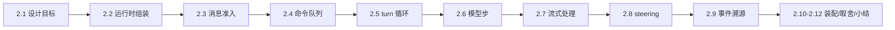
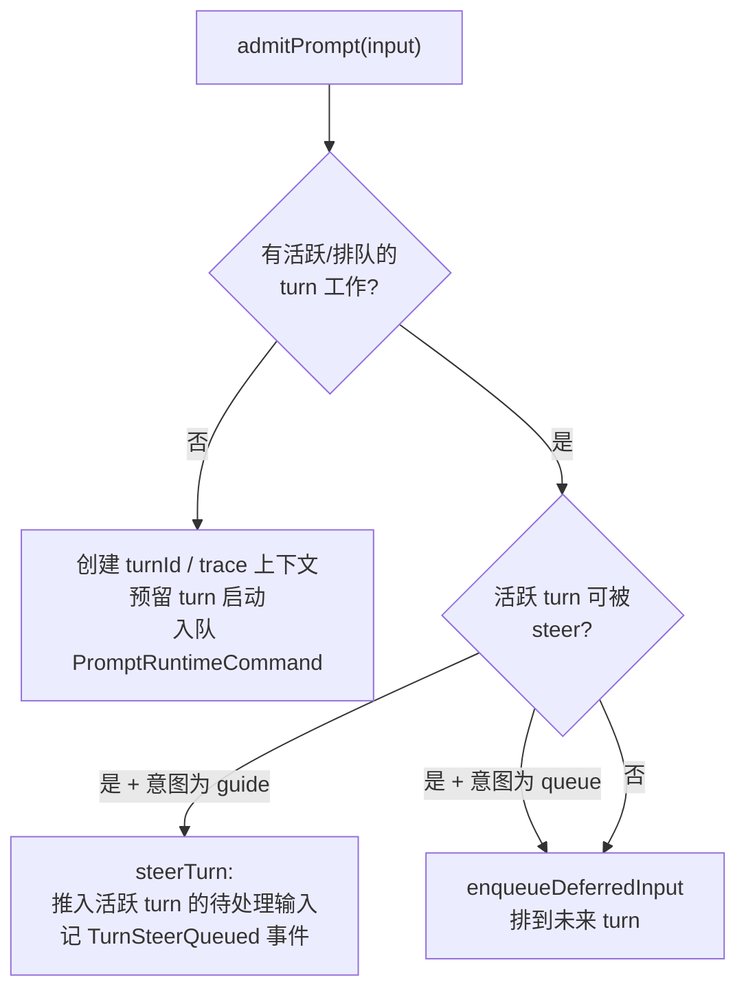
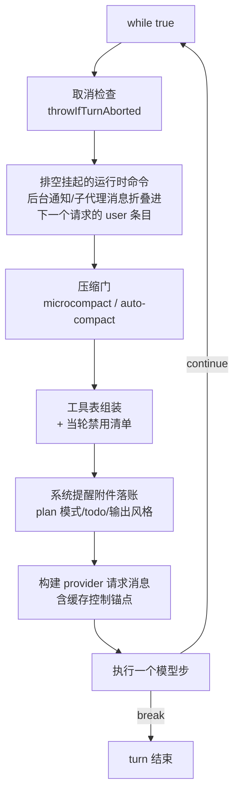

# 02. Agent 运行时与主循环：admission、turn 循环与事件溯源

> **文档同步跟踪**
> - 最后同步代码：`ZCode` commit `872ad960de`（2026-09-21）
> - 同步方式：基于该文档撰写时的源码路径梳理，关键论断已回到源码抽查

用户消息进入 Agent 之后发生什么？ZCode 的答案是三层结构：**admission（准入）→ 命令队列 → turn 循环**。准入决定"这条消息是开新轮、插进当前轮、还是排队"；命令队列把所有要跑的事（用户 prompt、后台通知、子代理消息）统一成串行队列；turn 循环则是"模型请求 → 流式解析 → 工具执行 → 结果回喂"的迭代。整个运行时建立在事件溯源之上——每个可持久化的事实都是带序号的事件，内存状态只是投影，这让会话可以随时被恢复、回滚、fork。读完你会理解运行时的组装方式、一条消息的完整生命周期、流式错误如何恢复、以及主循环为什么没有轮数上限。

本章结构如下——先看运行时如何组装（2.1-2.2），再沿一条消息走完准入、队列、turn 循环、模型步四层（2.3-2.6），然后拆流式处理与 steering（2.7-2.8），最后收在事件溯源与请求装配（2.9-2.10）：



## 2.1 设计目标

运行时围绕四个目标设计。

**第一，一个会话同时只有一个 turn。** 双击发送、并发注入、后台通知同时到达——所有输入都必须经过原子准入，busy 时要么插队（steer）要么排队，绝不允许两个 turn 并行写同一个会话历史。这是整个运行时最硬的不变量。

**第二，轮与步分离。** 一个 turn（一轮用户交互）内可以有一次到多次模型请求（step）：模型每发起一批工具调用，结果回喂后就再请求一次，直到模型不再调工具。turn 是用户视角的"一次对话"，step 是模型视角的"一次请求"——两级结构让"工具循环"与"用户输入边界"各自有清晰的状态机。

**第三，主循环没有轮数上限。** 与子代理（默认 4 轮封顶，第 04 章）不同，主 Agent 的 turn 循环不设 maxTurns——什么时候停由模型自己决定（不再发起工具调用）、由工具决定（结果带终止控制）、或由用户决定（取消/Stop）。上限缺失是刻意的产品判断：主会话是开放 ended 的工作循环。

**第四，一切状态是事件投影。** 会话事件流是唯一事实源，带单调序号；内存里的消息历史、模式、待办、检查点都是归约结果。任何崩溃、恢复、回滚都只是"重放事件到某个点"，不存在需要双写的第二份真相。

## 2.2 运行时组装：声明合并 + mixin 装配

AgentRuntime 的组装方式在这个体量的代码库里很少见，值得完整拆开：

```text
class AgentRuntime {        ← 类体只有私有字段 + 构造器（会话 ID、配置、
                              eventReducer、eventStore、messageHistory、
                              命令队列、activeTurn 等状态容器）
  ...
}
interface AgentRuntime {    ← 同名 interface 用声明合并挂出 ~90 个公开方法签名
  admitPrompt(...): ...
  executeTurn(...): ...
  steerTurn(...): ...
}
installAgentRuntimeMethods(AgentRuntime)  ← 把 ~190 个 mixin 函数逐个赋到
                                            prototype 上，收口装配
```

每个 mixin 是一个独立模块里的独立函数，`this` 类型指向一个"内部视图"类型——它能看到类的私有字段。方法目录下约百个模块、装配表约 190 个赋值，覆盖准入、turn、流式、压缩、子代理、事件、恢复等所有能力。

这个设计是仓库"单文件 ≤ 400 行"约束的直接产物：turn 循环、压缩、恢复任何一块都远超 400 行，拆成 mixin 是唯一能让每个模块保持小而完整的方式。代价是类的"真实形状"分散在几十个文件里，需要靠装配表还原全貌；收益是每个模块可以独立阅读、独立测试，方法之间的依赖全部显式走 `this`。

依赖注入刻意做薄：**必注入的只有两个**——事件存储与模型工厂。会话存储、权限 broker、MCP 端口、子代理端口、artifact 存储等其余十余个端口全部可选，缺省时落到内置的内存实现或拒绝实现。真正把一切接起来的组装点在 bootstrap 层的应用工厂：它建好 SQLite 会话存储、各端口、模型工厂后 `new AgentRuntime(...)` 一次性注入。

## 2.3 消息准入：admission 的三分支

一条用户消息从 UI（或宿主协议）到达运行时，第一站是准入：



准入的核心约束写在方法头注释里：**busy 检查 + turn 预留 + 队列插入必须原子完成**——否则两个并发提交可能各自通过 busy 检查，导致一个会话里出现两个 turn。这就是 2.1 第一条不变量的实现位置。

三种去向的语义差异：新 turn 完整走一遍启动流程；`guide` 型 steering 意图是"当轮内联引导"——消息会插进**当前** turn 的下一个模型请求；`queue` 型是"排到未来 turn"——等当前 turn 结束后由队列自动拉起。UI 的发送框默认尝试 steer（用户期望"补一句话"），显式选择入队时才走 queue。

## 2.4 命令队列：一切待办皆命令

准入之后，所有要执行的事被统一成运行时命令：

| 命令模式 | 内容 | 优先级 |
|---------|------|--------|
| `prompt` | 用户 prompt（新 turn） | next |
| `target-continuation` / `-loop` | 目标任务的续跑 | next/later |
| `task-notification` | 后台任务完成通知 | 可合并 |
| `subagent-message` | 子代理 SendMessage | next |
| `control-only-turn` | 纯控制操作 | — |

队列的关键语义：**串行消费、同优先级合并、前台占用记账**。后台通知在出队时按相同优先级**合并成批**——三个后台任务同时完成只产生一个批量通知 turn（第 04 章的批量合成消息即来源于此）；消费循环串行执行，每条命令跑完才取下一条；用户点 Stop 走的是"终止前台执行"的队列操作，不是杀掉整个运行时。

这个队列把"用户输入"与"系统注入"统一成一个模型：无论消息来自键盘、手机远控（第 07 章）、后台任务还是子代理，在运行时眼里都是一条待消费命令——副作用、优先级、合并策略按模式区分，消费路径只有一条。

## 2.5 turn 循环：每一步迭代做什么

命令消费后进入 `executeTurnCommand`，它先完成 turn 级准备（冻结当轮模型选择、建 turn 级取消域、会话首次持久化、发 TurnStarted 事件、SessionStart 与 UserPromptSubmit 钩子——后者可以拦截并直接终结本轮），然后进入模型步循环：



几个设计点：

- **取消检查在循环最顶端**——每一轮迭代、每个 await 边界都会抛检查，用户打断的响应延迟最多是一个模型步；
- **后台命令在步骤间排空**而非立即中断——正在跑的工具批不会被打断，挂起的通知作为 user 条目并入下一次请求（这就是 2.4 合并语义的落点）；
- **缓存锚点的刻意安排**：缓存控制标记打在"最新的非系统消息"上，且是在消息排序投影**之后**设置——防止合成条目（系统提醒、通知）抢走缓存锚点，否则每次请求的缓存前缀都会失效（与第 05 章压缩"不动稳定前缀"呼应）。

**turn 的结束条件**只有四种：模型步没有任何可执行的工具调用（先给内联引导和 Stop 钩子各一次"要不要继续"的机会，都放弃才算真结束）；工具结果携带终止控制；输出 token 续跑耗尽；取消。**没有轮数上限**——这与 2.1 的判断一致。

## 2.6 一个模型步：请求、解析、恢复

单步执行（`runModelBackedTurnStep`）是全运行时最长的函数，按顺序做五件事：

1. **请求前持久化**：assistant 消息与 step-start 先落库、发 ModelRequest 事件——先记账后干活，崩溃了也能看出"这步发出去了"；
2. **发起流式请求**：流式回调（文本增量/思考增量/工具调用）接到流式工具协调器上（纯读工具可在流中提前执行，见 3.7 章）；
3. **错误恢复链**：请求失败不是直接报错，按序尝试——流恢复（见 2.7）、Start-Plan 占用重试（1s/2s 退避）、取消流的快照持久化、错误持久化 + 溢出反应式压缩（第 05 章）后重试；
4. **成功后解析**：提取工具调用（按 ID 去重归一）、输出 token 续跑分类（模型把 token 用完了但话说一半，走续跑重请求）、可疑空输出检查、思考/文本块持久化、发 ModelComplete（含 stopReason 与 usage——provider 用量从这里进入第 05 章的 token 计数基线）；
5. **分支**：有工具调用 → 提交 assistant 工具条目并执行工具批；没有 → 走结束流程。

工具批的执行与回喂（第 03 章的管道在此被调用）完成后，结果经 `commitTurnRequestEntries` 写回请求条目——下一次模型请求的输入里就有工具结果了——然后返回 `continue`，循环回到 2.5 的顶端。

## 2.7 流式处理：增量、缓冲与恢复

流式层有三个精确的机制：

**事件扇出**：`for await` 消费模型流的十几种事件——文本起止/增量、思考起止/增量（按块 ID 归组）、工具入参起止/增量、tool_call、finish、error。文本增量既累积进完整文本，又同步发 `ModelStreaming` 会话事件给 UI。

**工具入参的部分缓冲**：`tool_input_delta` 是模型正在写的入参碎片（比如 Write 的文件内容）。碎片按工具调用 ID 缓冲，遇到换行或攒到 **4096 字符**就刷给 UI——注释明确说这是为了让 Write/Edit 的内容在 UI 上及时滚动可见。权威的完整入参以最终 tool_call 事件为准，增量只是预览。

**写队列背压**：流式事件写持久化不能阻塞 SSE 读取——追加操作串进一个 promise 尾队列，挂起写入超过 **128** 条即背压，在 finish/error/tool_call 边界显式排空。持久化慢于流是常态，队列保证不丢序、不阻塞、不无限积压。

**流恢复**：流中途断了怎么办？分两种局面。还没有已提交的工具调用 → 中止本次流，把部分 assistant 输出标记为"丢弃"持久化，从上一条消息锚点重开请求；已有已提交的工具调用 → 提交 assistant 工具条目，为未完成的调用合成合理结果，发 StreamRecovery 事件组（锚点选择/尾部丢弃/重试开始），下一请求带恢复标记。核心层重试封顶 **10 次**，且只对瞬态错误分类重试。原则是：**已发生的副作用绝不回滚，未发生的绝不重复**——恢复永远在"提交点"续接。

## 2.8 Steering：插队与排队的落地

steer 在 2.3 完成准入后，落地有两段：

**排队**：合法 steer 请求把输入推入活跃 turn 的 pending 列表（带 expectedTurnId 校验——UI 预期插队的是那个 turn，不是别的）。pending 是一等公民：可以移除、编辑、重排、清空、暂停自动排空——UI 的"发送队列"面板直接操作这份数据。

**消费**：guide 型输入只在**合法边界**被消费——一整批工具跑完之后、或纯文本边界处。消费时创建正式用户消息 ID、解析附件、持久化、发 TurnSteerDrained 事件，并把该条输入作为 user 条目追加进下一个模型请求。边界消费是刻意的：不在工具执行中途注入用户消息，模型看到的输入永远是"完整的一批工具结果 + 可能的引导"，语义干净。

## 2.9 事件溯源：append、归约与恢复

**append 是唯一的写入口**：事件先进内存事件存储领单调序号（只有存储发过号的事件才发布——保证实时订阅、重放、快照三者共用同一排序），然后写持久化投影行，再记账工具用量、扇出给事件 sink（UI 推送、子代理镜像等都挂在这里）。内存事件存储带轮次窗口的瞬时事件清理——事件流不能无限膨胀。

**归约**：EventReducer 按事件类型查表，把事件流折叠成投影（会话模式、消息历史锚点等）。运行时持有的 reducer 主要在恢复时用。

**恢复**（resume）是一次完整的"从存储重建现场"：

```text
加载会话 + 全部消息 → 恢复分支代际/任务注册表围栏
→ 重建消息历史（含读文件状态、检查点、rewind 条目）
→ 从事件流归约出权威模式 → 恢复执行状态条目
→ 丢弃未消费的持久化 steer 输入 → 重注入 todo 与目标状态
→ 发 SessionResumed → 跑 SessionStart(resume) 钩子
```

注意持久化是**分工**的：事件存储在内存（序号与订阅），会话内容本体在 SQLite（消息、条目、todo、用量）。恢复把两者拼起来——SQLite 给内容，事件流给模式与秩序。与第 05 章呼应：压缩改投影不动事件流，恢复重放投影不动原始事件。

## 2.10 provider 请求装配

每次请求前，运行时条目被投影成 provider 消息，装配分两半：

**系统侧**（会话初始化时构建一次）：ContextBuilder 按序组装段落——CLI/产品前缀、身份或自定义 system prompt、动态段落（桌面上下文、会话指引、记忆、环境与 Git 信息、输出风格、上下文管理说明）。每个段落带两个标注：注入目标（system 段还是 meta-user 附件）与缓存提示（stable/dynamic）。装配结果最多三条 system 消息，每条带 ephemeral 缓存标记——**分段即缓存边界**，动态段变了不会让稳定段缓存失效。技能清单、工作区指令、记忆索引、当前日期作为 meta-user 附件拼在用户侧（第 06 章的记忆注入即落在这里）。

**消息侧**（每次请求投影）：条目排序、附件归位、会话中途 system 投影、遗留系统提醒后置，最后打缓存锚点。媒体预算先于一切：默认单请求媒体总预算 **40MB**，超限从旧媒体开始降级/丢弃，但**保护最新真实用户消息的附件**——刚粘贴的截图永远优先于历史图片。

## 2.11 设计取舍

**为什么 mixin 装配而不是继承或组合？**
继承在这个体量下必然产生 5000 行的上帝类；组合（服务对象互相持有）会让"一个 turn 的状态"被撕碎到多个对象里，取消域、steering 队列这类 turn 级状态无法共享。mixin 是折中：状态集中在一个实例上，代码分散在几十个小文件里。装配表就是显式的类目录——读 index.ts 一遍等于读完 API 面。

**为什么准入要原子，而消费可以串行慢慢来？**
准入是唯一可能产生"双 turn"竞态的地方，必须一次判断内完成；消费天然串行（单队列单消费者），慢只影响延迟不影响正确性。把原子性收窄到准入一个函数，是把"必须正确的部分"做到最小。

**为什么主循环不设 maxTurns 而子代理设？**
主 Agent 是与人协作的开放循环，"跑到多少轮"不该由代码假设；子代理是资源受控的委托（父级在等它），必须有预算护栏防跑飞。同一份循环代码，两种宿主语义——预算由调用方注入，不是运行时内置。

**为什么 steering 只在工具批边界消费？**
在工具执行中途注入消息会让模型看到"半个工具结果 + 一句话"的破碎上下文；批边界消费让每次请求的输入都是完整语义单元。代价是引导消息最多延迟一个工具批，这是干净语义换来的合理延迟。

**为什么流恢复要区分"有无已提交工具调用"？**
没有工具调用时，整条 assistant 输出可以安全重来（无副作用）；有工具调用时，结果已经持久化甚至已经产生文件副作用——重来会双写。所以前者"丢弃重来"，后者"续接提交点"。恢复策略的分界线是副作用是否已发生，而不是错误类型。

## 2.12 关键实现入口

| 责任 | 主要文件（`apps/zcode-cli/packages/core/src/`） |
|------|------|
| 运行时类与装配收口 | `runtime/agent-runtime.ts`（`installAgentRuntimeMethods` 在文件尾） |
| mixin 装配表 | `runtime/methods/index.ts` |
| 内部视图类型 | `runtime/internal.ts` |
| 消息准入 | `runtime/methods/prompt-admission.ts` |
| turn 启动与拆除 | `runtime/methods/turn.ts` |
| 模型步循环 | `runtime/methods/turn-loop.ts` |
| 单个模型步 | `runtime/methods/turn-model-step.ts` |
| 工具批执行与回喂 | `runtime/methods/turn-tools.ts` |
| turn 结束条件 | `runtime/methods/turn-stop.ts` |
| steering 排队与消费 | `runtime/methods/steering.ts`、`turn-guide-drain.ts` |
| 命令队列 | `runtime/command-queue.ts`、`runtime/methods/runtime-command-queue.ts` |
| 流式事件与写队列 | `runtime/methods/model.ts`、`model-streaming-event-queue.ts` |
| 流恢复 | `runtime/methods/streaming-recovery.ts` |
| 事件追加与 sink | `runtime/methods/events.ts` |
| 恢复 | `runtime/methods/resume.ts` |
| 系统段装配 | `context/builder.ts` |
| 请求消息投影与缓存锚点 | `runtime/helpers/provider-request-messages.ts` |
| 媒体预算 | `runtime/helpers/media-budget.ts` |
| bootstrap 组装点 | `packages/bootstrap/src/app/create-app.ts`（运行时创建处） |

## 2.13 小结

主循环可以压缩成一句话：**准入定去向，队列定次序，turn 定边界，模型步定节奏，事件流定真相。**

- 组装：声明合并 + ~190 个 mixin 赋值，必注入仅事件存储与模型工厂两个；
- 准入：busy 检查 + turn 预留 + 入队原子完成，busy 时三分支——新轮 / 当轮 guide / 排队；
- 循环：每步迭代做取消检查、命令排空、压缩门、工具表、请求投影，无轮数上限；
- 模型步：先持久化后请求，失败走四级恢复链，恢复分界线是"副作用是否已提交"；
- 事件溯源：append 唯一入口、存储发号、内存与 SQLite 分工，恢复 = 重放投影。

模型步的末端把工具调用交给了执行管道——那条管道里的校验、权限、审批、预算，是下一章的全部内容（第 03 章）。
