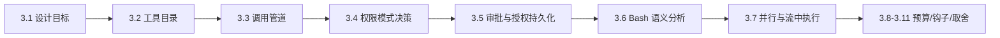
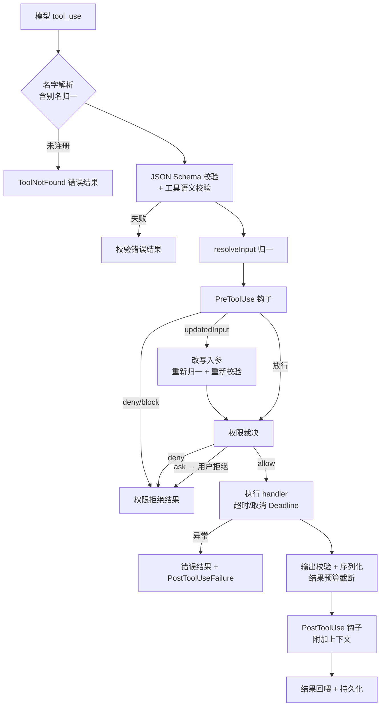
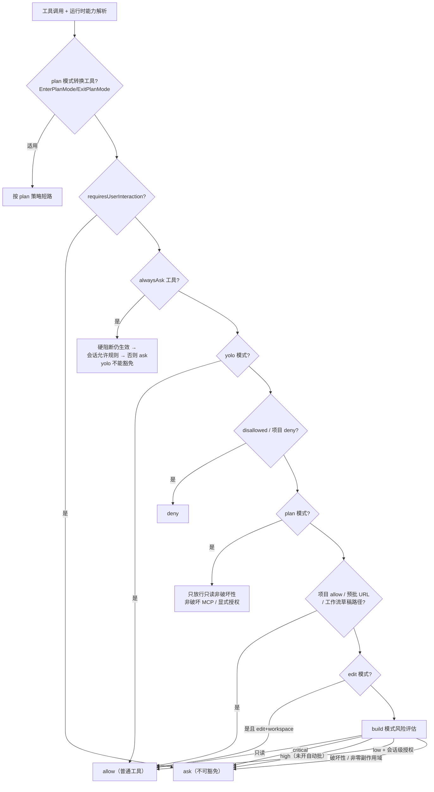
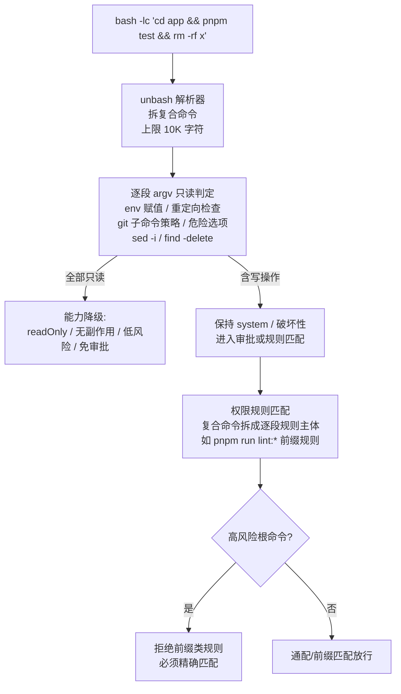

# 03. 工具系统与权限审批：一条调用管道与七种副作用域

> **文档同步跟踪**
> - 最后同步代码：`ZCode` commit `872ad960de`（2026-09-21）
> - 同步方式：基于该文档撰写时的源码路径梳理，关键论断已回到源码抽查

模型每发起一次工具调用，都要穿过一条固定的管道：名字解析 → 输入校验与归一 → 生命周期钩子 → 权限裁决 → 执行 → 结果预算 → 持久化。这条管道是 ZCode 安全模型的主承重墙——所有"模型能不能做这件事"的判断都收口在管道中段的一个权限服务里，而判断的依据是每个工具自带的**副作用域**与**风险级**标注。读完你会理解工具如何定义与注册、权限模式的完整决策序、审批弹窗背后的请求-响应机制、Bash 命令如何被逐段分析出读写性、以及并行工具调用与流中执行的调度规则。

本章结构如下——先看工具如何定义注册（3.1-3.2），再走通单次调用管道（3.3），然后下钻权限系统这个最重的模块（3.4-3.6），最后收在并行调度、结果预算与钩子（3.7-3.10）：

## 3.1 设计目标

工具系统围绕四个目标设计。

**第一，声明式安全标注。** 每个工具在定义处就声明自己的元数据：是否只读、是否破坏性、副作用域是哪一层、风险级多高、要不要审批。权限服务不认识具体工具，只消费这些标注——新增工具自动纳入同一套安全体系，不用改权限代码。

**第二，一处裁决，处处生效。** 模型发起的调用、钩子改写后的调用、子代理的调用、MCP 工具的调用，全部走同一条管道、同一个权限服务。不存在"某条路径绕过审批"的第二入口。

**第三，钩子可以干预，但不能拆底线。** 钩子（hook）可以在工具执行前拒绝、改写入参，在审批时抢答；但被标记为"永远要问"的工具（如 AskUserQuestion）连钩子和 yolo 都不能豁免——底线标注是结构性的，不是流程性的。

**第四，输出有预算。** 一次 Bash 调用可能吐几 MB 日志，一次 Read 可能读几万行。管道末端有统一的结果预算：正文截断、预览保留、超限内容转存 artifact——上下文窗口是共享资源，工具输出必须限额进上下文。

## 3.2 工具目录：定义、元数据与注册表

一个工具 = 契约声明 + 执行器。契约里的关键字段分三组：

| 字段组 | 内容 | 消费方 |
|--------|------|--------|
| 接口 | 名称、描述、JSON Schema 入参、别名 | 模型（provider 工具表） |
| 语义 | 只读 / 破坏性 / 并发安全 / 风险级 / `sideEffectScope` / `needsApproval` / `allowedInPlanMode` | 权限服务、调度器 |
| 执行 | handler、超时与取消策略、输出 schema、结果预算、模型内容格式化钩子 | 执行管道 |

**副作用域**是整个安全模型的坐标轴，取值七种：

| 域 | 含义 | 代表工具 |
|----|------|---------|
| `none` | 纯读，无副作用 | Read / Glob / Grep / TodoRead / TaskOutput |
| `workspace` | 改工作区文件 | Write / Edit / SaveWorkflow |
| `git` | 改 Git 状态 | （内置工具未用，Bash 下的 git 归 `system`） |
| `network` | 出网 | WebFetch / WebSearch / **所有 MCP 工具（默认）** |
| `system` | 执行任意系统命令 | Bash / node REPL |
| `session` | 只影响本会话状态 | Agent / Skill / EnterPlanMode / SendMessage / TaskStop |
| `userInteraction` | 需要用户交互 | AskUserQuestion |

**注册表**是模型可见工具的唯一来源：内置工具、MCP 工具（`mcp__<server>__<tool>` 命名，见 3.9）、工作流工具族都注册进同一个 Map。别名与正式名并存但正式名永远优先；发给 provider 的契约表会过滤掉 `providerVisible: false` 的工具，并把 `modelInstructions` 附加成"Usage:"说明块。

内置工具按注册时的功能开关组装——`includeAgent`、`includeSkill`、`includeNodeRepl`、`includeDynamicWorkflow` 等门控决定这批工具进不进表，这也是子代理工具面收窄（第 04 章）的物理基础：**收窄发生在注册层，不是执行层**。

## 3.3 单次调用的完整管道

从模型吐出一次 tool_use 到结果回喂，管道按固定顺序执行：

三个容易忽略的细节：

- **`resolveInput` 归一发生在钩子与权限之前**。这是刻意安排：钩子看到的、审批 UI 展示的、handler 实际执行的三者必须是同一份字节，否则"用户审批的是 A，执行的是 B"这类错位就可能出现。钩子改写入参后同样要重新归一、重新校验。
- **校验是两层的**：模型可见边界用手写的极简 JSON Schema 校验器（不引入运行时依赖）；工具内部的 runtime schema 可以用 zod 做更严的语义检查（如 Bash 的入参解析）。
- **执行在可暂停的 Deadline 下进行**：工具运行中用户可以打断，超时策略按工具声明执行；PostToolUse 钩子的输出作为 additional context 附加进结果——钩子不改变结果本体，只追加注释。

## 3.4 权限模式与裁决序

会话运行在五种模式之一：`plan`（只读规划）、`build`（默认，按风险逐次审批）、`edit`（放行文件编辑类）、`yolo`（放行普通操作）、`auto`（预留）。权限服务的裁决是**严格有序**的——顺序本身就是设计，前面的短路优先级高于后面：

两个关键机制支撑这张图：

**运行时能力重解析**。静态标注是兜底，工具可以实现 `resolvePermissionCapability` 在运行时按**具体入参**重算自己的能力——这正是 Bash 的接入点：一条命令经过语义分析（见 3.6）后，如果是纯只读，就把自己从 `system / 破坏性 / 高风险` 降级成 `readOnly / 无副作用 / 低风险 / 免审批`。权限服务拿到的是"这次调用"的能力，不是"Bash 这个工具"的能力。

**build 模式是风险驱动的**。只读直接放行；critical 一律要问；high 默认要问（可在设置里开自动批）；low 风险且已有会话级授权的放行；破坏性或副作用域非零的要问。这是"默认模式"的安全兜底——模型自由度大，破坏性动作前必有人工关卡。

## 3.5 审批流与授权持久化

裁决结果是 `ask` 时，进入审批流：

1. **prepareApproval 闸门**：工具可以先做一次"自检"——如果入参实际不需要问（如预批的 URL），直接放行；需要问的可以附带预览内容。
2. **事件广播**：`PermissionRequest` 事件带 requestId、入参、风险级、原因、建议的规则更新、选项策略（是否提供"本次会话总是允许"）发往 UI。
3. **竞争应答**：broker（人工应答通道）与 PermissionRequest 钩子**赛跑**——钩子可以先答，也可以改写入参（改了要重走权限检查，不能借审批通道提权）。
4. **结果落地**：deny / escalate / allow / modify 四种，modify 后重新校验入参再执行。

**授权的两种持久化**：用户选"总是允许"并指向项目级规则时，规则写入持久存储（下次会话仍生效）；只选会话级授权则记在权限服务的内存规则表里——随会话实例死亡。规则匹配支持 `:*` 前缀、`*` 通配与精确匹配。

**"批准并完全放开"** 是一个精心设计过的特例：审批弹窗上可以一键把当前任务切到 yolo。它不是简单改内存变量，而是**带幂等回执的事务提交**——模式变更与排队中的 steering 输入一起原子生效，回执记录进会话事件流，回执范围不匹配会被拒绝。这样"谁在哪个任务里开了 yolo"是可审计的，不会因为重放或恢复而状态漂移。

## 3.6 Bash：从一条字符串到读写裁决

Bash 是最危险的工具，因为它只有一个字符串入参。ZCode 为它建了三层语义分析：

- **解析层**用第三方命令解析器把复合命令（`&&`、管道、子 shell）拆成逐条 invocation，每条独立判定——"读一半写一半"的命令不会被整体放行；
- **判定层**是 argv 级策略表：环境变量赋值、输出重定向、`sed -i`、`find -delete` 这类写操作特征都有专项识别，git 按子命令拆分（`git status` 只读、`git push` 不是）；
- **规则层**处理"用户允许过什么"：复合命令被拆成逐段规则主体与允许清单匹配，且**高风险根命令拒绝前缀规则**——你可以允许 `pnpm run lint:*`，但不能用一条前缀规则放行 `rm` 的所有用法。

## 3.7 并行调度与流中执行

模型一轮可能发起多个工具调用，调度规则有两套：

**轮末调度**：调度器把调用做拓扑排序，按"能否并行"分层。判定依据元数据：破坏性的绝不并行；显式声明 `concurrentSafe` 的可以；否则只读且无副作用的可以。默认并发上限 10，逐层成批执行，批间发事件；任何一层出现要求终止轮次的控制结果，剩余批次整体取消。

**流中执行**：模型还在流式输出时就提前执行工具——但门禁极严，必须同时满足：只读、并发安全、非破坏、无需审批、无需交互、副作用域为 none。也就是说**只有纯读工具享受这个加速**，其余一律等流结束再统一执行。流中途模型失败时，协调器负责把已执行/未执行的工具合成为合理结果并重放，保证会话状态一致。

## 3.8 结果预算：输出不是想给多少给多少

管道末端的结果序列化带统一预算：

| 工具 | 内联上限 | 模型可见上限 | 超限行为 |
|------|---------|-------------|---------|
| 默认 | 100 KB | 100 KB | 截断，保留头部预览 |
| Bash | 30 KB 内联 | — | 转存 artifact，尾部预览，运行时持久化另计 |
| Read | 256 KiB / 默认 2000 行 | — | 截断；图片 5 MiB base64 上限 + 尺寸压缩 |
| MCP | 100 KB | 50 KB | 截断 |

预算的单位是字节不是 token，且分"内联进上下文"与"模型可见"两层——MCP 工具的模型可见额比内联额更紧，因为 MCP 输出质量不可控，收缩得更快。

## 3.9 MCP 工具：同一个注册表，同一条管道

MCP 服务器提供的工具不建旁路，直接注册进主工具注册表：命名统一为 `mcp__<server>__<tool>`，安全标注映射自 MCP 的 annotations（readOnlyHint/destructiveHint），并且有两条默认收紧——**一律标 `needsApproval: true`、副作用域默认 `network`**。也就是说 MCP 工具天然走完整审批流，除非用户用规则显式放行。传输层支持 stdio / Streamable HTTP / SSE 三种连接，官方服务带 OAuth 与身份头（详见第 09 章）。

## 3.10 Hooks：可干预的生命周期

钩子事件覆盖会话全生命周期：SessionStart / UserPromptSubmit / PreToolUse / PermissionRequest / PostToolUse / PostToolUseFailure / Stop，来源分用户、插件、项目、内置四类。干预能力按事件分层：

| 事件 | 能做什么 | 不能做什么 |
|------|---------|-----------|
| PreToolUse | 拒绝执行；改写入参（重校验）；注入上下文 | 豁免 alwaysAsk |
| PermissionRequest | 抢在人工前应答：允许/拒绝/改入参 | 借改参提权（改参触发重检） |
| PostToolUse | 给结果追加模型可见的上下文 | 改结果本体 |
| 异步钩子 | 观察与副作用 | 影响当前动作（fire-and-forget） |

配置式钩子（settings.json 里的命令钩子）还要过**工作区信任门**——不信任的项目里项目级钩子默认不执行，这是钩子系统的安全边界。

## 3.11 设计取舍

**为什么标注 + 裁决，而不是每个工具自己写审批逻辑？**
分散的审批逻辑必然漂移——每个工具对"要不要问"的判断标准会不一致。集中裁决的代价是权限服务要理解能力语义（只读/副作用域/风险级），收益是全局一致的策略序、规则匹配和审计面。Bash 的运行时降级证明这套模型能容纳特例：特例通过"重解析能力"注入，而不是开旁路。

**为什么 MCP 默认全审批？**
MCP 工具是外部代码，它的 readOnlyHint 是别人的声明。默认 `network` 域 + 强制审批把信任决策交给用户，annotations 只影响风险级显示——"不可信来源的标注只做参考，不做授权"。

**为什么流中执行只放行纯读工具？**
流中执行的价值是省一轮往返，风险是"输入还没定就开始执行"。纯读工具的失败模式是浪费一次读，写工具的失败模式是执行了一个模型其实想改参的调用。收益/风险比完全不对称，收紧到只读是自然结论。

**为什么"完全放开"要做成事务回执而不是改个标志位？**
yolo 是全局危险状态，开启动作必须可审计、可恢复、不可半途。事务提交 + 幂等回执让"开 yolo"变成会话事件流里的一条记录——重放会话时状态一致，异常恢复时不会出现"UI 显示 yolo、实际没开"的漂移。

**为什么钩子改参后要重新走权限检查？**
审批通道是最高危的提权面。如果钩子在用户点"允许"时顺手把 `rm a.txt` 改成 `rm -rf /`，授权就被人劫持了。改参必重检堵住这条路——即使多一次检查的成本。

## 3.12 关键实现入口

| 责任 | 主要文件（`apps/zcode-cli/packages/core/src/`） |
|------|------|
| 工具契约与元数据类型 | `tool/types.ts` |
| 注册表与别名归一 | `tool/registry.ts` |
| 内置工具组装与功能门控 | `tool/handlers/index.ts` |
| 单次调用管道 | `tool/executor/call-runner.ts` |
| 权限裁决流（含钩子赛跑） | `tool/executor/permission-flow.ts` |
| 并行调度（拓扑分层） | `tool/scheduler.ts`、`tool/executor/batch-runner.ts` |
| 流中执行协调 | `runtime/methods/streaming-tool-coordinator.ts` |
| 权限服务（模式决策序） | `permission/service.ts`、`permission/plan-mode-policy.ts` |
| 规则匹配（通配/前缀） | `permission/rule-matching.ts` |
| Bash 解析 / 只读判定 / 规则策略 | `tool/handlers/bash-command-parser.ts`、`bash-semantics.ts`、`bash-readonly-policy-argv.ts`、`bash-command-permission-policy.ts` |
| 结果预算与序列化 | `tool/executor/result-serialization.ts` |
| MCP 工具注册与命名 | `mcp/index.ts`、`mcp/name.ts` |
| 钩子运行器与输出语义 | `hooks/runner.ts`、`hooks/output.ts` |
| 完全放开事务回执 | `runtime/permission-full-access.ts` |
| 授权发布恢复 | `runtime/permission-grant-recovery.ts` |

## 3.13 小结

工具与权限系统可以概括为"**一条管道、七种副作用域、三层 Bash 分析、两条底线**"：

- 管道：解析 → 校验 → 归一 → 钩子 → 权限 → 执行 → 预算 → 持久化，所有工具（含 MCP）同一入口；
- 权限：五种模式 + 严格裁决序 + 运行时能力重解析，Bash 以"逐段语义分析"接入而非特判；
- 审批：prepareApproval 闸门 → UI 事件 → 钩子与人工赛跑 → 授权按会话/项目两级持久化，yolo 切换是事务回执；
- 底线：alwaysAsk 不可豁免、钩子改参必重检——安全标注是结构性的，任何流程优化都绕不过去。

到这里，单 Agent 的"感知-决策-行动"闭环已经完整。但当任务需要并行探索或专业分工时，一个 Agent 会派生出子 Agent——它们如何共享会话、如何回传权限、如何被监管，是下一章的主题（第 04 章）。
