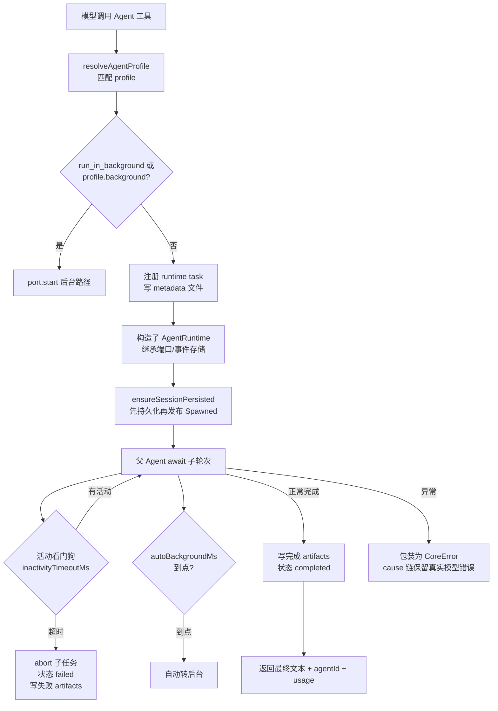
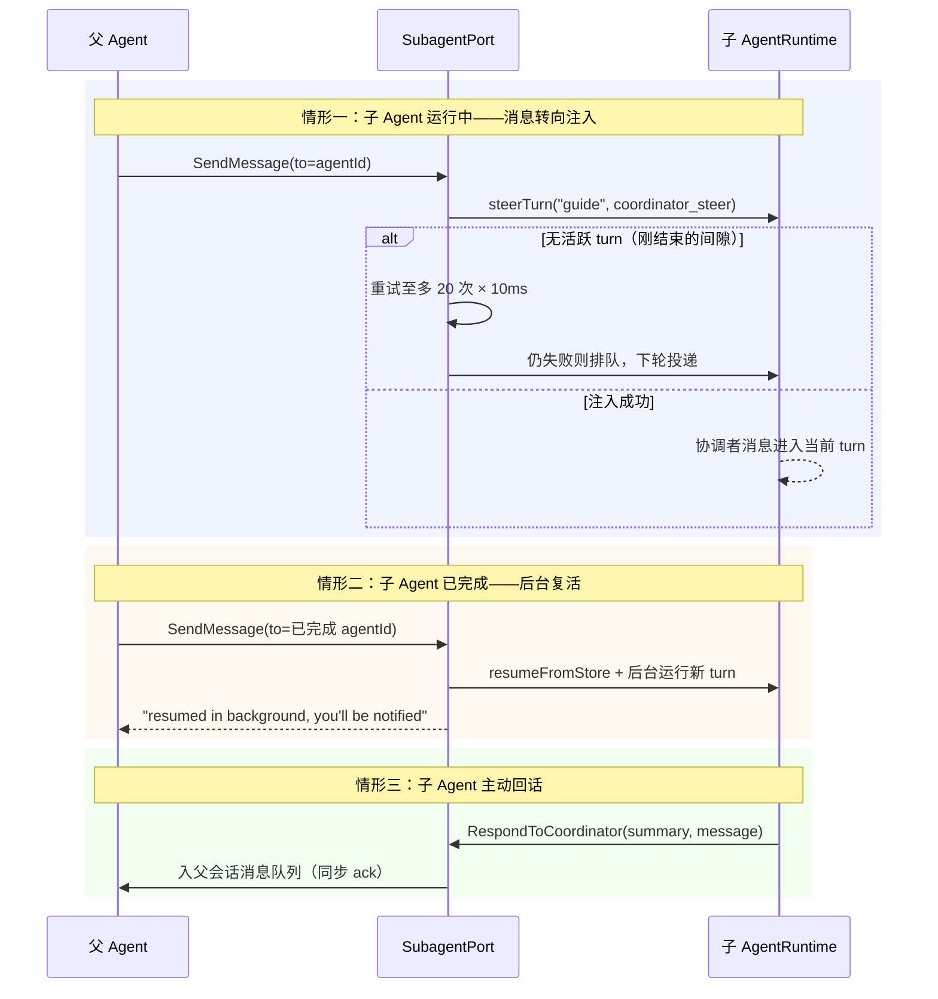

# 04. 多智能体模式：子 AgentRuntime、Profile 与运行时协作

> **文档同步跟踪**
> - 最后同步代码：`ZCode` commit `872ad960de`（2026-09-21）
> - 同步方式：基于该文档撰写时的源码路径梳理，关键论断已回到源码抽查

本章解释 ZCode 如何把独立工作封装成可派生、可后台化、可中途对话、可恢复的子 Agent。读完你会理解：主 Agent 用哪些工具委托任务、子 Agent 到底"是什么"（不是进程，而是一个共享事件存储的子运行时）、profile 如何决定子 Agent 的能力边界、前台与后台如何共享同一套生命周期、父子之间如何双向通信、以及 dynamic-workflow 这条模型自己写 TS 脚本编排多 actor 的独有路径。

本章结构如下——先讲设计目标（4.1），再认工具面与子运行时的本质（4.2-4.3），然后沿 profile → 生命周期 → 前后台 → 运行中协作 → 权限边界 → 持久记忆逐层下钻（4.4-4.9），最后收在 dynamic-workflow 与设计取舍（4.10-4.11）：


## 4.1 设计目标

ZCode 的多智能体体系围绕四个目标设计。

**第一，主上下文保持干净。** 子 Agent 的探索过程——读文件、搜索、跑命令——不会回灌主会话。主 Agent 收到的是子 Agent 的最终文本总结加上用量统计（token 数、工具调用次数、耗时）。子 Agent 的工具活动只以"摘要级镜像"出现在父时间线上，正文不进父上下文。

**第二，任务可以自然并行。** 主 Agent 在一条消息里发起多个 `Agent` 调用即可并发；`run_in_background: true` 让任务转入后台继续跑，主 Agent 先做别的事。

**第三，能力边界由 profile 声明，且是硬边界。** 子 Agent 能看到哪些工具、能否继承父权限服务、用哪个模型、带不带持久记忆，全部由 profile 决定。Explore 子 Agent 的只读不是靠提示词自律，而是工具面里根本没有 Write/Edit。

**第四，前台、后台、恢复共享同一套任务生命周期。** 一个子 Agent 可以前台等待、可以中途被转后台、可以停掉后再续跑。ZCode 没有为这些场景各写一套逻辑，而是统一放进 runtime task registry。

## 4.2 委托工具全景

子 Agent 相关的模型工具一共八件，各管一段：

| 工具 | 方向 | 作用 |
|------|------|------|
| `Agent` | 父 → 新子 | 派生一个子 Agent 执行完整任务；`subagent_type` 选 profile，省略时默认 `general-purpose` |
| `Task` | 父 → 新子 | `Agent` 的兼容别名，provider 不可见；插件指令要求 Task 工具时映射到它 |
| `SendMessage` | 父 ↔ 子 | 给指定 `agentId` 发消息：运行中的转向注入、没在跑的排队、已完成的带原上下文后台复活 |
| `RespondToCoordinator` | 子 → 父 | 子 Agent 在运行中途向父会话回消息；不受 profile 工具白名单约束，强制注入 |
| `TaskOutput` | 父 → 任务壳 | 读取后台任务输出，支持阻塞等待 + 超时 |
| `TaskStop` | 父 → 任务壳 | 停止一个后台任务 |
| `escalate` | workflow actor → 主代理 | dynamic-workflow actor 向主代理升级提问的通道 |
| `submit_result` | workflow actor | dynamic-workflow actor 提交结果的通道 |

`Agent` 工具的描述是动态拼出来的：`formatAgentProfilesForPrompt` 把当前所有可用 profile（名字、职责描述、工具清单）渲染进工具描述，模型在调用前就知道有哪些角色可选。dynamic-workflow 灰度开启时，描述里还会多一条"用户点名要 workflow 时必须用 `CreateWorkflow` 而不是本工具"的约束。

一个值得注意的输出设计：前台子 Agent 完成后，返回给父 Agent 的文本末尾会附上：

```text
agentId: agent_xxx (use SendMessage with to: 'agent_xxx' to continue this agent)
<usage>
subagent_tokens: 12345
tool_uses: 18
duration_ms: 96000
</usage>
```

也就是说，父 Agent 从返回值里天然学会"拿 agentId 续跑"这个动作——续跑能力不是藏在文档里的功能，而是每次委托结果自带的提示。

## 4.3 子 Agent 的本质：不是进程，是一个共享事件存储的子运行时

这是理解 ZCode 多智能体的第一个关键：**子 Agent 是在同一个 CLI 进程内构造出的另一个完整 `AgentRuntime` 实例**，不是子进程，也不是另一种轻量循环。

派生时（`createDefaultSubagentPort` 的 `runExploreAgent`）发生的核心动作是：

- `new AgentRuntime(childSessionId, config, deps)`——子运行时有自己的 session、turn 状态机、messageHistory、工具调度器和模型工厂；
- 但 `eventStore`、`sessionStore`、`toolScheduler`、`fileSystemPort`、`executionPort` 等底层端口**直接继承父实例**——子 Agent 的每一轮事件都按 childSessionId 落进同一个持久化存储；
- **阻塞交互统一路由回父会话**：权限审批、AskUserQuestion、provider 请求头这些需要"用户在场"的端口，经 `deriveChildClientPorts` 派生后归属父 session。原因写在注释里：桌面 UI 只认识父 task 的 sessionId——如果子 Agent 的审批请求留在子 session，父界面永远看不到，子 Agent 会永远卡住。

这个设计带来的三个直接后果：

1. **恢复是天然的**。子 Agent 的会话事实已经在共享 store 里，"复活一个已完成的子 Agent"只是 `resumeFromStore` 换个入口再跑一轮，不需要导出/导入任何状态。
2. **Trace 是真实的父子关系**。前台子 Agent 的遥测以 child span 挂在父 turn 下；后台子 Agent 可能晚于父 turn 结束，降级为用 Link 保留因果的独立 trace。
3. **崩溃边界与父相同**。子 Agent 不提供进程级隔离——它和父 Agent 死在同一艘船上。这是"轻量共享"换来的取舍。

另一个容易误解的点：**子 Agent 默认不能再派生子 Agent**。子运行时的 `subagents.enabled` 被显式设为 `false`（`apps/zcode-cli/packages/core/src/runtime/methods/subagent.ts:284-287`），委托树深度天然为一层。

## 4.4 Profile：能力边界的唯一声明处

### 4.4.1 内置 profile

ZCode 内置两个 profile：

| profile | 工具面 | 权限 | 说明 |
|---------|--------|------|------|
| `general-purpose`（默认） | `tools: ["*"]`——继承父会话当前可见的全部工具 | 继承父 `PermissionService` | `injectAgentsMd: true`，会带上用户级指令（AGENTS.md 类内容） |
| `Explore` | 白名单：`Bash, Glob, Grep, Read, WebFetch, WebSearch, TodoWrite` | 全新只读 `PermissionService`，默认模式 `yolo`（工具面本身已只读，无需逐次审批） | 只读搜索代理；它的 description 文案与 Claude Code 的 Explore agent 几乎逐字相同，血缘最直接的证据 |

### 4.4.2 自定义 profile：markdown frontmatter

用户和项目都可以用 markdown 文件定义子 Agent。加载位置有三层：

| 来源 | 目录 | 特殊限制 |
|------|------|----------|
| user | `~/.zcode/cli/agents/*.md`（storageRoot 下 `agents/`） | 可以声明 `permissionMode: auto` |
| project | `<workspace>/.zcode/agents/*.md` | **frontmatter 里的 `permissionMode` 被直接丢弃**——项目级文件是仓库内容，不能借它把子运行时提升到绕过审批的模式 |
| plugin | 插件包内 `agents/<name>.md` | 随插件启用生效 |

frontmatter 支持的字段：`name`、`description`（必填）、`tools`、`disallowedTools`、`model`、`maxTurns`、`permissionMode`、`memory`（user/project/local）、`color`、`skills`、`mcpServers`、`background`、`injectAgentsMd`。

同名 profile 覆盖内置的——用户可以写一个自己的 `Explore` 顶掉内置行为，但代码里用 `isBuiltInExploreAgentProfile` 严格区分"名字叫 Explore"和"真的是内置 Explore"，覆盖者享受不到内置的特殊权限语义。

### 4.4.3 工具白名单怎么算出来

子 Agent 的最终工具面不是简单抄 profile 的 `tools` 字段，而是三道过滤的交集（`resolveSubagentToolAllowlist`）：

1. **`tools: ["*"]`（继承模式）**：取父运行时当前可见的非 MCP 工具名 + 受父 allowlist 约束的 MCP 工具名；显式列出工具时，直接用那个白名单。
2. **统一剔除派发工具**：`isSubagentDispatchToolName` 把 `Agent`、`SendMessage` 这类再委托工具从子工具面移除（配合 4.3 的 `subagents.enabled: false` 双保险）。
3. **强制黑名单**：所有子 Agent 一律剔除 `EnterPlanMode` / `ExitPlanMode`——子 Agent 没有独立的 plan 审批恢复面，暴露 plan 工具会让 `ExitPlanMode` 等一个永远不会来的用户确认，卡死父 turn。`disallowedTools` 声明再叠加在这之上。

`RespondToCoordinator` 是唯一反向例外：它被强制追加进每个子 Agent 的工具面，不受 profile 白名单约束——这是子 Agent 的"逃生通道"，没有它，运行中的子 Agent 对父会话就是单向不可见的。

## 4.5 一次前台委托的完整生命周期



几个关键机制单独说明：

**先持久化，再宣告存在。** 新子 Agent 的会话事实落库（`ensureSessionPersistedForExternalActivity`）被安排在 `SubagentSpawned` 事件发布之前。注释给出的理由：过去"先发布、后落库"在并发派生时会让目录查询读到少一个 child——外部可见的状态变更必须以持久化为闸门。

**活动看门狗。** 每个子任务有一个按"最后活动时间"续期的定时器（默认等于模型流空闲超时）。子运行时的每个事件都会 `reportActivity` 续期；超时即 abort，任务状态记为 failed，错误标注为可重试。这堵的是"子 Agent 静默挂死、父 turn 永久等待"的洞。

**自动后台化。** 如果配置了 `autoBackgroundMs`，前台子 Agent 跑过这个时限还没结束，会被自动转入后台，`Agent` 工具立即返回 `async_launched` 形态的结果（带 outputFile 路径）。注意一个边界：带模型覆盖（idle-time 任务注入的 `modelOverride`）的前台子 Agent **不允许**进入后台——单次执行的模型与动态授权不能脱离父 loop 生命周期存活。

**失败包装。** 子 Agent 抛出的非 CoreError 会被包一层 `"Explore subagent failed"`，真实 provider/模型错误留在 cause 链里作为 UI hover 与父模型 tool result 的主摘要——父 Agent 和用户看到的是"孩子失败的原因"，而不是包装层的套话。

## 4.6 后台子任务与通知回流

后台路径（`port.start`）与前台共享同一套构造流程，区别只有三点：注册时就是 `isBackgrounded: true`、不 await 完成 promise、立即返回 `agentId` + `outputFile`。

后台子 Agent 完成后，结果如何回到父会话？链路是：

1. 完成事件触发 `enqueueParentTaskNotification`，把一段摘要文本作为 **runtime command**（`mode: "task-notification"`）同步入父运行时的命令队列——注意这是同步入队，类型系统特意拒绝 async，避免"假通知"；
2. 入队同时写一条 session input 账本记录（`saveSessionInput`，kind `backgroundNotification`）。注释点明：runtime 命令队列是纯内存的，账本是唯一持久痕迹——崩溃重启后子进程已死，通知不可恢复，resume 时把残留的账本记录收口为 discarded，留痕不静默；
3. 命令队列在合适的时机把文本合成为一条 **model-only 的 synthetic user message** 注入下一轮（`inputPresentation: "task_notification"`）。多条通知会在同一个 drain 里**整批合并成一条**合成消息——批量逐条启动模型轮会把请求数线性放大，整批只写一条；
4. 防陈旧：通知带 `branchGeneration`，如果会话在子任务运行期间被 rewind 到别的分支，过期分支的通知直接丢弃，不污染当前上下文。

子 Agent 自己派生的后台 Bash 任务也有对应收口：子 Agent 终止（完成/取消）时 `sealBackgroundTaskNotifications` 封口，之后迟到的 Bash 完成通知被抑制——不让孩子死后还有"幽灵通知"飘进父会话。

## 4.7 运行中协作：双向消息通道

这是 ZCode 多智能体最有特色的部分：委托不是"发射后不管"，父与子可以在子 Agent 运行途中对话。



**父 → 子（`SendMessage`）** 的三分支路由（`sendMessageToLocalAgent`）：目标在 registry 里不存在直接失败；是活跃任务则走 `steerTurn` 转向注入——转向被拒（`no_active_turn`，正好撞上轮次间隙）时以 10ms 间隔重试至多 20 次，仍不行就排队等下一轮；目标已是终态则最有趣——**带上原会话历史后台复活**（`resumeFromStore: true`），新结果照常走通知回流。

**子 → 父（`RespondToCoordinator`）**：子运行时通过 `createCoordinatorResponsePort` 拿到一个只做一件事的端口——把回复同步入父会话的 subagent 消息队列。这是"后台子 Agent 发现关键信息需要立即上报"的通道，不用等任务完成。

**事件镜像**（`mirrorSubagentToolEvent`）：子的工具调度/开始/进度/结果/错误事件，以及权限请求/解决/拒绝事件，会被改写后镜像到父 timeline。改写做三件事：toolCallId 加 `tool_subagent_<agentId>_` 前缀避免与父的工具调用撞号、附上 agent 元数据、权限请求补 origin 信息。镜像事件只进父的实时投影，不重复落库——子事件的持久化本体已在 childSessionId 名下完成。

## 4.8 权限与 MCP：借用而非复制

子 Agent 的权限体系有几个精确的设计点：

- **权限服务的两种继承**。`general-purpose` 和自定义 profile 直接引用父的 `PermissionService` 实例——父会话里用户设置的审批规则对子 Agent 同样生效；内置 `Explore` 则拿到一个全新的只读权限配置。叠加默认模式规则（`resolveSubagentPermissionMode`）：Explore 未声明时默认 `yolo`（工具面只读所以安全），其他子 Agent 未声明时继承父当前模式；父会话开着 plan mode 时子 Agent 也进 plan。
- **MCP 是借用，不是重连**。子 Agent 不拥有 MCP 连接生命周期，只能复用父运行时启动时建好的连接快照（`createBorrowedSubagentMcpAccess`）。profile 的 `mcpServers` 字段可以把可见服务器收窄到子集；收窄后目标服务器若没连上，派生直接报 `ConfigurationError: Required MCP server is not connected`——**失败发生在 spawn 时而不是工具调用时**，父 Agent 能立刻看到并换个方案。
- **Skill 经过滤端口**。子 Agent 的 SkillPort 是父端口的过滤视图：profile 声明了 `skills` 就只留子集；同名歧义时报错要求用全限定名；Computer Use 官方 skill 对子 Agent 一律 fail-closed——派生前就有一次预检（`validateSubagentComputerUseConfiguration`），profile 显式点名 CU 服务器/工具/skill 的话直接拒绝启动。

## 4.9 子 Agent 的持久记忆

每个子 Agent 还可以声明 `memory: user | project | local`，获得跨会话的持久记忆目录：

| scope | 路径 | 生命周期 |
|-------|------|----------|
| `user` | `~/.zcode/cli/agent-memory/<agent>/` | 跟着用户走，跨项目共享 |
| `project` | `<workspace>/.zcode/agent-memory/<agent>/` | 跟着仓库走，可提交 |
| `local` | `<workspace>/.zcode/agent-memory-local/<agent>/` | 跟着仓库走但不提交 |

机制上有两点值得注意：

1. **能力自动补齐**。声明了 `memory` 的 profile，若工具白名单里没有 `Write`/`Edit`，会被自动补上（`withPersistentAgentMemoryTools`）——记忆的前提是能写文件，这个矛盾由系统解决而不是要求 profile 作者自己记得加。
2. **索引常驻、文件按需读**。子 Agent 启动时读该目录的 `MEMORY.md` 索引（不存在则用基线空文案），拼进 agent prompt；具体记忆文件由子 Agent 按索引自行 Read。与主会话的 MEMORY.md 机制同构（见第 06 章），但目录按 agent 名隔离（`sanitizePersistentAgentMemoryKey` 把非法字符替换为 `-`）。

## 4.10 dynamic-workflow：模型写 TS 脚本编排多 actor

ZCode 还有第二条多智能体路径，与 `Agent` 工具的"模型临场委托"互补：**dynamic-workflow**。它让主 Agent 用 TypeScript 写一个多 actor 工作流脚本，经编译器静态分析后在沙箱里执行。用户不点名要 workflow 时，模型被明确禁止自行选择这条路径（工具描述里的强制条款 + 灰度门控制）。

流水线分四段，前两段在纯库 `@zcode/dynamic-workflow`，后两段分别在 runtime 与 bootstrap 包：

| 阶段 | 位置 | 做什么 |
|------|------|--------|
| 编译 | `compiler/` | 对脚本做虚拟 host typecheck——TS 标准库被内嵌进包里，编译期不读盘 |
| 静态分析 | `analysis/` | 收集 ask/actor/world-read/join 四类站点，跑**污点分析不动点 + 时序 walk**，产出 site/causality/flow/handoff 四种投影图 |
| 降级 | `lowering/` | type-strip + 站点 id 埋点，产出沙箱可执行的输入 |
| 执行 | `dynamic-workflow-runtime` + `bootstrap` | 子进程 + vm cell 沙箱，NDJSON 与宿主桥接；actor 会话、SQLite journal 回放、修复/催促由生产 driver 提供 |

其中 `ask<T>` 是核心原语：脚本用 `ask` 向某个 actor（模型）提问，`ask` 的返回类型由 JSDoc 约束合成 JSON Schema——schema 校验失败会以"模型可读"的形式回喂修复。journal 回放让工作流崩溃后可以从断点恢复，而不是从头再跑一遍。

对多智能体体系而言，这条路径的本质差异是：`Agent` 工具的编排逻辑活在模型脑子里（每一步临场决定），dynamic-workflow 的编排逻辑是**先写下来、先验证、再执行**——牺牲灵活性换取确定性、可恢复和可审计。

## 4.11 设计取舍

**为什么子 Agent 是进程内运行时而不是子进程？**
共享事件存储让"续跑、rewind 兼容、Trace 父子关系、UI 只认父 session"这些需求全部免费获得；代价是没有进程隔离。ZCode 的回答是把安全性放在工具与权限边界（profile 白名单、权限服务、MCP 收窄）而不是进程边界上——NOTICE.md 也明说当前不提供操作系统级沙箱。

**为什么Explore 默认 yolo 而 general-purpose 继承父模式？**
Explore 的工具面被白名单硬性限定为只读工具，`yolo`（免逐次审批）不会放大破坏面，反而省掉一连串无意义的审批打断；general-purpose 能写文件跑命令，它的审批语义必须跟随父会话——用户在父会话里设的规则不能因为委托了子 Agent 就失效。

**为什么子 Agent 不能再派生子 Agent？**
委托树深度不可控时，模型可以在子 Agent 里无节制地继续 spawn，配额、限流、UI 归属全部失控。关掉再委托（`subagents.enabled: false` + 派发工具从子工具面剔除，双保险）把树深固定为 1；需要多层编排时应该用 dynamic-workflow 显式建模。

**为什么 SendMessage 要对着轮次间隙重试 20 次？**
`steerTurn` 只在子 Agent 有活跃 turn 时成功。消息恰好落在两个 turn 的间隙会拿到 `no_active_turn`，直接排队会让本应"立即看到"的协调指令延迟一轮，直接失败则丢消息。10ms × 20 次的重试窗口用极低成本覆盖了绝大多数间隙场景。

**为什么后台通知要写账本？**
内存命令队列在崩溃后消失，但用户对"我派出去的任务后来怎么样了"有确定性期待。把通知入账本，resume 时至少能把状态收口为"已丢弃（会话恢复）"并留痕——系统不承诺恢复结果，但拒绝无声无息地吞掉事实。

**为什么 `Agent` 完成结果要附 agentId 与 usage？**
委托是复数次的：父 Agent 拿到总结后经常需要追问细节或追加任务。把续跑入口和成本统计内嵌在每次返回值里，模型不需要被特别提醒就会形成"委托 → 看结果 → 按需续跑"的行为闭环。

## 4.12 关键实现入口

| 责任 | 主要文件（`apps/zcode-cli/packages/core/src/`） |
|------|------|
| 委托工具（含 Task 别名） | `tool/handlers/agent.ts` |
| 消息发送/转向工具 | `tool/handlers/send-message.ts` |
| 任务查询/停止 | `tool/handlers/task-output.ts`、`tool/handlers/task-stop.ts` |
| 子代理端口：launch/run/start/sendMessage | `subagent/runner.ts` |
| 子运行时构造与装配 | `runtime/methods/subagent.ts` |
| profile 解析与内置定义 | `subagent/profile.ts`、`subagent/general-purpose.ts`、`subagent/explore.ts` |
| 自定义 agent markdown 加载 | `packages/bootstrap/src/subagents.ts` |
| 子工具面过滤（plan 工具强制剔除） | `subagent/tool-policy.ts` |
| 工具事件镜像 | `subagent/tool-event-mirror.ts` |
| 父→子消息转向 | `subagent/message-steering.ts` |
| 子→父协调者回信 | `subagent/coordinator-response.ts` |
| 后台通知入队/合并/封口 | `runtime/methods/background-notifications.ts` |
| 子代理持久记忆 | `subagent/persistent-memory.ts`、`subagent/persistent-memory-prompt.ts` |
| MCP 借用 | `subagent/borrowed-mcp-port.ts` |
| Computer Use 预检 | `subagent/computer-use-policy.ts` |
| 动态工作流（编译/分析） | `packages/dynamic-workflow/src/` |
| 动态工作流（沙箱/runtime） | `packages/dynamic-workflow-runtime/src/`、`packages/bootstrap/src/app/dynamic-workflow-run-service.ts` |

## 4.13 小结

ZCode 的多智能体体系可以概括成三层：

```text
模型工具层：Agent / SendMessage / TaskOutput / TaskStop（+ workflow 侧的 escalate / submit_result）
运行调度层：SubagentPort → 子 AgentRuntime（共享事件存储、交互路由回父、看门狗、自动后台化）
能力边界层：profile（工具白名单 + 权限继承 + MCP 借用 + 持久记忆）
```

与"每次委托都是一次性调用"的系统相比，ZCode 把子 Agent 做成了**有身份、有记忆、可对话、可复活的长期实体**：agentId 在返回值里自带、SendMessage 三分支覆盖运行中/排队/复活、事件镜像让父 timeline 保有摘要级可见性。而 dynamic-workflow 提供了另一极——把编排从模型的临场决策变成先验证后执行的静态脚本。

下一章进入这套机制的资源约束面：当子 Agent 与主 Agent 的上下文都被填满时，ZCode 用什么机制维持可用性——microcompact、auto-compact 与会话持久化（第 05 章）。
