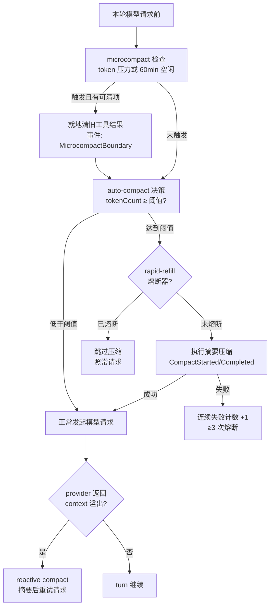

# 05. 上下文压缩：三层压缩体系与会话持久化

> **文档同步跟踪**
> - 最后同步代码：`ZCode` commit `872ad960de`（2026-09-21）
> - 同步方式：基于该文档撰写时的源码路径梳理，关键论断已回到源码抽查

长会话迟早把上下文窗口填满。ZCode 的回答不是一个"压缩函数"，而是一套分层的压力管理体系：轻压力就地清理旧工具结果（microcompact），重压力做模型摘要（auto-compact / 手动 `/compact`），溢出已经发生后做亡羊补牢（reactive compact），并用熔断器防止"压缩 → 立刻又满 → 再压缩"的死循环。读完你会理解每一层的触发条件、精确的阈值算术、摘要请求的构造方式、以及压缩与会话持久化（SQLite 事件溯源 + rewind/fork）之间的咬合关系。

本章结构如下——先立目标（5.1），再看三层体系的总决策流（5.2），然后从轻到重逐层下钻（5.3-5.6），最后落在持久化语义与取舍（5.7-5.8）：


## 5.1 设计目标

压缩体系围绕四个目标设计。

**第一，能不摘要就不摘要。** 摘要有损且要花一次模型请求。旧工具结果是上下文里最大的可清理项——一次 Read 几千行、一次 Bash 输出几万字节——而它们的历史价值随轮次急剧衰减。microcompact 用固定占位文案就地替换它们，零模型请求、零信息结构性损失（工具调用本身还在，只是结果正文被清了）。

**第二，阈值算术要诚实。** provider 的 context window 是输入输出共享的：窗口里给输出留多少，输入的可用上限就少多少。ZCode 的 auto-compact 阈值明确先从窗口里扣掉输出预留再算分母，而不是拿标称窗口当分母——后者会在模型还有大段输出要写时误判"还有余量"。

**第三，token 计数优先信 provider。** 本地按字符估算 token（`estimateMessageTokens`）是兜底；只要最近一条已提交 assistant 消息带回了 provider 的 usage，就用它做基线、只对之后的增量消息做本地估算。provider 说了算的数字比任何本地估算都准，尤其是缓存读/写分开计费的端点。

**第四，失败要熔断。** 压缩本身是模型请求，也会失败（provider 限流、上下文已经大到摘要请求都发不出去）。连续失败不能变成每次请求前都撞一次墙的死循环。

## 5.2 三层总决策流

每次模型请求前，turn loop 按固定顺序过一遍压缩检查：



三层各管一段压力：microcompact 处理"局部赘肉"，auto-compact 处理"整体超重"，reactive compact 处理"已经压到 provider 报错"。顺序很讲究——microcompact 在 auto-compact 决策**之前**执行，它清掉的空间可能直接让 auto-compact 不必触发。

## 5.3 microcompact：就地清理旧工具结果

microcompact 的操作对象非常具体：**历史里旧工具调用的结果正文**。机制（`maybeLocalMicrocompactMessages`）：

1. **触发条件**（二选一，先到先得）：
   - **token 压力**：估算 token 达到阈值。阈值默认取 auto-compact 阈值的 90% 与"auto-compact 阈值 − 2000"两者的较小值——保证 microcompact 总是先于 auto-compact 醒来；
   - **时间空闲**：距上次 assistant 完成超过 60 分钟。用户去开会了，回来前把会话清清爽爽。
2. **候选筛选**：只清默认九个"可压缩工具"的结果——`Read, Bash, Grep, Glob, WebFetch, WebSearch, Edit, Write, ApplyPatch`。三类结果受保护：错误结果（除非显式配置清错误）、已经清过的（占位文案幂等）、**含媒体内容的结果**（image/video/file block——注释里专门记录了"Read 视频结果漏判会被清掉"这个 bug 的教训）。
3. **保留最近 N 组**（默认 5）：候选按轮次分组，从最旧开始清，最近的 5 组结果保持原样。
4. **最小节省门槛**（默认 256 token）：清完后一算没省出 256 token，整个操作回滚——为省 300 token 改写历史、再触发一次缓存失效，不划算。
5. 被清的结果正文替换为一句话：`[Old tool result content cleared]`。工具调用的入参与结果的存在性都保留，模型仍然知道"我读过那个文件"，只是读到的内容不再占窗口。

成功应用后发一条 `MicrocompactBoundary` 事件，记录清了哪些 toolCallId、省了多少 token——这是审计面，也让 UI 能展示"刚才悄悄瘦身了一次"。

## 5.4 auto-compact：阈值算术

auto-compact 的决策全部在 `shouldAutoCompact`，算术值得完整拆开（默认值以 200K 窗口为例）：

```text
有效输入窗口 = contextWindow − min(outputReserve, contextWindow)
             = 200,000 − min(32,000 → 封顶 21,000, 200,000)
             = 179,000

压缩阈值     = 有效输入窗口 − 13,000 buffer = 166,000

当前 token 数 = provider 基线（最近 assistant 的 usage）
             + 增量消息的本地估算        ← 优先
             （无 provider usage 时退化为纯本地字符估算）
```

几个数字的来历：

- **32,000** 是输出预留的默认值，注释说明"正常请求默认输出已收敛到 32K"，auto-compact 必须按同一目标预留，否则请求预算和压缩窗口按两套常量各算各的；
- **21,000** 是预留的上限封顶：旧 legacy 策略会为完整模型输出预留整个窗口（远端模型 maxOutputTokens 可能很大），既过早压缩又依赖远端配置，现在统一封在 21K；
- **13,000 buffer** 是压缩动作本身的余量：从决策"该压了"到摘要完成，中间还有延迟，buffer 保证压缩期间不会顶穿；
- **熔断器**：连续失败 3 次后 auto-compact 直接进入 circuit breaker 状态，`reason: "circuit_breaker"`——宁可让会话撞 provider 的硬限制，也不无限烧压缩请求。

还有一个前置门槛容易被忽略：**历史至少要有 2 个完整轮次且含 assistant 消息**才允许压缩。刚开局的会话再长（比如被塞了一个巨型 prompt）也不会被 auto-compact 处理。

## 5.5 摘要请求：提示词、保留段与降级链

真正执行压缩的是 `compactActiveConversation`，它把会话分成两段：

```text
[被摘要的旧历史] + [preserved 保留的最近消息] → 替换为 [摘要消息] + [preserved 保留段]
```

**摘要提示词**（`buildCompactPrompt`）要求模型先输出 `<analysis>` 分析、再输出 `<summary>` 结构化总结，总结固定九个部分：Primary Request and Intent / Key Technical Concepts / Files and Code Sections / Errors and fixes / Problem Solving / **All user messages**（明确要求逐条列出非工具结果的用户消息）/ Pending Tasks / Current Work / Optional Next Step。两处细节体现工程判断：

- 提示词**点名要求安全类指令逐字保留**（"敏感文件、禁止操作、凭据处理规则 MUST be preserved verbatim"）——摘要可以有损，但安全约束有损等于失效；
- 最终注入的摘要消息会把 `<analysis>` 剥掉只留 `<summary>`，分析过程不进后续上下文。

提示词首尾各包一段"禁止调用工具"的硬约束（`NO_TOOLS_PREAMBLE`/`TRAILER`）——摘要请求给模型带了工具表，模型顺手调一次工具就会毁掉这次摘要轮。

摘要消息的组装（`buildCompactSummaryMessage`）是自适应的：带完整历史 transcript 的文件路径（"需要压缩前的细节，去读完整 transcript"）、标注"最近消息已原样保留"、node REPL 状态被清了会明确告知变量不可用、suppressFollowup 时附加"直接继续干活，不要复述总结"。

**降级链**（面对"摘要请求本身太长"的 prompt-too-long 错误）：

```text
重选保留段：多保近处、丢更远的旧历史 → 再试
    ↓ 仍太长
截断旧历史并打标 "[earlier conversation truncated for compaction retry]" → 再试
    ↓ 仍太长（重试上限 3 次）
按需剥离媒体内容 → 重试
    ↓ 全部失败
本轮压缩失败，计入连续失败计数
```

auto 触发时外层最多 3 次尝试（`AUTO_COMPACT_MAX_ATTEMPTS`），手动 `/compact` 只 1 次——用户手动触发时失败了应该直接看到错误，而不是被静默重试掩盖。

两个保护性细节：**MCP 工具数超过 100 时摘要请求直接不带任何工具**（止血注释：massive MCP 工具表会把摘要请求自己的上下文撑爆）；摘要请求也走与普通请求相同的**媒体预算投影**（早期版本漏了这步，摘要请求绕过了全局请求上限）。

## 5.6 reactive compact 与 rapid-refill 熔断

**reactive compact** 是最后一道网：如果模型请求仍然撞上了 provider 的 context 溢出错误（估算没追上真实用量、或 provider 计数口径不同），turn 不会直接失败，而是触发 `compactReason: ProviderOverflow` 的摘要压缩，成功后**重试原请求**。它复用同一套 `compactActiveConversation`，只是触发源和 phase（`Reactive`）不同。

**rapid-refill 熔断**防的是另一类死循环：压缩刚完成，模型工具几轮内又把上下文灌满（比如工具在反复读同一个大文件），又触发压缩——"压缩 → 立刻满 → 再压缩"地烧请求和缓存。判定规则（`evaluateRapidRefill`）：

- 压缩后**不足 3 个工具轮次**内再次触发压缩，记一次 rapid refill；
- **连续 3 次** rapid refill，熔断器跳闸，后续 auto-compact 被阻止（`rapid_refill_blocked`）——上下文确实满了，但压缩解决不了"工具行为在制造垃圾"这个根因，继续压只是空转；
- 正常节奏（压缩后跑了 ≥3 个工具轮）会重置计数。

这相当于承认了一个事实：压缩管得了"历史太长"，管不了"当前行为在快速产生历史"——后者要么等工具轮次自然展开，要么由用户介入。

## 5.7 压缩的持久化语义：boundary、账本与 rewind/fork

压缩改变的是"发给 provider 的投影"，不是存储本体。ZCode 的会话持久化是**事件溯源**：每条消息、每次工具调用、每个压缩边界都是追加进 SQLite 的事件，压缩只是加了一条 boundary 事件。

**存储形态**：默认库在 `~/.zcode/cli/db/db.sqlite`（Node 内置 `node:sqlite`，无原生依赖），repositories 覆盖 messages/entries、session-inputs（账本）、todos、usage、script-workflow 等。运行期 `messageHistory` 是内存投影，压缩后通过 `replaceMessages + preserveCanonicalContextPrefix` 重建。

**boundary 事件**（`CompactBoundaryPayload`）记录审计所需的全部事实：触发源（manual/auto/reactive）、原因（userRequested/providerOverflow…）、压缩前后 token 数（`preCompactTokenCount` / `postCompactTokenCount` / `truePostCompactTokenCount`——估算值与真实值分开记）、被摘要的消息数与最后一条的 ID、保留段（preservedSegment）、摘要消息 ID、以及 `willRetriggerNextTurn`（本轮压完仍然超限，下一轮还要再来）。UI 的 CompactStarted/CompactCompleted 时间线事件直接从这里渲染。

**rewind/fork 与压缩的关系**是本章最容易被误解的点：**rewind 恢复的是事件流，不是上下文窗口**。把会话倒回某个消息，被压缩掉的旧历史**不会**神奇地回来——boundary 之前的原始消息仍在库里（事件溯源），但重建投影时压缩边界依然生效。反过来，fork 出的新分支继承的是 fork 时刻的投影（含压缩边界）。每个后台通知/命令都带 `branchGeneration`，rewind 后旧分支的迟到事件按代际丢弃（见 04 章 4.6），压缩边界与分支代际共同构成"上下文投影"的两个坐标轴。

**手动 `/compact` 是一个独立 turn**（phase `StandaloneTurn`），输入被标记为 model-only——它不是用户真实 query，v4 投影不把它渲染成用户气泡。历史太少时 `/compact` 是健康 no-op，返回"Context is up to date; no compression needed"而不是报错。

## 5.8 设计取舍

**为什么三层而不是一层大压缩？**
一层大压缩等于"每次都付摘要的钱"。会话里的上下文压力大部分是工具结果赘肉，microcompact 用零模型请求解决大头；摘要只处理真正需要语义浓缩的部分；reactive 兜住估算失误。三层按代价递增排列，便宜的先动。

**为什么保留最近 5 组工具结果而不是全部清掉？**
模型"正在做"的事依赖最近的结果——刚读的文件、刚跑的命令。全部清掉会让压缩后的第一轮请求里模型失忆，重新读一遍刚才的文件，反而放大 token 消耗。保留段就是压缩版本的"工作记忆"。

**为什么阈值分母要扣输出预留？**
200K 窗口不是 200K 输入可用。模型一轮要写几千 token 输出时，输入侧的真实上限就是窗口减输出。不扣的话，压缩触发在"还差 3K 就溢出"的位置，摘要完成前请求已经失败了。

**为什么压缩失败要熔断而不是一直重试？**
连续 3 次失败说明压缩这条路暂时走不通（provider 限流或历史结构异常）。此时正确行为是让请求照常发出——也许 provider 能容忍、也许用户会自己止损——而不是每轮都先烧一次注定失败的摘要请求。

**为什么 token 计数要区分估算与真实两套并都记录？**
估算（字符/除数）便宜但失准，尤其对 reasoning 内容和工具入参；provider usage 准但滞后（只有最近 assistant 提交后有）。决策时"能真则真、以估兜底"，审计时两个数字都进 boundary 事件——`truePostCompactTokenCount` 的存在就是承认估算会错，且把错留了证据。

## 5.9 关键实现入口

| 责任 | 主要文件（`apps/zcode-cli/packages/core/src/`） |
|------|------|
| auto-compact 决策与阈值算术 | `compact/policy.ts` |
| microcompact 策略（候选/触发/门槛） | `compact/microcompact.ts` |
| 摘要提示词与摘要消息组装 | `compact/prompt.ts` |
| 手动 `/compact` 边界与轮次门槛 | `compact/manual.ts`、`compact/rounds.ts` |
| turn loop 内的压缩调用点 | `runtime/methods/turn-loop.ts`（69 行 microcompact、78 行 auto-compact） |
| 手动压缩 turn | `runtime/methods/compact.ts`（`executeManualCompact`） |
| 摘要压缩主体（降级链/保留段） | `runtime/methods/compact-active.ts` |
| reactive compact | `runtime/methods/compact.ts`（`reactiveCompactAfterContextExceeded`） |
| runtime 侧 microcompact 应用 | `runtime/methods/microcompact.ts` |
| rapid-refill 熔断 | `runtime/methods/turn-loop-state.ts`（`evaluateRapidRefill`） |
| 会话 SQLite 存储 | `packages/adapters/src/storage/session-store/`（`sqlite-session-store.ts`、`repositories/`） |
| rewind / fork / resume | `runtime/methods/rewind.ts`、`session-fork.ts`、`resume.ts` |
| 压缩持久化 | `runtime/methods/compact-persistence.ts` |

## 5.10 小结

ZCode 的上下文管理可以概括为"**一个决策循环 + 三层手段 + 两个保险**"：

- 决策循环：每次模型请求前先 microcompact、再评估 auto-compact，请求失败后还有 reactive 兜底；
- 三层手段：就地清工具结果（免费）→ 模型摘要（一次请求，九段结构 + 保留段）→ 溢出后重试（亡羊补牢）；
- 两个保险：连续失败熔断器管"压缩本身坏了"，rapid-refill 熔断器管"压缩救不了行为"。

压缩改变投影而不动事件流——这让它能与会话持久化、rewind/fork、分支代际干净地正交。历史不会消失，消失的只是"默认发给 provider 的投影"。

压缩省出来的是"留给当前任务的空间"，而记忆系统的目标是另一件事：让值得跨会话存活的事实不依赖窗口活着。下一章拆解 ZCode 的记忆系统（第 06 章）。
