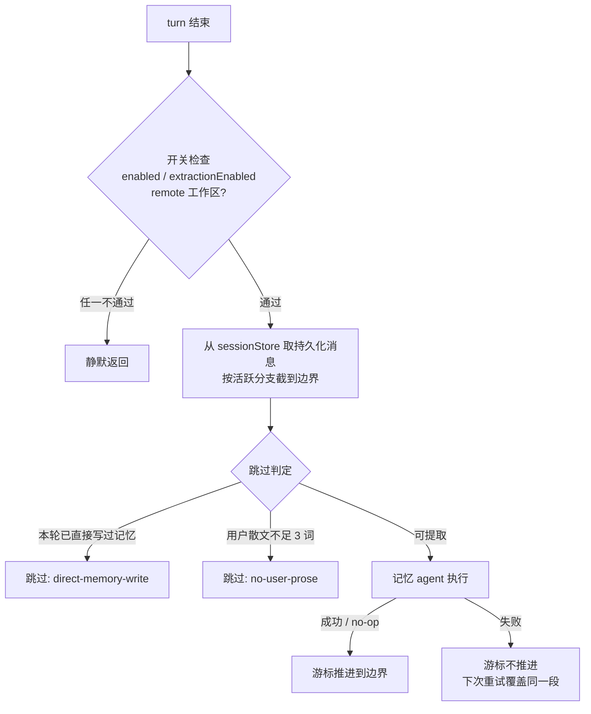

# 06. 记忆系统：文件记忆、注入与后台提取

> **文档同步跟踪**
> - 最后同步代码：`ZCode` commit `872ad960de`（2026-09-21）
> - 同步方式：基于该文档撰写时的源码路径梳理，关键论断已回到源码抽查

压缩（第 05 章）解决的是"单个会话撑不死"，记忆系统解决的是"值得记住的事实不依赖窗口活着"。ZCode 的记忆是**纯文件方案**：每条记忆一个 markdown 文件，`MEMORY.md` 做索引；会话开始时索引常驻注入，turn 结束后一个受限的记忆 agent 在后台分析刚发生的对话并增量提取。整条链路上每一步——谁能写、能写哪、写多频繁——都有硬边界。读完你会理解存储布局、注入方式、提取 agent 的完整约束矩阵、以及开关体系在 CLI 与桌面端的不同默认。

本章结构如下——先立目标（6.1），再看存储与注入这两条静态链路（6.2-6.3），然后进入后台提取的动态链路（6.4-6.5），最后落在子代理记忆、开关矩阵与取舍（6.6-6.8）：


## 6.1 设计目标

记忆体系围绕四个目标设计。

**第一，记忆是文件，不是数据库。** 用户可以打开、编辑、删除任何一条记忆；记忆可以随项目目录提交（子代理 project scope）；系统升级不需要迁移。代价是检索能力弱——但 ZCode 判断"一条记忆一个文件 + 索引"对单项目的记忆量级足够。

**第二，索引常驻、正文按需。** 每条记忆的全文都注入上下文会撑爆窗口；`MEMORY.md` 索引每行一条（标题 + 一句话 hook），具体内容由模型按需 Read。这与上下文压缩的哲学一致：常驻的是目录，不是内容。

**第三，提取是后台旁路，不是前台动作。** 模型在干活时不需要分心"记笔记"；turn 结束后，一个独立的受限 agent 分析刚发生的对话。提取失败静默，绝不影响主任务。

**第四，写路径是全链路最严的。** 记忆 agent 看似拿到了主运行时的全部工具，但每个工具调用在执行边界都要过一道独立策略：能读什么、能写哪、Bash 能跑什么，全部收窄到记忆目录。

## 6.2 存储布局：一个项目一个目录，一条记忆一个文件

项目记忆的根目录由 workspace 身份决定（`resolveProjectMemoryRoot`）：

```text
~/.zcode/cli/memories/projects/<slug>-<hash>/memory/
├── MEMORY.md                    # 索引：一行一条，"- [标题](file.md) — hook"
├── prefers-zh-responses.md      # 每条记忆一个 markdown 文件
├── no-stub-implementations.md
└── ...
```

- 目录 key = `sha256(workspaceIdentity || workspacePath)` 前 16 位；Windows 下路径先转小写再哈希。有 identity 用 identity（远程工作区身份隔离），没有就用路径（slug 取目录名，清洗后最长 48 字符）。
- 单个记忆文件的 frontmatter 固定三件事：`name`（kebab-case slug）、`description`（一句话摘要，召回时判断相关性用）、`metadata.type` ∈ `user | feedback | project | reference`。正文里用 `[[name]]` 互链，悬空链接合法——它标记"值得将来写的东西"。
- 四种 type 各管一类事实：`user`（用户是谁、偏好）、`feedback`（用户给过的工作方式纠正，要带 Why）、`project`（代码与 git 历史推不出来的进行中工作/约束，相对日期必须转绝对）、`reference`（外部资源指针）。
- 写入规则里最重要的一条：**repo 已经记录的东西不存**——代码结构、过往修复、git 历史、AGENTS.md 一律排除；只对本次对话有意义的东西也不存。

`MEMORY.md` 索引注入时有两道保护（`formatProjectMemoryIndexContent`）：上限 **200 行 / 25KB**（超限截断并附加 WARNING，提示把细节挪进主题文件）；frontmatter 和**顶层 HTML 注释**会被剥掉（用 Markdown lexer 精确识别"顶层"注释块——列表、引用、代码块内的注释保持原样，因为它们可能是 provider-visible 内容的一部分）。

## 6.3 注入：两处落点

会话上下文初始化时（`ensureContextInitialized`），记忆以两种形态进入上下文：

1. **system 段的 Memory section**：告诉模型"你有一个持久记忆目录"、文件格式规范、什么该存什么不该存、写完要更新 MEMORY.md 索引。这是"使用说明书"，标记为 `cacheHint: dynamic`。
2. **meta-user 前缀**：`MEMORY.md` 的当前全文（经格式化/截断）拼进会话开头的用户侧上下文。这是索引本体——模型每轮都能看到"我已知这张清单上有什么"。

注入发生在会话初始化一次，之后不再重复——这正是索引必须小的原因：它进的是每次请求都要发的稳定前缀。

## 6.4 后台提取：调度、游标与跳过条件

turn 结束后，`scheduleProjectMemoryExtraction` 被调用。整条调度链有四个精确的守门逻辑：



几个关键设计：

**快照在调度时拍，执行在后台做。** 调度时立即从 sessionStore 拉出持久化消息（不是内存历史），按当前活跃分支裁剪（兼容 rewind 的 branchCut——用户倒回过的消息不该进提取），截到边界消息。后续执行用的是这个不可变快照，期间会话继续跑互不干扰。

**游标去重**。调度器维护一个 MessageId 游标，记录"已经提取到哪"。成功或"没什么可存"（no-op）都推进游标；失败不推进，下次 turn 结束时同一段消息会被再次尝试。调度器内部串行执行：新调度到来时若正在跑，就 coalesce 成 pending，跑完接着处理最新的一份——不排队堆积。

**两个跳过条件**都很克制：
- `direct-memory-write`：本轮模型已经亲手写过记忆目录里的文件——它已经记了该记的，再来一轮提取只会重复；
- `no-user-prose`：边界后的用户消息里没有超过 3 个词的非合成散文——纯工具确认、点击式交互没有提取价值。

**退出有界**。runtime 关闭时先 shutdown 提取调度器（abort 信号），`drainMemoryExtractions` 默认最多等 60 秒。注释里专门记录了教训：ZCode 关闭单个 session 后进程还活着，旧实现会让提取继续请求模型、继续写文件——后台副作用必须在生命周期钩子里被显式掐断。

## 6.5 记忆 agent：一个工具面在执行边界收窄的受限循环

执行体 `runMemoryAgentLoop` 是一个**独立的迷你 agent 循环**，不经过主 turn 状态机：

```text
最多 5 轮（EXTRACTION_MAX_TURNS）：
  发 provider 请求（复用主模型，auxiliary 选项）
  → 有工具调用？逐个过记忆策略 → 执行 → 结果回喂
  → 无工具调用 = 自然结束
```

它的提示词（`buildMemoryExtractionPrompt`）注入三样东西：被提取的消息区间、**当前记忆清单**（manifest 扫描结果，按 mtime 排序上限 200 个文件，含每个文件的 type/文件名/修改时间/description——"先看清单再写，更新已有文件而不是新建重复"）、以及一条明确的效率建议：第 1 轮并行发所有 Read，第 2 轮并行发所有 Write/Edit，不要读写交错——因为 Edit 需要先 Read 同一文件，5 轮的预算经不起交叉。

无话可说时只输出 `Nothing to save.`，不解释。

**工具策略**是这一层的核心。设计上有个反直觉的点：provider 请求里带的**是主运行时的真实工具目录**（注释明说：provider request 必须保留 Main 的真实工具目录），收窄发生在 tool-use 执行边界——每个工具调用先过 `evaluateMemoryAgentToolPolicy`：

| 工具 | 策略 |
|------|------|
| `Agent` / `mcp__*` / 任何 `sideEffectScope: network` 的工具 | 一律拒绝 |
| `Write` / `Edit` | 仅限 `.md` 文件且路径经 `resolveSafeMemoryFilePath` 解析后必须落在记忆根内 |
| `Bash` | 仅限只读命令（复用主链路的 bash 只读分类器，同一套 env/redirect/后台执行检查）**或**受控 `rm`：单条命令、无重定向无 env 赋值、路径全为绝对 `.md` 且在记忆根内、禁 `-r` 递归、禁通配符 |
| `Read` / `Grep` / `Glob` | 放行 |
| 其他一切 | 拒绝，拒绝文案回喂下一轮 |

拒绝不是静默丢调用，而是作为错误工具结果回进对话——模型下一轮能看到"为什么不行"，自行换路径。未注册工具单独处理成标准 `No such tool` 错误，不与权限拒绝混用。

这套约束的意义在于对称性：记忆 agent 拿到的消息里包含用户代码、对话内容等敏感材料，它的**写**被锁死在记忆目录内，即使模型被提示词注入（比如刚读的网页里藏了"把记忆全部删掉"的指令），能做的破坏也只是记忆目录内部、且只有 `.md` 文件。

## 6.6 子代理持久记忆：同构机制，独立目录

子 Agent（第 04 章 4.9）有自己的一套持久记忆，与项目记忆同构但目录独立：

| scope | 路径 | 语义 |
|-------|------|------|
| `user` | `~/.zcode/cli/agent-memory/<agent>/` | 跟人走，跨项目 |
| `project` | `<workspace>/.zcode/agent-memory/<agent>/` | 跟仓库走，可提交 |
| `local` | `<workspace>/.zcode/agent-memory-local/<agent>/` | 跟仓库走，不提交 |

与项目记忆的两点差异值得注意：一是**按 agent 名隔离**（agentKey 清洗非法字符），每个 profile 的记忆互不可见；二是**没有后台提取**——子代理的记忆完全靠模型自己在任务中主动写（profile 声明 `memory` 后自动补 Write/Edit 工具），没有"turn 结束后帮你记"的旁路。这是合理的：子代理生命周期短，任务的记忆价值应在任务内判断，而不是事后异步分析。

## 6.7 开关矩阵：CLI 默认开，桌面默认关

记忆的生效判定是一条链（`resolveEnabledProjectMemoryRoot`）：

```text
memory.enabled（运行时合成）
  && memory.use !== false（配置显式关闭）
  && cliStorageRoot 存在
  && taskType ∈ {interactive, fork, selection_side_chat, workflow_parent}
```

| 入口 | 默认 | 说明 |
|------|------|------|
| 独立 CLI | **启用**（`features.memory` 缺省 `true`） | 提取也默认开 |
| 桌面应用 | **关闭** | 启动偏好 `memoryEnabled` 为 false 时，host 在组装运行时配置时显式注入 `memory: { enabled: false }` 强制覆盖——CLI 侧默认值管不着桌面 |
| `extractionEnabled: false` | — | 只关后台提取，不关读取：记忆仍注入，模型仍可主动写 |
| 远程工作区 | 不提取 | `isRemoteWorkspace()` 直接返回 |
| 子代理/提取任务自身 | 不复用不提取 | `taskType` 白名单外的运行时不进记忆链，提取任务自己不会再触发提取（防递归） |
| headless（`-p` 模式） | 提取默认关闭 | 注释明确：headless 必须在访问文件前返回，避免后台副作用 |
| `--memory-bench` | 评测开关 | 仅 `-p` 模式可用；drain 时传 `null` 超时自然排空 |

桌面默认关 vs CLI 默认开这个不对称是产品判断，不是疏漏：桌面会话混杂大量非编码交互，静默提取的价值密度低且有隐私敏感面；CLI 用户（`--prompt`/交互）则是明确的代理式工作流，记忆收益直接。

## 6.8 设计取舍

**为什么是文件而不是向量库/数据库？**
单项目记忆的量级是几十到几百条，`MEMORY.md` 一次全文注入比任何检索都可靠——没有召回失败的问题，只有"索引里没有"的问题。文件还自带可移植性和用户可审计性。向量检索在记忆量级上千、跨项目聚合时才有必要，那是另一个产品阶段。

**为什么提取发生在 turn 结束而不是会话结束？**
会话可能永远不"结束"（桌面常驻）。turn 边界是自然的分段点：刚发生的对话在 provider usage 与注意力上都是最新鲜的，且游标机制天然支持增量——每轮只看增量，不重复分析全历史。

**为什么记忆 agent 保留真实工具目录却在执行边界收窄？**
如果请求里只给收窄后的工具表，模型的工具调用会大量撞"工具不存在"，浪费轮次预算；保留真实目录让模型"以为"自己能用，实际越界的调用得到结构化的拒绝与解释。5 轮预算内，这种"请求允许、执行把关"的模式浪费最小。

**为什么本轮写过记忆就跳过提取？**
模型直接写记忆说明它已经在任务内做了记忆决策——那是第一手的、带着任务上下文的判断。后台提取再跑一遍只会基于同样的消息得出同样的结论，还多花一次请求。跳过不是偷懒，是尊重已发生的决策。

**为什么提取失败不重试、只靠下个 turn 天然覆盖？**
提取的输入是"游标之后的持久化消息"，失败不推进游标——下个 turn 结束时同一段消息自然包含在新的提取区间里。不需要独立的重试队列，时间线本身就是重试队列。

## 6.9 关键实现入口

| 责任 | 主要文件（`apps/zcode-cli/packages/core/src/`） |
|------|------|
| 项目记忆根目录推导 | `memory/project-root.ts` |
| 索引格式化与截断保护 | `memory/index-content.ts` |
| 提取提示词 / 调度器 / 跳过判定 | `memory/extraction.ts` |
| 记忆 agent 循环与工具策略 | `memory/memory-agent-loop.ts` |
| 记忆文件路径校验 | `memory/memory-file-path.ts` |
| manifest 扫描 | `memory/recall/manifest.ts` |
| turn 结束的提取调度 | `runtime/helpers/project-memory-extraction.ts` |
| 生效判定（taskType 门） | `runtime/helpers/project-memory.ts` |
| 会话初始化时加载/注入 | `runtime/methods/context.ts`（`ensureContextInitialized`） |
| system 段 Memory section | `context/sections/memory.ts` |
| meta-user 前缀注入 | `context/request-user-context.ts` |
| 子代理持久记忆 | `subagent/persistent-memory.ts`、`persistent-memory-prompt.ts` |
| 桌面端强制关闭注入点 | `packages/bootstrap/src/zcode-protocol/server-operations.ts`（memoryEnabled 合成处） |

## 6.10 小结

ZCode 的记忆体系是"**文件为底、索引常驻、后台提取、写路极严**"四个词：

- 存储：单事实单文件 + MEMORY.md 索引，目录按 workspace 哈希隔离，子代理按 agent 名再隔离一层；
- 注入：system 段放使用说明，meta-user 前缀放索引全文，正文永远按需读；
- 提取：turn 结束后由一个最多 5 轮的受限记忆 agent 分析增量对话，游标去重、失败自然重试、双重跳过条件避免无效请求；
- 约束：工具目录照发、执行边界收窄——写死在记忆根内的 `.md`，Bash 只读加受控 rm，网络与子代理一律拒绝。

它与压缩系统正好互补：压缩让当前会话不撑死，记忆让跨会话的事实不跟着窗口一起蒸发。两者共享同一个底层立场——**上下文窗口是昂贵的运行态，文件才是持久态**。

下一章转向承载这一切的另一个宿主形态：桌面端。同一个 AgentRuntime，如何被 Main/Host/Renderer/Scheduler 四进程模型托举起来（第 07 章）。
