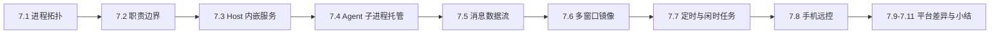
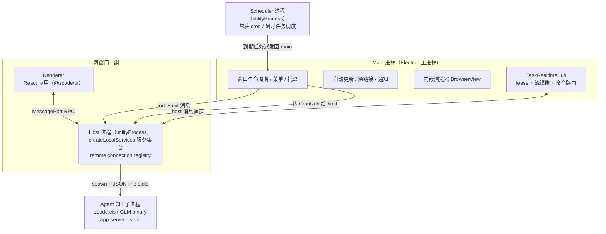
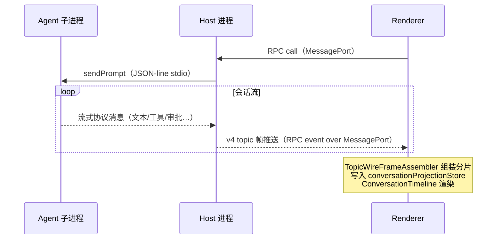

# 07. 桌面端：四进程模型与 Agent 运行时的托管

> **文档同步跟踪**
> - 最后同步代码：`ZCode` commit `872ad960de`（2026-09-21）
> - 同步方式：基于该文档撰写时的源码路径梳理，关键论断已回到源码抽查

桌面端是 ZCode 三种形态里最复杂的一个：它不是"Electron 壳包一个 Web 页"，而是一个**有自己操作系统级进程拓扑的宿主**——Main 管窗口与原生操作，每个窗口一个 Host 进程内嵌整套后端服务，Renderer 只做 UI，另有一个常驻 Scheduler 进程管定时任务。Agent 反而是最外层：一个由 Host 拉起的子进程，用 JSON-line 协议通信。读完你会理解每个进程的职责边界、三种 RPC 传输如何分工、一条会话消息从 Agent 进程流到屏幕的完整链路、多窗口与手机远控如何共享同一份会话流、以及桌面端与 CLI 的行为差异（记忆、权限）落在哪里。

本章结构如下——先看四进程模型总览（7.1-7.2），再拆 Host 内嵌服务与 Agent 子进程这两层托管（7.3-7.4），然后沿数据流、多窗口镜像、定时任务推进（7.5-7.7），最后收在手机远控与平台差异（7.8-7.9）：

## 7.1 进程拓扑：四个角色

桌面端运行时的进程关系如下：

这个拓扑回答一个核心问题：**后端放哪？** 桌面端不内嵌 HTTP server（那是 Web 形态的事），而是把整套 `@zcode/services` 服务集合当库直接在 Host 进程里实例化。Renderer 与"后端"之间的距离是一个 MessagePort，不是一条网络连接。

## 7.2 职责边界：什么在哪个进程，是硬规定

仓库的 AGENTS.md 把进程职责写成了架构规则，代码严格执行：

| 进程 | 负责 | 明确不负责 |
|------|------|-----------|
| **Main** | 窗口/菜单/托盘、原生操作、进程调度（fork Host 与 Scheduler）、消息转发、自动更新、内嵌浏览器、CUA 画中画、遥测 | 不承载 task/session 业务状态 |
| **Host** | 本地服务集合、与 Agent 子进程通信、远端连接注册表、会话级业务 | 不做原生 UI 操作 |
| **Renderer** | React UI、会话投影渲染、用户交互 | 不直接调 `window.zcode`，平台操作一律走 `IPlatformService` 抽象 |
| **Scheduler** | 定时任务认领与派发 | 只读写 tasks-index 数据库，不碰 UI、不碰 Agent runtime |

"Main 不承载业务状态"这条规矩的价值在多窗口与远控场景兑现：因为 Main 只有转发与调度，任务的真实状态只有一个所有者（Host 侧服务），任何窗口、任何设备的投影都是从同一事实源流出来的。

## 7.3 Host：每窗口一个的"后端进程"

Host 是理解桌面端的关键。每个 BrowserWindow 对应一个由 `utilityProcess.fork()` 创建的 Host 进程，启动流程被固化成三步（Host 入口文件头注释即架构声明）：

1. Main 通过 `utilityProcess.fork()` 创建进程；
2. Main 只发送**一次** `init-local` 初始化消息（带 workspacePath、provider 配置路径、运行时 env 补丁等），随消息把 MessagePort 的一半转交 Host；
3. 此后一切远端连接、scoped attachment 都由这个 Host 自行处理，Main 不再插手。

Host 内部做两件事：

**实例化服务集合**：`createLocalServices()` 与 Web server、远端 server 用的是**同一个工厂**——这是三形态共享后端的落点。服务再经 `ServiceCollection.exposeOnChannelServer` 挂到 RPC channel 上，外面套两层装饰器（`LoggingChannelServer` 日志、`NetworkTelemetryChannelServer` 网络遥测）。

**管理远端连接注册表**：当用户打开 SSH/WSL/Docker 远程工作区，Host 负责按需连接远端 stdio server，把远端文件/Git/终端服务桥接给本窗口的 Renderer。远程工作区不做进程级隔离——它们是同一个 Host 里的连接注册表条目。

**Renderer 拿到服务的方式**：Main 把 Host 创建的 MessagePortMain 经 preload 转交给页面（`window.postMessage(..., [port])` transfer 所有权），Renderer 的 `connectViaMessagePort` 把 port 包成 RPC `ChannelClient`，再经 `ProxyChannel.toService` 把 40+ 个服务变成类型安全的"本地对象"。UI 代码调用 `useWorkspaceServices()` 时感觉在调本地函数，实际每次都是一次 MessagePort 往返。

## 7.4 Agent 子进程：桌面端如何"养"Agent

Agent 运行时（第 02-06 章的主角）在桌面端是一个**独立子进程**。`ZCodeAgentProcessManager`（在 services 包里，Host 进程内运行）负责它的生老病死：

**命令解析链**（按优先级）：
1. `ZCODE_AGENT_SERVER_COMMAND` 环境变量显式覆盖；
2. monorepo 开发态（tsx 直接跑源码入口）；
3. **桌面打包态**：`process.execPath`（Electron 二进制，设 `ELECTRON_RUN_AS_NODE=1` 当纯 Node 用）运行随包携带的 `zcode.cjs`——注释里记录了这个选择的动机：独立打包 Node 运行时体积 180MB，复用 Electron 二进制降到 16MB；生产包必须用随包 runtime，因为 Agent 与 app 的协议是强绑版本的；
4. 已部署的原生 binary 兜底。

**进程池模型**：按 workspaceKey 一工作区一进程，复用而非每次 spawn；另支持"泳道"（如 MCP 状态探测这类控制面操作跑在单独实例上，配空闲超时回收）。POSIX 下 detached + 独立进程组，Windows 用 taskkill /T——回收时保证进程树整体清理，不留孤儿。

**协议**：Agent 子进程与 Host 之间是 **JSON-line over stdio**——每行一个 JSON 消息，stdout 按行拆帧（注释里专门记录了 U+2028/2029 会切坏帧的坑），stderr 收集脱敏。请求带 zod 校验、3 分钟默认超时。注意这是与 `@zcode/rpc` 二进制协议**不同的第三套通道**——Agent 协议（zcode-protocol-v4）独立演进，这就是为什么协议类型定义要放在 `packages/shared/src/zcode-protocol-v4/` 并要求"协议改动同步提供严格类型与运行时校验"。

**会话生命周期**：`ZCodeAgentService` 为每个 RPC attachment 建独立的连接 scope——会话索引、workspace 配置、对话三类 topic 订阅按 connectionId 归属，连接断开自动退订；trusted connection 字段由 Host 注入，Renderer 不可伪造。

## 7.5 一条消息的完整旅程

以桌面本地会话发一条消息为例，从 Agent 到屏幕：

两个容易忽略的细节：

- **子 Agent 事件的持久化路由**：Agent 进程内派生的子代理（第 04 章）事件按 childSessionId 落库，但通过"通知外部 sinks"的方式冒泡，bootstrap 按 `event.sessionId` 路由给对应 child 的 publisher——UI 订阅子会话 topic 后能拿到完整实时流，而不只是订阅时刻的快照。
- **订阅是 topic 制的**：v4 会话用"topic 帧"模型（订阅/重同步/动态帧），断线重连后用 resync 拉一次全量，之后靠增量帧。这让 Renderer 的会话投影可以从任意断点恢复。

## 7.6 多窗口与 TaskRealtimeBus：lease + 流镜像

多个窗口（或手机）可能同时关心同一个任务，但 Agent 会话只有一个属主连接。Main 进程里的 `TaskRealtimeBus` 解决"别人怎么看属主的实时流"：

**lease（运行租约）**：每次任务运行先取 lease，记录 ownerClientId / ownerDeviceLabel / ownerHostId——谁在"真正驱动"这个会话。命令路由按 lease 判定归属，防止两个窗口同时往一个会话发命令。

**流镜像的批量协议**：属主 Host 产生的会话流事件，被镜像成批量操作（`TaskStreamMirrorBatchEvent`）分发给非属主观察者。参数本身就是一份性能设计说明：

| 常量 | 值 | 含义 |
|------|-----|------|
| flush 间隔 | 1 秒 | 高频流事件攒批再发 |
| 单批上限 | 512KB | 超限拆批 |
| 文本单操作上限 | 128K 字符 | 超长文本单独处理 |
| 重放上限 | 60 批 / 512KB | 观察者重连时最多补这么多 |

**两种投递语义**是架构规则里点名要区分的：桌面窗口走 `desktop-continuous` 实时链路（在线就能看），手机走 `web-remote-replayable` 恢复链路（带 watermark 的可重放流——手机会休眠、会断网，恢复时按水位续传）。修改 stream/snapshot/queue/重连逻辑时必须同时验证两种语义，这是写进 AGENTS.md 的硬要求。

## 7.7 Scheduler：定时任务与闲时任务

第三个 utilityProcess 是常驻调度器，头注释把职责列得很清楚。它**只读写 tasks-index SQLite 数据库**，是这张表的属主：

- **20 秒轮询** automations 表（cron 最小粒度是分钟，20s 足够按时命中且开销低）；
- 到期任务用 `claimDue` **事务认领**（`BEGIN IMMEDIATE`，running 0→1）——单飞认领保证多实例/重启场景不会重复派发；
- **misfire 宽限 5 分钟**：`next_run_at` 落后当前时间超过 5 分钟，判定为关机/休眠期间错过的窗口，记 skipped **不补跑**——补跑一个过期的定时任务往往比不跑更危险；
- 认领后把派发请求发回 Main，Main 翻译成 CronRun 转给目标 workspace 的 Host，Host 执行 `createTask + sendPrompt`——调度器自己从不碰 Agent；
- **闲时任务（off-peak）** 独立一套表与状态机，回收被中断的任务、认领 queued 任务派发；注释特别标注：闲时任务**没有 misfire-skip 语义**——顺延但不丢弃，与 automation 的"错过就跳过"正好相反。

这套设计的核心判断是：定时任务的正确性问题（重复执行、补跑风暴）用数据库事务和明确的语义矩阵解决，而不是用分布式锁或消息队列。

## 7.8 手机远控：attachment 复用，不另起炉灶

手机远控（通过手机查看/操控桌面会话）的架构规则同样明确：

- 手机连接的是**桌面已有 Host 的 attachment**，复用既有会话运行时——不为手机另起 Agent 进程、另建 Local Host 或远程会话；
- 外部 relay 与 Main 只做四件事：鉴权、配对、心跳、转发及 attachment 调度，**不保存任务队列、快照等业务状态**；
- 用户输入的串行准入由 Agent/runtime 侧的 CommandInbox 负责——已接受的 busy/running 输入串行 admission，Renderer 只保留未提交草稿与 pending 乐观覆盖，Host 的 owner/lease 负责路由；
- stale run 防护、跨 Host 路由这些边界判断是保留项，不能在重构中按单一路径删掉。

与 7.6 合起来看，远控的完整图景是：**控制面**（谁能发命令）靠 lease 与 CommandInbox 串行化，**数据面**（会话流怎么看）按设备形态分流——桌面实时、手机重放。relay 始终只是 dumb pipe，业务状态的唯一所有者在 Host 与 Agent 进程内。

## 7.9 桌面端与 CLI 的行为差异

同一个 AgentRuntime，在桌面与 CLI 里默认行为不同，差异全部通过启动配置注入实现：

| 差异点 | CLI 默认 | 桌面默认 | 实现落点 |
|--------|---------|---------|---------|
| 记忆 | 启用（含后台提取） | **关闭** | Host 组装配置时注入 `memory: { enabled: false }` 强制覆盖 |
| 权限模式 | 交互会话 build；`--prompt` 非交互未指定时 **yolo** | 按会话/设置 | 运行配置 `mode` |
| 宿主交互 | TUI（OpenTUI + React，动态加载隔离） | Host 服务 + v4 协议 | 同一 core，不同入口壳 |
| 数据目录 | `~/.zcode/cli/` | `.zcode/` 数据基目录（可用 `ZCODE_DATA_BASE_DIR` 重定向） | cliStorageRoot 配置 |

模式的语义本身在 core 里统一：`build`（默认，逐次审批按规则）/ `plan`（只读规划）/ `yolo`（放行普通工具操作，交互类工具与明确要求确认的工具仍有各自规则）——NOTICE.md 特别强调 yolo 不等于全放行，也不能把模型工具审批当成整个应用的统一权限开关。

## 7.10 设计取舍

**为什么每窗口一个 Host，而不是全局一个？**
窗口级故障隔离：一个窗口的服务崩溃不影响别的窗口；窗口关闭即整个服务树确定性回收（`disposeServiceResourcesAndWait`）。代价是多窗口有重复的服务实例——用内存换隔离，对桌面场景是划算的。

**为什么把"后端"放进 utilityProcess 而不是 Main？**
Main 是 Electron 最不能崩的进程（它崩了窗口全没了），而且它的 CPU 抖动会直接影响 UI 合成。服务层有 SQLite、文件扫描、Agent 子进程管理这些重活，隔离出去让 Main 保持轻。utilityProcess 相比 child_process 的好处是原生 MessagePort 通道，省去 stdio 编码。

**为什么 Agent 是子进程而不是进程内模块？**
版本与协议稳定：Agent 与宿主通过显式协议（zcode-protocol-v4）交互，协议演进可以独立于桌面发版；进程隔离让 Agent 崩溃/挂死不拖垮 UI，看门狗可以整体回收。这与第 04 章"子 Agent 用进程内运行时"形成对照——**委托层级越深越倾向进程内（省成本），宿主边界越外越倾向进程隔离（保稳定）**。

**为什么流镜像要批量 + 上限而不是逐条转发？**
一次工具调用的流式输出可能每秒几十条事件。逐条转发让非属主观察者（尤其手机）的连接被打爆；1 秒攒批 + 512KB 上限把开销变成常数，重放上限则把"观察者断线一天后回来"的成本封住——补不全就从 watermark 起点重放。

**为什么定时任务"错过不补跑"而闲时任务"顺延不丢弃"？**
自动化（cron）的价值在"准点"，过期执行往往没有意义甚至有害；闲时任务的价值在"做完"，它本来就是填空闲资源的，晚点跑没有损失。两种语义按各自的产品目标选取，而不是用一个通用的调度语义硬套。

## 7.11 关键实现入口

| 责任 | 主要文件（`packages/desktop/src/`） |
|------|------|
| Main 入口 | `main/index.ts` |
| Host 进程创建与 port 转交 | `main/desktopHostProcess.ts`（`MessageChannelMain`，562 行附近） |
| Host 服务编排入口 | `host/index.ts`（文件头即拓扑声明） |
| Preload IPC 桥 | `preload/index.ts` |
| Renderer 入口 | `renderer/src/main.tsx` |
| TaskRealtimeBus（lease/镜像/路由） | `main/taskRealtimeBus.ts` |
| Scheduler 进程 | `scheduler/index.ts`（头注释即职责清单） |
| Agent 子进程管理 | `packages/services/src/zcode-agent/zcodeAgentProcessManager.ts` |
| stdio JSON 协议传输 | `packages/services/src/zcode-agent/zcodeStdioTransport.ts` |
| 会话 topic 帧（UI 侧） | `packages/ui/src/v4/agentConversationTransport.ts` |
| 随包 GLM binary 解析 | `main/desktopRuntimeEnv.ts`（397 行附近） |
| 两种投递语义类型 | `packages/shared/src/zcode-task-types-core.ts`（`ZCodeTaskClientMode`） |

## 7.12 小结

桌面端的架构可以压缩成一句话：**Main 管壳，Host 管命，Renderer 管脸，Scheduler 管钟，Agent 自己是一个被托管的进程。**

- 进程拓扑的每条边界都写进了仓库的架构规则并被代码遵守——Main 无业务状态、UI 不绕过平台抽象、调度器不碰 runtime；
- 三套通道分工明确：MessagePort RPC（Renderer↔Host）、JSON-line stdio（Host↔Agent）、Main 内部消息（调度/镜像）；
- 多窗口与远控共享同一事实源，靠 lease 控制写路径、按设备形态分流读路径；
- 与 CLI 的差异全部收敛为启动配置差异，核心运行时同一份。

至此，ZCode 的"单机形态"拆完了。下一章把镜头拉到多机：Web server 的四种形态、SSH/WSL/Docker 远程执行链路、以及三层 Provider overlay（第 08 章）。
