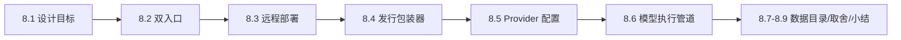
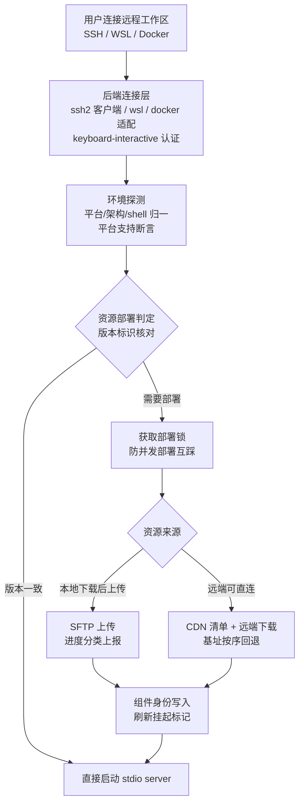
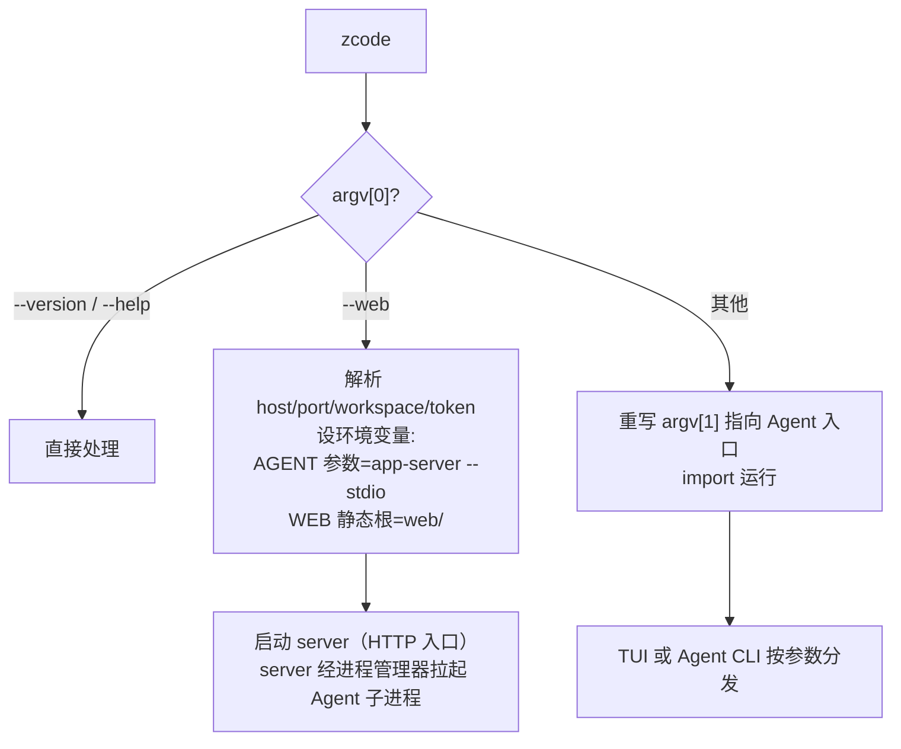

# 08. Server 形态与远程执行：双入口、远程部署与 Provider 管道

> **文档同步跟踪**
> - 最后同步代码：`ZCode` commit `872ad960de`（2026-09-21）
> - 同步方式：基于该文档撰写时的源码路径梳理，关键论断已回到源码抽查

第 07 章拆了"桌面"这个宿主，本章拆另外两个宿主维度：**服务化**（Web/远程形态里后端作为独立进程）与**模型接入**（provider 层）。核心事实只有几条：同一个服务集合被 HTTP 与 stdio 两种入口点亮；SSH/WSL/Docker 远程工作区靠"把整个 server 部署到远端机器再经 stdio 通信"实现，而不是远程文件系统挂载；模型请求走 AI SDK 三种 provider 类型加一条组装链，官方订阅端点被精确匹配改写到平台网关。读完你会理解一个 `zcode` 命令怎么分发出三种形态、远端资源怎么部署与校验、以及模型请求从运行时到网关的完整旅程。

本章结构如下——先看两种服务入口（8.1-8.2），再看远程部署链（8.3）与发行包装器（8.4），然后下钻 provider 配置与模型执行管道（8.5-8.6），最后收在数据目录与取舍（8.7-8.8）：



## 8.1 设计目标

Server 与 Provider 层围绕四个目标设计。

**第一，服务集合与传输解耦。** HTTP server 与 stdio server 不是两套后端——同一个 `createLocalServices` 工厂被两个入口调用，差异只在"RPC 帧走 HTTP/WebSocket 还是 stdin/stdout"。远程机器上的 server 与本机 server 是同一份代码，只是被部署到了别处。

**第二，远程 = 部署，不是挂载。** SSH 远程工作区不假设远端有任何环境，连接时把 server、Node 运行时、Agent、工具链整套推过去，版本不对就重新部署。慢在首次连接，稳在之后的所有操作——远端行为与本地完全一致。

**第三，模型协议差异被压到 fetch 层。** 三种 provider 类型（anthropic / openai / openai-compatible）之下，协议兼容性问题（流格式差异、JSON 响应归一、会话中途 system 消息）全部用"包一层 fetch"解决——请求体与响应流在进入 SDK 前被修正，模型执行主体不感知协议琐碎。

**第四，官方端点精确转发，用户配置不受影响。** 官方订阅套餐的模型请求要过平台网关做权益校验，但这个行为只对协议、主机、端口、路径**精确匹配**的官方端点生效——用户自建 provider 与第三方服务零感知。

## 8.2 双入口：HTTP 与 stdio

两个入口文件都很短，因为逻辑都在共享层：

| | HTTP 入口 | stdio 入口 |
|---|---|---|
| 传输 | HTTP + WebSocket | stdin/stdout RPC 帧 |
| 服务对象 | 本机/远程开发机的 Web 前端 | 远程部署场景、桌面拉起的远端 server |
| 鉴权 | 可选 auth token（设置后强制鉴权），OAuth token 端点单独代理 | 连接握手 + 设备标识 |
| 静态资源 | 可选 Web 静态目录（SPA 回退） | 无 |

**stdio 入口有两条铁律**值得点名：

- **stdout 只能承载 RPC 帧**。入口文件开头把 `console.log/info/warn/debug` 全部重定向到 stderr——历史上 services 层的普通日志混进 stdout 会直接打坏协议流，表现成远程调用永久 pending。这是用一次真实事故换来的防御。
- **先握手后服务**：进程启动先发 hello 消息，确认版本与设备标识后才进入服务循环；`--version` 参数供部署方做版本核对。

HTTP 入口启动时还有一件事：把**构建期嵌入的内置 provider 配置**物化成环境内的固定资源副本（原子写、按内容升级、不留按 hash 增长的历史文件）——这是 8.5 三层配置的最底层来源。

## 8.3 远程工作区：SSH/WSL/Docker 与资源部署

远程目录是 server 包里文件最多的一块，因为"把一套运行时装到陌生机器上"本身就是个分发问题：



关键设计：

- **部署是编排问题**：一个部署入口集中编排四类资源——server bundle、Node 运行时（含 node-pty 预编译产物）、Agent 运行时、运行时工具。每类有独立的组件 ID 与版本标识，已一致的就跳过，不完整的补齐。
- **两种资源通道**：远端网络受限时走"本地下载后上传"（开发态用本地伪 CDN 目录，经 SFTP 推送，上传失败按会话/写入/读取/中止分类上报）；远端可直连时走 CDN 清单 + 远端下载，CDN 基址支持候选列表按序回退。
- **部署锁**：远端部署用锁防并发——两个窗口同时连同一台机器不会互相踩部署过程。
- **幂等与可恢复**：组件身份（内容标识）写在远端元数据里，连接时先核对再决定是否重部署；刷新挂起标记防止"改到一半的版本被当作可用"。

WSL 与 Docker 是同一模式的不同后端：探测层识别 WSL 发行版/Docker 容器环境，连接层换成对应协议，部署与 stdio 通信链路完全复用。

## 8.4 发行包装器：一个 `zcode` 命令三种形态

命令行发行包的组装（构建脚本）把三种东西打进一个目录：Web 静态产物、server 构建产物、Agent 单文件 bundle（含 TUI 运行时与随包 provider 配置），入口是一个**分发 runner 脚本**：



这个包装器揭示了 Web 形态的进程关系：**server 是父进程，Agent 是它的子进程**——server 通过环境变量拿到 Agent 入口参数（缺省 `app-server --stdio`），由第 07 章拆过的同一个 Agent 进程管理器拉起并经 JSON-line stdio 通信。Web 前端（浏览器）↔ server（HTTP/WebSocket）↔ Agent（stdio）↔ 模型（HTTPS），四跳链路每一跳的协议都不同，但业务状态只在 Agent 与 server 两层。

注意 TUI 分支的实现细节：包装器把 `process.argv[1]` 重写指向真正的 Agent 入口再 import——注释说明这是因为 CLI 自启动子进程依赖 argv[1]，重写保证了 TUI 里再起子进程时路径正确。

## 8.5 Provider 配置：覆盖语义与模型选择

**三层配置覆盖**。Provider 配置的来源有三层——构建期内置配置（随包分发，见 8.2）、个人配置（用户自建的 provider）、账号配置（登录账号带来的套餐模型）。覆盖语义在一个抽象基类里统一定义，注释原话："缺省继承、Config 递归覆盖、其他值整体替换"——三层用同一类型，逐层 overlay 后做完整性校验（缺失必填字段、重复键、重复模型、非法 URL 等结构化错误码）。内置配置不直接读文件，而是经"物化"成环境副本再读，避免运行中配置漂移。

**模型选择解析**有一个容易被误解的约束：解析是**纯函数**——只解析未来执行的意图，不改原选择、不写持久记录。注释解释了原因：读取时清库会让临时失效永久丢失。解析处理三类 provider：普通、账号套餐、账号闲时；账号套餐类要解析到"当前连接的账号"对应的真实 provider（找不到报 `account-connection-unavailable`），其余解析失败有结构化原因码（provider 不存在 / 模型不存在），旧推理等级有专门的重命名映射兼容层。

## 8.6 模型执行管道：AI SDK 与 fetch 装配链

模型执行建立在 AI SDK 之上，provider 类型三种：`anthropic`、`openai`、`openai-compatible`。运行时看到的是协议无关的 Model 接口（generateText / streamText），协议差异在模型创建处收口：

**fetch 装配链**是本节的重点——每个请求经过的 fetch 是层层包裹的：

```text
业务错误识别 fetch（provider 业务错误码 → 结构化失败原因）
  → 官方网关改写 fetch（精确匹配官方端点 → 替换为网关端点）
  → 协议兼容 fetch（anthropic: 会话中途 system 字符串还原、thinking JSON 重写、SSE 帧过滤
                  openai responses: JSON 响应归一）
  → 网络代理 fetch（系统代理）
  → 选项映射捕获 fetch（请求体采样，供模型选项映射）
  → 真实网络
```

**官方网关转发**的精确性值得完整引用：官方 Coding Plan 套餐的模型请求统一发往平台网关，由平台完成套餐权益校验后转发到模型服务；客户端只做端点替换——请求方法、请求体、鉴权头、响应**原样透传**。匹配规则按协议、主机、端口、路径**精确匹配**两张路由表（BigModel 与 Z.ai 的 anthropic messages 端点各一条），网关 origin 跟随环境变量、缺省线上地址。用户自建 provider 与第三方模型服务不受任何影响。

**可靠性层**在 runner 周边文件群：重试预算与重试策略、流空闲超时、失败分类器（TLS/业务码/AI SDK 错误归一）、空完成重试、闲时模型重试、请求准入——这些共同构成第 02 章错误恢复链在模型层的后端。

## 8.7 数据目录与远端 supervisor

**数据目录解析**集中在一个 paths 模块：优先级是运行时设置 > 环境变量 `ZCODE_DATA_BASE_DIR` > 用户主目录；所有派生路径（`.zcode`、`.zcode/v2`、任务索引库等）从这里收口。Windows 有专门校验——数据目录不允许落在应用安装目录内（升级会清掉），违规给结构化错误码。桌面开发用环境变量重定向数据目录就是走这条链。

**zcode-server-cli** 是远端/server 场景的打包 supervisor：安装归属判定、不可变 release 目录、组件缓存、安装锁、清单管理、Agent 接线。它与 8.3 的部署链是一体两面——server 包负责"推"，supervisor 负责"远端落地后的所有权与版本管理"。

## 8.8 设计取舍

**为什么远程选"整体部署"而不是 SSHFS/挂载？**
挂载方案让文件操作的网络往返混进每一次工具调用，延迟不可控且断连语义复杂。整体部署后，远端 server 上的文件/Git/终端操作全是本地速度，本地与远端只传两类东西：stdio RPC 帧（小、快、可断线重连）和部署资源（一次性）。代价是首次连接慢，这用部署锁、组件身份核对、CDN 回退来收敛。

**为什么协议兼容做在 fetch 层而不是改 SDK？**
AI SDK 处理标准协议，但真实世界的端点总有偏差（流格式变体、响应字段差异、中途 system 消息的兼容性）。fetch 层是唯一能同时看到完整请求与原始响应的位置——在这里修正，SDK 拿到的就是"干净"的协议，模型执行代码保持无感知。补丁集中、可测试、升级 SDK 不丢。

**为什么网关转发用精确匹配而不是按 provider 类型？**
按类型转发（"所有 anthropic 协议都过网关"）会把用户自建的 Anthropic 兼容端点也劫持到平台网关——这是不可接受的行为。精确匹配四元组（协议+主机+端口+路径）把转发范围收窄到官方端点本身，宁可维护一张路由表也不冒误伤的风险。

**为什么模型选择解析是纯函数？**
"解析时顺手修复失效选择"很诱人，但会让读取产生副作用：一次并发的读可能把用户的临时失效变成永久丢失。解析返回结构化的失败原因，由调用方决定是否修复——写路径集中在显式的修复操作里。

**为什么内置 provider 配置要物化成副本？**
构建期嵌入的内容是只读的，但配置系统需要统一的文件读取路径。物化（原子写 + 按内容判断是否更新 + 不留历史）让内置配置和个人配置走同一套读取代码，同时保证升级时旧进程退出、新进程拿到新副本，没有半新半旧的窗口。

## 8.9 关键实现入口

| 责任 | 主要文件（`packages/` 除注明外） |
|------|------|
| HTTP server 入口 | `server/src/entry-http.ts`、`server/src/http.ts` |
| stdio server 入口 | `server/src/entry-stdio.ts`、`server/src/stdio.ts`、`stdioServices.ts` |
| SSH/WSL/Docker 后端 | `server/src/remote/ssh-backend.ts`、`wsl-backend.ts`、`docker-backend.ts` |
| 远程资源部署编排 | `server/src/remote/deploy.ts`、`remoteAssetInstaller.ts`、`remoteAssetCache.ts` |
| 部署锁 / 组件身份 | `server/src/remote/remoteDeployLock.ts`、`remoteAssetLiveIdentity.ts` |
| 发行包装器 | `scripts/zcode-distribution/runner.mjs`、`scripts/build-zcode.mjs` |
| Agent 进程解析链 | `services/src/zcode-agent/zcodeAgentProcessManager.ts`（446 行附近缺省参数） |
| Provider 配置覆盖语义 | `provider/src/config-overlay.ts`、`provider/src/config/` |
| 模型选择解析 | `provider/src/effective-model-selection.ts` |
| 内置配置物化 | `server/src/bundledZCodeBuiltinProviderConfig.ts`、`provider-node/src/zcode-builtin-*.ts` |
| 模型执行与 fetch 装配链 | `apps/zcode-cli/packages/adapters/src/model/model-execution.ts`、`official-coding-plan-gateway.ts`、`anthropic-stream-compat.ts`、`openai-responses-json-compat.ts` |
| 模型可靠性（重试/超时/失败分类） | `apps/zcode-cli/packages/adapters/src/model/runner-retry.ts`、`retry-budget.ts`、`stream-idle-timeout.ts`、`failure-classifier.ts` |
| 数据目录解析 | `services/src/paths.ts` |
| 远端 supervisor | `zcode-server-cli/src/`（`runtime/`、`supervisor/`） |

## 8.10 小结

Server 与 Provider 层可以概括为"**双入口共享一个后端，远程靠部署，模型靠装配链**"：

- HTTP 与 stdio 两种入口点亮同一份服务集合，stdio 入口守着"stdout 只走协议帧"的铁律；
- SSH/WSL/Docker 远程工作区是"整套运行时部署到远端"——部署锁、组件身份核对、双资源通道（SFTP 上传 / CDN 下载）保证幂等可恢复；
- 发行包装器把 Web/server/Agent/TUI 打成一个 `zcode` 命令，Web 形态里 server 是父、Agent 是 stdio 子进程；
- Provider 配置三层覆盖（内置/个人/账号），模型选择解析是纯函数，模型执行经五层 fetch 装配链，官方端点按四元组精确转发到平台网关。

至此，ZCode 的所有运行形态都拆完了。最后一章把镜头转向开放面：插件、技能与 MCP 如何在不破坏权限与信任边界的前提下接入这套系统（第 09 章）。
