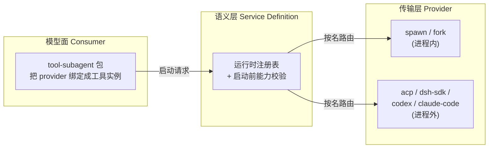
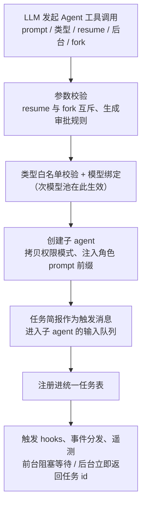
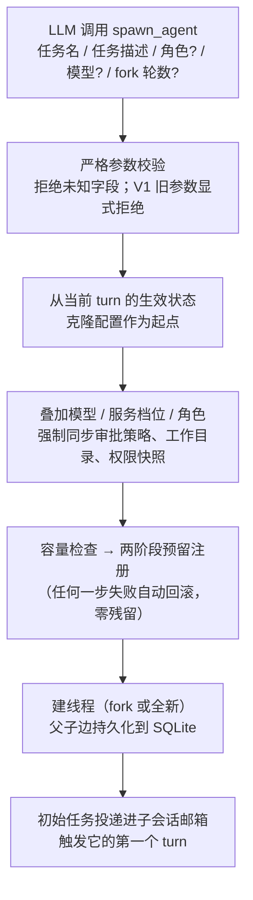
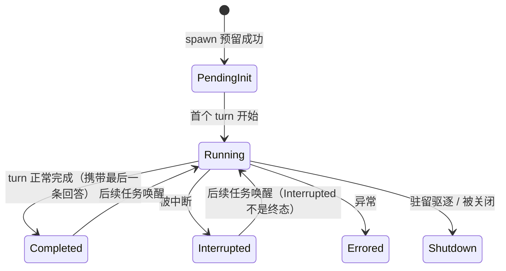

# 子智能体机制深度对比：kimi-code / codex / deepseek-harness

> 本文是 `agents-under-the-hood` 系列的专题对比篇。不重复各项目全量拆解（见 `how-kimi-code-works/`、`how-codex-works/`、`how-deepseek-harness-works/`），而是聚焦一个问题：**一个 AI 编码 agent 如何把工作委派给子智能体**——三个主流实现分别怎么回答这个问题，背后的设计取舍是什么。所有结论均以 2026-09 前后的源码为准验证过（codex @ `5bc190e`，dsh @ `73b2779`，kimi-code 以 `agent-core-v2` 为主线），文末附三方关键实现入口表。

## 全文结构

先建立三个项目的整体定位（第 1 章），再沿"定义 → 派发 → 上下文 → 生命周期 → 持久化 → 权限"这条委派链路逐环对比（第 2-7 章），最后落在设计取舍的横向分析和对自建项目的启示（第 8-9 章）：

| 章节 | 回答的问题 |
|------|-----------|
| 1. 三者定位 | 为什么需要子智能体，三个项目各自什么气质 |
| 2. 核心抽象 | 子智能体"是什么"：类型在哪定义、怎么扩展 |
| 3. 派发机制 | 子智能体怎么"生"出来：工具面与真实链路 |
| 4. 上下文与隔离 | 带什么"记忆"上岗：零继承还是 fork |
| 5. 生命周期与结果回传 | 怎么"交卷"：结局推导与通知模型 |
| 6. 持久化与恢复 | 状态存在哪、进程重启后怎么活过来 |
| 7. 权限与安全 | 权力怎么收：继承、快照还是釜底抽薪 |
| 8. 设计取舍横向对比 | 五组根本性分歧 |
| 9. 启示与最小复刻 | 自建项目该抄什么、按什么顺序抄 |

---

# 1. 三者定位：同一个问题，三种气质

子智能体机制要解决的核心工程问题是一致的：**主 agent 的上下文窗口是最贵的资源**，把探索、批量执行、独立验证这类"中间产物多、最终结论少"的工作外包出去，只让结论回到主上下文。三个项目对此的回答气质迥异：

| 维度 | kimi-code | codex | deepseek-harness (dsh) |
|---|---|---|---|
| 技术栈 | TypeScript pnpm monorepo | Rust workspace | TypeScript（cordis 插件框架） |
| 子智能体的本质 | 同构的 **Agent scope** + 一份 **AgentProfile**（prompt + 工具白名单） | 一个普通的**对话线程**，只是创建记录里标记了"由父 Agent 派生" | 一个普通 **Agent 实例 + 独立持久会话**，经 seam 三角色组装 |
| 架构口号 | "子 agent 不是特殊运行时" | "Agent ≈ Thread" | "委派没有发明任何新的循环/队列/持久化" |
| 多后端 | 否（进程内一种） | 否（进程内一种，V1/V2 两代协议并存） | **是**（6 个后端：spawn/fork 进程内 + acp/dsh-sdk/codex/claude-code 进程外） |
| 编排原语 | 批量模板派发（swarm） | root agent 即编排者（提示词纪律 + 硬限流） | 独立的 **workflow 脚本引擎**（agent / parallel / pipeline 原语） |

三者的共同点比差异更醒目：**没有任何一家给子智能体写独立的运行循环**。子 agent 全部复用主 agent 的 loop、工具路由、持久化。差异集中在三个决策点上——上下文给多少、结果怎么回来、权力怎么收。

# 2. 核心抽象：子智能体"是什么"

本章对比三方如何定义和注册子智能体类型。结构上按项目分节，每节回答同一组问题：类型在哪定义、内置了哪些、用户能不能扩展。

## 2.1 kimi-code：AgentProfile 即一切

kimi-code 的子智能体类型是一份 **AgentProfile**，装着：名字、描述、一句"什么时候该用它"的说明、工具白名单（允许/禁止两列，支持 `mcp__*` 通配整类 MCP 工具）、允许再派发的下游类型、system prompt 构造函数，以及一个很有特色的**摘要策略**——子 agent 交卷的摘要太短，就自动追加一轮逼它扩写。

内置四个 profile：`agent`（主 agent，可派发 coder/explore/plan）、`coder`（有写权限、无派发能力）、`explore`（带 git 上下文前缀；注意它的"只读"靠 prompt 强制——工具层仍持有 Bash）、`plan`（真·纯只读：无写工具、无 Bash）。子 agent 的 system prompt = 共享模板 + 一段角色前缀（"parent 只能看到你的最后一条消息"）+ profile 角色段落。

扩展面做得很开：用户可以用 Markdown + frontmatter 在 `~/.kimi-code/agents`、`~/.agents/agents`、项目级同名目录、插件包 `agents/` 里定义新 profile，六级优先级合并（builtin < plugin < user < extra < workspace < explicit），同名覆盖内置需显式 `override: true`。模型层面还有次模型池配置——"子 agent 用便宜模型"是显式产品特性（当前是实验开关，默认关闭）。

## 2.2 codex：角色是配置叠加层，不是类型

codex 里子智能体**没有独立类型**——它就是一个普通的对话线程，只是创建记录里标记了"由哪个父 Agent、以什么角色、在第几层派生"。所谓"角色"（生效的内置角色是 default/explorer/worker 三个；源码里还留着一个被注释掉的 awaiter）本质是一层**白名单配置叠加**：只允许覆盖 developer instructions、模型、推理档位等少数字段，能力开关只能**减**不能增。源码注释把原则写死了："Roles may customize the child or reduce its capabilities, but never replace the parent session's authority."

用户可在 `config.toml` 的 `[agent_roles]` 自定义角色。每个 agent 还有两套身份：寻址用的路径（类文件系统路径，必须以 `/root` 开头、禁 `..`，把 agent 拓扑钉死成树）和展示层昵称（内嵌 101 个科学家名字循环分配）。

## 2.3 dsh：语义/传输/消费三角色分离

dsh 的子智能体抽象是一条 **seam**（接缝），三个角色各司其职：

provider 用几个布尔能力标志（含"是否继承父上下文"）声明自己的能力；**方法存在性即能力**——实现了"可持续对话"接口的 provider 才支持多轮往来，没实现的就只能一次性问答。模型看到的工具 schema 里没有任何后端参数——"用哪个后端"是部署配置决定的，"后端存在"与"工具授予"是两层决策。

注意 dsh 里还有个与 subagent **正交**的 preset（预制能力组合）机制：preset 是"按会话组装能力"的组合文件，子 agent 通过组合关系继承父级的 preset 工具集。（同系列 dsh 拆解文档 09/11 章中的 preset 路径已过时：实际位于 `packages/preset/agent-presets/presets/`，且第三类模式目录名是 `ptc` 不是 `code`。）

## 2.4 小结

三种定义方式对应三种扩展哲学：kimi-code 把子智能体类型做成**用户可写的数据文件**（门槛最低）；codex 把它做成**配置叠加层**（权限语义最强：只能削权）；dsh 把它做成**插件注册表**（后端可插拔性最强）。共同点是：类型定义都只约束 prompt、工具集和模型路由，**没有一家允许子智能体类型替换运行循环**。

# 3. 派发机制：怎么"生"出来

本章是核心链路章。先给三方的模型可见工具面对比，再各给一张真实派发链路图。

## 3.1 工具面对比

| 能力 | kimi-code | codex (V2) | dsh |
|---|---|---|---|
| 派发 | `Agent`（单个）/ `AgentSwarm`（批量 ≤128，`{{item}}` 模板展开） | `spawn_agent`（同一轮可多次调用实现并行） | `subagent` / `subagent_fork`（工具名可配） |
| 追加任务 | `Agent(resume=agent_id)` | `followup_task`（触发 turn；**禁止以 root 为目标**——`send_message` 不受此限，root 靠它收汇报） | `send_message`（向直接父/子） |
| 等待 | 前台阻塞 / 后台自动通知 | `wait_agent`（事件驱动，默认 30s、上限 1h，**只回等待结果不搬运内容**） | 前台等结果 / 后台走任务系统 |
| 中断 | `TaskStop`（与后台 bash 共用） | `interrupt_agent` | `interrupt_agent`（任意活着的祖先可发起） |
| 列举 | `TaskList`（统一任务表） | `list_agents`（整棵活树） | `list_agents`（直接子级或后代树） |

工具面设计的分水岭在于：**kimi-code 把子 agent 收编进通用任务系统**（子 agent 和后台 bash 共享任务列表/输出/停止的词汇）；codex 和 dsh 则给 agent 协作一套**独立词汇**（spawn/send/wait/interrupt/list），强调"对等的协作体"而非"任务"。

## 3.2 kimi-code 派发链路

关键细节：后台派发有门控——仅当调用方 profile 同时具备任务管理三件套（列表/查看/停止）才开放后台模式。后台完成时，系统把完成通知**作为一条 user 消息注入父 agent 的循环**，自然 steer 出一个新 turn——天然落进会话历史、可重放、可去重。批量派发默认不设硬并发上限，但启动有爬坡（先放行 5 个、之后每 700ms 再放一个，可用环境变量显式设限）；遭遇 provider 限流时容量逐步收缩，最坏退化到串行重试（乐观并发、遇阻收敛）。

## 3.3 codex 派发链路

工程纪律最醒目的一点：两阶段预留 + 失败自动回滚贯穿 spawn、驻留、执行三层——任何一步失败都不会留下半截注册状态，也不会泄漏名额。另外 spawn 受三层硬闸限制：执行并发上限、驻留名额（默认 4 个常驻位、root 自己占一个）、模型能力位（模型声明支持 V2 协议才允许多级派发）。

## 3.4 dsh 派发链路

dsh 的工具层在一个分叉点分出三条执行路径：

| 路径 | 机制 | 语义 |
|---|---|---|
| 前台 one-shot | 同步启动 → 等结果 → 即销毁 | 工具调用即生命周期 |
| 后台 one-shot | 包装成通用后台任务 | 与后台 bash 共用任务列表/输出/终止词汇 |
| continuable | 启动后返回持久子级 id | 初始简报被子级收件箱接受即返回，之后靠双向消息往来 |

**真正的编排原语不在 subagent 包里，而在 workflow**：独立的脚本引擎（worker 线程 + 隔离脚本环境）提供 `agent()` / `parallel()` / `pipeline()` / `phase()` 编排函数，其中 `agent()` 子调用直接复用 subagent seam。也就是说 dsh 把"并行/串行/链式"从提示词纪律升格成了**可编程的脚本结构**。另有一套实验性的团队编排包（Lead/Teammate + 持久邮箱 + 共享任务 DAG），未进发行 bundle。

## 3.5 小结

派发机制的分歧本质是"编排逻辑放在哪"：kimi-code 放在**工具参数模板**里（swarm 的 `{{item}}`），codex 放在**系统提示词的委派纪律**里（root 即编排者，机制只负责限流兜底），dsh 放在**独立的脚本引擎**里（workflow 是一等公民）。三条路都能跑通，选择取决于你把编排看作模型行为、配置行为还是程序行为。

# 4. 上下文与隔离：带什么"记忆"上岗

这是三方分歧最大的一环，直接决定了子智能体机制的气质。

| 维度 | kimi-code | codex | dsh |
|---|---|---|---|
| 默认上下文 | **零继承**：prompt 即全部简报 | **全量 fork**：fork 轮数参数缺省即全量 | **后端属性**：spawn=干净，fork=已完成轮次前缀（进行中的轮次排除在外） |
| fork 语义 | 实验性开关；完整消息历史照搬，前置"这是一次性快照"提示 | 白名单筛选历史条目（丢弃推理过程与工具调用记录），并净化开发者指令里的多智能体管理段落 | 只复制对话历史；工具限制/权限/人格不随历史走（策略快照追加在历史之后，新策略覆盖旧状态） |
| 工作区隔离 | 无，共享 cwd | 无，usage hint 明文告知"所有 agent 共享同一容器和文件系统" | 无 |
| 嵌套派发 | 默认禁止（工具白名单不含派发工具）；profile 显式声明可开 | 深度限制（V1 默认只允许 root 派生一层）；V2 靠模型能力位 | 深度上限默认 3（经配置加载器生效；代码直调省略配置时无上限）；上限持久化为单调下限，防止靠恢复"洗白"深度 |

值得展开的是 fork 的动机差异。codex 的全量 fork 是为了让子 agent **继承父的 prompt 前缀缓存基线**（KV cache 复用）和协作上下文；dsh 同样把 KV cache 意识写进了产品设计——fork 工具**不开模型选择**，preset 注释把理由写得很直白：换路由会让继承的对话前缀失去缓存复用资格。而 kimi-code 的零继承是刻意的上下文经济学："委派的意义就是把中间文件内容挡在父上下文之外"这句话直接写在工具描述里。

**没有一家做 git worktree / 文件系统隔离**。codex 的选择最坦诚：把冲突协调外包给模型——worker 角色的描述专门教模型"划清 ownership、别 revert 别人的改动"。这是一个重要的行业级信号：在当前的工程共识里，文件系统隔离的成本超过了模型自律的风险。

# 5. 生命周期与结果回传：怎么"交卷"

## 5.1 状态机与结局推导

上图是 codex 的状态机（结局从会话事件流推导：turn 开始→Running、turn 完成→Completed……），但三方的结局语义高度同构。一个微妙共识是"**结局从日志推导，不从'怎么停的'推导**"：dsh 把这条做到极致——结局完全从子级自己的日志折叠得出（完成/中止/错误/拒绝/token 耗尽），且已记录的失败优先于取消（先失败后取消的，算失败）；codex 同样由事件流推导状态，而不是维护一个独立的状态字段。

## 5.2 结果回传的三种哲学

| | kimi-code | codex | dsh |
|---|---|---|---|
| 回传内容 | **只有摘要**：取子 agent 最后一条 assistant 文本 | 子的 final 回复，由完成观察者以 FINAL_ANSWER 消息**推进父邮箱** | 结果对象（子级失败不抛异常，失败即数据）+ 结算通知 |
| 摘要有质量问题怎么办 | 摘要策略：短于 200 字符自动追加一轮逼它扩写（最多重试 1 次；挂在 coder/explore 上） | 依赖角色提示词纪律 | 子级 prompt 自动追加"交卷指引"（结束前回传给父） |
| 失败如何表达 | 抛错；续跑提示只在特定场景附带（前台超时 / 后台回执 / swarm 有未完成项） | 错误状态 + 通知 | **失败即数据**：停止原因 + 诊断信息 + 部分产出 |
| 父忙时通知怎么处理 | 通知作为 user 消息入队 | 邮箱队列排队 | **四态路由**：父已消失→丢弃；父在拆除→只注入不唤醒；父空闲→入队开新轮；父忙→steer 并入当前轮 |

回传机制的共同底线是"**父上下文只收结论，transcript 留在子侧**"。分歧在于通知模型：kimi-code 复用"注入 user 消息"这条最通用的通道；codex 建了独立的邮箱协议；dsh 的驻留管理器会观察父级状态选择投递策略，是三家里最精细的。

# 6. 持久化与恢复：状态存在哪

| | kimi-code | codex | dsh |
|---|---|---|---|
| 子 agent 历史 | 每 agent 一个追加式 JSONL 记录文件（带格式迁移链） | 与父一样走统一历史持久化；父子关系另存图存储（SQLite 父子边） | **独立持久会话**，头部记录父会话、委派深度、"子级出身"标记 |
| 身份/元数据 | 会话元数据里的 agents 表（类型/父级/工作目录） | 注册表内存态 + 父子边持久化 | 身份描述符以会话事件写进子级自己的日志（不进模型历史，压缩后仍能存活） |
| 恢复模型 | 恢复是一等的工具参数；校验目标必须空闲、必须属于当前调用方 | **驻留 LRU**：满员驱逐（关停+落盘），有后续任务时从存储重建；重建时"先存后还"审批快照 | **冷恢复不经原后端**：身份描述符自带全部重建输入——"创建方式是出生证明，不是监护人" |
| 进程重启 | 磁盘上未终结任务标记为丢失；未送达的终态通知补投 | 按未关闭的父子边重建注册表；V1 沿边广度优先恢复整棵后代树 | 一份持久会话 + 至多一个进程内激活态；恢复完全从持久日志重建 |

恢复语义上 dsh 的表述最哲学化也最彻底：身份描述符是**子级自己日志里的事件**，恢复时只从自己写的后缀折叠，防祖先身份污染。codex 的"先存后还"（恢复时保住运行期的审批决定）则是安全工程上的细腻一笔。三家的共同模式可以概括为：**日志是真相，驻留是缓存**。

# 7. 权限与安全：权力怎么收

子智能体最危险的问题是"权力放大"——子 agent 能不能绕过父级的审批约束？三家的答案高度一致，但收紧方式不同：

| | kimi-code | codex | dsh |
|---|---|---|---|
| 审批策略 | 权限模式**继承**父级；子 agent 的敏感调用走同一审批服务弹给用户 | 强制**同步**审批策略与权限快照（不可旁路）；角色只能削权不能扩权 | 审批策略**无条件钉死为 never**：子代理不能发起权限升级，审批请求自动拒绝 |
| 工具面收缩 | profile 的工具白名单 | 角色能力只能减；root 专属工具（如异步给用户发消息）不下发 | 工具过滤器：从提示词移除并拒绝执行（源码将其定位为可见性控制） |
| 策略留痕 | — | 命令执行策略在父子兼容时共享同一实例 | 策略快照以"来自委派"事件写进**子级自己的日志**，恢复时随日志重放而非重读父级 |
| 被拒后的行为引导 | 提示语额外加"换条路，别重试别绕过" | — | 委派范围声明在启动时钉死 |

三家代表了收权的三个档位：kimi-code 是"继承"（子和父权力相同）；codex 是"快照 + 只减不增"；dsh 是"釜底抽薪"（子代理根本没有审批通道）。dsh 的做法在安全语义上最干净——**不能升级就不存在升级绕过**，但代价是子 agent 遇到需要审批的操作只能失败返回，无法像 kimi-code 那样由用户临场授权。

# 8. 设计取舍横向对比

经过前七章的逐环对比，可以提炼出五组根本性的取舍分歧：

**1. 上下文哲学：隔离派 vs 共享派 vs 把选择权做成后端属性。** kimi-code 赌"干净上下文 + 好好写简报"优于历史继承；codex 赌"协作需要共享记忆，fork 顺带赚 KV cache"；dsh 拒绝二选一，把继承做成 provider 声明。kimi-code 的工具描述甚至内置了 briefing 教学（"Brief it like a colleague who just walked into the room"）——它把上下文隔离的代价（简报质量）显式转嫁给了模型纪律。

**2. 失败模型：异常派 vs 数据派。** kimi-code 走异常路线（错误 + 续跑提示），dsh 走数据路线（子级层面的失败一律以数据返回，只有 seam 无法表示的基础设施故障才抛异常），codex 居中（状态机 + 通知）。数据派的好处是工具调用层几乎不需要 try/catch 语义，模型处理失败分支更自然；异常派的好处是失败不会被模型忽略。

**3. 编排的原语层级。** kimi-code 提供批量模板（swarm），codex 提供通信原语（spawn/send/wait），dsh 提供脚本引擎（workflow）。抽象层级逐级升高，对模型能力的依赖逐级降低。

**4. "子 agent 是任务还是同事"。** kimi-code 收编进任务系统（和后台 bash 同词汇），dsh 的持续对话 + 父子双向消息明显是"同事"模型，codex 的路径树 + 昵称 + 追加任务也是"常驻团队"模型（V2 的驻留 LRU 甚至支持"可驱逐可召回的常驻团队"）。这个分歧直接影响 UX：任务模型配任务列表面板，同事模型配 agent 切换快捷键（codex 的 Alt+←/→）。

**5. 恢复的一等公民化。** 三家都把"子 agent 可以复活续跑"做成了一等能力而非事后补救：kimi-code 的恢复参数、codex 的父子边持久化 + 驱逐召回、dsh 的冷恢复。这是子智能体机制从"一次性函数调用"演化为"长寿命工作单元"的标志。

共同的反面也值得一提：三家都**没有**做文件系统隔离、都**没有**给子 agent 独立运行循环、都**没有**让模型在工具 schema 里感知传输细节。这些"都没做"本身就是当前 agent 架构的收敛共识。

# 9. 对自建项目的启示与最小复刻

如果要给自己的 agent 项目（如 Ace）实现子智能体机制，最小必要组件清单是：

1. **复用主 loop**，写一个 profile/配置叠加层描述子 agent 的 prompt + 工具白名单——不要发明第二个运行时（三家共同结论）。
2. **一个派发工具**（prompt + description + 类型选择），前台阻塞返回摘要即可跑通 MVP。
3. **每子 agent 一个独立持久日志**，父子关系写进元数据；这是恢复和审计的地基。
4. **结果只回传摘要**，配一个保底机制（摘要扩写重试，或交卷指引提示词）。
5. **权限策略在 spawn 时快照**，至少做到"只减不增"；最省心的方案是学 dsh 把子代理审批直接钉死。
6. **嵌套深度上限**写死在创建路径上（dsh 的单调下限持久化是最稳的防绕过写法）。

二期再考虑：后台派发（复用已有任务/通知系统，别单建）、fork 上下文（先想清楚 KV cache 收益）、批量/编排（swarm 模板最轻，workflow 引擎最重但最强）、进程外后端（需要 seam 式的语义/传输分离才值得）。

选型建议一句话版：要**开发体验**学 kimi-code（markdown 自定义 profile、swarm 模板）；要**安全与工程纪律**学 codex（失败自动回滚、权限快照、角色只削权）；要**可插拔与编排上限**学 dsh（provider seam、workflow 引擎、失败即数据）。

# 附录：关键实现入口速查

**kimi-code**（v2 主线，`packages/agent-core-v2/src/`）

| 主题 | 位置 |
|---|---|
| 派发工具 / schema | `agent/tools/agent/agentTool.ts:82`、`agent/tools/agent/agent.ts:10` |
| Swarm 批量 | `features/swarm/tools/agent-swarm/agentSwarmTool.ts:71`、`features/swarm/session/agentRunBatch.ts` |
| spawn / 类型校验 | `session/subagent/subagentService.ts:96,154` |
| 运行 + 摘要蒸馏 | `session/subagent/runAgentTurn.ts:31,112` |
| profile 目录 / 摘要策略 | `app/agentProfileCatalog/agentProfileCatalog.ts` |
| profile 定义 | `session/agentLifecycle/profile/profiles.ts` |
| 自定义 profile 加载 | `workspace/workspaceAgentProfileLoader/internal/agentRoots.ts:14` |
| 后台通知注入 | `agent/task/taskService.ts:1097` |
| v1 对照 | `packages/agent-core/src/session/subagent-host.ts` |

**codex**（`codex-rs/`）

| 主题 | 位置 |
|---|---|
| 控制面 / spawn 主流程 | `core/src/agent/control.rs:106`、`core/src/agent/control/spawn.rs:403` |
| fork 算法 | `control/spawn.rs:609`（白名单 `:54`、净化 `:93`） |
| residency LRU | `control/residency.rs:80` |
| 角色应用 / 内置角色 | `core/src/agent/role.rs:51,355` |
| AgentPath / AgentStatus / 通信协议 | `protocol/src/agent_path.rs:125`、`protocol/src/protocol.rs:1740,738` |
| V2 spawn handler / 子配置构建 | `tools/handlers/multi_agents_v2/spawn.rs:90`、`multi_agents_common.rs:176,234` |
| spawn edge 持久化 | `agent-graph-store/` |

**dsh**（`packages/`）

| 主题 | 位置 |
|---|---|
| seam 契约 / 注册表 | `subagent/subagent/src/types.ts:130,344`、`subagent/subagent/src/index.ts:186` |
| continuable 管理器 / 冷恢复 | `subagent/subagent/src/continuation.ts:101,399` |
| 驻留注册表 / 结算通知 | `subagent/subagent/src/continuation-activation.ts:153,824` |
| 创建窗口组装 / 策略快照 | `subagent/subagent/src/child-agent.ts:199,242` |
| 深度记账 / 身份描述符 | `subagent/subagent/src/depth.ts:28`、`subagent/subagent/src/descriptor.ts:48` |
| 结局推导 | `subagent/subagent/src/lifecycle.ts:236` |
| 委派工具 / 三条派发路径 | `subagent/tool-subagent/src/index.ts:48,525` |
| workflow 编排 | `workflow/workflow/src/index.ts:157`、`workflow/workflow-worker-thread/src/host.ts:355` |
| 实验性团队编排 | `experimental/agent-team/` |

---

> 证据边界说明：codex 调研基线为 commit `5bc190e`（2026-08-21），dsh 为 master `73b2779`，kimi-code 以 `agent-core-v2` 包为主线（v1 `agent-core` 为当前 CLI 实际消费路径，机制同构）；2026-09-10 又按三个仓库的当前工作树逐条复核了一轮（explore 的"只读"性质、swarm 并发爬坡、dsh 结果对象的 reject 边界等修正即来自这轮复核）。kimi-code 的"进程重启后跨会话 resume 子 agent 的自动再物化入口"在 v2 核心内未追到确切路径，工具文案声称支持，标注为待核实点。各项目全量拆解见同目录 `how-*-works/` 系列。
